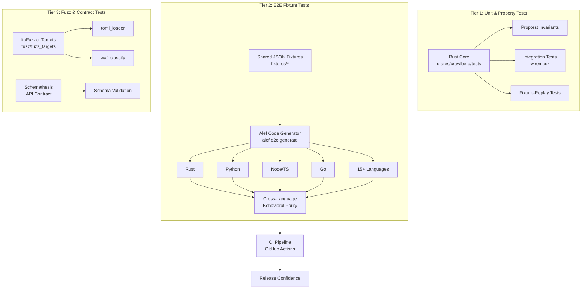
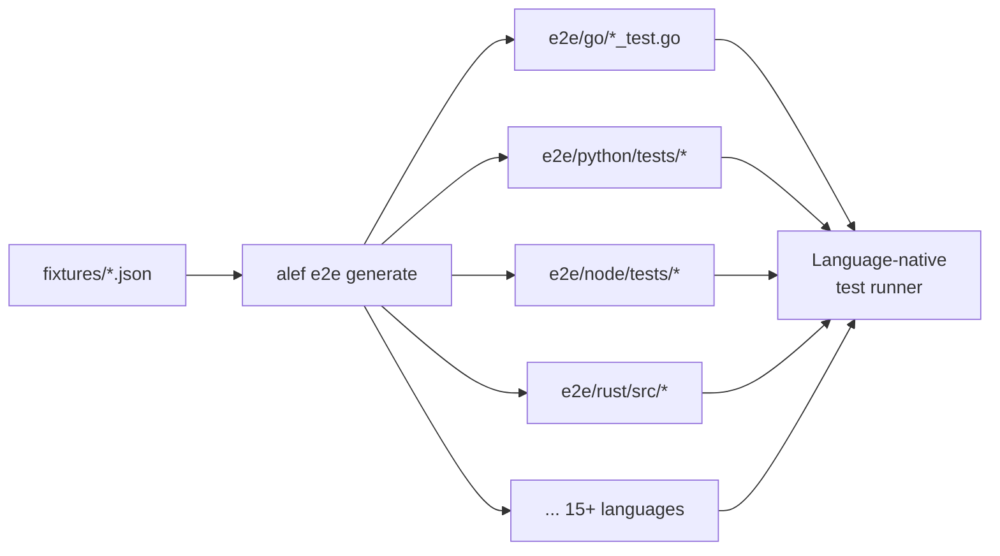
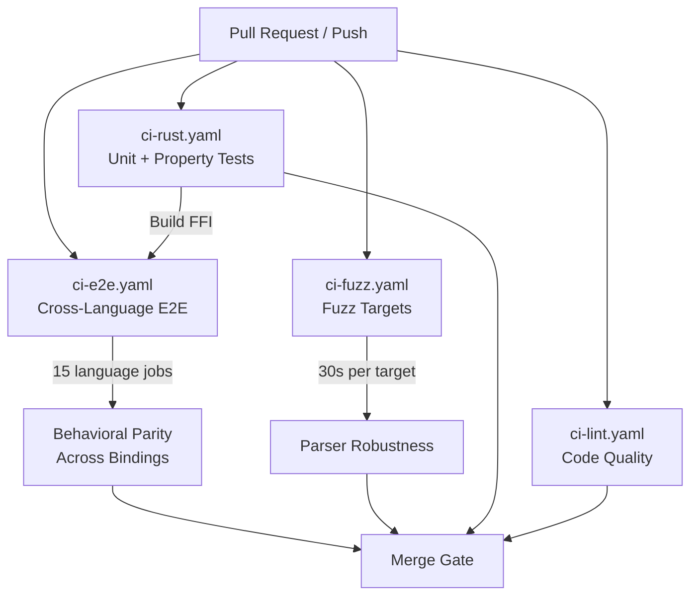

Crawlberg employs a **three-tier testing architecture** designed to validate correctness across its polyglot codebase — from low-level Rust algorithms to end-to-end behavior in 15+ programming language bindings. This page covers the testing philosophy, infrastructure, and patterns that ensure reliability across the entire stack.

## Architecture Overview

The testing strategy follows a layered defense model where each tier catches a different class of defect:



Sources: [.github/workflows/ci-fuzz.yaml](.github/workflows/ci-fuzz.yaml#L1-L32), [.github/workflows/ci-e2e.yaml](.github/workflows/ci-e2e.yaml#L1-L100)

## Unit & Property Tests

The Rust core crate contains comprehensive integration and property-based tests that run against the library internals without requiring external services. These tests use `wiremock` for HTTP simulation and `proptest` for invariant verification.

### Property-Based Invariant Tests

Three behavioral surfaces are validated through randomly-generated inputs using `proptest`:

| Surface | Property | Bounds |
|---------|----------|--------|
| **EWMA Update** | Output always in `[0.0, 1.0]` | Any valid previous value |
| **EWMA Convergence** | 200 blocked → within 0.01 of 1.0 | Any starting value |
| **EWMA Convergence** | 200 success → within 0.01 of 0.0 | Any starting value |
| **FixedBudget** | Approved sum never exceeds initial | Random demands `0..=1000` |
| **Concurrent Budget** | 100 concurrent `try_consume(1)` on budget 100 → exactly 100 succeed | Multi-threaded race |
| **Backoff Capping** | `compute_backoff_ms` always ≤ `max_backoff_ms` | Random attempt `0..32` |
| **Backoff Monotonicity** | Non-decreasing until cap reached | Random parameters |

The concurrent budget test is particularly important: it spawns 100 async tasks on an 8-thread runtime, each trying to consume 1 unit from a budget of 100. This validates that the `tokio::sync::Semaphore`-based implementation prevents overdraw under contention.

Sources: [crates/crawlberg/tests/test_proptest_invariants.rs](crates/crawlberg/tests/test_proptest_invariants.rs#L1-L162)

### WAF Fixture-Replay Tests

The WAF fingerprint classifier is validated through a corpus of synthetic HTTP responses stored as `.http` files. Each fixture follows a strict naming convention:

```
<vendor>_<scenario>_<n>.http
```

The test dynamically derives the expected vendor from the filename prefix and asserts the classifier returns the correct `WafSignal`. This approach ensures **every fingerprint rule in `waf_fingerprints.toml` has at least one matching fixture**.

The fixture corpus covers six vendors: Cloudflare, DataDome, PerimeterX, Imperva/Incapsula, AWS WAF, and generic block responses. Adding a new fixture requires:

1. Capture or synthesize a response matching a real WAF challenge
2. Anonymize cookies, auth headers, and hostnames
3. Place in `tests/fixtures/waf/` following the naming convention
4. Run `cargo test -p crawlberg --test test_waf_fixtures` to verify

Sources: [crates/crawlberg/tests/test_waf_fixtures.rs](crates/crawlberg/tests/test_waf_fixtures.rs#L1-L145), [crates/crawlberg/tests/fixtures/waf/README.md](crates/crawlberg/tests/fixtures/waf/README.md#L1-L45)

### Integration Tests with wiremock

HTTP-level integration tests use `wiremock` to simulate real server behavior, including WAF detection, escalation strategies, and error handling. These tests validate the full request lifecycle from configuration through engine creation to result parsing, without touching the network.

Sources: [crates/crawlberg/tests/test_waf_detection_integration.rs](crates/crawlberg/tests/test_waf_detection_integration.rs#L1-L100)

## E2E Fixture-Driven Testing

The E2E layer is the centerpiece of Crawlberg's cross-language validation strategy. A **single source of truth** — JSON fixture files in `fixtures/` — drives test generation for 15+ language bindings through the `alef` code generation tool.

### Fixture Schema

Each fixture JSON defines a complete test scenario with mock HTTP responses and expected assertions:

```json
{
  "id": "scrape_asset_dedup",
  "description": "Same asset linked twice results in one download",
  "tags": ["scrape", "assets"],
  "input": {
    "mock_responses": [
      {
        "path": "/",
        "status_code": 200,
        "headers": { "content-type": "text/html; charset=utf-8" },
        "body_inline": "<html>...</html>"
      }
    ],
    "config": { "download_assets": true }
  },
  "assertions": [
    { "type": "equals", "field": "status_code", "value": 200 },
    { "type": "equals", "field": "assets.length", "value": 2 }
  ]
}
```

The schema supports multiple assertion types (`equals`, `not_empty`, `contains`, `exists`, `gt`, `lt`) and allows both inline bodies and external files referenced via `body_file`.

Sources: [fixtures/schema.json](fixtures/schema.json#L1-L100), [fixtures/scrape/scrape_asset_dedup.json](fixtures/scrape/scrape_asset_dedup.json#L1-L53)

### Code Generation Pipeline

The `alef` tool reads fixtures and generates idiomatic test code for each target language:



Every generated file contains a freshness hash:

```rust
// This file is auto-generated by alef — DO NOT EDIT.
// alef:hash:7c011ee5688979448c85a639a24835fac91faabe56dd33eb0e8239833a035980
// To regenerate: alef generate
// To verify freshness: alef verify --exit-code
```

CI runs `alef verify --exit-code` to detect stale generated code.

Sources: [e2e/go/scrape_test.go](e2e/go/scrape_test.go#L1-L80), [scripts/task/e2e-generate.sh](scripts/task/e2e-generate.sh#L1-L15)

### Mock Server Infrastructure

All E2E tests communicate with a Rust-based mock HTTP server (`e2e/rust/src/main.rs`) that:

1. Reads fixture JSON files from the `fixtures/` directory
2. Serves mock responses under `/fixtures/{fixture_id}` namespaced routes
3. Handles origin-root fixtures (robots.txt, sitemap.xml) via dedicated per-fixture listeners
4. Emits `MOCK_SERVER_URL` and `MOCK_SERVERS` environment variables to stdout

The mock server is built as a release binary during CI's `build-ffi` job and shared across all language test suites. Test runners in each language spawn the server if `MOCK_SERVER_URL` is not already set, or connect to an existing one.

Sources: [e2e/rust/src/main.rs](e2e/rust/src/main.rs#L1-L100), [e2e/python/conftest.py](e2e/python/conftest.py#L1-L133)

### Supported Languages

The E2E suite covers the full polyglot surface:

| Language | Test Framework | Fixture Count | Notes |
|----------|---------------|---------------|-------|
| **Rust** | `cargo test` | ~200 | Core behavioral parity |
| **Python** | `pytest` | ~200 | Data science primary |
| **Node/TS** | `vitest` | ~200 | With globalSetup for mock server |
| **Go** | `testing` | ~200 | Includes `helpers_test.go` |
| **Ruby** | `RSpec` | ~200 | With rubocop lint |
| **Java** | JUnit/Maven | ~200 | JVM-based |
| **C#** | xUnit | ~200 | .NET runtime |
| **PHP** | PHPUnit | ~200 | With Composer deps |
| **Elixir** | ExUnit | ~200 | NIF-based |
| **WASM** | `vitest` | ~200 | Compiled to WebAssembly |
| **C** | Custom runner | ~200 | Via FFI + Makefile |
| **Dart** | `dart test` | ~200 | Flutter ecosystem |
| **Swift** | XCTest | ~200 | Swift Package Manager |
| **Zig** | Custom | ~200 | Build-time integration |
| **Brew** | Shell (bash) | ~30 | CLI-level smoke tests |

Sources: [.github/workflows/ci-e2e.yaml](.github/workflows/ci-e2e.yaml#L100-L200), [.task/workflows/e2e.yml](.task/workflows/e2e.yml#L1-L200)

### E2E Test Categories

Fixtures are organized by functional domain, mirroring the feature surface:

| Directory | Coverage Area |
|-----------|--------------|
| `fixtures/scrape/` | Single-page scraping, metadata, assets |
| `fixtures/crawl/` | Multi-page crawling, deduplication, depth control |
| `fixtures/map/` | URL discovery and sitemap parsing |
| `fixtures/browser/` | Headless Chrome fallback, SPA detection |
| `fixtures/waf/` | WAF detection and escalation |
| `fixtures/robots/` | robots.txt compliance |
| `fixtures/redirect/` | Redirect chains and loops |
| `fixtures/error/` | Error handling (4xx, 5xx, timeouts, DNS) |
| `fixtures/validation/` | SSRF defense, config validation |
| `fixtures/stream/` | Streaming event ordering |
| `fixtures/batch/` | Batch operations |
| `fixtures/rate_limit/` | Adaptive throttling |
| `fixtures/cache/` | ETag/Last-Modified caching |

Sources: [fixtures/](fixtures/)

## Fuzz Testing

Fuzz testing targets the parser and classifier layers that process untrusted external input. Crawlberg uses `cargo-fuzz` with `libfuzzer-sys` to continuously probe these surfaces.

### Current Fuzz Targets

| Target | Input Domain | What It Tests |
|--------|-------------|---------------|
| `toml_loader` | Arbitrary byte sequences → `&str` | TOML rule parser robustness against malformed fingerprints |
| `waf_classify` | Random status bytes + body bytes | WAF classifier stability under adversarial HTTP responses |

The `waf_classify` target synthesizes random `HttpResponse` structs with:
- Status codes in range `200..599` (derived from first byte modulo 400)
- Body content as lossy UTF-8 from remaining bytes
- Empty headers (isolates body-only classification paths)

Sources: [fuzz/fuzz_targets/toml_loader.rs](fuzz/fuzz_targets/toml_loader.rs#L1-L10), [fuzz/fuzz_targets/waf_classify.rs](fuzz/fuzz_targets/waf_classify.rs#L1-L29)

### Fuzz CI Configuration

The fuzz workflow runs on every push and PR, executing each target for 30 seconds:

```yaml
strategy:
  fail-fast: false
  matrix:
    target: [toml_loader, waf_classify]
steps:
  - uses: dtolnay/rust-toolchain@nightly
  - run: cargo +nightly fuzz run ${{ matrix.target }} -- -max_total_time=30
```

This duration is sufficient to catch obvious parser panics and infinite loops while keeping CI fast. For deeper fuzzing runs, developers can execute `cargo +nightly fuzz run <target>` locally with longer timeouts.

Sources: [.github/workflows/ci-fuzz.yaml](.github/workflows/ci-fuzz.yaml#L1-L32)

## API Contract Testing

The REST API server is validated against its OpenAPI specification using **Schemathesis**, a property-based API testing tool. The contract tests verify:

| Check | Description |
|-------|-------------|
| `not_a_server_error` | No 5xx responses for any valid or invalid input |
| `response_schema_conformance` | Response bodies match declared schemas |
| `content_type_conformance` | Content-Type headers match the spec |

A dedicated `conftest.py` starts the API server (`crawlberg-cli serve --features api`) on a random port before the test session, loads the OpenAPI schema from `/openapi.json`, and tears down the server afterward.

The tests use a `_safe_url_case` helper that replaces user-supplied URLs with `http://127.0.0.1:1/noop` to prevent DNS resolution hangs during property-based case generation.

Sources: [tests/api/test_contract.py](tests/api/test_contract.py#L1-L93), [tests/api/conftest.py](tests/api/conftest.py#L1-L92)

## CI Pipeline Integration

The testing tiers are orchestrated through GitHub Actions workflows with strict concurrency controls:



Key CI behaviors:
- **Concurrency groups** (`ci-rust-${{ github.ref }}`) cancel in-progress runs for the same branch
- **Path filtering** ensures workflows only run when relevant files change
- **Matrix strategies** with `fail-fast: false` ensure all platforms report independently
- **FFI artifact sharing** between the `build-ffi` and `e2e-tests` jobs via `actions/upload-artifact` and `actions/download-artifact`

Sources: [.github/workflows/ci-rust.yaml](.github/workflows/ci-rust.yaml#L1-L135), [.github/workflows/ci-e2e.yaml](.github/workflows/ci-e2e.yaml#L1-L200)

## Running Tests Locally

### Quick Feedback Loop

```bash
# Core Rust unit + property tests
task rust:test:quick

# Full E2E (starts mock server automatically)
task e2e:test:quick

# Single language E2E
task python:e2e:test
task go:e2e:test
```

### Verification Pipelines

Each language has a `verify` task that regenerates tests, lints, and runs them:

```bash
# Full verification for a language
task rust:e2e:verify    # generate + format + lint + test
task go:e2e:verify      # generate + test
task python:e2e:verify  # generate + lint + test
```

### Fuzz Testing

```bash
# Run a fuzz target locally (requires nightly toolchain)
cd fuzz
cargo +nightly fuzz run waf_classify -- -max_total_time=60
```

## Next Steps

For deeper understanding of related architectural topics, explore:

- [Concurrent Crawl Strategies and URL Frontier](15-concurrent-crawl-strategies-and-url-frontier) — How the EWMA and budget systems tested above are used in production
- [WAF Detection and Fingerprint Classification](19-waf-detection-and-fingerprint-classification) — The classifier rules validated by fixture and fuzz tests
- [Polyglot Language Bindings Architecture](26-polyglot-language-bindings-architecture) — How the FFI layer connects to language-specific test suites