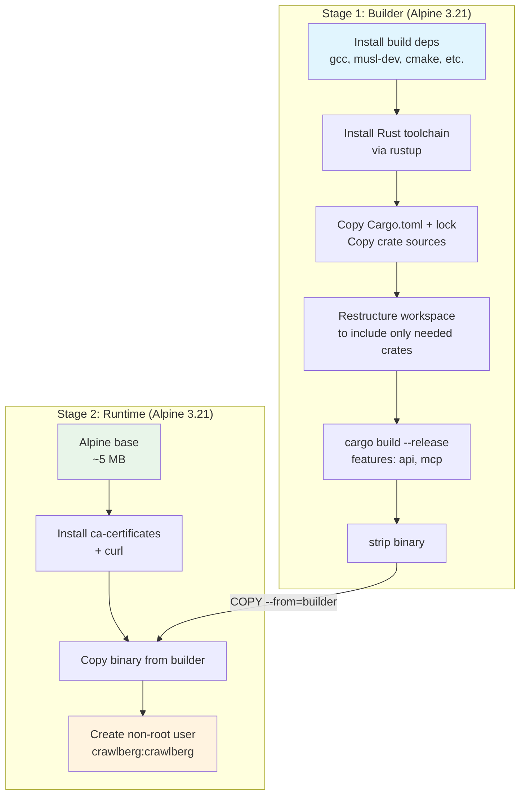
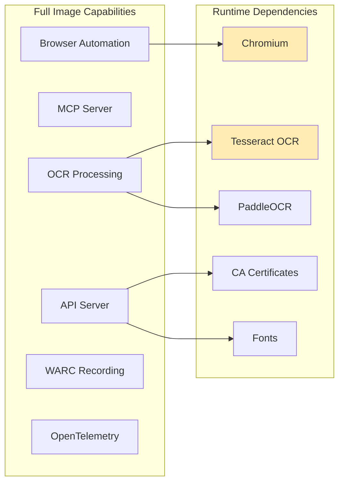
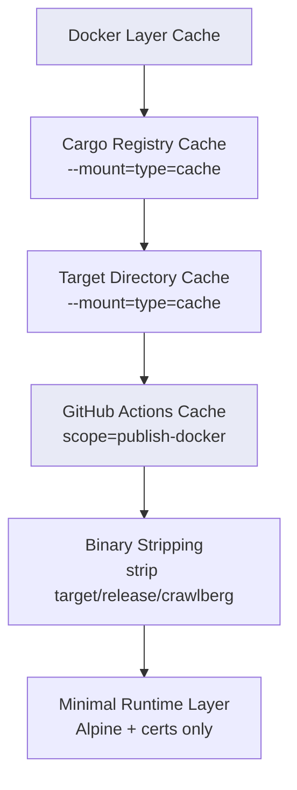
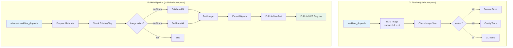

Crawlberg provides a multi-variant Docker deployment strategy designed for different operational contexts — from lightweight CLI distribution to full-featured API servers with browser automation. The deployment pipeline integrates with GitHub Actions for automated multi-architecture builds, registry publishing, and MCP registry submission. This page covers image architecture, build optimization, CI/CD pipelines, security hardening, and operational best practices.

Sources: [docker/README.md](docker/README.md#L1-L250)

## Image Variants

Crawlberg ships six Dockerfiles, each serving a distinct purpose in the build and deployment lifecycle. Understanding the variant landscape is essential for choosing the right image for your use case.

| Variant | Base Image | Primary Use Case | Size | Chromium | Features |
|---|---|---|---|---|---|
| `Dockerfile.alpine` | Alpine 3.21 | **Production CLI + API** (recommended) | ~30-50 MB | ❌ | API, MCP, CLI |
| `Dockerfile` | Debian bookworm-slim | Full-featured server | ~500 MB+ | ✅ | API, MCP, Browser, OCR, WARC |
| `Dockerfile.cli` | Debian bookworm-slim | Legacy CLI (superseded) | ~100-150 MB | ❌ | CLI only |
| `Dockerfile.musl-build` | Alpine 3.21 → scratch | Static binary extraction | scratch | ❌ | CLI binary only |
| `Dockerfile.musl-ffi` | Alpine 3.21 → scratch | FFI shared library | scratch | ❌ | `libcrawlberg_ffi.so` |
| `Dockerfile.musl-nif` | Alpine 3.21 → scratch | Ruby NIF shared library | scratch | ❌ | `libcrawlberg_nif.so` |

The **Alpine variant** is the primary production image, optimized for portability and minimal attack surface. The `scratch`-based musl images exist solely as build intermediaries — they produce artifacts extracted via `docker cp` or CI artifact upload steps for language binding distribution.

Sources: [docker/Dockerfile.alpine](docker/Dockerfile.alpine#L1-L55), [docker/Dockerfile](docker/Dockerfile#L1-L73), [docker/Dockerfile.cli](docker/Dockerfile.cli#L1-L44), [docker/Dockerfile.musl-build](docker/Dockerfile.musl-build#L1-L35), [docker/Dockerfile.musl-ffi](docker/Dockerfile.musl-ffi#L1-L40), [docker/Dockerfile.musl-nif](docker/Dockerfile.musl-nif#L1-L39)

## Production Image Architecture (Alpine)

The production image uses a two-stage multi-stage build pattern: a heavy builder stage that compiles the Rust binary with musl, and a minimal runtime stage containing only the static binary and essential certificates.



### Workspace Restructuring Strategy

A notable optimization in the Dockerfile is the workspace restructuring step. Rather than building the entire Cargo workspace (which includes language bindings, benchmark harnesses, and FFI crates), the Dockerfile dynamically rewrites `Cargo.toml` to include only the crates needed for the CLI binary:

```dockerfile
RUN perl -0777 -i -pe 's/members = \[.*?\]/members = ["crates\/crawlberg", "crates\/crawlberg-cli", "crates\/crawlberg-bindings-common", "crates\/crawlberg-browser"]/s' Cargo.toml
```

This technique uses Perl's multiline mode to replace the workspace `members` array in-place, ensuring Docker's layer cache remains valid when unrelated crates change. The CLI crate depends on `crawlberg-bindings-common` and `crawlberg-browser` even though the Alpine image doesn't ship browser support — these are compile-time dependencies of the CLI binary, not runtime dependencies.

Sources: [docker/Dockerfile.alpine](docker/Dockerfile.alpine#L1-L55)

### Feature Flag Configuration

The build commands differ across variants based on which Cargo features are activated. The feature flags control compile-time inclusion of optional subsystems:

| Feature Flag | Purpose | Alpine Image | Full Image |
|---|---|---|---|
| `api` | REST API server (`serve` command) | ✅ | ✅ |
| `mcp` | Model Context Protocol server | ✅ | ✅ |
| `warc` | WARC recording support | ❌ | ✅ |
| `ai` | AI/LLM integration | ❌ | ✅ |
| `otel` | OpenTelemetry export | ❌ | ✅ |
| `browser` | Chromium automation (compile-time) | ❌ | ✅ |
| `interact` | Page interaction actions | ❌ | ✅ |

The Alpine image activates only `api` and `mcp`, keeping the binary lean. The full Debian image activates the complete feature set, including browser automation which requires Chromium at runtime.

Sources: [docker/Dockerfile.alpine](docker/Dockerfile.alpine#L30-L35), [docker/Dockerfile](docker/Dockerfile#L35-L45), [crates/crawlberg-cli/Cargo.toml](crates/crawlberg-cli/Cargo.toml#L30-L46)

## Full Feature Image (Debian)

The full Debian-based image is the legacy variant maintained for use cases requiring browser automation, OCR capabilities, or the complete feature set. It trades portability for breadth.



The full image includes a health check endpoint and runs as an API server by default:

```dockerfile
HEALTHCHECK --interval=30s --timeout=10s --start-period=5s --retries=3 \
    CMD ["curl", "-f", "http://localhost:3000/health"]

ENTRYPOINT ["crawlberg"]
CMD ["serve", "--host", "0.0.0.0", "--port", "3000"]
```

Chromium is configured with sandbox-disabling flags appropriate for containerized environments, controlled by the `CHROMIUM_FLAGS` environment variable. The `DISABLE_GPU` build argument defaults to `true` to avoid GPU-related failures in container environments without GPU passthrough.

Sources: [docker/Dockerfile](docker/Dockerfile#L55-L73)

## Build Optimization

### Multi-Stage Build Performance

The build pipeline leverages several optimization strategies to minimize both build time and final image size:



**Build time estimates:**

| Scenario | Duration | Notes |
|---|---|---|
| First build (cold) | ~10-15 minutes | Downloads Rust toolchain, compiles all dependencies |
| Incremental (cached) | ~2-3 minutes | Only recompiles changed crates |
| CI with GHA cache | ~3-5 minutes | Restores registry + target caches |

**Image size breakdown (Alpine variant):**

| Component | Size | Notes |
|---|---|---|
| Alpine base | ~5 MB | Minimal Linux distribution |
| CA certificates | ~500 KB | For HTTPS validation |
| curl | ~3 MB | Used for health checks and testing |
| crawlberg binary | ~20-30 MB | Stripped of debug symbols |
| **Total** | **~30-40 MB** | Highly portable across registries |

The CI workflows use Docker Buildx with `--mount=type=cache` for Cargo registry and target directory caching, combined with GitHub Actions cache (`type=gha`) for cross-run persistence. The cache scope is architecture-specific (`scope=publish-docker-amd64`, `scope=publish-docker-arm64`) to avoid cache collisions between cross-compilation targets.

Sources: [docker/README.md](docker/README.md#L130-L160), [docker/Dockerfile.alpine](docker/Dockerfile.alpine#L1-L55), [.github/workflows/publish-docker.yaml](.github/workflows/publish-docker.yaml#L120-L160)

### Static vs. Dynamic Linking

The musl build variants produce fully static binaries suitable for `FROM scratch` images. The distinction between variants is controlled by the `RUSTFLAGS` environment variable:

| Dockerfile | Linking | Output | Target Image |
|---|---|---|---|
| `Dockerfile.alpine` | Static (musl default) | `crawlberg` binary | Alpine 3.21 |
| `Dockerfile.musl-ffi` | Dynamic (`-crt-static`) | `libcrawlberg_ffi.so` | scratch |
| `Dockerfile.musl-nif` | Dynamic (`-crt-static`) | `libcrawlberg_nif.so` | scratch |

The FFI and NIF builds explicitly disable static CRT linking because shared libraries must be dynamically linkable by host applications (Python, Ruby, Elixir). The `file` and `readelf` commands in the Dockerfiles verify the linking state post-build.

Sources: [docker/Dockerfile.musl-ffi](docker/Dockerfile.musl-ffi#L15-L40), [docker/Dockerfile.musl-nif](docker/Dockerfile.musl-nif#L15-L39)

## CI/CD Pipeline

The Docker deployment pipeline spans two GitHub Actions workflows: continuous integration testing (`ci-docker.yaml`) and release publishing (`publish-docker.yaml`).



### CI Pipeline

The CI pipeline (`ci-docker.yaml`) runs on manual dispatch and tests both image variants in parallel using a matrix strategy. It validates that images build successfully, stay within size thresholds, and pass functional tests.

**Key CI steps:**

1. **Build**: Uses `docker/build-push-action` with Buildx for layer caching
2. **Size check**: Validates images against threshold warnings (200 MB for CLI)
3. **Feature tests**: Runs `test_docker.py` against the built image
4. **Config tests**: Validates TOML/YAML/JSON configuration loading in containers

Sources: [.github/workflows/ci-docker.yaml](.github/workflows/ci-docker.yaml#L1-L71)

### Publish Pipeline

The publish pipeline (`publish-docker.yaml`) handles release-triggered multi-architecture builds and registry publishing. It is the most sophisticated pipeline in the repository, implementing a multi-phase approach:

**Phase 1 — Metadata Resolution:**
Uses a custom action (`xberg-io/actions/prepare-release-metadata@v1`) to extract the release tag, version, and target ref. Supports `workflow_dispatch`, `release`, and `repository_dispatch` triggers.

**Phase 2 — Idempotency Check:**
The `check-docker` job uses `docker manifest inspect` to determine if the target tag already exists in the registry. Publishing is skipped unless `force_republish` is enabled, preventing redundant rebuilds.

**Phase 3 — Parallel Architecture Build:**
Builds run on architecture-specific runners (`ubuntu-latest` for amd64, `ubuntu-24.04-arm` for arm64) to avoid QEMU emulation overhead. Each build exports a digest artifact for later manifest assembly.

**Phase 4 — Manifest Creation:**
The `publish-docker` job downloads both architecture digests and uses `docker buildx imagetools create` to compose a multi-architecture manifest list tagged with both the version and `latest`.

**Phase 5 — MCP Registry:**
After Docker publishing succeeds, the pipeline publishes server metadata to the Model Context Protocol registry using `mcp-publisher` with GitHub OIDC authentication.

Sources: [.github/workflows/publish-docker.yaml](.github/workflows/publish-docker.yaml#L1-L343)

### Docker Registry

Images are published to the GitHub Container Registry (GHCR):

```bash
# Pull latest
docker pull ghcr.io/xberg-io/crawlberg:latest

# Pull specific version
docker pull ghcr.io/xberg-io/crawlberg:v1.1.2
```

The registry authentication uses the built-in `GITHUB_TOKEN` secret, and the `packages: write` permission is scoped to the publish job only.

Sources: [.github/workflows/publish-docker.yaml](.github/workflows/publish-docker.yaml#L60-L70)

## Security Hardening

The Docker images follow several security best practices to minimize attack surface and enforce principle of least privilege:

### Non-Root Execution

Every image variant creates a dedicated `crawlberg` user and group, and the `USER crawlberg` directive ensures the process never runs as root:

```dockerfile
RUN addgroup -S crawlberg && \
    adduser -S -G crawlberg -h /app -s /sbin/nologin crawlberg && \
    chown -R crawlberg:crawlberg /app

USER crawlberg
```

The `test_docker.py` suite explicitly verifies non-root execution:

```python
def test_nonroot_user(image: str) -> bool:
    """Verify the container runs as non-root."""
    cmd = ["docker", "run", "--rm", "--entrypoint", "id", image]
    result = subprocess.run(cmd, capture_output=True, text=True, check=False)
    ok = result.returncode == 0 and "root" not in result.stdout
    ...
```

### Read-Only Filesystem Support

The images are designed to operate with read-only root filesystems, with an explicit `/tmp` exemption for temporary file operations:

```bash
docker run --rm \
    --read-only \
    --tmpfs /tmp \
    --user crawlberg:crawlberg \
    -v /data:/data:ro \
    crawlberg:latest \
    extract /data/document.pdf
```

### Memory Constraints

For production deployments, memory limits prevent runaway crawls from consuming host resources:

```bash
docker run --rm \
    --memory 512m \
    --memory-swap 512m \
    crawlberg:latest \
    scrape https://example.com
```

### Minimal Base Image

The Alpine variant uses a minimal base (~5 MB) with only CA certificates and curl added. No shell utilities, editors, or debugging tools are included, reducing both image size and potential attack vectors.

### Hadolint Configuration

The repository uses Hadolint for Dockerfile linting with specific rule suppressions. Package version pinning is intentionally omitted (`DL3008`, `DL3018`) because build images track distro security updates — this is a deliberate trade-off favoring security patches over reproducibility for build-time dependencies.

Sources: [docker/Dockerfile.alpine](docker/Dockerfile.alpine#L40-L55), [scripts/ci/docker/test_docker.py](scripts/ci/docker/test_docker.py#L60-L68), [docker/README.md](docker/README.md#L165-L195), [.hadolint.yaml](.hadolint.yaml#L1-L7)

## Testing Infrastructure

Docker images are validated through a comprehensive Python-based test suite that exercises both basic functionality and security properties.

### Test Suite Overview

The `test_docker.py` script runs six verification tests against any crawlberg Docker image:

| Test | What It Validates |
|---|---|
| `test_version` | Binary executes and reports version |
| `test_help` | CLI help output includes `scrape` and `crawl` subcommands |
| `test_scrape_help` | `scrape --help` returns valid output |
| `test_scrape_json` | End-to-end scrape of `example.com` with JSON parsing |
| `test_nonroot_user` | Container process is not running as root |
| `test_invalid_url` | Error handling returns non-zero exit code |

### Running Tests Locally

```bash
# Build and test the Alpine image (default)
scripts/ci/docker/build_and_test.sh

# Test a pre-built image
scripts/ci/docker/build_and_test.sh --image crawlberg:latest --verbose

# Test a specific variant
scripts/ci/docker/test_docker.py --image crawlberg:cli --variant cli --verbose
```

### Configuration Tests

For the full image variant, the `test-docker-config-local.sh` script validates that crawlberg correctly loads TOML, YAML, and JSON configuration files when running inside a container. This ensures that volume-mounted configuration files are parsed correctly.

Sources: [scripts/ci/docker/test_docker.py](scripts/ci/docker/test_docker.py#L1-L128), [scripts/ci/docker/build_and_test.sh](scripts/ci/docker/build_and_test.sh#L1-L109), [scripts/test/test-docker-config-local.sh](scripts/test/test-docker-config-local.sh#L1-L200)

## Task Runner Integration

The [Task runner](https://taskfile.dev) provides convenient aliases for Docker operations through the `docker` namespace. These commands encapsulate the most common development workflows:

```bash
# Build the full API server image
task docker:build

# Build the lightweight CLI image  
task docker:build:cli

# Run the API server on port 3000
task docker:run
```

The `docker:run` task depends on `docker:build`, ensuring the image is always fresh before execution. The `docker:schemathesis` task provides an on-demand API contract testing workflow that starts the server, runs Schemathesis against the OpenAPI spec, and validates response conformance.

Sources: [.task/tools/docker.yml](.task/tools/docker.yml#L1-L38)

## Docker Compose for Testing

A minimal `docker-compose.test.yml` provides infrastructure dependencies for integration testing:

```yaml
services:
  redis:
    image: redis:7-alpine
    ports:
      - "6379:6379"
    healthcheck:
      test: ["CMD", "redis-cli", "ping"]
      interval: 5s
      timeout: 3s
      retries: 5
```

This Redis service supports cache-related feature tests that require a backing store. The health check ensures the container is fully initialized before test execution begins.

Sources: [docker-compose.test.yml](docker-compose.test.yml#L1-L11)

## Build Context Optimization

The `.dockerignore` file excludes build artifacts, test fixtures, and generated files from the Docker build context, significantly reducing build time and preventing cache invalidation:

```
target/
.git/
.github/
e2e/
packages/
!packages/elixir/native/
!packages/ruby/ext/
fixtures/
*.md
node_modules/
```

Notable inclusions with negation patterns: `packages/elixir/native/` and `packages/ruby/ext/` are explicitly included because the musl-nif and musl-ffi Dockerfiles copy NIF source files from these directories. The `!packages/elixir/native/` pattern overrides the broader `packages/` exclusion for these specific paths.

Sources: [.dockerignore](.dockerignore#L1-L17)

## Disk Space Management in CI

The CI pipeline includes dedicated disk space management scripts because Rust compilation and Docker image building are disk-intensive operations. The `free-disk-space.sh` script runs early in the workflow to reclaim space occupied by pre-installed tools:

```bash
sudo rm -rf /usr/share/dotnet /usr/local/lib/android /opt/ghc
docker system prune -af --volumes
docker builder prune -af
```

This script is invoked both in the publish pipeline (before architecture-specific builds) and in the CI pipeline (before Docker builds). The publish pipeline's `check-image-size` action warns when images exceed 200 MB for the CLI variant, providing early visibility into image bloat.

Sources: [scripts/publish/ubuntu/free-disk-space.sh](scripts/publish/ubuntu/free-disk-space.sh#L1-L37), [scripts/ci/docker/check-image-size.sh](scripts/ci/docker/check-image-size.sh#L1-L24)

## Deployment Patterns

### CLI as a Container

For batch processing or CI/CD integration, the Alpine image provides a portable CLI that can be invoked directly:

```bash
# Scrape with JSON output
docker run --rm ghcr.io/xberg-io/crawlberg:latest \
    scrape https://example.com --format json

# Crawl with depth and page limits
docker run --rm ghcr.io/xberg-io/crawlberg:latest \
    crawl https://example.com --max-depth 3 --max-pages 100

# Extract content from mounted files
docker run --rm -v ./downloads:/data:ro \
    ghcr.io/xberg-io/crawlberg:latest \
    extract /data/document.pdf
```

### API Server Deployment

The full image runs as an API server by default, exposing port 3000 with a health check endpoint:

```bash
docker run -d \
    --name crawlberg-api \
    -p 8000:3000 \
    --memory 1g \
    --restart unless-stopped \
    ghcr.io/xberg-io/crawlberg:latest
```

The Alpine image can also run in server mode by overriding the default command:

```bash
docker run -d \
    --name crawlberg-api \
    -p 8000:3000 \
    ghcr.io/xberg-io/crawlberg:latest \
    serve --host 0.0.0.0 --port 3000
```

### MCP Server Mode

For AI agent integration, the image supports Model Context Protocol server mode:

```bash
docker run --rm -i \
    ghcr.io/xberg-io/crawlberg:latest \
    mcp
```

This mode is designed for stdio-based MCP transport, making it suitable for integration with AI agent frameworks that manage MCP server lifecycle.

Sources: [docker/README.md](docker/README.md#L40-L60)

## Next Steps

- Understand the [REST API Server](25-rest-api-server) that runs inside Docker containers
- Explore [MCP Server for AI Agents](24-mcp-server-for-ai-agents) for the `mcp` Docker mode
- Review [Testing Strategy](28-testing-strategy-unit-e2e-fuzz) for the broader testing philosophy including Docker test validation
- Examine [Architecture and Data Flow](9-architecture-and-data-flow) for the system design that these images package