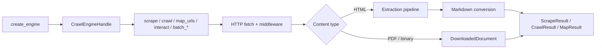
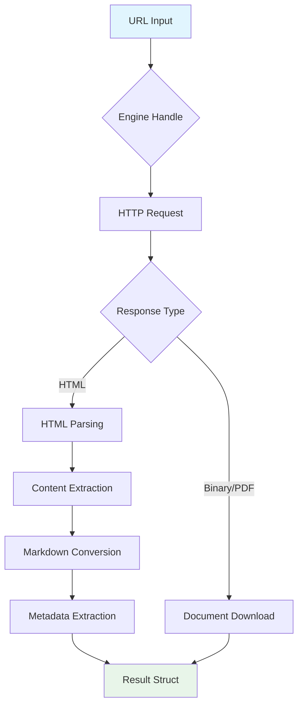

Crawlberg is a high-performance web crawling engine that transforms websites into clean, structured data. Built in Rust with native bindings for 14 languages, it provides a unified API for scraping single pages, crawling entire websites, and discovering URLs — while handling the complex parts like JavaScript rendering, bot detection evasion, and content extraction automatically.

## What Crawlberg Does

At its core, Crawlberg solves a fundamental problem: **extracting usable data from the web**. Raw HTML is messy, inconsistent, and difficult to work with. Crawlberg handles the entire pipeline — from fetching pages and following links to converting content to clean Markdown and extracting structured metadata — so you get data ready for analysis, LLM pipelines, or your application.

The engine operates through three primary operations:

| Operation | Purpose | Use Case |
|-----------|---------|----------|
| **Scrape** | Fetch and extract a single page | Getting content from a specific URL |
| **Crawl** | Follow links from a seed URL up to configured depth | Indexing a website or collecting content across multiple pages |
| **Map** | Discover URLs via sitemaps and link extraction | Building a URL inventory without fetching content |

## Architecture at a Glance

Crawlberg follows a modular, trait-based architecture where every component is pluggable. The core engine constructs an opaque handle, then operations like `scrape`, `crawl`, and `map_urls` execute over that handle.

The middleware stack applies per-domain rate limiting, conditional caching, and User-Agent rotation. When JavaScript rendering or bot protection is detected, the engine can automatically escalate to a headless browser backend.

Sources: [lib.rs](crates/crawlberg/src/lib.rs#L1-L112), [architecture.md](docs-site/src/content/docs/concepts/architecture.md#L1-L80)

## Key Features

Crawlberg provides a comprehensive feature set designed for real-world web scraping challenges:

| Feature | Description |
|---------|-------------|
| **Structured extraction** | Titles, links, images, feeds, social-card data (Open Graph, Twitter Card), JSON-LD, Dublin Core, and 40+ metadata fields |
| **Always-on Markdown** | Every HTML page returns clean Markdown ready for LLMs or content pipelines |
| **14 language bindings** | Identical results across Rust, Python, Node.js, Go, Java, Kotlin, C#, Ruby, PHP, Elixir, Dart, Swift, Zig, and WebAssembly |
| **Concurrent crawling** | Depth-first, breadth-first, best-first, or adaptive traversal strategies with configurable depth and page limits |
| **Smart filtering** | BM25 relevance scoring, URL include/exclude patterns, robots.txt compliance, and sitemap discovery |
| **Browser fallback** | Automatic escalation to headless Chrome for JavaScript-heavy SPAs or WAF-protected sites |
| **SSRF protection** | Refuses loopback, private, and cloud-metadata addresses by default |
| **Batch & streaming** | Process hundreds of URLs concurrently with real-time crawl events |
| **Auth & rate limiting** | HTTP Basic, Bearer, and custom-header auth with per-domain request throttling |
| **MCP & REST servers** | Model Context Protocol integration for AI agents plus an HTTP server with OpenAPI spec |

Sources: [README.md](README.md#L45-L89), [features.md](docs-site/src/content/docs/features.md#L1-L192)

## How Crawlberg Works

The engine follows a clear pipeline for processing web content:

**Content extraction** pulls structured data from HTML: links (categorized as internal, external, anchor, or document), images (from ``, `<picture>`, `og:image`, and `srcset`), feeds (RSS, Atom, JSON Feed), and comprehensive metadata.

**Markdown conversion** happens automatically on every HTML page via the [html-to-markdown](https://docs.html-to-markdown.xberg.io) engine. Results include the converted content, optional citations, and fit-content pruning optimized for LLM consumption.

Sources: [architecture.md](docs-site/src/content/docs/concepts/architecture.md#L20-L40), [features.md](docs-site/src/content/docs/features.md#L100-L150)

## Pluggable Architecture

Every major component in Crawlberg is defined as a trait, allowing you to swap implementations without modifying the core engine:

| Trait | Purpose | Default Implementation |
|-------|---------|----------------------|
| `Frontier` | URL queue and deduplication | `InMemoryFrontier` |
| `RateLimiter` | Per-domain request throttling | `PerDomainThrottle` |
| `CrawlStore` | Persistence for crawl results | `NoopStore` |
| `EventEmitter` | Crawl lifecycle events | `NoopEmitter` |
| `CrawlStrategy` | URL selection and scoring | BFS (breadth-first) |
| `ContentFilter` | Post-extraction filtering | `NoopFilter` |
| `CrawlCache` | HTTP response caching | `NoopCache` |
| `PageBudget` | Resource limits per page | `DefaultPageBudget` |

This design enables use cases like distributed crawling (custom `Frontier`), persistent storage (custom `CrawlStore`), or domain-specific filtering (custom `ContentFilter`).

Sources: [traits.rs](crates/crawlberg/src/traits.rs#L1-L196), [builder.rs](crates/crawlberg/src/engine/builder.rs#L1-L80)

## Multi-Language Support

Crawlberg delivers identical crawling results across 14 languages through a single Rust core. The polyglot binding generator [alef](https://github.com/xberg-io/alef) produces native bindings for each language, ensuring consistent behavior and API ergonomics.

| Language | Package | Mechanism |
|----------|---------|-----------|
| **Rust** | `cargo add crawlberg` | Native crate |
| **Python** | `pip install crawlberg` | PyO3 + maturin |
| **Node.js** | `npm install @xberg-io/crawlberg` | NAPI-RS |
| **WebAssembly** | `npm install @xberg-io/crawlberg-wasm` | wasm-bindgen |
| **Go** | `go get github.com/xberg-io/crawlberg/packages/go` | cgo over C FFI |
| **Java** | Maven Central `io.xberg.crawlberg:crawlberg` | Java 25 Panama FFM |
| **Kotlin Android** | Maven Central `io.xberg.crawlberg.android:crawlberg-android` | Android AAR with JNI |
| **C#** | `dotnet add package Crawlberg` | .NET 10 P/Invoke |
| **Ruby** | `gem install crawlberg` | Magnus + rb-sys |
| **PHP** | `composer require xberg-io/crawlberg` | ext-php-rs |
| **Elixir** | `{:crawlberg, "~> 0.3"}` | Rustler NIF |
| **Dart/Flutter** | `dart pub add crawlberg` | Dart FFI |
| **Swift** | Swift Package Manager | Swift over C FFI |
| **Zig** | `zig fetch --save` | Zig over C FFI |
| **C/C++** | Shared library + header | C FFI |

Sources: [architecture.md](docs-site/src/content/docs/concepts/architecture.md#L40-L80), [README.md](README.md#L90-L180)

## Security by Default

Crawlberg takes a security-first approach to web scraping:

- **SSRF protection** — Refuses requests to loopback addresses, private networks, link-local ranges, and cloud-metadata endpoints by default
- **robots.txt compliance** — RFC 9309 compliant with user-agent prefix matching and crawl-delay support
- **Config validation** — `serde` with `deny_unknown_fields` catches configuration typos at parse time
- **Safe defaults** — Rate limiting, redirect caps, and body-size limits prevent accidental abuse

You can opt out of SSRF restrictions via environment variable or `CrawlConfig` when needed for internal network access.

Sources: [features.md](docs-site/src/content/docs/features.md#L150-L192), [ssrf-defense.md](docs-site/src/content/docs/concepts/ssrf-defense.md)

## Part of the Xberg Ecosystem

Crawlberg is one component of the Xberg content-intelligence platform:

| Project | Description |
|---------|-------------|
| **[Xberg](https://github.com/xberg-io/xberg)** | Open-source content-intelligence engine for 101 formats with OCR and code intelligence |
| **[crawlberg](https://github.com/xberg-io/crawlberg)** | Web crawling and scraping with HTML→Markdown and browser fallback |
| **[html-to-markdown](https://github.com/xberg-io/html-to-markdown)** | Fast, lossless HTML→Markdown conversion engine |
| **[liter-llm](https://github.com/xberg-io/liter-llm)** | Universal LLM API client with native bindings for 14 languages |
| **[alef](https://github.com/xberg-io/alef)** | Polyglot binding generator for cross-language packages |

Sources: [README.md](README.md#L350-L380)

## Next Steps

Now that you understand what Crawlberg is and how it works, here's the recommended reading progression:

1. **[Quick Start](2-quick-start)** — Get up and running with your first scrape, crawl, or map operation in under 5 minutes
2. **[Installation Across Languages](3-installation-across-languages)** — Find the package for your language and install it
3. **[CLI Usage](4-cli-usage)** — Use Crawlberg from the command line without writing code
4. **[Core Public API](5-core-public-api)** — Understand the main functions and their parameters

For deeper exploration:
- **[Architecture and Data Flow](9-architecture-and-data-flow)** — Detailed look at the engine internals
- **[Configuration Reference](11-configuration-reference-crawlconfig)** — All configuration options explained
- **[Polyglot Language Bindings](26-polyglot-language-bindings-architecture)** — How the multi-language support works