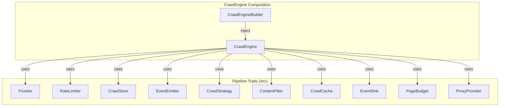
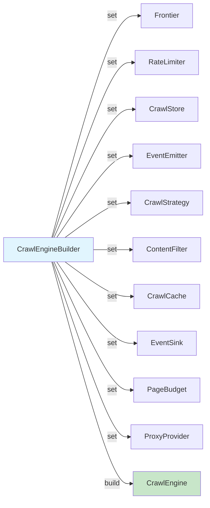
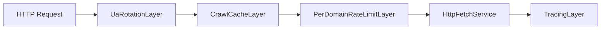

The crawl engine's extensibility is rooted in Rust's trait system. Every major concern — URL queuing, rate limiting, content filtering, persistence, strategy selection, event emission, caching, budget enforcement, proxy rotation, and anti-bot interception — is expressed as an async trait object. `CrawlEngine` composes these trait implementations via `Arc<dyn Trait>`, and `CrawlEngineBuilder` provides the injection surface. Unset fields receive lightweight defaults from the `defaults` module, meaning the engine works out of the box while remaining fully substitutable at every seam.

Sources: [traits.rs](crates/crawlberg/src/traits.rs#L1-L196), [engine/mod.rs](crates/crawlberg/src/engine/mod.rs#L62-L85)

## Extension Point Architecture

The engine exposes **ten primary extension traits** that define the crawl pipeline's behavior, plus **six dispatch-level traits** that govern tiered escalation, WAF detection, and anti-bot interception. Each trait is object-safe, `Send + Sync`, and designed for cheap construction via `Arc<dyn Trait>`.

### Pipeline Traits



Sources: [traits.rs](crates/crawlberg/src/traits.rs#L76-L196), [proxy.rs](crates/crawlberg/src/proxy.rs#L36-L42), [sink.rs](crates/crawlberg/src/sink.rs#L17-L25), [budget.rs](crates/crawlberg/src/budget.rs#L20-L37)

### Dispatch-Level Traits

These traits govern the tiered escalation loop — the mechanism that decides whether to retry, escalate to browser, or stop when a fetch encounters WAF blocks, rate limits, or anti-bot challenges.

| Trait | Purpose | Decision Type |
|-------|---------|---------------|
| `RetryPolicy` | Post-attempt retry/escalate/stop decision | `RetryDirective` |
| `WafClassifier` | Fingerprint detection in HTTP responses | `Option<WafSignal>` |
| `AntibotStrategy` | Pre/post request interception hooks | `Decision` |
| `BypassProvider` | External vendor fetch routing | `BypassResponse` |
| `DomainStatePort` | Per-domain learning state backend | `DomainRecommendation` |
| `EscalationBudget` | Tier escalation cost control | `Result<(), BudgetExhausted>` |

Sources: [dispatch.rs](crates/crawlberg/src/types/dispatch.rs#L290-L560), [antibot.rs](crates/crawlberg/src/types/antibot.rs#L107-L130), [bypass.rs](crates/crawlberg/src/types/bypass.rs#L52-L62)

## Trait Reference

### Frontier — URL Queue Management

The `Frontier` trait manages URL deduplication and queue ordering. The default `InMemoryFrontier` uses a `VecDeque` with an `AHashSet` for O(1) deduplication, but implementations can target persistent backends (Redis, PostgreSQL) for distributed crawls.

```rust
#[async_trait]
pub trait Frontier: Send + Sync {
    async fn push(&self, entry: FrontierEntry) -> Result<(), CrawlError>;
    async fn pop(&self) -> Result<Option<FrontierEntry>, CrawlError>;
    async fn pop_batch(&self, n: usize) -> Result<Vec<FrontierEntry>, CrawlError>;
    async fn len(&self) -> Result<usize, CrawlError>;
    async fn is_seen(&self, url: &str) -> Result<bool, CrawlError>;
    async fn mark_seen(&self, url: &str) -> Result<(), CrawlError>;
}
```

The engine maintains a local `working_set: Vec<FrontierEntry>` that the strategy selects from, keeping the hot path lock-free while the frontier handles persistence and deduplication.

Sources: [traits.rs](crates/crawlberg/src/traits.rs#L76-L110), [frontier.rs](crates/crawlberg/src/defaults/frontier.rs#L38-L75)

### CrawlStrategy — URL Selection and Scoring

The `CrawlStrategy` trait is **synchronous** (not async) to minimize overhead on the selection hot path. It receives a slice of candidates and returns the index of the next URL to crawl.

| Strategy | Behavior | `select_next` Logic |
|----------|----------|---------------------|
| `BfsStrategy` | Breadth-first, oldest first | Returns index `0` |
| `DfsStrategy` | Depth-first, newest first | Returns last index |
| `BestFirstStrategy` | Priority-scored selection | Returns highest `priority` |
| `AdaptiveStrategy` | Stops on content saturation | BFS + `should_continue` check |

The `AdaptiveStrategy` tracks unique term discovery rate across crawled pages. When the ratio of new terms per page drops below a configurable threshold (default 5%), the strategy signals the engine to halt — useful for research crawls where content diversity matters more than completeness.

```rust
pub trait CrawlStrategy: Send + Sync {
    fn select_next(&self, candidates: &[FrontierEntry]) -> Option<usize>;
    fn score_url(&self, url: &str, depth: usize) -> f64;
    fn should_continue(&self, stats: &CrawlStats) -> bool;
    fn on_page_processed(&self, page: &CrawlPageResult);
}
```

Sources: [traits.rs](crates/crawlberg/src/traits.rs#L158-L180), [strategy.rs](crates/crawlberg/src/defaults/strategy.rs#L1-L150)

### RateLimiter — Per-Domain Throttling

The `RateLimiter` trait enforces delays between requests to the same domain. The default `PerDomainThrottle` implements adaptive back-off: it doubles the delay on 429 responses (up to 60 seconds) and halves it after 5 consecutive successes, respecting `robots.txt` crawl-delay directives.

Sources: [traits.rs](crates/crawlberg/src/traits.rs#L112-L123), [rate_limiter.rs](crates/crawlberg/src/defaults/rate_limiter.rs#L45-L143)

### ContentFilter — Post-Extraction Filtering

The `ContentFilter` trait runs after HTML extraction and can discard pages that don't match criteria. The built-in `Bm25Filter` scores pages against a query using TF-saturation scoring — useful for focused crawls where only relevant pages should be retained.

| Filter | Behavior |
|--------|----------|
| `NoopFilter` | Passes all pages through (default) |
| `Bm25Filter` | Scores against query terms, filters by threshold |

Sources: [traits.rs](crates/crawlberg/src/traits.rs#L181-L186), [filter.rs](crates/crawlberg/src/defaults/filter.rs#L16-L171)

### CrawlCache — HTTP Response Caching

The `CrawlCache` trait avoids re-fetching unchanged pages. The default `DiskCache` stores responses as JSON files using blake3 hashes of URLs as filenames, with TTL-based expiry and LRU eviction. The cache integrates into the Tower service stack via `CrawlCacheLayer`, checking for cached responses before forwarding requests.

Sources: [traits.rs](crates/crawlberg/src/traits.rs#L188-L194), [cache.rs](crates/crawlberg/src/defaults/cache.rs#L36-L166), [tower/cache.rs](crates/crawlberg/src/tower/cache.rs#L46-L100)

### CrawlStore — Persistence

The `CrawlStore` trait handles crawl result persistence. The default `NoopStore` discards all data, suitable for ephemeral crawls. Implementations can target databases, file systems, or message queues.

Sources: [traits.rs](crates/crawlberg/src/traits.rs#L125-L139), [store.rs](crates/crawlberg/src/defaults/store.rs#L14-L51)

### EventEmitter — Lifecycle Events

The `EventEmitter` trait notifies listeners of crawl lifecycle events (page crawled, error occurred, URL discovered, crawl complete). The default `NoopEmitter` silently discards all events.

Sources: [traits.rs](crates/crawlberg/src/traits.rs#L141-L156), [emitter.rs](crates/crawlberg/src/defaults/emitter.rs#L12-L42)

### EventSink — External Event Streaming

The `EventSink` trait streams `CrawlEvent`s to external consumers (NATS, dashboards, analytics) without crawlberg depending on those backends. The `MultiEventSink` fans out events to multiple sinks concurrently.

```rust
#[async_trait]
pub trait EventSink: Send + Sync + 'static {
    async fn emit(&self, event: CrawlEvent);
}
```

Sources: [sink.rs](crates/crawlberg/src/sink.rs#L17-L80)

### PageBudget — Crawl Extent Control

The `PageBudget` trait enforces per-crawl page allowances. Returning `Err(BudgetError::Exhausted)` halts the crawl gracefully. The hook is completely tenant-agnostic — crawlberg only checks and does not care how the budget is implemented.

Sources: [budget.rs](crates/crawlberg/src/budget.rs#L20-L65)

### ProxyProvider — Per-Request Proxy Rotation

The `ProxyProvider` trait resolves a proxy configuration for each outbound HTTP request. The default `StaticProxyProvider` implements round-robin rotation across a fixed pool. The provider only routes the reqwest HTTP path — browser-backend proxies are configured separately.

Sources: [proxy.rs](crates/crawlberg/src/proxy.rs#L36-L95)

## Builder Pattern and Default Injection

`CrawlEngineBuilder` provides a fluent API for injecting trait implementations. Any field left unset receives a default implementation from the `defaults` module.



```rust
let engine = CrawlEngine::builder()
    .config(CrawlConfig::default())
    .strategy(AdaptiveStrategy::new(20, 0.03))
    .content_filter(Bm25Filter::new("rust async", 0.1))
    .cache(DiskCache::new(".cache", 3600, 10000)?)
    .event_sink(NatsEventSink::new(nats_url))
    .page_budget(FixedBudget::new(5000))
    .build()?;
```

The builder also supports injecting pre-built pools for long-lived processes:

```rust
let pool = BrowserPool::new(BrowserPoolConfig::default());
pool.warm().await?;

let engine = CrawlEngine::builder()
    .with_browser_pool(pool)
    .build()?;
// The engine reuses the same Chrome instance across all crawls.
```

Sources: [builder.rs](crates/crawlberg/src/engine/builder.rs#L1-L310)

## Tower Service Stack Integration

The engine's HTTP fetching pipeline uses Tower's composable middleware pattern. Trait implementations are wrapped in Tower layers that intercept requests before they reach the HTTP client.



Each Tower layer wraps the inner service and delegates to the corresponding trait implementation:

| Tower Layer | Trait | Behavior |
|-------------|-------|----------|
| `PerDomainRateLimitLayer` | `RateLimiter` | Calls `acquire()` before request, `record_response()` after |
| `CrawlCacheLayer` | `CrawlCache` | Checks cache before request, stores on success |
| `UaRotationLayer` | (inline) | Rotates User-Agent headers from config list |
| `CrawlTracingLayer` | (inline) | Adds OpenTelemetry spans to each request |

Sources: [tower/mod.rs](crates/crawlberg/src/tower/mod.rs#L1-L34), [engine/mod.rs](crates/crawlberg/src/engine/mod.rs#L92-L110)

## Dispatch Traits — Tiered Escalation

The dispatch-level traits govern the engine's tiered escalation strategy: HTTP → Bypass → Browser. When a fetch encounters WAF blocks, rate limits, or anti-bot challenges, the dispatch loop consults these traits to decide whether to retry, escalate, or stop.

### RetryPolicy

The `RetryPolicy` trait decides what happens after each fetch attempt. The default `SimpleRetryPolicy` implements a fixed retry count with exponential backoff.

```rust
#[async_trait]
pub trait RetryPolicy: Send + Sync + fmt::Debug {
    async fn decide(&self, outcome: &AttemptOutcome) -> RetryDirective;
    fn name(&self) -> &'static str;
}
```

| Directive | Engine Action |
|-----------|---------------|
| `Retry { backoff_ms }` | Sleep then retry same tier |
| `Escalate { reason }` | Move to next tier in escalation chain |
| `Stop` | Return current result to caller |

Sources: [dispatch.rs](crates/crawlberg/src/types/dispatch.rs#L290-L320), [dispatch.rs](crates/crawlberg/src/defaults/dispatch.rs#L1-L100)

### WafClassifier

The `WafClassifier` trait inspects HTTP responses for WAF fingerprints. The default `TomlClassifier` loads fingerprint rules from `rules/waf_fingerprints.toml` and uses Aho-Corasick matching over response bodies and headers.

Sources: [dispatch.rs](crates/crawlberg/src/types/dispatch.rs#L346-L380)

### AntibotStrategy

The `AntibotStrategy` trait provides pre/post request interception hooks. `pre_request` fires before the fetch (useful for token rotation), and `post_response` fires after WAF classification to produce a `Decision` that overrides the retry policy.

Sources: [antibot.rs](crates/crawlberg/src/types/antibot.rs#L107-L130)

### BypassProvider

The `BypassProvider` trait routes URL fetches through external vendors (e.g., Bright Data, ScrapingBee). Implementations handle vendor authentication, request shaping, and response decoding.

Sources: [bypass.rs](crates/crawlberg/src/types/bypass.rs#L52-L62)

## Crawl Loop Orchestration

The crawl loop in `crawl_loop.rs` demonstrates how traits are orchestrated at runtime. Each iteration:

1. **Strategy Selection**: `strategy.select_next(working_set)` picks the next URL
2. **Budget Check**: `page_budget.check()` verifies page allowance
3. **URL Validation**: robots.txt, include/exclude patterns, SSRF checks
4. **Concurrent Fetch**: Tower service stack executes the request
5. **WAF Classification**: `waf_classifier.classify()` detects fingerprints
6. **Antibot Interception**: `antibot_strategy.post_response()` decides next action
7. **Retry Decision**: `retry_policy.decide()` determines outcome
8. **Content Filtering**: `content_filter.filter()` discards irrelevant pages
9. **Result Storage**: `store.store_crawl_page()` persists results
10. **Event Emission**: `event_emitter.on_page()` notifies listeners

Sources: [crawl_loop.rs](crates/crawlberg/src/engine/crawl_loop.rs#L460-L520)

## Implementing Custom Traits

All traits follow a consistent pattern: implement the trait on a struct, wrap in `Arc`, and inject via the builder. The `Noop*` defaults provide reference implementations for every trait.

```rust
use crawlberg::{CrawlEngine, CrawlConfig};
use crawlberg::traits::*;
use async_trait::async_trait;

#[derive(Debug)]
struct MyFrontier {
    // Your state here
}

#[async_trait]
impl Frontier for MyFrontier {
    async fn push(&self, entry: FrontierEntry) -> Result<(), CrawlError> {
        // Your implementation
        todo!()
    }
    // ... other methods
}

let engine = CrawlEngine::builder()
    .config(CrawlConfig::default())
    .frontier(MyFrontier { /* ... */ })
    .build()?;
```

Sources: [traits.rs](crates/crawlberg/src/traits.rs#L1-L196), [builder.rs](crates/crawlberg/src/engine/builder.rs#L87-L165)

## Public API Surface

The following types and traits are exported from the crate root for external use:

| Category | Exported Types |
|----------|----------------|
| Core Engine | `CrawlEngine`, `CrawlEngineBuilder` |
| Pipeline Traits | `Frontier`, `RateLimiter`, `CrawlStore`, `EventEmitter`, `CrawlStrategy`, `ContentFilter`, `CrawlCache`, `PageBudget`, `EventSink`, `ProxyProvider` |
| Defaults | `BfsStrategy`, `DfsStrategy`, `BestFirstStrategy`, `AdaptiveStrategy`, `InMemoryFrontier`, `PerDomainThrottle`, `NoopStore`, `NoopEmitter`, `NoopFilter`, `NoopCache`, `DiskCache`, `DefaultPageBudget`, `StaticProxyProvider`, `TracingEventSink`, `MultiEventSink` |
| Dispatch Traits | `RetryPolicy`, `WafClassifier`, `AntibotStrategy`, `BypassProvider`, `DomainStatePort`, `EscalationBudget` |
| Dispatch Defaults | `SimpleRetryPolicy`, `UnlimitedBudget`, `FixedBudget`, `DefaultAntibotStrategy` |