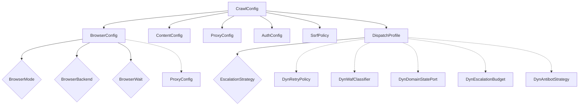

CrawlConfig is the central configuration type that controls every aspect of crawl, scrape, and map operations. It is a deeply nested, serializable struct supporting JSON, TOML, and programmatic construction via a fluent builder. This reference documents every field, its type, default value, validation constraints, and practical guidance for choosing appropriate values.

## Architecture Overview

The configuration follows a compositional design: the top-level `CrawlConfig` contains nested sub-configuration structs for browser, content, proxy, authentication, and security concerns. Each sub-config is independently serializable and defaults to a sensible baseline, meaning a bare `{}` configuration produces a working, conservative crawl.



The top-level `CrawlConfig` struct is defined in a single authoritative source file:

Sources: [config.rs](crates/crawlberg/src/types/config.rs#L294-L444)

## Top-Level Fields

### Crawl Scope and Limits

These fields control the boundaries of a crawl operation — how deep the crawler follows links, how many pages it collects, and how much parallelism it uses.

| Field | Type | Default | Validation | Description |
|---|---|---|---|---|
| `max_depth` | `Option<usize>` | `None` (unlimited) | `≤ 100` | Maximum link hops from the seed URL. `None` means no depth limit. |
| `max_pages` | `Option<usize>` | `None` (unlimited) | `> 0` when set | Maximum pages to crawl before stopping. |
| `max_concurrent` | `Option<usize>` | `None` (engine default) | `> 0` when set | Maximum concurrent in-flight HTTP requests. |

A `max_depth` of 0 means only the seed URL is fetched. A depth of 1 fetches the seed plus every URL found on the seed page, and so on.

Sources: [config.rs](crates/crawlberg/src/types/config.rs#L298-L303)

### Domain and Path Filtering

These options restrict which URLs the crawler will visit, enabling targeted crawls that ignore irrelevant sections of a site.

| Field | Type | Default | Description |
|---|---|---|---|
| `stay_on_domain` | `bool` | `false` | Restrict crawling to the seed URL's domain. |
| `allow_subdomains` | `bool` | `false` | When `stay_on_domain` is `true`, also allow subdomains (e.g., `blog.example.com`). |
| `include_paths` | `Vec<String>` | `[]` | Regex patterns — only URLs whose path matches at least one pattern are followed. |
| `exclude_paths` | `Vec<String>` | `[]` | Regex patterns — URLs whose path matches any pattern are skipped. |

Both `include_paths` and `exclude_paths` are validated as Rust regex patterns at configuration time. An invalid regex causes `CrawlConfig::validate()` to return an error before any network request is made.

```json
{
  "stay_on_domain": true,
  "allow_subdomains": false,
  "include_paths": ["/blog/.*"],
  "exclude_paths": ["/admin/.*", "/tag/.*"]
}
```

Sources: [config.rs](crates/crawlberg/src/types/config.rs#L318-L326)

### Network Behavior

These fields govern the low-level HTTP mechanics: timeouts, retries, redirects, rate limiting, and custom headers.

| Field | Type | Default | Validation | Description |
|---|---|---|---|---|
| `request_timeout` | `Duration` | 30s | `> 0` | Per-request timeout (serialized as milliseconds). |
| `rate_limit_ms` | `Option<u64>` | `None` (200ms effective) | — | Minimum delay between requests to the same domain in ms. |
| `max_redirects` | `usize` | `10` | `≤ 100` | Maximum HTTP redirect hops to follow. |
| `retry_count` | `usize` | `0` | — | Number of retries for failed requests. |
| `retry_codes` | `Vec<u16>` | `[]` | Each `100..=599` | HTTP status codes that trigger a retry. |
| `custom_headers` | `HashMap<String, String>` | `{}` | — | Extra headers sent with every request. |
| `user_agent` | `Option<String>` | `None` (engine default) | — | Custom `User-Agent` string. |
| `user_agents` | `Vec<String>` | `[]` | — | Rotation pool — when non-empty, overrides `user_agent`. |
| `max_body_size` | `Option<usize>` | `None` (unlimited) | `> 0` when set | Maximum response body size in bytes. |

The `Duration` fields are serialized to/from JSON as milliseconds through dedicated serde modules. This means `request_timeout: 5000` in JSON becomes 5 seconds internally.

Sources: [config.rs](crates/crawlberg/src/types/config.rs#L327-L373)

### Error Handling

| Field | Type | Default | Description |
|---|---|---|---|
| `soft_http_errors` | `bool` | `false` | When `true`, HTTP error responses (404, 403, WAF blocks) produce `ScrapeResult` records with the error `status_code` instead of raising a `CrawlError`. |
| `respect_robots_txt` | `bool` | `false` | When `true`, the crawler parses and obeys robots.txt directives including `Crawl-delay` and `Disallow`. |
| `cookies_enabled` | `bool` | `false` | Enable cookie persistence across requests within a single crawl session. |

The `soft_http_errors` flag is particularly important for crawls where encountering 404 pages is expected (e.g., comprehensive site audits). Note that 404s reached at the end of a redirect chain are *always* surfaced softly regardless of this flag — following redirects is an explicit user choice.

Sources: [config.rs](crates/crawlberg/src/types/config.rs#L306-L314)

### Document and Asset Handling

| Field | Type | Default | Description |
|---|---|---|---|
| `download_documents` | `bool` | `true` | Download non-HTML documents (PDF, DOCX, images) encountered during crawl. |
| `document_max_size` | `Option<usize>` | `Some(50 MB)` | Maximum download size in bytes for documents. |
| `document_mime_types` | `Vec<String>` | `[]` (built-in defaults) | MIME type allowlist for document downloads. Empty uses the built-in defaults. |
| `follow_document_urls` | `bool` | `false` | Re-enqueue document URLs (PDFs, etc.) into the crawl frontier so links *from* documents are followed. |
| `document_url_depth` | `Option<u32>` | `None` (inherits `max_depth`) | Independent depth limit for document-originated links when `follow_document_urls` is `true`. A URL enqueued only if *both* `max_depth` and `document_url_depth` permit it. |
| `download_assets` | `bool` | `false` | Download CSS, JS, and images from the page during scrape. |
| `asset_types` | `Vec<AssetCategory>` | `[]` (all categories) | Filter for which asset categories to download. |
| `max_asset_size` | `Option<usize>` | `None` (unlimited) | Maximum size in bytes for individual asset downloads. |

The `AssetCategory` enum has the following variants: `Document`, `Image` (default), `Audio`, `Video`, `Font`, `Stylesheet`, `Script`, `Archive`, `Data`, `Other`.

Sources: [config.rs](crates/crawlberg/src/types/config.rs#L376-L393), [discovery.rs](crates/crawlberg/src/types/discovery.rs#L177-L203)

### Map Operation Fields

| Field | Type | Default | Description |
|---|---|---|---|
| `map_limit` | `Option<usize>` | `None` (unlimited) | Maximum URLs returned from a `map` operation. |
| `map_search` | `Option<String>` | `None` | Case-insensitive substring filter applied to discovered URLs. |

### Output

| Field | Type | Default | Description |
|---|---|---|---|
| `capture_screenshot` | `bool` | `false` | Capture a screenshot when using the browser. |
| `warc_output` | `Option<PathBuf>` | `None` (disabled) | File path for WARC archive output. |
| `remove_tags` | `Vec<String>` | `[]` | Legacy CSS selectors for tags to remove from HTML before processing. |

Sources: [config.rs](crates/crawlberg/src/types/config.rs#L355-L397)

### Browser Profile Persistence

| Field | Type | Default | Description |
|---|---|---|---|
| `browser_profile` | `Option<String>` | `None` | Named profile for persistent browser sessions (cookies, localStorage). |
| `save_browser_profile` | `bool` | `false` | Whether to save profile state back on crawl completion. |

Sources: [config.rs](crates/crawlberg/src/types/config.rs#L397-L399)

## BrowserConfig (Nested)

The `browser` field configures headless browser fallback behavior for JavaScript-heavy pages.

| Field | Type | Default | Description |
|---|---|---|---|
| `mode` | `BrowserMode` | `Auto` | When to use the browser. |
| `backend` | `BrowserBackend` | `Chromiumoxide` | Which browser backend to use. |
| `endpoint` | `Option<String>` | `None` | CDP WebSocket URL (`ws://` or `wss://`). Only for `Chromiumoxide` backend. |
| `timeout` | `Duration` | 30s | Browser page load and rendering timeout (serialized as ms). |
| `wait` | `BrowserWait` | `NetworkIdle` | Wait strategy after navigation. |
| `wait_selector` | `Option<String>` | `None` | CSS selector to wait for when `wait` is `Selector`. **Required** when `wait` is `Selector`. |
| `extra_wait` | `Option<Duration>` | `None` | Additional wait time after the wait condition is met. |
| `proxy` | `Option<ProxyConfig>` | `None` | Browser-specific proxy, overrides the top-level `proxy`. Native backend: HTTP/HTTPS only. |
| `block_url_patterns` | `Vec<String>` | `[]` | URL patterns to block before network request fires (supports `*` wildcards). Native only. |
| `eval_script` | `Option<String>` | `None` | JavaScript snippet evaluated after navigation. |
| `robots_user_agent` | `Option<String>` | `None` | User-agent for robots.txt fetches. Native only. |
| `capture_network_events` | `bool` | `false` | Capture full network event stream. Native only. |
| `session_affinity` | `bool` | `true` | Reuse browser pages for same-domain requests (persists cookies + fingerprint). |

### BrowserMode Variants

| Variant | Behavior |
|---|---|
| `Auto` (default) | Detects when JS rendering is needed and falls back to browser automatically. |
| `Always` | Routes every request through the browser tier. |
| `Never` | Never uses browser fallback. |
| `Stealth` | Like `Always`, but also enables JS stealth patches, TLS fingerprint spoofing, stealth-aware UA, and 1920×1080 viewport. |

### BrowserBackend Variants

| Variant | Description |
|---|---|
| `Chromiumoxide` (default) | CDP-based backend powered by chromiumoxide. |
| `Native` | Crawlberg's own native browser backend derived from Obscura. Supports `block_url_patterns`. |

### BrowserWait Variants

| Variant | Description |
|---|---|
| `NetworkIdle` (default) | Wait until network activity settles. |
| `Selector` | Wait for a CSS selector to appear (requires `wait_selector`). |
| `Fixed` | Wait for a fixed duration after navigation (uses `extra_wait`). |

Sources: [config.rs](crates/crawlberg/src/types/config.rs#L28-L77), [config.rs](crates/crawlberg/src/types/config.rs#L223-L292)

## ContentConfig (Nested)

The `content` field controls HTML-to-output conversion, powered by `html-to-markdown-rs`.

| Field | Type | Default | Description |
|---|---|---|---|
| `output_format` | `String` | `"markdown"` | Output format: `"markdown"`, `"plain"`, or `"djot"`. |
| `preprocessing_preset` | `String` | `"standard"` | Preprocessing aggressiveness: `"minimal"`, `"standard"`, `"aggressive"`. |
| `remove_navigation` | `bool` | `true` | Remove nav, breadcrumbs, menus. |
| `remove_forms` | `bool` | `true` | Remove form elements. |
| `strip_tags` | `Vec<String>` | `["noscript"]` | Tags to strip (keep children, remove wrapper). |
| `preserve_tags` | `Vec<String>` | `[]` | Tags to preserve as raw HTML in output. |
| `exclude_selectors` | `Vec<String>` | `[]` | CSS selectors for elements to drop entirely (element + all descendants). |
| `skip_images` | `bool` | `false` | Omit `` elements from output. |
| `max_depth` | `Option<usize>` | `None` | Max DOM traversal depth (prevents stack overflow on deeply nested HTML). |
| `wrap` | `bool` | `false` | Enable line wrapping. |
| `wrap_width` | `usize` | `80` | Wrap column width when `wrap` is `true`. |
| `include_document_structure` | `bool` | `true` | Include document structure tree in output. |

### Preprocessing Presets

| Preset | Behavior |
|---|---|
| `minimal` | Only scripts and styles removed. |
| `standard` | Also removes nav, nav-hinted headers/footers/asides, forms. |
| `aggressive` | Removes all footers and asides unconditionally. |

The `exclude_selectors` field supports full CSS selector syntax (classes, IDs, attributes, compound selectors), unlike `strip_tags` which only accepts tag names.

Sources: [config.rs](crates/crawlberg/src/types/config.rs#L156-L221)

## ProxyConfig (Nested)

Configures HTTP proxy routing for all requests.

| Field | Type | Default | Description |
|---|---|---|---|
| `url` | `String` | — (required) | Proxy URL. Supported schemes: `http://`, `https://`, `socks5://`, `socks5h://`. |
| `username` | `Option<String>` | `None` | Proxy authentication username. |
| `password` | `Option<String>` | `None` | Proxy authentication password. |

```json
{
  "proxy": {
    "url": "http://proxy.example.com:8080",
    "username": "user",
    "password": "pass"
  }
}
```

The browser config's `proxy` field is a separate `ProxyConfig` that overrides the top-level `proxy` for browser-originated requests. The native browser backend supports HTTP/HTTPS proxies only (no SOCKS5).

Sources: [config.rs](crates/crawlberg/src/types/config.rs#L107-L117)

## AuthConfig (Nested)

A tagged enum supporting three authentication methods. The tag field is `type`.

| Variant | Fields | Description |
|---|---|---|
| `basic` | `username`, `password` | HTTP Basic authentication (`Authorization: Basic`). |
| `bearer` | `token` | Bearer token authentication (`Authorization: Bearer`). |
| `header` | `name`, `value` | Custom authentication header (e.g., `X-API-Key`). |

```json
{
  "auth": {
    "type": "bearer",
    "token": "sk-your-token-here"
  }
}
```

Validation ensures that username, token, and header name/value are non-empty when present.

Sources: [config.rs](crates/crawlberg/src/types/config.rs#L119-L154)

## SsrfPolicy (Nested)

Configures Server-Side Request Forgery protection. Loaded from environment variables by default.

| Field | Type | Default | Description |
|---|---|---|---|
| `deny_private` | `bool` | `true` | Reject URLs resolving to private/metadata/loopback IP ranges. |
| `allowlist` | `Vec<HostMatcher>` | `[]` | Hostname/IP allowlist (Rust-only, not exposed to bindings yet). |
| `max_redirects` | `u8` | `5` | Maximum redirects during SSRF validation. |
| `scheme_allowlist` | `HashSet<&str>` | `{"http", "https"}` | Allowed URI schemes (Rust-only). |

The `CRAWLBERG_ALLOW_PRIVATE_NETWORK` environment variable overrides `deny_private`. On WASM targets, SSRF checking is disabled since outbound requests go through the browser's fetch API.

Denied IP ranges include: `127.0.0.0/8`, `10.0.0.0/8`, `172.16.0.0/12`, `192.168.0.0/16`, `169.254.0.0/16`, `0.0.0.0/8`, `224.0.0.0/4`, and IPv6 equivalents.

Sources: [ssrf.rs](crates/crawlberg/src/net/ssrf.rs#L100-L161)

## DispatchProfile (Rust-Only)

The `dispatch` field provides pluggable tier-dispatch components. It is **not serializable** — Rust callers construct it at runtime and it is skipped in TOML/JSON configs. Generated language bindings use the engine's built-in defaults.

| Field | Type | Default | Description |
|---|---|---|---|
| `bypass` | `Option<DynBypassProvider>` | `None` | Bypass provider for WAF evasion. |
| `strategy` | `EscalationStrategy` | `BrowserOnly` | Escalation chain when a tier produces a block signal. |
| `retry_policy` | `Option<DynRetryPolicy>` | `None` | Custom per-attempt retry decision logic. |
| `waf_classifier` | `Option<DynWafClassifier>` | `None` | Custom WAF detection classifier. |
| `domain_state` | `Option<DynDomainStatePort>` | `None` | Per-domain state tracking backend. |
| `escalation_budget` | `Option<DynEscalationBudget>` | `None` | Per-job escalation budget limiter. |
| `max_total_attempts` | `u32` | `10` | Maximum fetch attempts across all tiers before giving up. |
| `antibot_strategy` | `Option<DynAntibotStrategy>` | `None` | Pre/post request antibot hook pair. |

### EscalationStrategy Variants

| Strategy | Behavior |
|---|---|
| `None` | No escalation — surface HTTP errors as-is. For audit crawls. |
| `BrowserOnly` (default) | HTTP → Browser on WAF block / 403. |
| `BypassFirst` | Always route through the bypass provider (legacy mode). |
| `BypassOnly` | HTTP → Bypass on block. Browser never invoked. |
| `BypassThenBrowser` | HTTP → Bypass → Browser. Maximum resilience. |

Sources: [dispatch.rs](crates/crawlberg/src/types/dispatch.rs#L18-L63), [dispatch.rs](crates/crawlberg/src/types/dispatch.rs#L592-L641)

## Validation Rules

`CrawlConfig::validate()` performs comprehensive checks at configuration time. Invalid configurations fail fast before any network request is made.

| Rule | Error Message |
|---|---|
| `max_concurrent == 0` | `max_concurrent must be > 0` |
| `browser.wait == Selector` without `wait_selector` | `browser.wait_selector required when browser.wait is Selector` |
| `max_depth > 100` | `max_depth must be <= 100` |
| `max_pages == 0` | `max_pages must be > 0` |
| `max_redirects > 100` | `max_redirects must be <= 100` |
| `max_body_size == 0` | `max_body_size must be > 0` |
| Proxy URL is invalid or wrong scheme | `invalid proxy URL ...` |
| Proxy scheme not in `http/https/socks5/socks5h` | `invalid proxy URL scheme ...` |
| Auth fields empty | `auth.basic.username must not be empty` etc. |
| Invalid regex in `include_paths`/`exclude_paths` | `invalid include_path regex ...` |
| `retry_codes` value outside `100..=599` | `invalid retry code: {code}` |
| `request_timeout == 0` | `request_timeout must be > 0` |
| `browser.endpoint` not `ws://`/`wss://` | `browser.endpoint must start with ws:// or wss://` |
| `browser.endpoint` set with `Native` backend | `browser.endpoint is only supported by the chromiumoxide backend` |

Sources: [config.rs](crates/crawlberg/src/types/config.rs#L505-L595)

## Construction Patterns

### Builder Pattern (Recommended)

The fluent builder is the idiomatic way to construct configuration in Rust. All setters consume `self` and return `Self`, enabling method chaining. Unset fields fall back to `CrawlConfig::default()`.

```rust
let config = CrawlConfig::builder()
    .max_pages(50)
    .max_depth(3)
    .stay_on_domain(true)
    .request_timeout(Duration::from_secs(15))
    .respect_robots_txt(true)
    .content(ContentConfig {
        output_format: "plain".to_owned(),
        preprocessing_preset: "aggressive".to_owned(),
        ..ContentConfig::default()
    })
    .build();
```

Sources: [builder.rs](crates/crawlberg/src/types/builder.rs#L19-L46)

### JSON / TOML Construction

Configuration is serializable to JSON and TOML. Fields use milliseconds for `Duration` types. The `#[serde(deny_unknown_fields)]` attribute on nested structs rejects typos in configuration files.

```json
{
  "max_depth": 2,
  "stay_on_domain": true,
  "request_timeout": 15000,
  "browser": {
    "mode": "auto",
    "timeout": 45000
  },
  "content": {
    "output_format": "markdown",
    "preprocessing_preset": "standard"
  }
}
```

### Fixture-Based Testing

The repository uses JSON fixture files for end-to-end configuration testing. Each fixture specifies a `config` object that maps directly to `CrawlConfig` fields:

```json
{
  "config": {
    "max_depth": 1,
    "include_paths": ["/blog/.*"],
    "respect_robots_txt": false
  }
}
```

Sources: [crawl_include_path_pattern.json](fixtures/crawl/crawl_include_path_pattern.json), [content_main_only.json](fixtures/content/content_main_only.json)

## Configuration Relationships

```mermaid
graph TD
    subgraph "Network Layer"
        UA[user_agent / user_agents] --> REQ[Request Execution]
        PROXY[proxy] --> REQ
        HDRS[custom_headers] --> REQ
        AUTH[auth] --> REQ
        TIMEOUT[request_timeout] --> REQ
        RL[rate_limit_ms] --> REQ
    end

    subgraph "Crawl Control"
        DEPTH[max_depth] --> FRONTIER[URL Frontier]
        PAGES[max_pages] --> FRONTIER
        CONC[max_concurrent] --> SCHEDULER[Request Scheduler]
        DOMAIN[stay_on_domain] --> FILTER[URL Filter]
        INCLUDE[include_paths] --> FILTER
        EXCLUDE[exclude_paths] --> FILTER
    end

    subgraph "Browser Fallback"
        MODE[browser.mode] --> ESC[Escalation]
        BACKEND[browser.backend] --> BROWSER[Browser Execution]
        PROXY_B[browser.proxy] --> BROWSER
        BLOCK[browser.block_url_patterns] --> BROWSER
    end

    subgraph "Content Pipeline"
        FORMAT[content.output_format] --> CONVERT[Conversion]
        PREPROC[content.preprocessing_preset] --> CONVERT
        STRIP[content.strip_tags] --> CONVERT
        EXCL_SEL[content.exclude_selectors] --> CONVERT
    end

    SSRF[ssrf] --> REQ
    RETRY[retry_count / retry_codes] --> REQ
    DISPATCH[dispatch] --> ESC
    ROBOTS[respect_robots_txt] --> FILTER
    SOFT_ERR[soft_http_errors] --> ERR_HANDLING[Error Handling]
```



## Environment Variable Integration

The `SsrfPolicy` reads from the environment at construction time via `SsrfPolicy::from_env()`:

| Variable | Effect |
|---|---|
| `CRAWLBERG_ALLOW_PRIVATE_NETWORK=1` or `true` | Sets `deny_private = false`, allowing requests to localhost and private IPs. |
| `CRAWLBERG_ALLOW_PRIVATE_NETWORK=0` or `false` | Sets `deny_private = true` (the default). |

On WASM targets, this function is bypassed entirely — private network access is implicitly allowed since the browser's fetch API enforces its own network policies.

Sources: [ssrf.rs](crates/crawlberg/src/net/ssrf.rs#L164-L200)

## Next Steps

With the full configuration reference understood, consider exploring how these configurations interact with the crawl pipeline:

- [HTML Parsing and Content Extraction](13-html-parsing-and-content-extraction) — how `ContentConfig` fields affect the parsing pipeline
- [Concurrent Crawl Strategies and URL Frontier](15-concurrent-crawl-strategies-and-url-frontier) — how `max_concurrent`, `max_depth`, and frontier filtering work together
- [SSRF Defense and URL Validation](18-ssrf-defense-and-url-validation) — the security model behind `SsrfPolicy`
- [Tiered Escalation Strategy (HTTP, Bypass, Browser)](20-tiered-escalation-strategy-http-bypass-browser) — how `DispatchProfile` and `EscalationStrategy` orchestrate fallback tiers
- [Result Types and Data Models](12-result-types-and-data-models) — the output structures produced by configurations