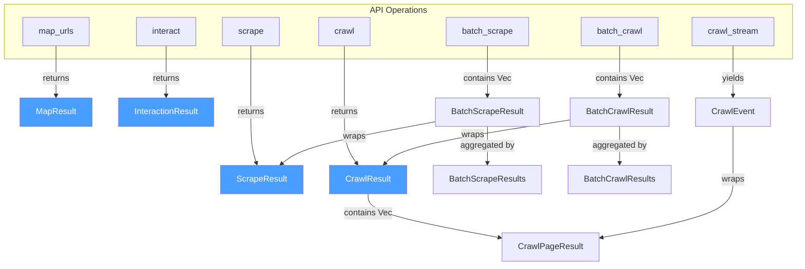
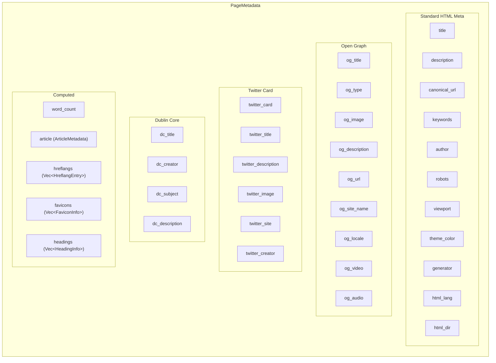
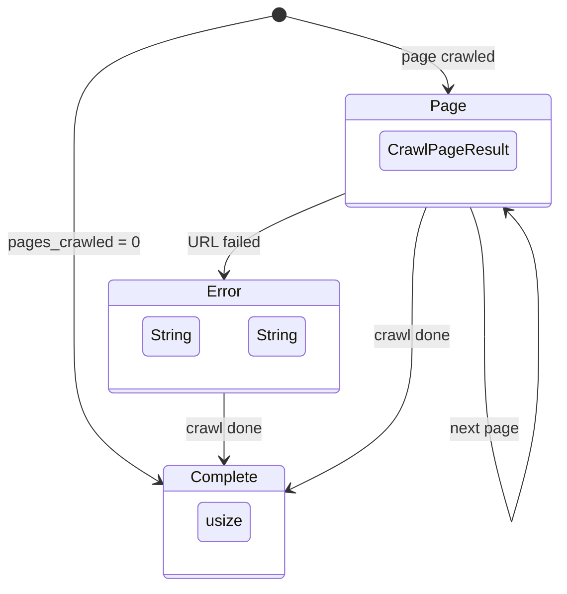
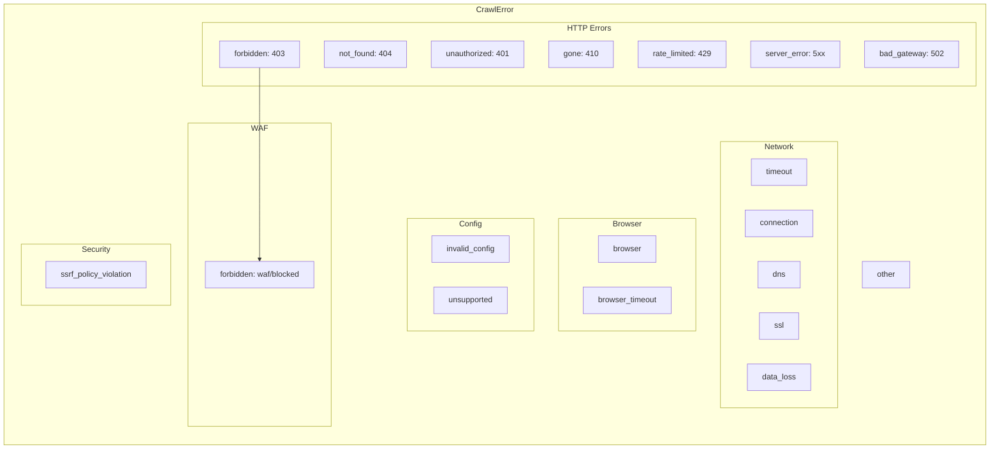

Crawlberg's result types are **language-agnostic, JSON-serializable structures** that flow identically across all 14+ language bindings. Every operation — scrape, crawl, map, interact — returns a strongly-typed result whose shape is defined once in Rust and projected into Python, Go, Node.js, Dart, Swift, and more through polyglot code generation. This page dissects the complete type hierarchy: primary results, nested metadata, discovery elements, streaming events, batch wrappers, and error classification.

## Primary Result Types

The engine exposes **five primary result types**, each corresponding to an API operation. They share a common anatomy: HTTP response data at the top, extracted semantic content in the middle, and operational flags (browser used, robots compliance, JS hints) at the bottom.

| Result Type | Operation | Top-Level Identity | Unique Fields |
|---|---|---|---|
| `ScrapeResult` | `scrape` | `final_url`, `status_code` | `browser`, `extracted_data`, `extraction_meta`, `response_meta` |
| `CrawlPageResult` | `crawl` (per-page) | `url`, `normalized_url`, `status_code` | `depth`, `stayed_on_domain` |
| `CrawlResult` | `crawl` (aggregate) | `pages[]`, `final_url` | `redirect_count`, `cookies`, `normalized_urls` |
| `MapResult` | `map_urls` | `urls[]` | `SitemapUrl` entries with `lastmod`, `changefreq`, `priority` |
| `InteractionResult` | `interact` | `action_results[]`, `final_html`, `final_url` | `screenshot` (optional PNG bytes) |

Sources: [types/results.rs](crates/crawlberg/src/types/results.rs#L1-L350)

The relationship between these types follows a clear containment hierarchy:

## ScrapeResult: The Universal Page Snapshot

`ScrapeResult` is the most field-rich type in the engine. It captures everything the scraping pipeline extracts from a single HTTP response, including the raw HTML, markdown conversion, metadata, links, images, feeds, JSON-LD structured data, downloaded assets, and optional browser-specific extras.

### Core Fields

| Field | Type | Description |
|---|---|---|
| `status_code` | `u16` | HTTP status code (200, 404, 503, etc.) |
| `final_url` | `String` | URL after following all redirects |
| `content_type` | `String` | Value of the `Content-Type` header |
| `html` | `String` | Raw HTML body of the response |
| `body_size` | `usize` | Response body size in bytes |
| `detected_charset` | `Option<String>` | Character encoding detected by the charset module |
| `auth_header_sent` | `bool` | Whether an authentication header was attached |

Sources: [types/results.rs](crates/crawlberg/src/types/results.rs#L80-L100)

### Semantic Extraction Fields

| Field | Type | Description |
|---|---|---|
| `metadata` | `PageMetadata` | Title, description, Open Graph, Twitter Card, Dublin Core, headings, favicons, word count |
| `links` | `Vec<LinkInfo>` | Resolved URLs with type classification (internal/external/anchor/document) |
| `images` | `Vec<ImageInfo>` | Image URLs with alt text, dimensions, and source attribution |
| `feeds` | `Vec<FeedInfo>` | RSS/Atom/JSON Feed discovery links |
| `json_ld` | `Vec<JsonLdEntry>` | Schema.org structured data (`@type`, `name`, raw JSON) |
| `markdown` | `Option<MarkdownResult>` | Converted markdown with document structure, tables, warnings, citations |
| `assets` | `Vec<DownloadedAsset>` | Downloaded CSS/JS/images with SHA-256 content hashes |

### Robots Compliance Fields

| Field | Type | Description |
|---|---|---|
| `is_allowed` | `bool` | Whether robots.txt permits crawling this URL |
| `crawl_delay` | `Option<u64>` | Crawl-delay from robots.txt, in seconds |
| `noindex_detected` | `bool` | Whether a `<meta name="robots" content="noindex">` directive was found |
| `nofollow_detected` | `bool` | Whether a `<meta name="robots" content="nofollow">` directive was found |
| `x_robots_tag` | `Option<String>` | Value of the `X-Robots-Tag` HTTP header |

### Operational Flags

| Field | Type | Description |
|---|---|---|
| `is_pdf` | `bool` | Whether the response content is a PDF document |
| `was_skipped` | `bool` | Whether the page was skipped (binary or PDF content) |
| `js_render_hint` | `bool` | Whether the engine detected indicators of client-side rendering |
| `browser_used` | `bool` | Whether the browser fallback tier was used to fetch this page |

### Optional Extension Fields

| Field | Type | Condition |
|---|---|---|
| `response_meta` | `Option<ResponseMeta>` | Present when HTTP header extraction is enabled |
| `extracted_data` | `Option<serde_json::Value>` | Present when LLM-based extraction is configured |
| `extraction_meta` | `Option<ExtractionMeta>` | Present when extraction is configured — cost, tokens, model, chunks |
| `screenshot` | `Option<Vec<u8>>` | PNG bytes — present when browser is used and `capture_screenshot` is enabled |
| `downloaded_document` | `Option<DownloadedDocument>` | Present when the response is a non-HTML document and `download_documents` is enabled |
| `browser` | `Option<BrowserExtras>` | Present when `BrowserBackend::Native` handled the request |

Sources: [types/results.rs](crates/crawlberg/src/types/results.rs#L100-L170)

## CrawlResult and CrawlPageResult

When the engine crawls a website, it produces a **hierarchical result**. `CrawlResult` is the top-level container returned by the `crawl` operation; it holds a `Vec<CrawlPageResult>` with one entry per visited page.

### CrawlResult (Aggregate)

| Field | Type | Description |
|---|---|---|
| `pages` | `Vec<CrawlPageResult>` | All crawled pages, in visit order |
| `final_url` | `String` | Final URL after redirect following on the seed URL |
| `redirect_count` | `usize` | Number of redirects followed to reach the seed page |
| `was_skipped` | `bool` | Whether any page was skipped during crawling |
| `error` | `Option<String>` | Error message if the crawl encountered a problem |
| `cookies` | `Vec<CookieInfo>` | Cookies collected across all pages |
| `stayed_on_domain` | `bool` | Whether all pages remained on the same domain as the seed |
| `browser_used` | `bool` | Whether any page used the browser fallback tier |
| `normalized_urls` | `Vec<String>` | Normalized URLs encountered (excluded from JSON serialization) |

The `unique_normalized_urls()` method computes the count of distinct normalized URLs, useful for deduplication statistics in crawl reports.

Sources: [types/results.rs](crates/crawlberg/src/types/results.rs#L220-L260)

### CrawlPageResult (Per-Page)

`CrawlPageResult` extends the scrape-extraction fields with crawl-specific metadata. It shares most fields with `ScrapeResult` (metadata, links, images, feeds, JSON-LD, markdown, extracted data) but adds:

| Crawl-Specific Field | Type | Description |
|---|---|---|
| `url` | `String` | The original URL of the page |
| `normalized_url` | `String` | The URL after normalization (trailing slash, fragment stripping) |
| `depth` | `usize` | Number of link hops from the seed URL |
| `stayed_on_domain` | `bool` | Whether this individual page is on the same domain as the seed |

Sources: [types/results.rs](crates/crawlberg/src/types/results.rs#L145-L200)

## MapResult and SitemapUrl

`MapResult` is the simplest primary result type. It contains a flat list of `SitemapUrl` entries discovered from the site's HTML links, sitemaps, and `robots.txt` references.

| Field | Type | Description |
|---|---|---|
| `urls` | `Vec<SitemapUrl>` | Discovered URLs |

Each `SitemapUrl` entry carries optional sitemap metadata:

| Field | Type | Description |
|---|---|---|
| `url` | `String` | The discovered URL |
| `lastmod` | `Option<String>` | Last modification date from `<lastmod>` |
| `changefreq` | `Option<String>` | Change frequency hint (`daily`, `weekly`, etc.) |
| `priority` | `Option<String>` | Priority hint (`0.8`, `1.0`, etc.) |

Sources: [types/results.rs](crates/crawlberg/src/types/results.rs#L268-L290)

## InteractionResult: Browser Automation Output

`InteractionResult` captures the outcome of executing a sequence of page actions (click, type, scroll, wait, execute JS, screenshot).

| Field | Type | Description |
|---|---|---|
| `action_results` | `Vec<ActionResult>` | Individual results for each action in the sequence |
| `final_html` | `String` | Page HTML after all actions completed |
| `final_url` | `String` | Page URL after all actions (may have changed due to navigation) |
| `screenshot` | `Option<Vec<u8>>` | Full-page screenshot PNG bytes (if requested) |

Each `ActionResult` records:

| Field | Type | Description |
|---|---|---|
| `action_index` | `usize` | Zero-based position in the action sequence |
| `action_type` | `Cow<'static, str>` | Action type name (`click`, `type`, `scroll`, `wait`, `execute_js`, `screenshot`, `press_key`) |
| `success` | `bool` | Whether the action completed without error |
| `data` | `Option<serde_json::Value>` | Action-specific return data (screenshot bytes, JS return value, scraped HTML) |
| `error` | `Option<String>` | Error message if the action failed |

Sources: [types/results.rs](crates/crawlberg/src/types/results.rs#L50-L80)

## MarkdownResult: Rich Conversion Output

`MarkdownResult` wraps the output of the HTML-to-Markdown conversion pipeline. It goes beyond plain text by providing structured document information.

| Field | Type | Description |
|---|---|---|
| `content` | `String` | The converted markdown text |
| `document_structure` | `Option<serde_json::Value>` | Semantic document tree (headings, paragraphs, lists) |
| `tables` | `Vec<serde_json::Value>` | Extracted tables with structured cell data |
| `warnings` | `Vec<String>` | Non-fatal processing warnings |
| `citations` | `bool` | Whether citation conversion was applied and produced references |
| `fit_content` | `Option<String>` | Content-filtered markdown optimized for LLM consumption |

Sources: [types/results.rs](crates/crawlberg/src/types/results.rs#L296-L320)

## PageMetadata: The Semantic Core

`PageMetadata` is the most field-dense nested type in the engine. It aggregates metadata from multiple sources: standard `<meta>` tags, Open Graph protocol, Twitter Cards, Dublin Core, and computed properties.

Sources: [types/metadata.rs](crates/crawlberg/src/types/metadata.rs#L1-L170)

### Supporting Metadata Types

| Type | Purpose | Key Fields |
|---|---|---|
| `ArticleMetadata` | `article:*` Open Graph tags | `published_time`, `modified_time`, `author`, `section`, `tags` |
| `HreflangEntry` | Internationalization links | `lang`, `url` |
| `FaviconInfo` | Icon/favicon references | `url`, `rel`, `sizes`, `mime_type` |
| `HeadingInfo` | Document structure | `level` (1-6), `text` |
| `ResponseMeta` | HTTP header metadata | `etag`, `last_modified`, `cache_control`, `server`, `content_encoding` |
| `ExtractionMeta` | LLM extraction provenance | `cost`, `prompt_tokens`, `completion_tokens`, `model`, `chunks_processed` |

Sources: [types/metadata.rs](crates/crawlberg/src/types/metadata.rs#L1-L80), [types/config.rs](crates/crawlberg/src/types/config.rs#L1-L40)

## Discovery Types: Links, Images, Feeds, and Assets

These types represent the content elements extracted from HTML pages during scraping and crawling.

### LinkInfo and LinkType

Every `<a>` tag on a page produces a `LinkInfo` entry with a resolved URL and a classification.

| `LinkType` Variant | Description | Example |
|---|---|---|
| `Internal` | Same domain as the source page | `/about`, `/blog/post-1` |
| `External` | Different domain | `https://example.com` |
| `Anchor` | Fragment-only link | `#section-2` |
| `Document` | Downloadable file (PDF, DOC, etc.) | `/files/report.pdf` |

| LinkInfo Field | Type | Description |
|---|---|---|
| `url` | `String` | Resolved absolute URL |
| `text` | `String` | Visible anchor text |
| `link_type` | `LinkType` | Classification |
| `rel` | `Option<String>` | Raw `rel` attribute value |
| `nofollow` | `bool` | Whether `rel="nofollow"` is present |

Sources: [types/discovery.rs](crates/crawlberg/src/types/discovery.rs#L1-L75)

### ImageInfo and ImageSource

Images are attributed to their HTML source, enabling downstream consumers to distinguish editorial content from social metadata.

| `ImageSource` Variant | Description |
|---|---|
| `Img` | Standard `` tag |
| `PictureSource` | `<source>` inside `<picture>` |
| `OgImage` | `og:image` meta tag |
| `TwitterImage` | `twitter:image` meta tag |

### DownloadedAsset and AssetCategory

When `download_assets` is enabled, the engine downloads referenced resources and records them as `DownloadedAsset` entries with content hashes for deduplication.

| `AssetCategory` | MIME Pattern |
|---|---|
| `Document` | `application/pdf`, `application/msword`, etc. |
| `Image` | `image/*` |
| `Audio` | `audio/*` |
| `Video` | `video/*` |
| `Font` | `font/*`, `application/font-*` |
| `Stylesheet` | `text/css` |
| `Script` | `application/javascript` |
| `Archive` | `application/zip`, `application/gzip` |
| `Data` | `application/json`, `application/xml`, `text/csv` |
| `Other` | Unrecognized MIME types |

Sources: [types/discovery.rs](crates/crawlberg/src/types/discovery.rs#L150-L230)

## DownloadedDocument: Non-HTML Content

When `download_documents` is enabled, non-HTML responses (PDF, DOCX, images, code files) are captured as `DownloadedDocument` entries rather than being skipped.

| Field | Type | Description |
|---|---|---|
| `url` | `String` | Original fetch URL |
| `mime_type` | `Cow<'static, str>` | MIME type (charset parameter stripped) |
| `content` | `Vec<u8>` | Raw bytes (excluded from JSON serialization) |
| `size` | `usize` | Byte count (may be capped at `document_max_size`) |
| `filename` | `Option<Box<str>>` | Extracted from `Content-Disposition` or URL path |
| `content_hash` | `Box<str>` | SHA-256 hex digest (64 characters) |
| `headers` | `HashMap<Box<str>, Box<str>>` | Selected response headers |

The default maximum document size is 50 MB. The `content` field is excluded from JSON serialization via `#[serde(skip)]` to prevent unbounded serialization of binary data across FFI boundaries.

Sources: [types/results.rs](crates/crawlberg/src/types/results.rs#L30-L50), [document.rs](crates/crawlberg/src/document.rs#L38-L85)

## Batch Results and Streaming Events

### Batch Wrappers

Batch operations aggregate per-URL results into structs with precomputed counts:

| Type | Contains | Counts |
|---|---|---|
| `BatchScrapeResult` | `url`, `result: Option<ScrapeResult>`, `error: Option<String>` | — |
| `BatchScrapeResults` | `results: Vec<BatchScrapeResult>` | `total_count`, `completed_count`, `failed_count` |
| `BatchCrawlResult` | `url`, `result: Option<CrawlResult>`, `error: Option<String>` | — |
| `BatchCrawlResults` | `results: Vec<BatchCrawlResult>` | `total_count`, `completed_count`, `failed_count` |

The aggregate types (`BatchScrapeResults`, `BatchCrawlResults`) derive their counts once at construction, allowing binding languages to read them as plain integer fields without re-iterating the results vector.

Sources: [bindings.rs](crates/crawlberg/src/bindings.rs#L170-L260)

### CrawlEvent (Streaming)

For streaming crawl operations, pages are delivered incrementally as `CrawlEvent` enum variants:

| Variant | Payload | When Emitted |
|---|---|---|
| `Page` | `result: Box<CrawlPageResult>` | Each page successfully crawled |
| `Error` | `url: String`, `error: String` | A URL fails during the crawl |
| `Complete` | `pages_crawled: usize` | The crawl has finished |

Streaming is not available on `wasm32` targets, as it requires native concurrency primitives (tokio channels, `JoinSet`).

Sources: [types/discovery.rs](crates/crawlberg/src/types/discovery.rs#L232-L263), [types/streaming.rs](crates/crawlberg/src/types/streaming.rs#L1-L29)

## Error Classification: CrawlError

`CrawlError` is the unified error type returned by all operations. Each variant carries a stable, language-agnostic tag that appears in the error message for cross-language log matching.

The `NetworkErrorKind` enum provides finer-grained classification for network-level failures:

| Variant | Tag | Detection |
|---|---|---|
| `Connection` | `"connection"` | TCP refusal or unreachable |
| `Dns` | `"dns"` | Name resolution failure |
| `Ssl` | `"ssl"` | TLS handshake or certificate error |
| `Timeout` | `"timeout"` | Deadline exceeded |
| `Proxy` | `"proxy"` | Proxy configuration or communication error |
| `Other` | `"network"` | Unclassified network error |

Sources: [error.rs](crates/crawlberg/src/error.rs#L1-L200)

## CookieInfo

Cookies are tracked across both HTTP responses and browser sessions, enabling session-aware crawling.

| Field | Type | Description |
|---|---|---|
| `name` | `String` | Cookie name |
| `value` | `String` | Cookie value |
| `domain` | `Option<String>` | Domain scope |
| `path` | `Option<String>` | Path scope |

Cookies appear in `ScrapeResult` (per-page via `BrowserExtras`), `CrawlResult` (aggregated across all pages), and are persisted when browser profiles are used.

Sources: [types/discovery.rs](crates/crawlberg/src/types/discovery.rs#L130-L150)

## BrowserExtras: Native Backend Metadata

When the native browser backend (`BrowserBackend::Native`) handles a request, `ScrapeResult.browser` is populated with `BrowserExtras`:

| Field | Type | Description |
|---|---|---|
| `eval_result` | `Option<serde_json::Value>` | Return value of `BrowserConfig.eval_script` |
| `network_events` | `Vec<ResponseMeta>` | Full network event stream (when `capture_network_events` is true) |
| `cookies` | `Vec<CookieInfo>` | All non-expired cookies in the browser jar after navigation |

Sources: [types/results.rs](crates/crawlberg/src/types/results.rs#L15-L30)

## CachedPage: Internal Cache Entry

`CachedPage` is used internally by the `CrawlCache` trait for HTTP response caching. It is **not part of the polyglot binding surface** and is excluded from alef-generated bindings.

| Field | Type | Description |
|---|---|---|
| `url` | `String` | Absolute URL |
| `status_code` | `u16` | HTTP status at cache time |
| `content_type` | `String` | Content-Type header |
| `body` | `String` | Raw response body |
| `etag` | `Option<String>` | ETag for conditional revalidation |
| `last_modified` | `Option<String>` | Last-Modified for conditional revalidation |
| `cached_at` | `u64` | Unix timestamp (seconds) |

Sources: [types/results.rs](crates/crawlberg/src/types/results.rs#L330-L350)

## CitationResult: LLM-Optimized Link Conversion

`CitationResult` transforms inline markdown links into numbered citations, a format preferred by LLM consumption pipelines.

| Field | Type | Description |
|---|---|---|
| `content` | `String` | Markdown with `[text](url)` replaced by `text[N]` |
| `references` | `Vec<CitationReference>` | Numbered reference list |

Each `CitationReference` contains `index` (1-based), `url`, and `text`. Duplicate URLs receive the same index number.

Sources: [citations.rs](crates/crawlberg/src/citations.rs#L1-L80)

## Serialization Patterns

All result types use consistent serialization strategies to ensure cross-language compatibility:

| Pattern | Implementation | Purpose |
|---|---|---|
| `#[serde(deny_unknown_fields)]` | All primary types | Prevents silent field drift between schema and serialization |
| `#[serde(skip)]` | `screenshot`, `content` fields | Excludes large binary data from JSON across FFI |
| `#[serde(skip_serializing_if = "Option::is_none")]` | Optional extension fields | Omits unset fields from output |
| `#[serde(rename_all = "snake_case")]` | All enums | Consistent lowercase variant names |
| `#[cfg_attr(feature = "mcp", derive(schemars::JsonSchema))]` | All types | Generates JSON Schema for MCP tool output schemas |

Sources: [types/results.rs](crates/crawlberg/src/types/results.rs#L1-L10), [types/discovery.rs](crates/crawlberg/src/types/discovery.rs#L1-L10)

## Next Steps

- [Configuration Reference (CrawlConfig)](11-configuration-reference-crawlconfig) — Full field-by-field reference for the configuration objects that control result generation
- [HTML Parsing and Content Extraction](13-html-parsing-and-content-extraction) — How raw HTML becomes `PageMetadata`, `LinkInfo`, `ImageInfo`, and other discovery types
- [Markdown Conversion Pipeline](14-markdown-conversion-pipeline) — The conversion engine that produces `MarkdownResult` from HTML
- [Architecture and Data Flow](9-architecture-and-data-flow) — System-level view of how data flows through the engine's trait-based pipeline