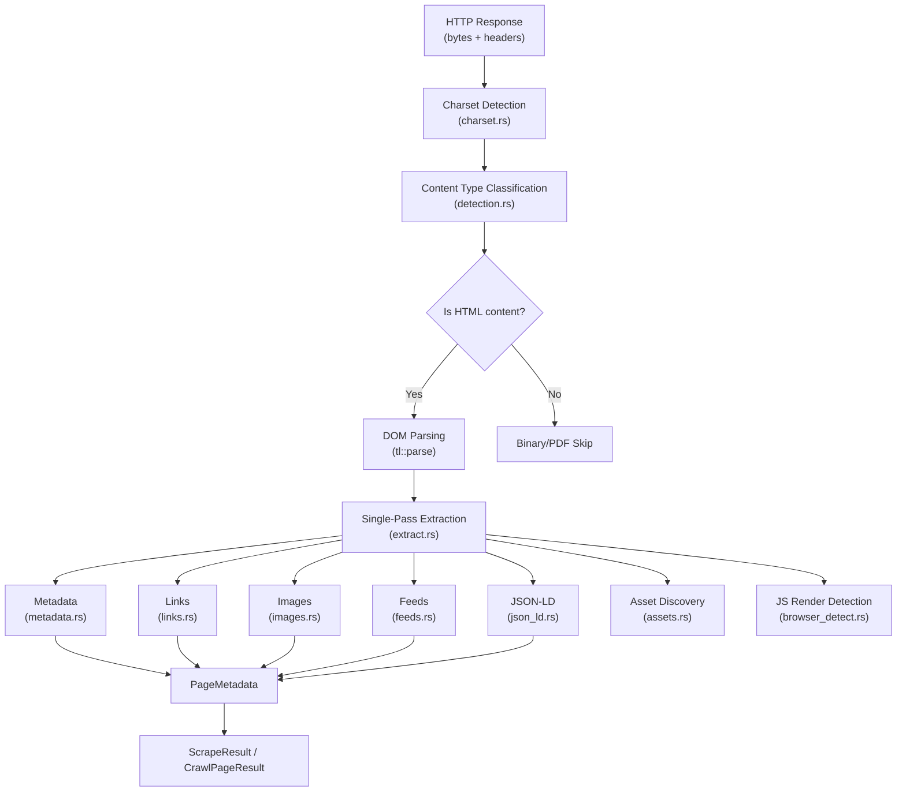
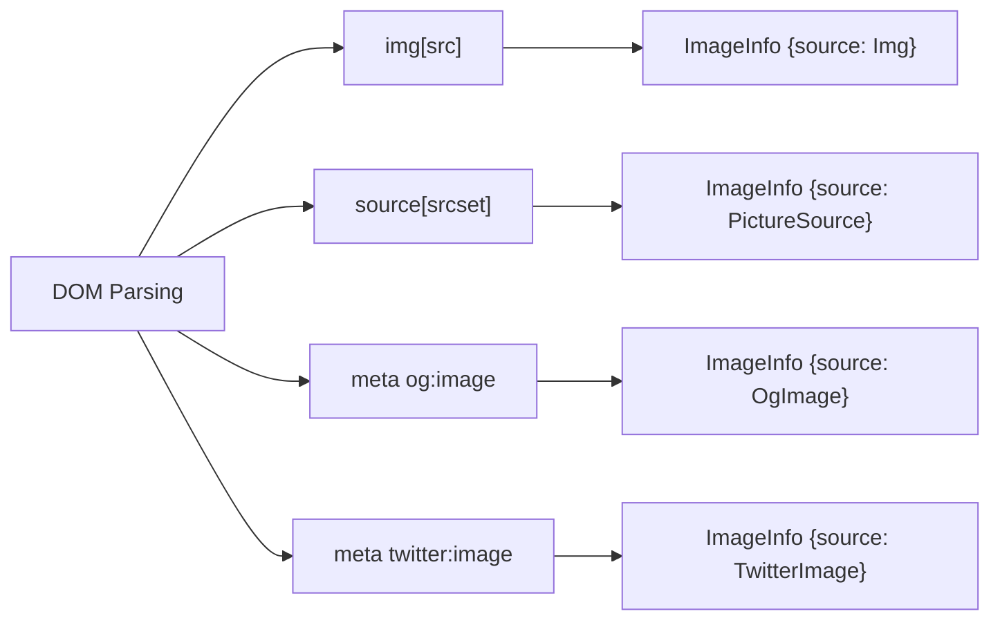

Crawlberg's HTML parsing and content extraction pipeline transforms raw HTTP response bodies into structured data through a multi-phase, single-pass architecture. The pipeline is designed around a central principle: **parse the DOM once, extract everything in one traversal**, then let downstream consumers (markdown conversion, link discovery, SEO analysis) consume the already-extracted results without re-parsing.

The `html/` module ([mod.rs](crates/crawlberg/src/html/mod.rs#L1-L59)) serves as the public surface of this subsystem, re-exporting a curated set of functions while keeping internal helpers private to the crate.

## Architecture Overview

The extraction pipeline follows a layered design where raw bytes flow through charset detection, content type classification, DOM parsing, and structured extraction stages. Each layer adds information without modifying the original content, enabling independent testing and selective feature usage.



Sources: [mod.rs](crates/crawlberg/src/html/mod.rs#L1-L59), [extract.rs](crates/crawlberg/src/html/extract.rs#L1-L76)

## DOM Parsing Engine: `tl`

Crawlberg uses the [`tl`](https://docs.rs/tl) crate as its HTML parser. Unlike DOM libraries that build tree structures with owned data, `tl` produces a **borrowed virtual DOM** (`VDom`) that references the original HTML string. This design choice has two significant implications for the extraction pipeline:

1. **Zero-copy parsing**: The DOM nodes borrow directly from the input `&str`, eliminating allocation overhead for the HTML content itself.
2. **Lifetime-coupled extraction**: All extraction functions must operate within the same scope as the parsed body, which is why the crawl loop uses `spawn_blocking` to run extraction in a blocking context where the borrow checker constraints are satisfied.

The parser is invoked with default options in two locations — the single-page scrape path and the concurrent crawl loop:

```rust
let doc = tl::parse(&body, ParserOptions::default())
    .map_err(|e| CrawlError::Other(format!("HTML parse error: {e:?}")))?;
```

All CSS selectors are stored as `&str` constants in [selectors.rs](crates/crawlberg/src/html/selectors.rs#L1-L39) rather than pre-compiled objects, because `tl` re-parses selectors on each `query_selector` call. The constants are organized by extraction domain (metadata, links, images, feeds, etc.).

Sources: [selectors.rs](crates/crawlberg/src/html/selectors.rs#L1-L39), [scrape.rs](crates/crawlberg/src/scrape.rs#L118-L120), [crawl_loop.rs](crates/crawlberg/src/engine/crawl_loop.rs#L300-L310)

## Content Type Detection

Before any parsing occurs, the pipeline classifies the response into one of several content categories. This classification determines whether HTML parsing proceeds at all, and whether the result is a structured page or a raw document download.

The [detection.rs](crates/crawlberg/src/html/detection.rs#L1-L166) module implements a multi-signal classification system:

| Detection Method | Function | Signals Used |
|---|---|---|
| HTML detection | `is_html_content` | Content-Type header + body sniffing |
| Binary detection | `is_binary_content_type` | Content-Type MIME prefix matching |
| Binary URL detection | `is_binary_url` | File extension matching against 120+ extensions |
| PDF detection | `is_pdf_content` | Content-Type + `%PDF` magic bytes |
| PDF URL detection | `is_pdf_url` | `.pdf` extension check |

The `is_html_content` function [implements body-sniffing heuristics](crates/crawlberg/src/html/detection.rs#L28-L47) that look for common HTML root elements (`<!doctype>`, `<html>`, `<head>`, `<body>`, `<div>`, `<p>`, `<h1>`, `<script>`, `<meta>`, `<link>`, and HTML comments). Notably, it explicitly rejects XML that lacks an `<html>` tag, preventing XML feeds from being misclassified as HTML pages.

Sources: [detection.rs](crates/crawlberg/src/html/detection.rs#L22-L47), [detection.rs](crates/crawlberg/src/html/detection.rs#L50-L65)

## Character Encoding Detection

The [charset.rs](crates/crawlberg/src/html/charset.rs#L1-L58) module implements a three-tier encoding detection strategy that handles the most common real-world encoding scenarios:

1. **Content-Type header charset**: Parses `charset=` from the `Content-Type` header, handling quoted values and trailing semicolons.
2. **HTML meta tag charset**: Searches the first 2,048 bytes of the body for `<meta charset="...">` declarations, using case-insensitive ASCII byte comparison.
3. **UTF-8 BOM detection**: Checks for the Unicode Byte Order Mark (`\u{FEFF}`) at the start of the body.

Once detected, the encoding is resolved through `encoding_rs::Encoding::for_label` and applied to transcode the raw bytes into a UTF-8 `String`. Non-UTF-8, non-US-ASCII encodings (such as ISO-8859-1 or Shift_JIS) are decoded before DOM parsing, ensuring the `tl` parser always receives valid UTF-8 input.

Sources: [charset.rs](crates/crawlberg/src/html/charset.rs#L8-L42), [scrape.rs](crates/crawlberg/src/scrape.rs#L80-L93)

## Single-Pass Extraction Pipeline

The [extract.rs](crates/crawlberg/src/html/extract.rs#L1-L76) module orchestrates the core extraction logic. The `extract_page_data` function is the single entry point that performs all structured data extraction in one DOM traversal:

```rust
pub(crate) fn extract_page_data(
    dom: &VDom<'_>,
    body: &str,
    base_url: &Url,
    is_html: bool,
    include_extended: bool,
) -> HtmlExtraction
```

The `include_extended` parameter controls whether extended metadata (hreflangs, favicons, headings, word count) is extracted. During **crawling**, this is set to `false` to minimize per-page overhead — the crawl loop only needs links for URL frontier expansion. During **scraping**, it is set to `true` to provide the full metadata payload.

The `HtmlExtraction` struct bundles all extracted data:

| Field | Type | Source Module | Always Populated |
|---|---|---|---|
| `metadata` | `PageMetadata` | metadata.rs | Yes |
| `links` | `Vec<LinkInfo>` | links.rs | Yes |
| `images` | `Vec<ImageInfo>` | images.rs | Yes |
| `feeds` | `Vec<FeedInfo>` | feeds.rs | Yes |
| `json_ld` | `Vec<JsonLdEntry>` | json_ld.rs | Yes |

When `is_html` is false (binary/PDF content), the function returns defaults for all fields — an empty `PageMetadata` and empty vectors — without attempting any DOM traversal.

Sources: [extract.rs](crates/crawlberg/src/html/extract.rs#L30-L76), [crawl_loop.rs](crates/crawlberg/src/engine/crawl_loop.rs#L300-L310), [scrape.rs](crates/crawlberg/src/scrape.rs#L118-L130)

## Metadata Extraction

The [metadata.rs](crates/crawlberg/src/html/metadata.rs#L1-L212) module extracts over 40 metadata fields from HTML documents, organized into seven categories:

### Extraction Strategy

The module employs a **dual-strategy approach** for maximum resilience:

1. **DOM-based extraction** (primary): Uses `tl`'s `query_selector` to find `<meta>`, `<title>`, `<link rel="canonical">`, and `<html>` tags, then reads their attributes. This handles well-formed HTML efficiently.

2. **Regex fallback** (secondary): For malformed HTML where DOM parsing fails to extract critical meta tags, two regex patterns (`META_RE_NAME_CONTENT` and `META_RE_CONTENT_NAME`) scan the raw HTML body. This fallback only applies to five high-value fields: `description`, `og:title`, `og:description`, `twitter:title`, and `twitter:description` — fields where SEO visibility depends on extraction completeness.

### Metadata Categories

| Category | Fields | Source |
|---|---|---|
| **Core** | title, description, keywords, author, canonical_url, viewport, theme_color, generator, robots | `<meta name="...">` + `<title>` |
| **HTML attributes** | html_lang, html_dir | `<html lang="..." dir="...">` |
| **Open Graph** | og_title, og_type, og_image, og_description, og_url, og_site_name, og_locale, og_video, og_audio, og_locale_alternates | `<meta property="og:*">` |
| **Article** | published_time, modified_time, author, section, tags | `<meta property="article:*">` |
| **Twitter Card** | twitter_card, twitter_title, twitter_description, twitter_image, twitter_site, twitter_creator | `<meta name="twitter:*">` |
| **Dublin Core** | dc_title, dc_creator, dc_subject, dc_description, dc_publisher, dc_date, dc_type, dc_format, dc_identifier, dc_language, dc_rights | `<meta name="dc.*">` |
| **Extended** | hreflangs, favicons, headings, word_count | Various `<link>` and heading elements |

The `PageMetadata` struct ([types/metadata.rs](crates/crawlberg/src/types/metadata.rs#L100-L170)) provides `Option<T>` wrappers for all fields, allowing consumers to distinguish between "not present" and "empty value."

Sources: [metadata.rs](crates/crawlberg/src/html/metadata.rs#L44-L170), [types/metadata.rs](crates/crawlberg/src/types/metadata.rs#L100-L170)

## Link Extraction and Classification

The [links.rs](crates/crawlberg/src/html/links.rs#L1-L121) module extracts and classifies all hyperlinks from `<a href="...">` elements. The extraction process handles several real-world complexities:

### Base Tag Resolution

Before processing any links, the extractor checks for a `<base href="...">` element. When present, all relative URLs are resolved against this base rather than the page URL. This is critical for correctly handling sites that use `<base>` tags (common in CMS platforms and single-page applications).

### Link Classification

Each link is classified into one of four types based on the resolved URL:

| Link Type | Condition | Example |
|---|---|---|
| `Internal` | Same host as base URL | `https://example.com/about` |
| `External` | Different host | `https://other.com/page` |
| `Anchor` | Fragment-only (`#section`) | `#top` |
| `Document` | File extension in document list | `report.pdf` |

The document extension list [includes 17 common formats](crates/crawlberg/src/html/links.rs#L7-L13): `.pdf`, `.doc`, `.docx`, `.xls`, `.xlsx`, `.ppt`, `.pptx`, `.odt`, `.ods`, `.odp`, `.rtf`, `.csv`, `.txt`, `.zip`, `.tar`, `.gz`, `.rar`.

### Link Filtering

Links are filtered during extraction to exclude:
- `mailto:` links
- `javascript:` links
- `tel:` links
- `data:` links
- Empty `href` values

Each extracted `LinkInfo` includes the resolved URL, visible text, link type, `rel` attribute, and a `nofollow` boolean derived from the `rel` attribute.

Sources: [links.rs](crates/crawlberg/src/html/links.rs#L1-L121), [types/discovery.rs](crates/crawlberg/src/types/discovery.rs#L1-L100)

## Image Extraction

The [images.rs](crates/crawlberg/src/html/images.rs#L1-L105) module extracts images from four distinct HTML sources, each mapped to a typed `ImageSource` enum:



For `` tags, the extractor captures `src`, `alt`, `width`, and `height` attributes. For `<source>` elements, only the first URL from the `srcset` attribute is extracted (a pragmatic choice that avoids the complexity of resolution-width matching). Data URIs (`data:`) are explicitly excluded to avoid capturing inline base64-encoded images.

All extracted URLs are resolved against the base URL using [the shared `resolve_url` helper](crates/crawlberg/src/html/mod.rs#L7-L12).

Sources: [images.rs](crates/crawlberg/src/html/images.rs#L1-L105), [types/discovery.rs](crates/crawlberg/src/types/discovery.rs#L102-L140)

## Feed Discovery

The [feeds.rs](crates/crawlberg/src/html/feeds.rs#L1-L36) module identifies syndication feeds by querying `<link rel="alternate">` elements and matching their `type` attribute against known feed MIME types:

| Feed Type | MIME Type | Enum Variant |
|---|---|---|
| RSS | `application/rss+xml` | `FeedType::Rss` |
| Atom | `application/atom+xml` | `FeedType::Atom` |
| JSON Feed | `application/json` or `application/feed+json` | `FeedType::JsonFeed` |

This data enables downstream consumers to discover a site's syndication feeds without parsing `robots.txt` or performing separate HTTP requests.

Sources: [feeds.rs](crates/crawlberg/src/html/feeds.rs#L14-L36)

## JSON-LD Structured Data

The [json_ld.rs](crates/crawlberg/src/html/json_ld.rs#L1-L28) module extracts structured data from `<script type="application/ld+json">` elements. For each script block, the module:

1. Extracts the raw text content
2. Parses it as JSON via `serde_json`
3. Extracts the `@type` and `name` fields (if present)
4. Preserves the raw JSON string for consumers that need the full schema.org object

This approach provides both structured access to common fields and full fidelity for downstream consumers that need the complete JSON-LD payload.

Sources: [json_ld.rs](crates/crawlberg/src/html/json_ld.rs#L1-L28)

## Extended Metadata Extraction

When `include_extended` is true (typically during scraping, not crawling), the pipeline extracts additional SEO and structural metadata through four specialized extractors in [feeds.rs](crates/crawlberg/src/html/feeds.rs#L38-L114):

| Extractor | Selector | Output |
|---|---|---|
| `extract_hreflangs` | `link[rel='alternate'][hreflang]` | `Vec<HreflangEntry>` |
| `extract_favicons` | `link[rel='icon'], link[rel='shortcut icon'], link[rel='apple-touch-icon']` | `Vec<FaviconInfo>` |
| `extract_headings` | `h1, h2, h3, h4, h5, h6` | `Vec<HeadingInfo>` |
| `compute_word_count` | `body` inner text → split whitespace | `usize` |

The word count is computed by the [content.rs](crates/crawlberg/src/html/content.rs#L1-L18) module, which extracts the inner text of the `<body>` element and counts whitespace-delimited tokens. This count serves dual purposes: it appears in the metadata output, and it is used by the JS render detection heuristic (pages with fewer than 50 words may be SPA shells).

Sources: [feeds.rs](crates/crawlberg/src/html/feeds.rs#L38-L114), [content.rs](crates/crawlberg/src/html/content.rs#L1-L18)

## Asset Discovery and Downloading

The [assets.rs](crates/crawlberg/src/assets.rs#L1-L175) module extends beyond metadata extraction to discover and optionally download page assets (CSS stylesheets, JavaScript files, and images). Asset discovery uses three CSS selectors:

| Asset Type | Selector | HTML Tag |
|---|---|---|
| Stylesheet | `link[rel='stylesheet'][href]` | `<link>` |
| Script | `script[src]` | `<script>` |
| Image | `img[src]` | `` |

When `config.download_assets` is enabled, discovered assets are downloaded concurrently (bounded by `max_concurrent`), deduplicated by URL, filtered by `config.asset_types`, and capped by `config.max_asset_size`. Each downloaded asset is assigned a SHA-256 content hash for integrity tracking.

Sources: [assets.rs](crates/crawlberg/src/assets.rs#L30-L75), [assets.rs](crates/crawlberg/src/assets.rs#L110-L175)

## Robots Directive Detection

The metadata module also handles search engine directive detection through three mechanisms:

1. **Meta robots tag**: `detect_noindex` and `detect_nofollow` functions parse `<meta name="robots">` content for `noindex` and `nofollow` directives.
2. **HTTP X-Robots-Tag header**: Checked at the crawl loop level before DOM parsing, with the same directive detection logic.
3. **Meta refresh redirect**: `detect_meta_refresh` extracts the target URL from `<meta http-equiv="refresh">` tags, supporting the redirect-following logic in the crawl loop.

These directives influence both the crawl frontier (nofollow pages don't yield new URLs to visit) and the output metadata (noindex is flagged on the result).

Sources: [metadata.rs](crates/crawlberg/src/html/metadata.rs#L175-L195), [metadata.rs](crates/crawlberg/src/html/metadata.rs#L198-L212)

## Integration with Downstream Systems

The HTML extraction pipeline feeds into several downstream systems within crawlberg:

| Consumer | Input from Extraction | Purpose |
|---|---|---|
| **Markdown conversion** | Raw HTML body | Converts HTML to markdown via `html_to_markdown_rs` |
| **JS render detection** | Body text + word count | Detects SPA shells needing browser rendering |
| **Crawl frontier** | Links + nofollow flag | Populates URL queue for multi-page crawling |
| **Document download** | Content-type + binary classification | Downloads non-HTML resources when enabled |
| **Content pruning** | Markdown output | Removes boilerplate for LLM-optimized output |

The `ContentConfig` struct ([config.rs](crates/crawlberg/src/types/config.rs#L163-L220)) controls how the markdown conversion stage processes the HTML, with options for preprocessing aggressiveness, tag stripping, selector-based exclusion, and output format selection.

Sources: [scrape.rs](crates/crawlberg/src/scrape.rs#L130-L173), [browser_detect.rs](crates/crawlberg/src/browser_detect.rs#L1-L80), [pruning.rs](crates/crawlberg/src/pruning.rs#L1-L151), [config.rs](crates/crawlberg/src/types/config.rs#L163-L220)

## Next Steps

- [Markdown Conversion Pipeline](14-markdown-conversion-pipeline) — How raw HTML becomes structured markdown output
- [Configuration Reference (CrawlConfig)](11-configuration-reference-crawlconfig) — Full reference for `ContentConfig` and extraction options
- [Result Types and Data Models](12-result-types-and-data-models) — Detailed documentation of `PageMetadata`, `LinkInfo`, and other extraction output types
- [Browser Rendering Backends](21-browser-rendering-backends) — When and how the pipeline falls back to headless browser rendering