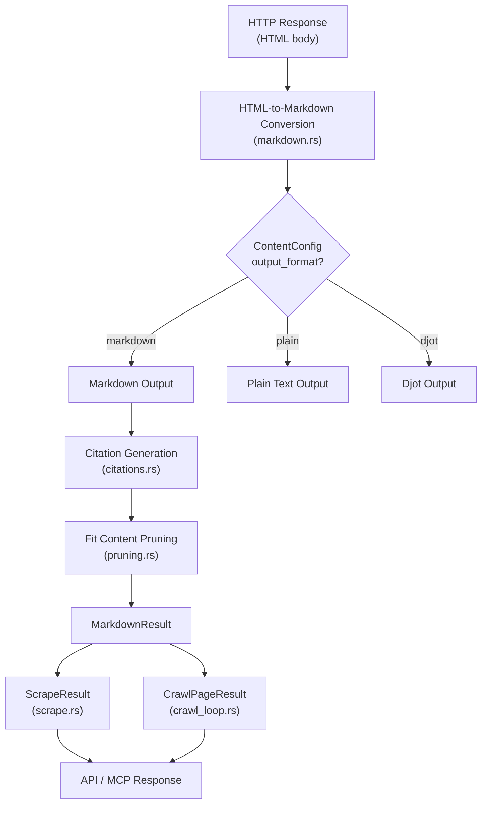

Crawlberg's Markdown Conversion Pipeline transforms raw HTML content into clean, structured Markdown optimized for both human reading and LLM consumption. The pipeline operates as a **three-stage post-processing system** — HTML conversion, citation normalization, and content pruning — that runs automatically on every scraped or crawled page. This always-active design means Markdown output is available without explicit opt-in, ensuring AI-ready content is the default rather than an afterthought.

## Architecture Overview

The pipeline integrates into the content extraction flow as a parallel output channel alongside the raw HTML. Rather than replacing HTML extraction, it produces a rich `MarkdownResult` that coexists with the original markup. The design philosophy is **additive transformation** — each stage enriches the content without discarding the source material.



The pipeline executes synchronously within a blocking task (on native targets) to avoid blocking the async runtime during CPU-intensive conversion work. On WASM targets, it runs synchronously within the single-threaded execution context.

Sources: [markdown.rs](crates/crawlberg/src/markdown.rs#L1-L50), [scrape.rs](crates/crawlberg/src/scrape.rs#L135-L140)

## HTML-to-Markdown Conversion Engine

The core conversion is delegated to the [`html-to-markdown-rs`](https://crates.io/crates/html-to-markdown-rs) crate, which performs semantic HTML parsing and element-by-element conversion. Crawlberg configures this engine through the `ContentConfig` struct, which exposes fine-grained control over preprocessing aggressiveness, output format, and element handling.

### Conversion Flow

The conversion process follows these sequential steps:

1. **Preprocessing Preset Selection**: The `preprocessing_preset` field maps to one of three aggressiveness levels that determine how much boilerplate is stripped before conversion.
2. **Output Format Configuration**: The engine supports three output formats, each targeting different downstream use cases.
3. **Element Handling Rules**: Custom rules for stripping, preserving, or excluding specific HTML elements.
4. **Document Structure Extraction**: When enabled, produces a hierarchical document tree alongside the flat Markdown.

The `convert_html_to_markdown` function constructs `ConversionOptions` from the configuration and delegates to `html_to_markdown_rs::convert`:

```rust
let options = html_to_markdown_rs::options::ConversionOptions {
    output_format,
    include_document_structure: config.include_document_structure,
    preprocessing: html_to_markdown_rs::options::PreprocessingOptions {
        enabled: true,
        preset,
        remove_navigation: config.remove_navigation,
        remove_forms: config.remove_forms,
    },
    strip_tags: config.strip_tags.clone(),
    preserve_tags: config.preserve_tags.clone(),
    exclude_selectors: config.exclude_selectors.clone(),
    skip_images: config.skip_images,
    max_depth: config.max_depth,
    wrap: config.wrap,
    wrap_width: config.wrap_width,
    ..Default::default()
};
```

Sources: [markdown.rs](crates/crawlberg/src/markdown.rs#L10-L35), [config.rs](crates/crawlberg/src/types/config.rs#L130-L180)

### Output Formats

The pipeline supports three output formats, each optimized for different consumption patterns:

| Format | Configuration Value | Use Case | Description |
|---|---|---|---|
| **Markdown** | `"markdown"` (default) | General purpose, LLM training | Standard Markdown with headings, links, lists, code blocks |
| **Plain Text** | `"plain"`, `"plaintext"`, `"text"` | Text-only analysis | Strips all formatting, preserves only text content |
| **Djot** | `"djot"` | Structured markup | Alternative markup language with richer semantics |

The format selection is determined by the `output_format` field in `ContentConfig`. When no configuration is provided, the pipeline defaults to Markdown format.

Sources: [markdown.rs](crates/crawlberg/src/markdown.rs#L18-L23), [config.rs](crates/crawlberg/src/types/config.rs#L132-L133)

### Preprocessing Presets

The preprocessing stage applies DOM transformations before conversion. Three preset levels control the aggressiveness of content cleaning:

| Preset | Behavior | Navigation | Forms | Asides/Footers |
|---|---|---|---|---|
| `"minimal"` | Only removes `<script>` and `<style>` tags | Kept | Kept | Kept |
| `"standard"` (default) | Removes nav, forms, and hinted elements | Removed | Removed | Conditionally removed |
| `"aggressive"` | Unconditionally removes footers and asides | Removed | Removed | Always removed |

The `"standard"` preset uses semantic heuristics to detect navigation elements (e.g., `<nav>` tags, elements with navigation-related class names) and form elements. This balances content preservation with noise reduction for most web pages.

Sources: [config.rs](crates/crawlberg/src/types/config.rs#L136-L140), [config.rs](crates/crawlberg/src/types/config.rs#L208-L212)

## Citation Generation

Crawlberg includes a citation normalization system that transforms inline Markdown links into numbered references. This feature is specifically designed for LLM consumption, where numbered citations reduce token overhead while preserving source attribution.

### Transformation Rules

The citation engine applies these transformation rules:

| Input Pattern | Output | Example |
|---|---|---|
| `[text](url)` | `text[N]` | `[Example](https://example.com)` → `Example[1]` |
| Duplicate URLs | Same index reused | `[A](url)` and `[B](url)` → `A[1]` and `B[1]` |
| `` | Preserved unchanged | Images are not cited |
| Nested parentheses | Balanced rendering | `(see [link](url))` → `(see link[1])` |

The citation generation uses a compiled regex pattern that matches both simple and complex link patterns, including URLs with balanced parentheses (common in Wikipedia links):

```rust
static LINK_RE: LazyLock<Regex> = LazyLock::new(|| {
    Regex::new(r"!?\[([^\]]*)\]\(([^)(]*(?:\([^)]*\)[^)(]*)?)\)")
        .expect("hardcoded regex is valid")
});
```

Sources: [citations.rs](crates/crawlberg/src/citations.rs#L30-L32), [citations.rs](crates/crawlberg/src/citations.rs#L43-L72)

### Citation Result Structure

The `CitationResult` struct provides both the transformed content and the reference list:

```rust
pub struct CitationResult {
    /// Markdown with links replaced by numbered citations.
    pub content: String,
    /// Numbered reference list: (index, url, text).
    pub references: Vec<CitationReference>,
}
```

Each `CitationReference` contains the 1-based index, resolved URL, and anchor text. The reference list maintains insertion order, ensuring citations appear in the order they first occur in the source content.

Sources: [citations.rs](crates/crawlberg/src/citations.rs#L14-L38), [lib.rs](crates/crawlberg/src/lib.rs#L68)

### Public API Access

Citation generation is exposed as a public function for standalone use:

```rust
use crawlberg::generate_citations;

let markdown = "Visit [Example](https://example.com) for more.";
let result = generate_citations(markdown);
// result.content = "Visit Example[1] for more."
// result.references = [CitationReference { index: 1, url: "https://example.com", text: "Example" }]
```

This function is also available through the MCP server as the `generate_citations` tool, enabling AI agents to normalize citations in arbitrary Markdown content.

Sources: [lib.rs](crates/crawlberg/src/lib.rs#L68), [mcp/server.rs](crates/crawlberg/src/mcp/server.rs#L516-L530)

## Fit Content Pruning

The fit content pruning system removes low-value content to produce focused Markdown optimized for LLM consumption. This runs as the final stage of the pipeline, operating on the already-converted Markdown rather than the source HTML.

### Pruning Heuristics

The `generate_fit_markdown` function applies these heuristic rules:

| Rule | Condition | Action |
|---|---|---|
| **Link-heavy lines** | Link character ratio > 70% and line length > 20 chars | Remove (navigation menus) |
| **Short lines** | Line length < 5 chars and not a heading | Remove (breadcrumbs, separators) |
| **Boilerplate patterns** | Matches common phrases | Remove (copyright, cookie notices) |
| **Code blocks** | Content within ` ``` ` or `~~~` fences | Preserve regardless of line length |
| **Empty line deduplication** | Consecutive empty lines | Collapse to single empty line |

The boilerplate detection covers 15 common patterns:

```rust
fn is_boilerplate(lower: &str) -> bool {
    let patterns = [
        "cookie policy", "cookie consent", "use cookies",
        "privacy policy", "terms of service", "all rights reserved",
        "copyright", "©", "subscribe to", "sign up for",
        "follow us", "share this", "powered by", "back to top",
    ];
    patterns.iter().any(|p| lower.contains(p))
}
```

Sources: [pruning.rs](crates/crawlberg/src/pruning.rs#L10-L25), [pruning.rs](crates/crawlberg/src/pruning.rs#L75-L92)

### Fit Content in MarkdownResult

The pruned content is available in the `MarkdownResult.fit_content` field:

```rust
pub struct MarkdownResult {
    pub content: String,           // Full converted Markdown
    pub document_structure: Option<serde_json::Value>,
    pub tables: Vec<serde_json::Value>,
    pub warnings: Vec<String>,
    pub citations: bool,           // Whether citation conversion was applied
    pub fit_content: Option<String>,  // Pruned content for LLM consumption
}
```

The `fit_content` field is always populated when the conversion succeeds, providing a ready-to-use content stream for AI agents without requiring additional processing.

Sources: [types/results.rs](crates/crawlberg/src/types/results.rs#L307-L328), [pruning.rs](crates/crawlberg/src/pruning.rs#L10-L50)

## Content Configuration Reference

The `ContentConfig` struct provides comprehensive control over the conversion pipeline. All fields have sensible defaults, making the pipeline usable with zero configuration.

### Configuration Fields

| Field | Type | Default | Description |
|---|---|---|---|
| `output_format` | `String` | `"markdown"` | Output format: `"markdown"`, `"plain"`, `"djot"` |
| `preprocessing_preset` | `String` | `"standard"` | Aggressiveness: `"minimal"`, `"standard"`, `"aggressive"` |
| `remove_navigation` | `bool` | `true` | Remove `<nav>` and navigation-hinted elements |
| `remove_forms` | `bool` | `true` | Remove `<form>` and input elements |
| `strip_tags` | `Vec<String>` | `["noscript"]` | Tags to strip (remove wrapper, keep children) |
| `preserve_tags` | `Vec<String>` | `[]` | Tags to preserve as raw HTML in output |
| `exclude_selectors` | `Vec<String>` | `[]` | CSS selectors for elements to drop entirely |
| `skip_images` | `bool` | `false` | Omit `` elements from output |
| `max_depth` | `Option<usize>` | `None` | Max DOM traversal depth (prevents stack overflow) |
| `wrap` | `bool` | `false` | Enable line wrapping |
| `wrap_width` | `usize` | `80` | Characters per line when wrapping is enabled |
| `include_document_structure` | `bool` | `true` | Include semantic document tree in output |

### Selector Syntax

The `exclude_selectors` field supports standard CSS selector syntax:

```json
{
  "content": {
    "exclude_selectors": [
      ".cookie-banner",
      "#ad-container",
      "[role='complementary']",
      "aside.sidebar",
      "footer.main-footer"
    ]
  }
}
```

Unlike `strip_tags` (which removes the wrapper but keeps children), excluded selectors drop the element and all descendants entirely.

Sources: [config.rs](crates/crawlberg/src/types/config.rs#L130-L180), [config.rs](crates/crawlberg/src/types/config.rs#L196-L218)

## Integration with Scrape and Crawl Operations

Markdown conversion runs automatically on every HTML page processed by the scrape and crawl pipelines. The integration points differ slightly between the two paths.

### Single-Page Scrape

In the scrape path, markdown conversion occurs after HTML extraction and before the `ScrapeResult` is constructed:

```rust
let markdown = crate::markdown::convert_to_markdown(&body, &content_config).await;

Ok(ScrapeResult {
    // ... other fields ...
    html: body,
    markdown,
    // ...
})
```

The content configuration is derived from `CrawlConfig.content`, with additional `exclude_selectors` merged from the top-level `remove_tags` field.

Sources: [scrape.rs](crates/crawlberg/src/scrape.rs#L135-L145)

### Multi-Page Crawl

In the crawl path, markdown conversion runs inside the crawl loop after response processing. Skipped pages (binary content, PDFs) receive `None` for the markdown field:

```rust
let markdown = if page_was_skipped {
    None
} else {
    crate::markdown::convert_to_markdown(&body, &self.config.content).await
};
```

This optimization avoids unnecessary conversion work for non-HTML content types.

Sources: [crawl_loop.rs](crates/crawlberg/src/engine/crawl_loop.rs#L842-L848)

### Async Execution Model

On native targets, the conversion runs in a Tokio blocking task to prevent CPU-intensive work from starving the async runtime:

```rust
pub(crate) async fn convert_to_markdown(html: &str, config: &ContentConfig) -> Option<MarkdownResult> {
    #[cfg(not(target_arch = "wasm32"))]
    {
        let html = html.to_owned();
        let config = config.clone();
        tokio::task::spawn_blocking(move || convert_html_to_markdown(&html, &config))
            .await
            .ok()
            .flatten()
    }
    // ...
}
```

The HTML and config are cloned into the blocking task to satisfy lifetime requirements. On WASM targets (which lack thread support), the conversion runs synchronously.

Sources: [markdown.rs](crates/crawlberg/src/markdown.rs#L66-L82)

## Result Types and Data Flow

The `MarkdownResult` structure serves as the primary output type, containing all conversion artifacts. This structure is embedded in both `ScrapeResult` and `CrawlPageResult`, ensuring consistent access across operation types.

### MarkdownResult Fields

| Field | Type | Description |
|---|---|---|
| `content` | `String` | Converted Markdown (or plain text/Djot) |
| `document_structure` | `Option<serde_json::Value>` | Hierarchical document tree when `include_document_structure` is true |
| `tables` | `Vec<serde_json::Value>` | Extracted tables with structured cell data |
| `warnings` | `Vec<String>` | Non-fatal processing warnings |
| `citations` | `bool` | Whether citation conversion produced references |
| `fit_content` | `Option<String>` | Pruned content optimized for LLM consumption |

### Accessing Markdown in Results

```rust
// From a scrape result
let result = engine.scrape("https://example.com").await?;
if let Some(markdown) = &result.markdown {
    println!("Full content:\n{}", markdown.content);
    println!("Fit content:\n{}", markdown.fit_content.as_deref().unwrap_or(""));
    println!("Has citations: {}", markdown.citations);
}

// From a crawl result
let crawl = engine.crawl("https://example.com").await?;
for page in &crawl.pages {
    if let Some(markdown) = &page.markdown {
        // Process page markdown...
    }
}
```

Sources: [types/results.rs](crates/crawlberg/src/types/results.rs#L307-L328), [types/results.rs](crates/crawlberg/src/types/results.rs#L145), [types/results.rs](crates/crawlberg/src/types/results.rs#L202)

## Performance Considerations

The citation benchmark suite measures conversion performance across three input patterns:

| Benchmark | Input Size | Pattern | Purpose |
|---|---|---|---|
| `short_urls` | 64 KB | Simple `[text](url)` links | Baseline regex performance |
| `paren_urls` | 64 KB | URLs with balanced parentheses | Complex regex path |
| `mixed_1mib` | 1 MB | Mixed short and parenthesized URLs | Real-world workload |

The citations are compiled once using `LazyLock` (a thread-safe lazy initialization primitive), ensuring the regex compilation cost is paid only once per process lifetime.

Sources: [benches/citations.rs](crates/crawlberg/benches/citations.rs#L1-L51), [citations.rs](crates/crawlberg/src/citations.rs#L30-L32)

## Testing Strategy

The pipeline is validated through three testing tiers:

### Unit Tests

Located in the source modules, these verify core conversion logic:

| Test | Module | Verification |
|---|---|---|
| `converts_heading` | markdown.rs | H1 elements produce `# ` prefixed output |
| `converts_paragraph` | markdown.rs | `<p>` tags preserve text content |
| `converts_link` | markdown.rs | `<a>` tags produce `[text](url)` syntax |
| `empty_html_returns_some` | markdown.rs | Empty input produces valid empty output |
| `test_basic_citation` | citations.rs | Links convert to `text[N]` format |
| `test_duplicate_urls_same_index` | citations.rs | Same URL reuses citation index |
| `test_images_not_cited` | citations.rs | Image syntax preserved unchanged |
| `test_removes_nav_links` | pruning.rs | Navigation-heavy lines are dropped |
| `test_preserves_code_blocks` | pruning.rs | Code fences are never pruned |

### Fixture-Based E2E Tests

The `fixtures/markdown/` directory contains 8 test scenarios validating end-to-end behavior across all language bindings:

| Fixture | Description | Key Assertion |
|---|---|---|
| `markdown_basic_conversion` | Basic HTML→Markdown | Content contains heading text |
| `markdown_headings_and_paragraphs` | Hierarchy preservation | Heading levels maintained |
| `markdown_links_converted` | Link syntax conversion | Links produce markdown syntax |
| `markdown_with_citations` | Citation integration | Citation field populated |
| `markdown_fit_content` | Pruning behavior | Navigation content removed |
| `markdown_crawl_all_pages` | Crawl integration | All pages have markdown field |
| `citations_balanced_parens` | Parenthesized URLs | Links in parens preserved |
| `citations_duplicate_urls` | URL deduplication | `citations` field is `true` |

Sources: [fixtures/markdown/](fixtures/markdown/), [e2e/brew/test_markdown.sh](e2e/brew/test_markdown.sh#L1-L138)

## Cross-References

- For HTML parsing details preceding Markdown conversion: [HTML Parsing and Content Extraction](13-html-parsing-and-content-extraction)
- For result type definitions: [Result Types and Data Models](12-result-types-and-data-models)
- For configuration options: [Configuration Reference (CrawlConfig)](11-configuration-reference-crawlconfig)
- For MCP tool integration: [MCP Server for AI Agents](24-mcp-server-for-ai-agents)