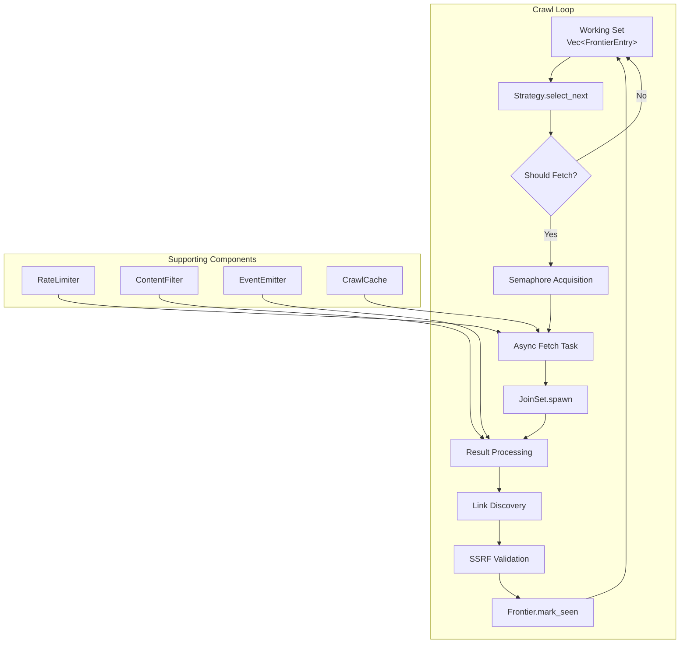
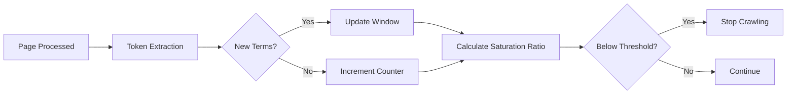

Crawlberg's concurrent crawl pipeline orchestrates high-throughput web traversal through a carefully designed coordination of **crawl strategies**, **URL frontier management**, and **async task scheduling**. This documentation dissects the architectural patterns that enable configurable traversal behaviors—from breadth-first scans to adaptive saturation-aware crawls—while maintaining thread-safe deduplication and domain-respecting rate limits.

## Architecture Overview

The crawl engine employs a **strategy-frontier-decoupled** design where URL selection logic is separated from queue management. This allows different traversal patterns without modifying the underlying frontier implementation.



The engine maintains a **working set** (`Vec<FrontierEntry>`) that provides strategy objects with random access to all candidates, enabling intelligent selection while keeping the hot path lock-free for concurrent operations. The actual deduplication and persistence layer uses the [`Frontier`](crates/crawlberg/src/traits.rs#L67-L108) trait, which separates the synchronous strategy selection from asynchronous queue operations.

Sources: [crawl_loop.rs](crates/crawlberg/src/engine/crawl_loop.rs#L506-L650), [traits.rs](crates/crawlberg/src/traits.rs#L67-L108)

## Crawl Strategy Implementations

Crawlberg provides four core strategy implementations, each optimized for different crawling objectives:

| Strategy | Traversal Pattern | Selection Logic | Use Case |
|----------|-------------------|-----------------|----------|
| **BFS** | Breadth-first | Always selects first (oldest) entry | Complete site enumeration |
| **DFS** | Depth-first | Always selects last (newest) entry | Deep link following |
| **Best-First** | Priority-based | Highest priority score wins | Focused content discovery |
| **Adaptive** | Saturation-aware | BFS with auto-stop on content saturation | Research crawling |

### BFS Strategy

The [`BfsStrategy`](crates/crawlberg/src/defaults/strategy.rs#L9-L19) provides FIFO ordering by always selecting the first entry from the working set. This guarantees level-by-level exploration of the link graph:

```rust
impl CrawlStrategy for BfsStrategy {
    fn select_next(&self, candidates: &[FrontierEntry]) -> Option<usize> {
        if candidates.is_empty() { None } else { Some(0) }
    }
}
```

### Best-First Strategy

[`BestFirstStrategy`](crates/crawlberg/src/defaults/strategy.rs#L37-L68) introduces priority-based selection, scoring URLs by inverse depth (`1.0 / (depth + 1.0)`) by default. This naturally favors shallower pages while allowing custom scoring via trait implementation.

### Adaptive Strategy

The [`AdaptiveStrategy`](crates/crawlberg/src/defaults/strategy.rs#L70-L165) tracks content saturation by monitoring unique term discovery rates. When new terms per page drops below a configurable threshold (default 5%), it signals the engine to stop crawling—preventing redundant fetches on content-rich sites.



Sources: [strategy.rs](crates/crawlberg/src/defaults/strategy.rs#L9-L165)

## URL Frontier and Deduplication

The [`InMemoryFrontier`](crates/crawlberg/src/defaults/frontier.rs#L12-L72) implements a thread-safe queue with `Mutex<VecDeque>` and `AHashSet` for O(1) deduplication. Key operations:

- **Push/Pop**: FIFO ordering for BFS behavior
- **Mark_seen/Is_seen**: Atomic deduplication before SSRF validation
- **Pop_batch**: Efficient bulk extraction for parallel processing

The frontier operates in two modes:
1. **Working Set Mode**: Engine maintains `Vec<FrontierEntry>` for strategy access
2. **Persistence Mode**: Frontier handles deduplication and optional external storage

This hybrid approach keeps the hot path (strategy selection) lock-free while ensuring thread-safe deduplication across concurrent discovery tasks.

Sources: [frontier.rs](crates/crawlberg/src/defaults/frontier.rs#L12-L72), [crawl_loop.rs](crates/crawlberg/src/engine/crawl_loop.rs#L936-L1059)

## Concurrent Execution Model

The crawl loop uses Tokio's `Semaphore` and `JoinSet` for bounded concurrency:

```rust
const DEFAULT_MAX_CONCURRENT: usize = 10;
let semaphore = Arc::new(Semaphore::new(max_concurrent));
let mut join_set: JoinSet<Result<FetchResult, (FrontierEntry, CrawlError)>> = JoinSet::new();
```

**Concurrency Control Flow**:
1. Strategy selects next URL from working set
2. Semaphore permit acquired (blocks if at capacity)
3. Async fetch task spawned in JoinSet
4. Result processed on completion
5. New links discovered and validated in parallel (16 concurrent SSRF checks)

The engine respects both `max_concurrent` (overall parallelism) and `max_pages` (total work limit), with the latter causing immediate task cancellation when reached.

Sources: [crawl_loop.rs](crates/crawlberg/src/engine/crawl_loop.rs#L522-L620)

## Rate Limiting Integration

The [`PerDomainThrottle`](crates/crawlberg/src/defaults/rate_limiter.rs#L43-L142) implements a per-domain token bucket algorithm with adaptive backoff:

- **Default delay**: Configurable via `rate_limit_ms` (default 200ms)
- **Robots.txt compliance**: Respects `Crawl-delay` directives
- **Adaptive backoff**: Doubles delay on 429 responses, halves after 5 successes
- **Thread-safe**: Uses `Mutex<AHashMap>` for concurrent domain tracking

The rate limiter integrates with Tower middleware, ensuring all HTTP requests (both regular and browser-fetched) pass through the same throttling layer.

Sources: [rate_limiter.rs](crates/crawlberg/src/defaults/rate_limiter.rs#L43-L142)

## Configuration Reference

Key configuration parameters affecting concurrency:

| Parameter | Default | Description |
|-----------|---------|-------------|
| `max_concurrent` | 10 | Maximum parallel fetch tasks |
| `max_depth` | None | Link hop limit from start URL |
| `max_pages` | None | Total page limit (cancels remaining tasks) |
| `rate_limit_ms` | 200 | Per-domain delay between requests |
| `respect_robots_txt` | false | Honor robots.txt directives |
| `follow_document_urls` | false | Traverse PDF/document links |

The engine validates configuration at startup, rejecting invalid combinations like `max_concurrent: 0` or `max_depth: >30`.

Sources: [config.rs](crates/crawlberg/src/types/config.rs#L294-L340)

## Strategy Selection Guide

**When to use each strategy**:

- **BFS**: Site completeness audits, sitemap validation, content inventory
- **DFS**: Deep link analysis, vulnerability scanning, recursive document traversal
- **Best-First**: Focused research, priority content extraction, score-driven crawling
- **Adaptive**: Large-scale research, content saturation detection, cost-aware crawling

**Performance considerations**:
- BFS provides predictable memory usage (frontier size proportional to frontier width)
- DFS may cause stack growth on deep sites but finds deepest content fastest
- Best-First requires careful scoring to avoid starvation of low-priority sections
- Adaptive automatically optimizes for content-rich vs. sparse sites

## Next Steps

After understanding concurrent crawl strategies, explore these related topics:

1. [Rate Limiting and Caching](17-rate-limiting-and-caching) - Deep dive into request throttling and cache strategies
2. [Robots.txt and Sitemap Compliance](16-robots-txt-and-sitemap-compliance) - How frontier respects site policies
3. [SSRF Defense and URL Validation](18-ssrf-defense-and-url-validation) - Security measures during URL validation
4. [Configuration Reference (CrawlConfig)](11-configuration-reference-crawlconfig) - Complete configuration options