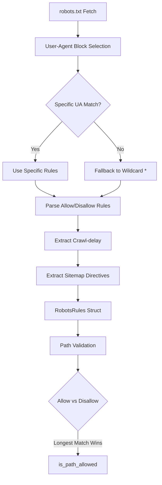
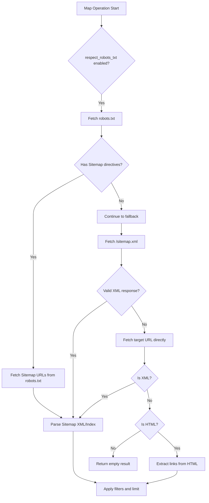

Crawlberg implements a dual-layer compliance system that handles both robots.txt directives and sitemap discovery. The system operates at two distinct integration points: **path validation** during crawling and **URL discovery** during sitemap mapping. This separation ensures that robots.txt rules are enforced consistently while sitemap parsing remains flexible for various XML formats.

## Robots.txt Parsing Architecture

The robots.txt parser operates as a standalone substrate module, meaning it can be used independently of the full crawl engine. The core parsing logic resides in `robots.rs`, which implements RFC-compliant path matching with longest-match semantics.



The `parse_robots_txt` function (lines 44–156 in [robots.rs](crates/crawlberg/src/robots.rs#L44-L156)) implements a block-based parser that:

1. **Segments rules by User-Agent blocks** — maintains current agent list and rules block, pushing completed blocks when encountering new `User-agent:` directives
2. **Supports comment stripping** — removes inline `#` comments before processing
3. **Handles request-rate directives** — extracts crawl-delay from `Request-rate: N/M` format when `Crawl-delay` is absent
4. **Implements wildcard fallback** — returns wildcard (`*`) block when no specific User-Agent match exists

The parser produces a `RobotsRules` struct (lines 20–31 in [robots.rs](crates/crawlberg/src/robots.rs#L20-L31)) containing:

| Field | Type | Purpose |
|-------|------|---------|
| `allow` | `Vec<String>` | Explicit allow patterns (prefix match) |
| `disallow` | `Vec<String>` | Explicit disallow patterns (prefix match) |
| `crawl_delay` | `Option<u64>` | Crawl-delay in seconds |
| `sitemaps` | `Vec<String>` | Sitemap URLs declared in the file |
| `is_wildcard_block` | `bool` | True when using `User-agent: *` fallback |

Sources: [robots.rs](crates/crawlberg/src/robots.rs#L20-L156)

## Path Matching Semantics

The `is_path_allowed` function (lines 197–231 in [robots.rs](crates/crawlberg/src/robots.rs#L197-L231)) implements **longest-match semantics** as specified in the robots.txt specification. This means the most specific matching rule wins, regardless of whether it's an Allow or Disallow directive.

The matching algorithm works as follows:

1. **Pattern matching** — The `robots_path_matches` function (lines 161–192 in [robots.rs](crates/crawlberg/src/robots.rs#L161-L192)) supports:
   - Prefix matching (default behavior)
   - Exact matching with `$` anchor suffix
   - Wildcard `*` patterns for flexible path matching

2. **Longest-match resolution** — For both Allow and Disallow rules, the system tracks the longest matching pattern length, then compares them:
   - If both match: longer pattern wins (`a >= d` in the code)
   - If only Allow matches: path is allowed
   - If only Disallow matches: path is disallowed
   - If neither matches: path is allowed (permissive default)

3. **Wildcard block special case** — When using the wildcard (`*`) block, `Allow: /` is treated as a baseline rather than a root-specific override over Disallow rules (lines 200–203 in [robots.rs](crates/crawlberg/src/robots.rs#L200-L203))

```rust
// Example from robots.rs showing longest-match logic
match (best_allow, best_disallow) {
    (Some(a), Some(d)) => a >= d,  // longer pattern wins
    (None, Some(_)) => false,      // disallow only
    (Some(_), None) => true,       // allow only
    (None, None) => true,          // no rules match
}
```

Sources: [robots.rs](crates/crawlberg/src/robots.rs#L161-L231)

## Engine Integration

The crawl engine integrates robots.txt compliance at two critical points:

### 1. Crawl Loop Integration

During crawl initialization, the engine fetches and parses robots.txt (lines 389–403 in [crawl_loop.rs](crates/crawlberg/src/engine/crawl_loop.rs#L389-L403)):

```rust
let robots_rules: Option<RobotsRules> = if self.config.respect_robots_txt {
    fetch_robots_rules(&final_url, &self.config, &client).await
} else {
    None
};

// Apply crawl-delay to rate limiter
if let Some(rules) = &robots_rules
    && let Some(delay) = rules.crawl_delay
    && let Ok(parsed) = Url::parse(&final_url)
    && let Some(domain) = parsed.host_str()
{
    self.rate_limiter
        .set_crawl_delay(domain, Duration::from_secs(delay))
        .await?;
}
```

The `should_fetch_url` method (lines 696–740 in [crawl_loop.rs](crates/crawlberg/src/engine/crawl_loop.rs#L696-L740)) performs path validation before each fetch:

- Compiles exclude/include regex patterns
- Validates path against robots.txt rules using `is_path_allowed`
- Records telemetry metrics for blocked URLs
- Returns boolean indicating whether the URL should be fetched

### 2. Scrape Operation Integration

For single-page scraping, the `scrape_from_crawl_response` function (lines 22–172 in [scrape.rs](crates/crawlberg/src/scrape.rs#L22-L172)) performs robots.txt validation and extracts the `ScrapeResult` with compliance metadata:

```rust
let mut is_allowed = true;
let mut crawl_delay = None;
if config.respect_robots_txt {
    let robots = robots_url(&parsed_url);
    if let Ok(robots_resp) = http_fetch(&robots, config, &std::collections::HashMap::new(), &client).await {
        let ua = config.user_agent.as_deref().unwrap_or("*");
        let rules = parse_robots_txt(&robots_resp.body, ua);
        is_allowed = is_path_allowed(parsed_url.path(), &rules);
        crawl_delay = rules.crawl_delay;
    }
}
```

Sources: [crawl_loop.rs](crates/crawlberg/src/engine/crawl_loop.rs#L389-L740), [scrape.rs](crates/crawlberg/src/scrape.rs#L22-L172)

## Meta Robots Directives

Beyond robots.txt files, crawlberg detects HTML-level robots directives in two forms:

### Meta Tag Detection

The `has_robots_directive` function (lines 161–174 in [metadata.rs](crates/crawlberg/src/html/metadata.rs#L161-L174)) scans for `<meta name="robots" content="...">` tags:

```html
<meta name="robots" content="noindex, nofollow">
<meta name="googlebot" content="nosnippet">
```

### HTTP Header Detection

The system also inspects the `X-Robots-Tag` HTTP header (lines 73–86 in [scrape.rs](crates/crawlberg/src/scrape.rs#L73-L86)):

```rust
let x_robots_tag = resp.headers.get("x-robots-tag").and_then(|v| v.first().cloned());

if let Some(ref xrt) = x_robots_tag {
    let lower = xrt.to_lowercase();
    if lower.contains("noindex") {
        noindex_detected = true;
    }
    if lower.contains("nofollow") {
        nofollow_detected = true;
    }
}
```

The `ScrapeResult` struct exposes these as boolean flags:

| Field | Type | Source |
|-------|------|--------|
| `noindex_detected` | `bool` | Meta tag or X-Robots-Tag header |
| `nofollow_detected` | `bool` | Meta tag, X-Robots-Tag header, or `rel="nofollow"` |
| `x_robots_tag` | `Option<String>` | Raw X-Robots-Tag header value |

Sources: [metadata.rs](crates/crawlberg/src/html/metadata.rs#L161-L174), [scrape.rs](crates/crawlberg/src/scrape.rs#L73-L86)

## Sitemap Discovery System

The sitemap system operates as a two-tier discovery mechanism, with robots.txt `Sitemap:` directives taking priority over conventional paths.

### Discovery Hierarchy



The `map` function (lines 32–142 in [map.rs](crates/crawlberg/src/map.rs#L32-L142)) implements this hierarchy:

1. **Robots.txt sitemap discovery** (lines 37–60) — When `respect_robots_txt` is enabled, fetches robots.txt and extracts `Sitemap:` directives
2. **Standard sitemap.xml fallback** (lines 62–80) — Attempts to fetch `{scheme}://{authority}/sitemap.xml`
3. **Direct URL parsing** (lines 82–106) — Handles the target URL as an XML sitemap or index
4. **HTML link extraction** (lines 108–139) — Falls back to extracting internal/external links from HTML

### Sitemap XML Parsing

The `parse_sitemap_xml` function (lines 35–106 in [sitemap.rs](crates/crawlberg/src/sitemap.rs#L35-L106)) uses streaming XML parsing with `quick_xml` to extract `SitemapUrl` entries:

```xml
<?xml version="1.0"?>
<urlset xmlns="http://www.sitemaps.org/schemas/sitemap/0.9">
  <url>
    <loc>https://example.com/about</loc>
    <lastmod>2025-01-15</lastmod>
    <changefreq>monthly</changefreq>
    <priority>0.8</priority>
  </url>
</urlset>
```

The parser extracts:
- `loc` — Required URL location
- `lastmod` — Optional last modification timestamp
- `changefreq` — Optional change frequency hint
- `priority` — Optional page priority

### Sitemap Index Support

For large sites, sitemap index files reference child sitemaps. The `parse_sitemap_index` function (lines 109–150 in [sitemap.rs](crates/crawlberg/src/sitemap.rs#L109-L150)) extracts child sitemap URLs, and `process_sitemap_response` (lines 198–282 in [sitemap.rs](crates/crawlberg/src/sitemap.rs#L198-L282)) recursively fetches them with a 100-child safety limit.

### Gzip Compression Support

Sitemap files may be gzip-compressed. The `decompress_gzip` function (lines 287–298 in [sitemap.rs](crates/crawlberg/src/sitemap.rs#L287-L298)) handles decompression with a 50 MB safety limit to prevent gzip bomb attacks.

Sources: [sitemap.rs](crates/crawlberg/src/sitemap.rs#L35-L298), [map.rs](crates/crawlberg/src/map.rs#L32-L142)

## Configuration Options

The `CrawlConfig` struct (lines 294–444 in [config.rs](crates/crawlberg/src/types/config.rs#L294-L444)) provides these compliance-related options:

| Option | Type | Default | Description |
|--------|------|---------|-------------|
| `respect_robots_txt` | `bool` | `false` | Enable robots.txt compliance |
| `user_agent` | `Option<String>` | `None` | Custom User-Agent for robots.txt matching |
| `rate_limit_ms` | `Option<u64>` | `None` | Default delay between requests (ms) |
| `map_limit` | `Option<usize>` | `None` | Maximum URLs from map operation |
| `map_search` | `Option<String>` | `None` | Filter map results by substring |
| `exclude_paths` | `Vec<String>` | `[]` | Regex patterns to exclude from crawling |
| `include_paths` | `Vec<String>` | `[]` | Regex patterns to include (non-zero depth only) |

### Rate Limiting Integration

The `PerDomainThrottle` rate limiter (lines 48–142 in [rate_limiter.rs](crates/crawlberg/src/defaults/rate_limiter.rs#L48-L142)) integrates with robots.txt crawl-delay:

- **Crawl-delay application** — When robots.txt specifies a crawl-delay, it's stored in `robots_delay` and used as the minimum delay floor
- **Adaptive backoff** — 429 responses trigger exponential backoff, but never below the robots.txt crawl-delay floor
- **Recovery** — After 5 consecutive successful requests, the adaptive delay halves but never drops below the robots.txt floor

```rust
let effective = match (&domain_state.crawl_delay, &domain_state.robots_delay) {
    (Some(cd), Some(rd)) => std::cmp::max(*cd, *rd),
    (Some(cd), None) => *cd,
    (None, Some(rd)) => *rd,
    (None, None) => self.default_delay,
};
```

Sources: [config.rs](crates/crawlberg/src/types/config.rs#L294-L444), [rate_limiter.rs](crates/crawlberg/src/defaults/rate_limiter.rs#L48-L142)

## Test Coverage

The compliance system has comprehensive test coverage across unit tests and end-to-end fixtures:

### Robots.txt Test Scenarios

| Fixture | Description | Expected Behavior |
|---------|-------------|-------------------|
| `robots_allow_all.txt` | Permissive `Allow: /` | All paths allowed |
| `robots_disallow_admin.txt` | `Disallow: /admin/` | Admin paths blocked |
| `robots_multiple_agents.txt` | Multiple User-Agent blocks | Specific UA rules take precedence |
| `robots_crawl_delay.txt` | `Crawl-delay: 2` | Rate limiter receives 2s delay |
| `robots_wildcard_paths.txt` | Wildcard `*` patterns | Flexible path matching |
| `robots_allow_override.txt` | Allow overrides Disallow | Longest match wins |
| `robots_meta_nofollow.json` | `<meta name="robots" content="nofollow">` | Link extraction skipped |
| `robots_x_robots_tag.json` | `X-Robots-Tag: noindex` | Page marked as noindex |

### Sitemap Test Scenarios

| Fixture | Description | Expected Behavior |
|---------|-------------|-------------------|
| `sitemap_basic.json` | Standard urlset | Parses 4 URLs |
| `sitemap_index.json` | Sitemap index file | Follows child sitemaps |
| `sitemap_compressed_gzip.json` | Gzip-compressed sitemap | Decompresses and parses |
| `sitemap_from_robots_txt.json` | Sitemap in robots.txt | Discovers via robots.txt |
| `sitemap_lastmod_filter.json` | lastmod filtering | Applies date filters |

Sources: [robots_allow_all.json](fixtures/robots/robots_allow_all.json), [sitemap_basic.json](fixtures/sitemap/sitemap_basic.json)

## Public API

The compliance modules expose both high-level engine functions and low-level parsing utilities:

### Substrate-Level APIs (for custom implementations)

```rust
// Robots.txt parsing
use crawlberg::robots::{parse_robots_txt, is_path_allowed, RobotsRules};

// Sitemap parsing
use crawlberg::sitemap::{parse_sitemap_xml, parse_sitemap_index, is_sitemap_index};
```

### Engine-Level APIs

```rust
// Single page with robots.txt compliance
use crawlberg::scrape;
let result = scrape(&engine, &url).await?;

// Map operation with sitemap discovery
use crawlberg::map_urls;
let result = map_urls(&engine, &url).await?;

// Crawl with robots.txt enforcement
use crawlberg::crawl;
let config = CrawlConfig {
    respect_robots_txt: true,
    ..Default::default()
};
let result = crawl(&engine, &url, Some(config)).await?;
```

Sources: [lib.rs](crates/crawlberg/src/lib.rs#L42-L46)

## Best Practices

1. **Enable robots.txt compliance by default** — Set `respect_robots_txt: true` in production to respect website policies
2. **Set appropriate User-Agent** — Use a identifiable User-Agent string for robots.txt matching
3. **Configure rate limits** — Set `rate_limit_ms` as a baseline; robots.txt crawl-delay overrides when higher
4. **Use map_limit** — Prevent unbounded sitemap fetching on large sites
5. **Monitor compliance metrics** — Track `robots_blocked_total` metric for observability