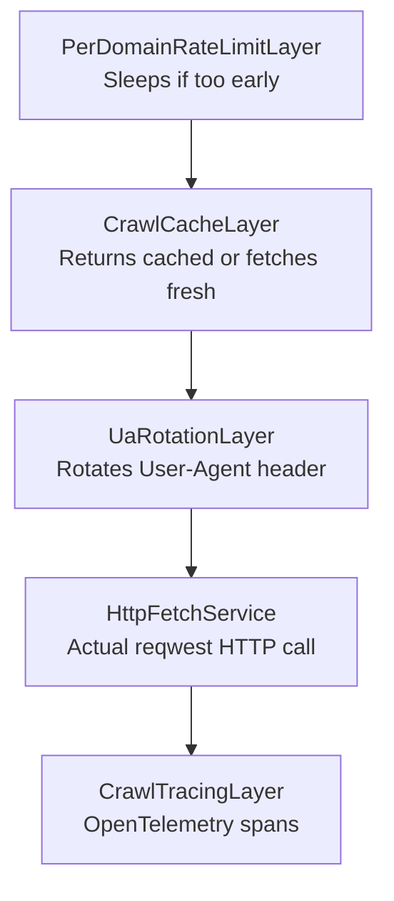
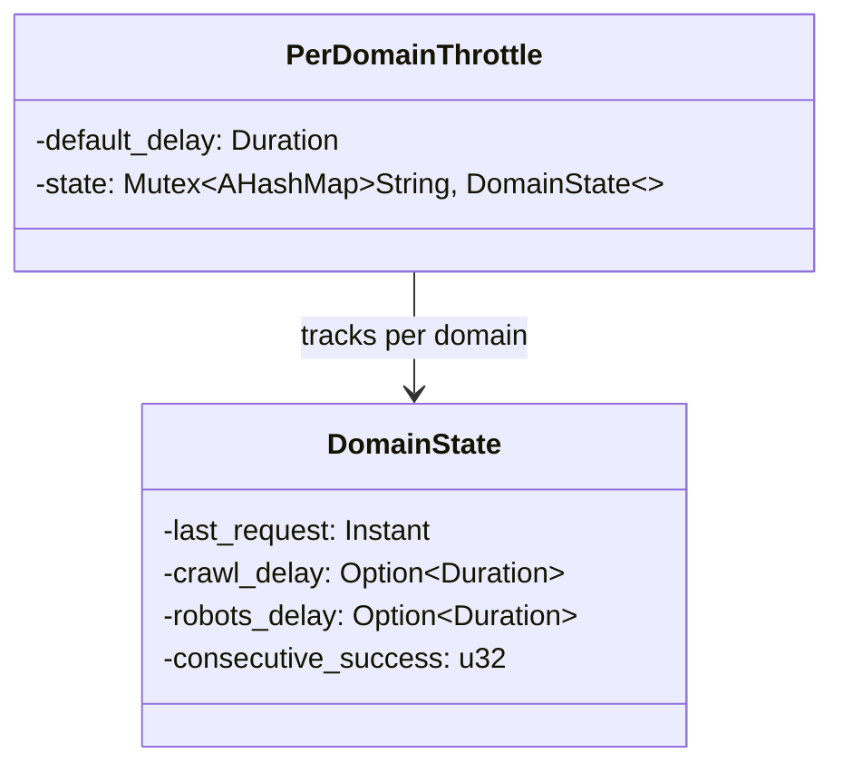
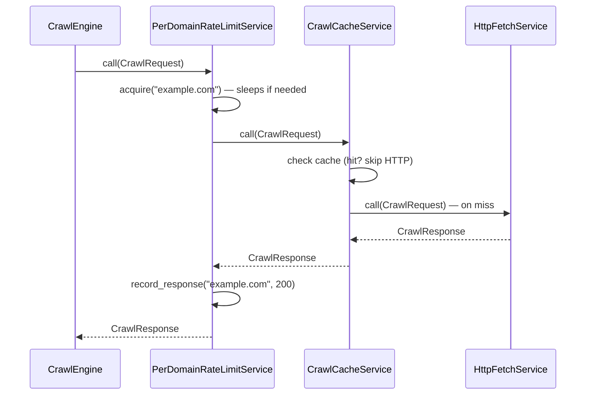
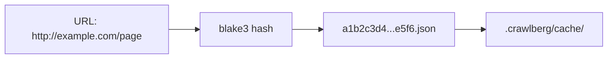
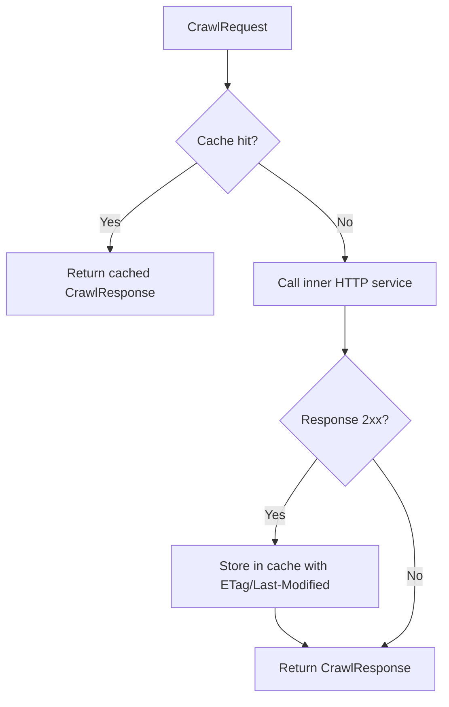

Rate limiting and caching are two fundamental mechanisms in crawlberg's crawling pipeline that work together to ensure respectful, efficient web crawling. Rate limiting prevents overwhelming target servers by enforcing per-domain request throttling, while caching eliminates redundant network fetches for previously retrieved content. Both are implemented as composable [Tower](https://docs.rs/tower) middleware layers, forming the outermost rings of the HTTP service stack that every request passes through.

**Scope**: This page covers the per-domain rate limiting system, the HTTP response cache, their trait-based abstractions, and how they integrate into the Tower service stack. For URL-level deduplication and frontier management, see [Concurrent Crawl Strategies and URL Frontier](15-concurrent-crawl-strategies-and-url-frontier). For robots.txt crawl-delay integration, see [Robots.txt and Sitemap Compliance](16-robots-txt-and-sitemap-compliance).

---

## Architecture Overview

Both rate limiting and caching follow the same architectural pattern: a **trait abstraction** that defines the contract, **default implementations** provided by the engine, and **Tower layers** that plug them into the HTTP fetch pipeline. This design allows consumers to swap implementations — for example, replacing the in-memory throttle with a Redis-backed distributed rate limiter, or substituting the disk cache with an in-memory LRU cache.

The Tower service stack, built inside `CrawlEngine::build_service`, applies layers in this order from **outermost** (first to execute) to **innermost** (last to execute):



The critical insight is that rate limiting sits *outside* the cache layer. This means a cached response never triggers a rate-limit sleep — only actual HTTP requests consume the token budget. Sources: [engine/mod.rs#L92-L117](crates/crawlberg/src/engine/mod.rs#L92-L117)

---

## Rate Limiting

### Trait Contract

The `RateLimiter` trait defines three methods that together cover the full lifecycle of rate-controlled requests:

| Method | Purpose | When Called |
|--------|---------|------------|
| `acquire(domain)` | Block until a request to the domain is permitted | Before every HTTP fetch |
| `record_response(domain, status)` | Record the response status for adaptive back-off | After every HTTP response |
| `set_crawl_delay(domain, delay)` | Override the delay (e.g., from robots.txt) | When robots.txt Crawl-delay is parsed |

Sources: [traits.rs#L110-L121](crates/crawlberg/src/traits.rs#L110-L121)

### PerDomainThrottle — The Default Implementation

The built-in `PerDomainThrottle` implements a **per-domain token bucket** rate limiter. Each domain maintains independent state:



Sources: [defaults/rate_limiter.rs#L34-L62](crates/crawlberg/src/defaults/rate_limiter.rs#L34-L62)

**Delay resolution logic** — When deciding how long to wait, the limiter picks the *maximum* of three possible delays:

1. **Default delay** from configuration (`rate_limit_ms`, defaults to 200ms)
2. **Crawl-delay** from robots.txt (set via `set_crawl_delay`)
3. **Back-off delay** from 429 responses (adaptive)

The effective delay is `max(robots_delay, crawl_delay) || default_delay`. Sources: [defaults/rate_limiter.rs#L77-L82](crates/crawlberg/src/defaults/rate_limiter.rs#L77-L82)

**`acquire()` flow**:

1. Compute the effective delay for the domain
2. Check how much time has elapsed since the last request
3. If elapsed time < effective delay, `tokio::time::sleep()` for the remaining duration
4. Otherwise, proceed immediately and update `last_request` timestamp

**`record_response()` adaptive back-off**:

The adaptive back-off mechanism responds to HTTP 429 (Too Many Requests) status codes by doubling the delay, and recovers on success by halving the delay after 5 consecutive successes:

| Event | Behavior |
|-------|----------|
| **HTTP 429 received** | Reset `consecutive_success` to 0, double `crawl_delay` (capped at 60s) |
| **5 consecutive successes** | If `crawl_delay` exists, halve it. If halved value ≤ robots_delay, remove the override entirely |

This creates a natural oscillation: the limiter backs off under pressure, then cautiously re-probes the server's actual rate tolerance. Sources: [defaults/rate_limiter.rs#L103-L128](crates/crawlberg/src/defaults/rate_limiter.rs#L103-L128)

**`set_crawl_delay()` — robots.txt integration**:

When the engine parses a `Crawl-delay` directive from robots.txt (during the initial crawl setup), it calls `set_crawl_delay` on the rate limiter. This sets *both* `robots_delay` and `crawl_delay` to the same value, so the domain immediately adopts the robots.txt-specified delay. Sources: [engine/crawl_loop.rs#L395-L403](crates/crawlberg/src/engine/crawl_loop.rs#L395-L403)

### Configuration

Rate limiting is configured through the `rate_limit_ms` field on `CrawlConfig`:

```rust
let config = CrawlConfig::builder()
    .rate_limit_ms(500) // 500ms between requests to the same domain
    .build();
```

| Setting | Default | Effect |
|---------|---------|--------|
| `rate_limit_ms: None` | 200ms | Minimum delay between requests to the same domain |
| `rate_limit_ms: Some(0)` | 0ms | No delay — all requests pass through immediately |
| `rate_limit_ms: Some(N)` | N ms | Enforces N-millisecond delay per domain |

Sources: [types/config.rs#L333-L335](crates/crawlberg/src/types/config.rs#L333-L335), [engine/builder.rs#L249-L269](crates/crawlberg/src/engine/builder.rs#L249-L269)

### Tower Integration

The `PerDomainRateLimitLayer` wraps any inner Tower service and intercepts every `CrawlRequest`. Before forwarding, it extracts the domain from the request URL and calls `acquire()`. After the inner service responds, it calls `record_response()` with the HTTP status code.



Sources: [tower/rate_limit.rs#L56-L76](crates/crawlberg/src/tower/rate_limit.rs#L56-L76)

### NoopRateLimiter

The `NoopRateLimiter` is a pass-through implementation that performs no throttling. It is used internally for tests and can be injected via the engine builder when rate limiting is explicitly disabled. Note that in the default engine, `PerDomainThrottle` is always instantiated — to truly disable rate limiting, inject a custom `NoopRateLimiter` via the builder. Sources: [defaults/rate_limiter.rs#L15-L32](crates/crawlberg/src/defaults/rate_limiter.rs#L15-L32)

---

## HTTP Response Caching

### Trait Contract

The `CrawlCache` trait defines three methods for URL-keyed response storage:

| Method | Purpose |
|--------|---------|
| `get(key)` | Retrieve a cached page by URL, returning `None` if missing or expired |
| `set(key, page)` | Store a page in the cache |
| `has(key)` | Check whether a URL is cached |

Sources: [traits.rs#L187-L195](crates/crawlberg/src/traits.rs#L187-L195)

### CachedPage Data Model

Each cached entry is stored as a `CachedPage` struct:

| Field | Type | Purpose |
|-------|------|---------|
| `url` | `String` | Absolute URL of the cached page |
| `status_code` | `u16` | HTTP status code at time of caching |
| `content_type` | `String` | `Content-Type` header from the response |
| `body` | `String` | Raw response body stored verbatim |
| `etag` | `Option<String>` | `ETag` header for conditional revalidation |
| `last_modified` | `Option<String>` | `Last-Modified` header for conditional revalidation |
| `cached_at` | `u64` | Unix timestamp (seconds) when entry was written |

Sources: [types/results.rs#L334-L349](crates/crawlberg/src/types/results.rs#L334-L349)

### DiskCache — The Default Implementation

The built-in `DiskCache` persists cached pages as JSON files on the filesystem. It is the only non-trivial `CrawlCache` implementation provided by the engine.

**Key design choices**:

- **URL hashing**: URLs are hashed with **blake3** to produce deterministic filenames, avoiding filesystem-unsafe characters. Two URLs that differ only in fragment (`#section`) will produce different hashes since the full URL is hashed.
- **Atomic writes**: New entries are written to a `.tmp` file first, then atomically renamed, preventing corruption from concurrent writes or interrupted processes.
- **LRU eviction**: When `max_entries` is set and the limit is reached, the oldest files (by filesystem modification time) are evicted to make room.



Sources: [defaults/cache.rs#L35-L70](crates/crawlberg/src/defaults/cache.rs#L35-L70)

**Configuration**:

| Parameter | Default | Effect |
|-----------|---------|--------|
| `cache_dir` | `.crawlberg/cache/` | Directory where JSON cache files are stored |
| `ttl_secs` | 3600 (1 hour) | Time-to-live before a cached entry is considered stale (0 = no expiry) |
| `max_entries` | 10000 | Maximum number of cached entries; 0 = unlimited |

Sources: [defaults/cache.rs#L52-L59](crates/crawlberg/src/defaults/cache.rs#L52-L59)

**Cache lookup flow (`get`)**:

1. Compute the blake3 hash of the URL to derive the file path
2. If the file does not exist, return `None` (cache miss)
3. Read and deserialize the JSON file. If deserialization fails, delete the corrupt file and return `None`
4. If `ttl_secs > 0`, check whether the entry has expired. If expired, delete the file and return `None`
5. Return the `CachedPage`

**Cache store flow (`set`)**:

1. If `max_entries > 0`, count existing `.json` files in the cache directory
2. If at or above the limit, sort by modification time and delete the oldest entries to make room
3. Serialize the `CachedPage` to JSON
4. Write to a `.tmp` file, then rename to the final path

Sources: [defaults/cache.rs#L82-L158](crates/crawlberg/src/defaults/cache.rs#L82-L158)

### NoopCache

The `NoopCache` returns `None` for all `get()` calls and silently discards all `set()` calls. This is the **default** cache implementation — caching is effectively disabled out of the box. To enable caching, inject a `DiskCache` (or a custom `CrawlCache` implementation) via the engine builder. Sources: [defaults/cache.rs#L30-L32](crates/crawlberg/src/defaults/cache.rs#L30-L32)

### Tower Integration

The `CrawlCacheLayer` wraps the inner service and intercepts every `CrawlRequest`:

1. **On request**: Check the cache for the URL. If found (cache hit), reconstruct a `CrawlResponse` from the cached data (including `ETag` and `Last-Modified` headers) and return immediately — the inner HTTP service is never called.
2. **On response**: If the HTTP response is a 2xx success, store it in the cache with the `ETag` and `Last-Modified` headers captured for future conditional requests.



Sources: [tower/cache.rs#L59-L108](crates/crawlberg/src/tower/cache.rs#L59-L108)

---

## Tower Layer Composition

The engine constructs the Tower service stack once per HTTP client instance. The layer ordering is deliberate and has functional implications:

| Layer (outermost → innermost) | Trait/Implementation | Behavior |
|-------------------------------|---------------------|----------|
| **Rate Limiting** | `PerDomainThrottle` via `PerDomainRateLimitLayer` | Sleeps before requests; records response status after |
| **Caching** | `CrawlCache` via `CrawlCacheLayer` | Short-circuits on cache hit; stores on cache miss |
| **UA Rotation** | `UaRotationLayer` | Cycles through configured user-agent strings |
| **HTTP Fetch** | `HttpFetchService` | Actual reqwest HTTP call with SSRF validation |
| **Tracing** | `CrawlTracingLayer` | OpenTelemetry span wrapping |

The key architectural property is that **cached responses bypass rate limiting entirely**. Since the cache layer sits inside the rate-limit layer, a cache hit returns before the rate limiter's `record_response()` is called. This means aggressive caching naturally reduces the effective request rate, complementing the explicit throttling.

Sources: [engine/mod.rs#L100-L117](crates/crawlberg/src/engine/mod.rs#L100-L117)

---

## Injecting Custom Implementations

Both rate limiting and caching are pluggable through the engine builder:

```rust
use crawlberg::{CrawlEngine, CrawlConfig};
use crawlberg::traits::{RateLimiter, CrawlCache};

// Replace rate limiter with a custom implementation
let engine = CrawlEngine::builder()
    .config(CrawlConfig::default())
    .rate_limiter(my_custom_rate_limiter)  // impl RateLimiter
    .cache(my_custom_cache)                // impl CrawlCache
    .build()?;
```

When not explicitly set, the builder defaults to `PerDomainThrottle` (with the configured delay) and `NoopCache` respectively. Sources: [engine/builder.rs#L92-L138](crates/crawlberg/src/engine/builder.rs#L92-L138), [engine/builder.rs#L260-L285](crates/crawlberg/src/engine/builder.rs#L260-L285)

---

## Practical Guidance

| Scenario | Recommended Configuration |
|----------|--------------------------|
| **Aggressive crawl of own site** | `rate_limit_ms: 0`, custom `NoopRateLimiter` |
| **Polite crawling of external sites** | `rate_limit_ms: 200` (default), `respect_robots_txt: true` |
| **Repeated crawls of the same site** | Enable `DiskCache` with `ttl_secs: 3600` to avoid re-fetching unchanged pages |
| **High-concurrency crawl** | Keep default rate limiting; increase `max_concurrent` — the per-domain throttle prevents any single domain from being overwhelmed |
| **Distributed crawl workers** | Implement a custom `RateLimiter` backed by Redis or a similar shared store; the `CrawlCache` trait similarly supports distributed cache backends |

## Next Steps

- [Robots.txt and Sitemap Compliance](16-robots-txt-and-sitemap-compliance) — How `Crawl-delay` directives feed into the rate limiter
- [Concurrent Crawl Strategies and URL Frontier](15-concurrent-crawl-strategies-and-url-frontier) — How concurrency interacts with per-domain throttling
- [Configuration Reference (CrawlConfig)](11-configuration-reference-crawlconfig) — Full list of `rate_limit_ms` and related configuration fields
- [Trait-Based Pluggable Engine](10-trait-based-pluggable-engine) — Deep dive into the trait system that makes both components swappable