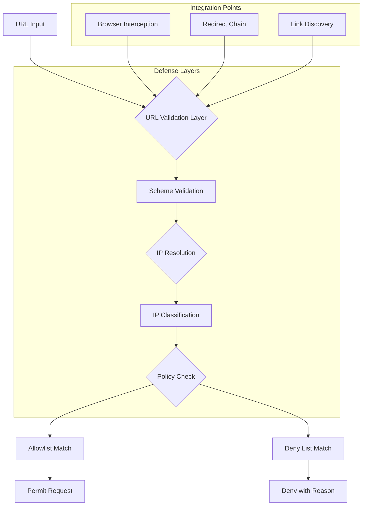
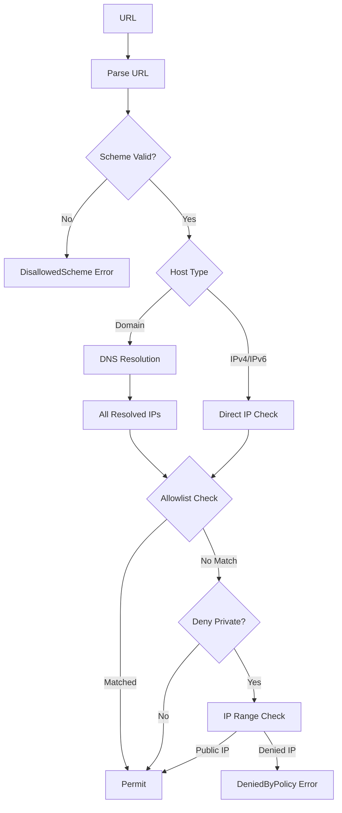

Crawlberg implements a comprehensive SSRF (Server-Side Request Forgery) defense system that protects against attacks targeting internal infrastructure, cloud metadata endpoints, and restricted network ranges. This defense is applied at every stage of the crawling pipeline — from initial URL validation through HTTP requests, redirect following, and link discovery during crawling operations.

## Architecture Overview

The SSRF defense operates as a multi-layered security system integrated across the crawling architecture:



The system enforces a **deny-by-default** policy, rejecting URLs that resolve to private IP ranges unless explicitly allowlisted. This approach ensures that crawlers operate safely even when encountering malicious redirects or manipulated links.

## Core Components

### SsrfPolicy Configuration

The `SsrfPolicy` struct defines the security boundaries for outbound requests:

```rust
pub struct SsrfPolicy {
    pub deny_private: bool,           // Default: true
    pub allowlist: Vec<HostMatcher>,  // Empty by default
    pub max_redirects: u8,            // Default: 5
    pub scheme_allowlist: HashSet<&'static str>,  // http, https
}
```

Sources: [crates/crawlberg/src/net/ssrf.rs](crates/crawlberg/src/net/ssrf.rs#L92-L118)

### IP Range Classification

Crawlberg maintains a comprehensive list of private and restricted IP ranges:

| Category | IPv4 Ranges | IPv6 Ranges | Reason |
|----------|-------------|-------------|--------|
| Loopback | 127.0.0.0/8 | ::1/128 | Localhost access |
| Private Network | 10.0.0.0/8, 172.16.0.0/12, 192.168.0.0/16 | fc00::/7 | RFC1918 ranges |
| Link-local | 169.254.0.0/16 | fe80::/10 | Cloud metadata (AWS/GCP) |
| Unspecified | 0.0.0.0/8 | - | Non-routable |
| Multicast | 224.0.0.0/4 | ff00::/8 | Broadcast addresses |

Sources: [crates/crawlberg/src/net/ssrf.rs](crates/crawlberg/src/net/ssrf.rs#L20-L45)

### Host Matching System

The `HostMatcher` enum provides flexible allowlist patterns:

```rust
pub enum HostMatcher {
    Exact(String),    // Case-insensitive exact match
    Suffix(String),   // Domain suffix match (with dot handling)
    Cidr(String),     // CIDR range match for IP addresses
}
```

**Matching Logic:**
- **Exact**: Matches the exact hostname (case-insensitive)
- **Suffix**: Matches domain suffixes (handles leading dots properly)
- **Cidr**: Matches IP addresses within CIDR ranges

Sources: [crates/crawlberg/src/net/ssrf.rs](crates/crawlberg/src/net/ssrf.rs#L48-L88)

## URL Validation Flow

The validation process follows a strict sequence:



### Key Validation Steps

1. **Scheme Validation**: Only `http` and `https` schemes are allowed by default
2. **IP Resolution**: DNS resolution for domain names (skipped on wasm32)
3. **Allowlist Checking**: First-pass allowlist matching for quick permits
4. **Deny List Checking**: IP range validation against private ranges
5. **DNS Rebinding Mitigation**: All resolved IPs must pass validation

Sources: [crates/crawlberg/src/net/ssrf.rs](crates/crawlberg/src/net/ssrf.rs#L169-L248)

## Integration Points

### HTTP Layer Integration

The `http_fetch` function applies SSRF validation at multiple points:

```rust
pub(crate) async fn http_fetch(
    url: &str,
    config: &CrawlConfig,
    extra_headers: &HashMap<String, String>,
    client: &reqwest::Client,
) -> Result<HttpResponse, CrawlError> {
    // 1. Validate initial URL
    validate_url(&initial_url, &config.ssrf).await?;
    
    // 2. Follow redirects with validation
    loop {
        // ... handle response ...
        if (300..400).contains(&status) {
            validate_url(&next_url, &config.ssrf).await?;
            redirects_followed += 1;
            if redirects_followed > config.ssrf.max_redirects {
                return Err(CrawlError::SsrfPolicyViolation { ... });
            }
        }
    }
}
```

Sources: [crates/crawlberg/src/http.rs](crates/crawlberg/src/http.rs#L90-L170)

### Crawl Loop Integration

During crawling operations, SSRF validation is applied to discovered links:

```rust
// In crawl_loop.rs
for link in discovered_links {
    if let Ok(parsed_target) = url::Url::parse(&target)
        && let Err(e) = validate_url(&parsed_target, &engine.config.ssrf).await
    {
        return Err(CrawlError::SsrfPolicyViolation {
            url: target,
            reason: e.to_string(),
        });
    }
}
```

Sources: [crates/crawlberg/src/engine/crawl_loop.rs](crates/crawlberg/src/engine/crawl_loop.rs#L136-L167)

### Browser Layer Interception

The browser layer implements CDP (Chrome DevTools Protocol) interception:

```rust
async fn ssrf_verdict(request_url: &str, policy: &SsrfPolicy) -> Result<(), String> {
    match url::Url::parse(request_url) {
        Ok(parsed) => validate_url(&parsed, policy).await.map_err(|e| e.to_string()),
        Err(e) => Err(format!("invalid URL: {e}")),
    }
}

async fn start_ssrf_interception(
    page: &chromiumoxide::Page,
    policy: &SsrfPolicy,
) -> Result<SsrfInterceptGuard, CrawlError> {
    // Register CDP request interception
    page.execute(FetchEnableParams::default()).await?;
    
    // Spawn validation listener
    while let Some(event) = events.next().await {
        match ssrf_verdict(&request_url, &listener_policy).await {
            Ok(()) => { /* Continue request */ }
            Err(reason) => { /* Fail request with BlockedByClient */ }
        }
    }
}
```

Sources: [crates/crawlberg/src/browser.rs](crates/crawlberg/src/browser.rs#L229-L280)

## Configuration Examples

### Basic Configuration (Rust)

```rust
use crawlberg::{CrawlConfig, HostMatcher};

let config = CrawlConfig::builder()
    .allow_private_networks(false)  // Default behavior
    .ssrf_allowlist_host(HostMatcher::Suffix(".internal.company.com".into()))
    .ssrf_allowlist_host(HostMatcher::Cidr("10.0.0.0/8".into()))
    .build();
```

Sources: [crates/crawlberg/src/types/builder.rs](crates/crawlberg/src/types/builder.rs#L265-L280)

### JSON Configuration

```json
{
  "ssrf": {
    "deny_private": true,
    "max_redirects": 5,
    "allowlist": [
      {"Suffix": ".internal.company.com"},
      {"Cidr": "10.0.0.0/8"}
    ]
  }
}
```

Sources: [fixtures/validation/validation_ssrf_loopback_denied.json](fixtures/validation/validation_ssrf_loopback_denied.json)

### Environment Variable Override

```bash
# Allow private network access (for development/testing)
export CRAWLBERG_ALLOW_PRIVATE_NETWORK=1

# Or disable it (default)
export CRAWLBERG_ALLOW_PRIVATE_NETWORK=0
```

Sources: [crates/crawlberg/src/net/ssrf.rs](crates/crawlberg/src/net/ssrf.rs#L128-L168)

## Error Handling

### Error Types

```rust
pub enum SsrfError {
    DeniedByPolicy { reason: &'static str },
    NotOnAllowlist,
    DnsResolutionFailed(String),
    InvalidUrl(String),
    DisallowedScheme(String),
    TooManyRedirects,
}

pub enum CrawlError {
    SsrfPolicyViolation { url: String, reason: String },
    // ... other variants
}
```

### Error Mapping

The system maps `SsrfError` to `CrawlError` with structured information:

```rust
impl From<crate::net::ssrf::SsrfError> for CrawlError {
    fn from(err: crate::net::ssrf::SsrfError) -> Self {
        CrawlError::SsrfPolicyViolation {
            url: "unknown".to_string(),
            reason: err.to_string(),
        }
    }
}
```

Sources: [crates/crawlberg/src/error.rs](crates/crawlberg/src/error.rs#L127-L134)

### Retry Policy

SSRF violations are classified as **permanent errors** — the crawler will not retry refused requests. For link-following operations, refused targets are dropped from the queue and logged with `tracing::warn!`.

## Browser-Specific Protections

### CDP Interception

The browser layer implements request interception at the Chrome DevTools Protocol level:

1. **Request Paused Events**: All network requests are intercepted before execution
2. **Per-Request Validation**: Each request URL is validated against the SSRF policy
3. **Immediate Blocking**: Failed requests are immediately blocked with `BlockedByClient` error

### Wasm32 Considerations

On wasm32 targets (browser/Node.js environments):

- **No DNS Resolution**: Rust-side DNS resolution is unavailable
- **CORS Enforcement**: Browser's same-origin and CORS policies provide enforcement
- **File Scheme**: `file://` is permitted for test support
- **Environment Variables**: `CRAWLBERG_ALLOW_PRIVATE_NETWORK` is ignored (browser sandbox enforces)

Sources: [crates/crawlberg-browser/src/net/ssrf.rs](crates/crawlberg-browser/src/net/ssrf.rs#L1-L105)

## Security Considerations

### DNS Rebinding Defense

The system validates **all resolved IPs** for a hostname. If any resolved IP violates the policy, the entire request is rejected. This prevents DNS rebinding attacks where a hostname alternates between public and private IPs.

### Redirect Chain Validation

Every hop in a redirect chain is validated against the same policy. The system enforces:

1. **Per-Hop Validation**: Each redirect target must pass SSRF checks
2. **Redirect Cap**: Maximum 5 redirects by default (configurable via `max_redirects`)
3. **Loop Detection**: Redirect loops are detected and terminated

### Allowlist Trust Boundaries

Allowlists operate on **hostname strings** rather than resolved IPs. This creates a trust boundary:

- Hostname allowlists trust the DNS resolution
- CIDR allowlists trust the IP address
- Mixed allowlists (hostname + different IP) may have unexpected behavior

## Testing Strategy

### Unit Tests

Comprehensive unit tests validate:

- IP classification for IPv4 and IPv6 ranges
- Host matcher patterns (Exact, Suffix, CIDR)
- Policy configuration and deserialization
- Error mapping and propagation

### Integration Tests

Integration tests verify:

- Full request flow with SSRF validation
- Redirect chain handling with policy enforcement
- Browser interception with CDP events
- Environment variable overrides

### E2E Tests

End-to-end tests confirm:

- SSRF policy enforcement through public API
- Error handling in different languages (Rust, Python, Go, etc.)
- Cross-platform consistency (native, wasm, browser)

Sources: [crates/crawlberg/tests/ssrf_integration.rs](crates/crawlberg/tests/ssrf_integration.rs#L1-L200)

## Next Steps

For related security topics, explore:
- [WAF Detection and Fingerprint Classification](19-waf-detection-and-fingerprint-classification) - Additional security layers for WAF bypass
- [Tiered Escalation Strategy](20-tiered-escalation-strategy-http-bypass-browser) - Multi-tier security escalation
- [Bot Detection Evasion and Stealth](23-bot-detection-evasion-and-stealth) - Browser-level security considerations

For configuration details, see:
- [Configuration Reference (CrawlConfig)](11-configuration-reference-crawlconfig) - Complete SSRF configuration options
- [Result Types and Data Models](12-result-types-and-data-models) - Error types and structured responses