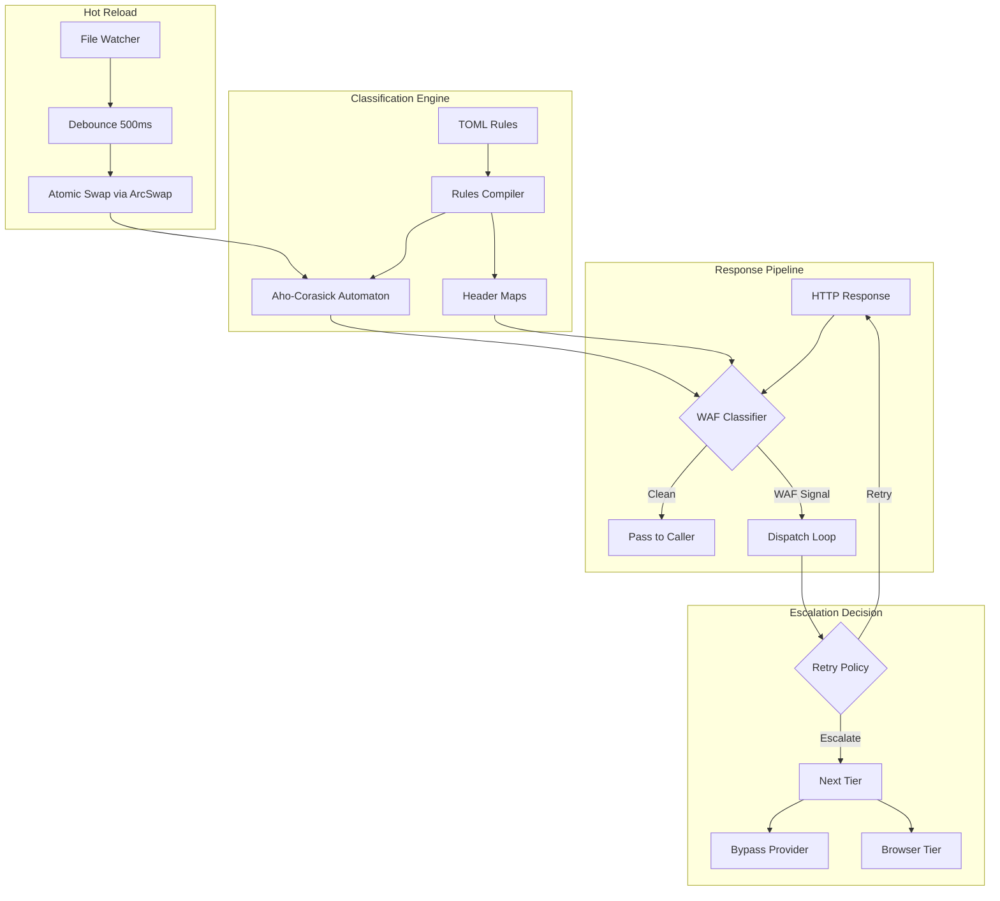
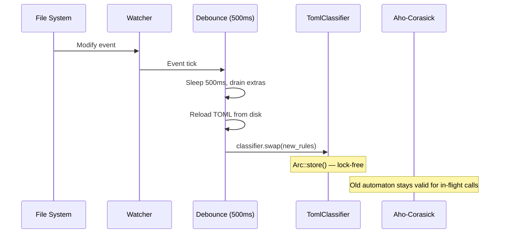
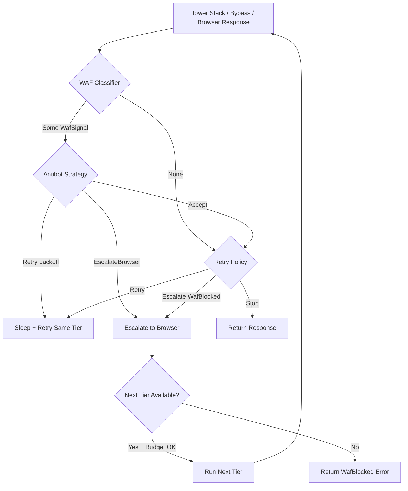

The WAF detection subsystem provides **automatic identification of Web Application Firewall (WAF) and bot-protection systems** through a TOML-driven fingerprint classifier. Rather than hardcoding vendor-specific detection logic, crawlberg uses a declarative fingerprint corpus that maps HTTP response patterns (headers and body substrings) to vendor identifiers. When a WAF challenge is detected, the engine triggers tiered escalation — automatically falling back to browser rendering or bypass providers to retrieve the actual content.

This page covers the classifier architecture, TOML rule format, the two-pass matching algorithm, hot-reload capabilities, and how WAF signals drive the dispatch loop's escalation decisions.

## Architecture Overview

The WAF detection system is built around four core components that interact through well-defined trait boundaries:



The architecture follows a **trait-based pluggable design** ([Trait-Based Pluggable Engine](10-trait-based-pluggable-engine)), allowing callers to swap the default `TomlClassifier` with custom implementations.

## Core Types and Traits

### WafSignal

The output of a successful classification — a single fingerprint match:

| Field | Type | Description |
|-------|------|-------------|
| `vendor` | `String` | Lowercase vendor identifier: `"cloudflare"`, `"datadome"`, `"perimeterx"`, etc. |
| `fingerprint_id` | `String` | Stable, dot-free identifier for the matched fingerprint (used as a metric label) |
| `weight` | `f32` | Confidence weight `0.0–1.0`; multi-signal fingerprints typically have higher weight |

Sources: [dispatch.rs](crates/crawlberg/src/types/dispatch.rs#L315-L323)

### WafClassifier Trait

The pluggable interface for all WAF detection implementations:

```rust
pub trait WafClassifier: Send + Sync + fmt::Debug {
    fn classify(&self, response: &HttpResponse) -> Result<Option<WafSignal>, WafClassifyError>;
}
```

The trait is **object-safe**, enabling dynamic dispatch via `Arc<dyn WafClassifier>`. The default implementation is `TomlClassifier`, which loads the TOML corpus at compile time and builds a single Aho-Corasick automaton over all body patterns.

Sources: [dispatch.rs](crates/crawlberg/src/types/dispatch.rs#L346-L354)

### WafClassifyError

Classifier failures are separated into two categories:

| Variant | When | Engine Behavior |
|---------|------|-----------------|
| `BuildError` | TOML parse or AC build failure at construction | Logs at WARN; dispatched as `Ok(None)` |
| `ClassifyError` | Per-call failure (e.g., body decoding) | Logs at WARN; dispatched as `Ok(None)` |

A misconfigured classifier does NOT crash the dispatcher — errors are logged and treated as "no WAF detected."

Sources: [dispatch.rs](crates/crawlberg/src/types/dispatch.rs#L215-L224)

## TOML Fingerprint Corpus

All fingerprints are defined in a single TOML file that serves as the **source of truth** for all WAF signals:

```
crates/crawlberg/rules/waf_fingerprints.toml
```

### Fingerprint Structure

Each fingerprint contains:

| Field | Type | Constraints |
|-------|------|-------------|
| `id` | `String` | Unique, no dots, used as metric label |
| `vendor` | `String` | Lowercase vendor identifier |
| `weight` | `f32` | Confidence `0.0–1.0` |
| `signals` | `Vec<TomlSignal>` | 1–16 signals per fingerprint |

Sources: [rules.rs](crates/crawlberg/src/waf/rules.rs#L36-L50)

### Signal Types

There are exactly two signal types:

| Signal Type | Fields | Matching Method |
|-------------|--------|-----------------|
| `response_header` | `name`, `value_contains` (optional) | Case-insensitive header name lookup; optional substring match on values |
| `body_substring` | `pattern` | Case-insensitive Aho-Corasick automaton |

**A fingerprint fires only when ALL of its signals match.** This enables vendor-specific combinations — for example, Cloudflare's `cloudflare_challenge_v1` requires both `server: cloudflare` AND the body containing `/cdn-cgi/challenge-platform/`.

Sources: [rules.rs](crates/crawlberg/src/waf/rules.rs#L52-L65), [waf_fingerprints.toml](crates/crawlberg/rules/waf_fingerprints.toml#L1-L15)

### Supported Vendors

The built-in corpus covers seven major WAF/bot-protection vendors:

| Vendor | Fingerprints | Example Signals |
|--------|--------------|-----------------|
| **Cloudflare** | 10 | `cf-chl-`, `__cf_chl_`, `turnstile`, `just a moment` |
| **DataDome** | 6 | `x-datadome` header, `captcha-delivery.com`, `dd.js` |
| **PerimeterX** | 5 | `x-px-block` header, `px-captcha`, `/_px/captcha` |
| **Imperva/Incapsula/Sucuri** | 5 | `x-sucuri-id` header, `_incap_ses_`, `incapsula` |
| **AWS WAF** | 4 | `x-amzn-waf-action` header, `awswaf.com/token` |
| **Akamai** | 1 | `AkamaiGHost` server header |
| **F5 Big-IP** | 2 | `big-ip` server header, `bigipserver` body |
| **Generic** | 1 | `"request blocked"` body pattern |

Sources: [waf_fingerprints.toml](crates/crawlberg/rules/waf_fingerprints.toml#L1-L318)

## Classification Algorithm

The `Rules::classify` method executes a **two-pass algorithm** that optimizes for common cases:

### Pass 1: Header-Only Short-Circuit

Fingerprints whose signals are **ALL** `response_header` signals are evaluated first. If any header-only fingerprint matches, the method returns immediately without scanning the body. This is critical for vendors like DataDome (`x-datadome` header) and PerimeterX (`x-px-block` header) where the header alone is sufficient.

```rust
// Header-only fingerprints short-circuit before body scans
for fingerprint in &self.fingerprints {
    if fingerprint.signals.iter().all(|s| matches!(s, Signal::ResponseHeader { .. }))
        && /* all headers match */ {
        return Ok(Some(signal));
    }
}
```

Sources: [rules.rs](crates/crawlberg/src/waf/rules.rs#L289-L312)

### Pass 2: Full Body Scan

The Aho-Corasick automaton runs over the response body (case-insensitive), collecting all matched fingerprint indices. Each fingerprint is then evaluated to verify **all** of its signals match.

**Key optimization**: On 2xx responses with bodies exceeding `CHALLENGE_BODY_LIMIT` (100 KB), body fingerprints are skipped entirely. Real content pages are much larger than WAF interstitials, and legitimate pages may mention vendor names in prose.

```rust
const CHALLENGE_BODY_LIMIT: usize = 100 * 1024; // 100 KB
let check_body = !is_2xx || !body_too_large;
```

Sources: [rules.rs](crates/crawlberg/src/waf/rules.rs#L20-L22), [rules.rs](crates/crawlberg/src/waf/rules.rs#L314-L338)

### Multi-Signal Matching

A fingerprint with multiple signals (e.g., `response_header` + `body_substring`) requires **all** signals to match. The `fingerprint_matches` method checks each signal against the response, returning `false` on the first non-matching signal:

```rust
fn fingerprint_matches(&self, fingerprint, fp_idx, matched_body_fps, response, is_2xx) -> bool {
    for signal in &fingerprint.signals {
        match signal {
            Signal::BodySubstring => {
                if !check_body || !matched_body_fps.contains(&fp_idx) {
                    return false;
                }
            }
            Signal::ResponseHeader { name, value_contains } => {
                if !header_matches(&response.headers, name, value_contains) {
                    return false;
                }
            }
        }
    }
    true
}
```

Sources: [rules.rs](crates/crawlberg/src/waf/rules.rs#L341-L372)

### Special Case: `x-px-*` Header Prefix

PerimeterX uses a header prefix pattern (`x-px-block`, `x-px-*`). The `header_matches` function handles this with a special case:

```rust
fn header_matches(headers, name, value_contains) -> bool {
    if name == "x-px-" {
        return headers.keys().any(|k| k.starts_with("x-px-"));
    }
    // ... normal exact-name matching
}
```

Sources: [rules.rs](crates/crawlberg/src/waf/rules.rs#L376-L388)

## Integration with the HTTP Pipeline

The WAF classifier is invoked at multiple points in the HTTP fetch pipeline to catch different blocking scenarios:

### 1. 403 Forbidden (WAF Block Detection)

When a 403 response is received, the classifier inspects the partial response (headers + body) before surfacing a `CrawlError::WafBlocked`:

```rust
403 => {
    let body = resp.text().await.unwrap_or_default();
    let partial_response = build_partial_response(status, &body, &headers);
    let classifier = TomlClassifier::builtin();
    if let Ok(Some(signal)) = classifier.classify(&partial_response) {
        return Err(CrawlError::WafBlocked {
            vendor: signal.vendor.clone(),
            message: format!("waf/blocked detected: {}", signal.vendor),
        });
    }
    return Err(CrawlError::Forbidden("forbidden".into()));
}
```

Sources: [http.rs](crates/crawlberg/src/http.rs#L196-L207)

### 2. 2xx Header-Stamp Early Exit

On 2xx responses, header-only fingerprints are checked **before** reading the body. If a header match is found, the body is read for the full classification, preventing false negatives:

```rust
if (200..300).contains(&status) {
    let headers_only_response = build_partial_response(status, "", &headers);
    let classifier = TomlClassifier::builtin();
    if let Ok(Some(signal)) = classifier.classify(&headers_only_response) {
        let body = resp.text().await.unwrap_or_default();
        // Full classification with body
        return Err(CrawlError::WafBlocked { vendor, message });
    }
}
```

Sources: [http.rs](crates/crawlberg/src/http.rs#L220-L238)

### 3. 2xx Body Interstitial Detection

Small 2xx bodies with high-confidence vendor JS fingerprints are treated as WAF interstitials (e.g., Cloudflare's "Just a moment..." page):

```rust
if (200..300).contains(&status) {
    let partial_response = build_partial_response_with_bytes(status, &body_bytes_vec, &body, &headers);
    let classifier = TomlClassifier::builtin();
    if let Ok(Some(signal)) = classifier.classify(&partial_response) {
        return Err(CrawlError::WafBlocked {
            vendor: signal.vendor.clone(),
            message: format!("waf/blocked detected on 2xx (body): {}", signal.vendor),
        });
    }
}
```

Sources: [http.rs](crates/crawlberg/src/http.rs#L278-L288)

## Hot-Reload and File Watching

The `TomlClassifier` supports **atomic hot-reload** of rules without process restart, using `arc_swap::ArcSwap` for lock-free concurrent access:



### WatchHandle Lifecycle

```rust
let classifier = Arc::new(TomlClassifier::builtin());
let handle = classifier.watch("rules/waf_fingerprints.toml")?;
// Rules auto-reload on file change
drop(handle); // Stops watcher and debounce task
```

The debounce interval is **500 ms**, handling editors that write via tmpfile + rename (and Kubernetes ConfigMap atomic projection).

Sources: [watch.rs](crates/crawlberg/src/waf/watch.rs#L1-L156), [mod.rs](crates/crawlberg/src/waf/mod.rs#L75-L91)

## Integration with the Dispatch Loop

WAF signals drive the tiered escalation strategy in the engine's dispatch loop:



### DispatchProfile Configuration

The `DispatchProfile` bundles all pluggable dispatch components:

| Field | Type | Default | Purpose |
|-------|------|---------|---------|
| `bypass` | `Option<DynBypassProvider>` | `None` | Vendor bypass provider |
| `strategy` | `EscalationStrategy` | `BrowserOnly` | Tier escalation chain |
| `retry_policy` | `Option<DynRetryPolicy>` | `SimpleRetryPolicy` | Per-attempt decisions |
| `waf_classifier` | `Option<DynWafClassifier>` | `None` (uses builtin) | Custom classifier |
| `domain_state` | `Option<DynDomainStatePort>` | `None` | Per-domain observations |
| `escalation_budget` | `Option<DynEscalationBudget>` | `None` (unlimited) | Cost control |
| `antibot_strategy` | `Option<DynAntibotStrategy>` | `None` | Pre/post hooks |
| `max_total_attempts` | `u32` | `10` | Global attempt cap |

Sources: [dispatch.rs](crates/crawlberg/src/types/dispatch.rs#L592-L619)

### EscalationStrategy Variants

| Strategy | Chain | Use Case |
|----------|-------|----------|
| `None` | HTTP only | Diagnostic/audit crawls |
| `BrowserOnly` | HTTP → Browser | Default; JS-heavy sites |
| `BypassFirst` | Always Bypass | Legacy bypass-first behavior |
| `BypassOnly` | HTTP → Bypass | WAF-heavy targets, no browser |
| `BypassThenBrowser` | HTTP → Bypass → Browser | Maximum resilience |

Sources: [dispatch.rs](crates/crawlberg/src/types/dispatch.rs#L44-L63)

## Custom WAF Classifiers

Implement the `WafClassifier` trait to plug in custom detection logic:

```rust
use crawlberg::{WafClassifier, WafSignal, WafClassifyError};
use crawlberg::http::HttpResponse;

#[derive(Debug)]
struct AlwaysClean;

impl WafClassifier for AlwaysClean {
    fn classify(&self, _response: &HttpResponse) -> Result<Option<WafSignal>, WafClassifyError> {
        Ok(None)
    }
}
```

Attach via `DispatchProfile`:

```rust
let profile = DispatchProfile::builder()
    .waf_classifier(Arc::new(MyCustomClassifier))
    .build();
```

Sources: [dispatch.rs](crates/crawlberg/src/types/dispatch.rs#L325-L345)

## Pluggable AntibotStrategy

For vendor-specific escalation logic beyond the default WAF → Browser behavior:

```rust
use crawlberg::{AntibotStrategy, Decision, WafSignal};
use crawlberg::http::HttpResponse;
use async_trait::async_trait;
use std::time::Duration;

#[derive(Debug)]
struct VendorAwareStrategy;

#[async_trait]
impl AntibotStrategy for VendorAwareStrategy {
    async fn pre_request(&self, _url: &str) -> Result<(), crawlberg::AntibotError> {
        Ok(())
    }

    async fn post_response(
        &self,
        _response: &HttpResponse,
        waf_signal: Option<&WafSignal>,
    ) -> Decision {
        match waf_signal {
            Some(signal) if signal.vendor == "datadome" => {
                Decision::Retry { backoff: Duration::from_secs(5) }
            }
            Some(_) => Decision::EscalateBrowser,
            None => Decision::Accept,
        }
    }
}
```

Sources: [antibot.rs](crates/crawlberg/src/types/antibot.rs#L1-L165)

## Observability and Telemetry

WAF classification emits OpenTelemetry metrics unconditionally:

| Metric | Instrument | Labels | Description |
|--------|------------|--------|-------------|
| `crawl_waf_blocks_total` | `u64_counter` | `vendor` | WAF challenges detected per vendor |
| `crawl_backend_escalations_total` | `u64_counter` | `from_tier`, `to_tier`, `reason` | Tier escalations in dispatch chain |

The `waf_blocks_total` counter is incremented inside `Rules::classify` on every successful fingerprint match, providing real-time visibility into which WAF vendors are blocking crawl requests.

Sources: [rules.rs](crates/crawlberg/src/waf/rules.rs#L307-L310), [metrics.rs](crates/crawlberg/src/telemetry/metrics.rs#L56-L58)

## Validation Constraints

The TOML loader enforces strict limits to prevent abuse and ensure performance:

| Constraint | Value | Error |
|------------|-------|-------|
| Max fingerprints per rules file | 1,000 | `RulesError::Validation` |
| Max pattern length per signal | 4,096 bytes | `RulesError::Validation` |
| Max signals per fingerprint | 16 | `RulesError::Validation` |
| Fingerprint IDs must be unique | — | `RulesError::Validation` |
| Fingerprint IDs must not contain dots | — | `RulesError::Validation` |
| Unknown signal kinds | — | `RulesError::Validation` |

Sources: [rules.rs](crates/crawlberg/src/waf/rules.rs#L24-L29)

## Performance Characteristics

The classifier is benchmarked across four scenarios:

| Benchmark | Description |
|-----------|-------------|
| `waf_ac_build_builtin` | Time to build the Aho-Corasick automaton from the builtin corpus |
| `waf_classify_clean_100kb` | Classification of a clean 100 KB HTML page (no WAF markers) |
| `waf_classify_match_early_100kb` | Classification when the match is in the first few bytes |
| `waf_classify_match_late_100kb` | Classification when the match is in the last few bytes |

The Aho-Corasick automaton provides **O(n)** body scanning regardless of the number of patterns, making classification fast even with hundreds of fingerprints.

Sources: [waf.rs](crates/crawlberg/benches/waf.rs#L1-L88)

## Fuzz Testing

A libFuzzer target exercises the classifier against random HTTP responses to ensure robustness:

```rust
fuzz_target!(|data: &[u8]| {
    let status = 200u16 + (status_byte as u16 % 400);
    let body = String::from_utf8_lossy(rest).into_owned();
    let response = HttpResponse { status, body, ... };
    let classifier = TomlClassifier::builtin();
    let _ = classifier.classify(&response);
});
```

Sources: [waf_classify.rs](fuzz/fuzz_targets/waf_classify.rs#L1-L29)

## Related Pages

- [SSRF Defense and URL Validation](18-ssrf-defense-and-url-validation) — URL validation before WAF classification
- [Tiered Escalation Strategy (HTTP, Bypass, Browser)](20-tiered-escalation-strategy-http-bypass-browser) — How WAF signals drive tier escalation
- [Bot Detection Evasion and Stealth](23-bot-detection-evasion-and-stealth) — Browser-level evasion after WAF detection
- [Observability and Telemetry](27-observability-and-telemetry) — Full metrics reference including WAF counters