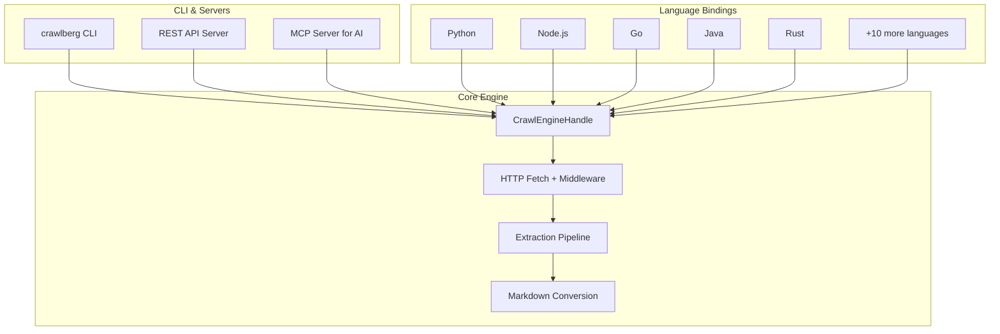

Crawlberg is a high-performance web crawling engine written in Rust, with native bindings for 14 programming languages. It transforms websites into clean, structured data — Markdown, metadata, and links — from a single page or an entire site. This guide gets you from zero to your first working crawl in under five minutes.

## Architecture Overview

Before diving into code, understanding Crawlberg's three-layer architecture helps you choose the right tools:



**Sources**: [architecture.md](docs-site/src/content/docs/concepts/architecture.md)

## Installation

Choose your language and install the package. No Rust toolchain required for most bindings — pre-built binaries are included.

### Language Packages

| Language | Install Command | Package Name |
|----------|----------------|--------------|
| **Python** | `pip install crawlberg` | `crawlberg` |
| **Node.js** | `npm install @xberg-io/crawlberg` | `@xberg-io/crawlberg` |
| **Rust** | `cargo add crawlberg` | `crawlberg` |
| **Go** | `go get github.com/xberg-io/crawlberg/packages/go` | `crawlberg` |
| **Java** | Maven Central `io.xberg.crawlberg:crawlberg` | `io.xberg-io.crawlberg` |
| **C#** | `dotnet add package Crawlberg` | `Crawlberg` |
| **Ruby** | `gem install crawlberg` | `crawlberg` |
| **PHP** | `composer require xberg-io/crawlberg` | `xberg-io/crawlberg` |
| **Elixir** | `{:crawlberg, "~> 0.3"}` in mix.exs | `crawlberg` |
| **Dart** | `dart pub add crawlberg` | `crawlberg` |
| **Swift** | SPM: `https://github.com/xberg-io/crawlberg` | `crawlberg` |
| **Zig** | `zig fetch --save` from GitHub | `crawlberg` |
| **Kotlin** | Maven Central `io.xberg.crawlberg:crawlberg-android` | `crawlberg-android` |
| **WebAssembly** | `npm install @xberg-io/crawlberg-wasm` | `@xberg-io/crawlberg-wasm` |

### CLI Installation

```bash
# Homebrew (macOS / Linux)
brew trust xberg-io/tap
brew install xberg-io/tap/crawlberg

# Cargo
cargo install crawlberg-cli

# npm (thin proxy, no Rust needed)
npm install -g @xberg-io/crawlberg-cli
```

### Docker

```bash
docker pull ghcr.io/xberg-io/crawlberg:latest
docker run --rm ghcr.io/xberg-io/crawlberg:latest scrape https://example.com
```

**Sources**: [installation.mdx](docs-site/src/content/docs/getting-started/installation.mdx)

## Three Core Operations

Crawlberg exposes three primary operations: **scrape** (single page), **crawl** (follow links), and **map** (discover URLs). Every operation follows the same pattern: create an engine, call the operation, process results.

### 1. Scrape a Single Page

Scraping fetches one URL and returns its metadata, links, images, and markdown content.

```python title="scrape.py"
import asyncio
from crawlberg import CrawlConfig, create_engine, scrape

async def main() -> None:
    engine = create_engine()
    result = await scrape(engine, "https://example.com")

    print(f"Status: {result.status_code}")
    print(f"Title: {result.metadata.title}")
    print(f"Description: {result.metadata.description}")
    print(f"Links: {len(result.links)}")
    print(f"Images: {len(result.images)}")

    if result.markdown:
        print(f"\n--- Markdown ({len(result.markdown.content)} chars) ---")
        print(result.markdown.content[:200])

asyncio.run(main())
```

```typescript title="scrape.ts"
import { createEngine, scrape } from "@xberg-io/crawlberg";

const engine = createEngine();
const result = await scrape(engine, "https://example.com");

console.log(`Status: ${result.statusCode}`);
console.log(`Title: ${result.metadata?.title ?? "(none)"}`);
console.log(`Description: ${result.metadata?.description ?? "(none)"}`);
console.log(`Links: ${result.links?.length ?? 0}`);
console.log(`Images: ${result.images?.length ?? 0}`);

if (result.markdown) {
    console.log(`\n--- Markdown (${result.markdown.content.length} chars) ---`);
    console.log(result.markdown.content.slice(0, 200));
}
```

```rust title="src/main.rs"
use crawlberg::{CrawlConfig, create_engine, scrape};

#[tokio::main]
async fn main() -> Result<(), Box<dyn std::error::Error>> {
    let engine = create_engine(None)?;
    let result = scrape(&engine, "https://example.com").await?;

    println!("Status: {}", result.status_code);
    println!("Title: {}", result.metadata.title.as_deref().unwrap_or("(none)"));
    println!("Links: {}", result.links.len());
    println!("Images: {}", result.images.len());

    if let Some(ref md) = result.markdown {
        println!("\n--- Markdown ({} chars) ---", md.content.len());
        println!("{}", &md.content[..200.min(md.content.len())]);
    }

    Ok(())
}
```

```bash title="CLI"
# JSON output with all metadata
crawlberg scrape https://example.com

# Markdown output only
crawlberg scrape https://example.com --format markdown
```

**Sources**: [quickstart.mdx](docs-site/src/content/docs/getting-started/quickstart.mdx#L1-L80)

### 2. Crawl a Website

Crawling starts from a seed URL, follows links up to a configured depth, and returns results for all discovered pages.

```python title="crawl.py"
import asyncio
from crawlberg import CrawlConfig, create_engine, crawl

async def main() -> None:
    engine = create_engine(CrawlConfig(
        max_depth=2,
        max_pages=50,
        stay_on_domain=True,
        respect_robots_txt=True,
    ))
    result = await crawl(engine, "https://example.com")

    print(f"Crawled {len(result.pages)} pages (final URL: {result.final_url})")

    for page in result.pages:
        title = page.metadata.title or "(no title)"
        md_len = len(page.markdown.content) if page.markdown else 0
        print(f"  [depth={page.depth}] {page.url} - {title} ({md_len} chars markdown)")

asyncio.run(main())
```

```typescript title="crawl.ts"
import { createEngine, crawl } from "@xberg-io/crawlberg";

const engine = createEngine({
    maxDepth: 2,
    maxPages: 50,
    stayOnDomain: true,
    respectRobotsTxt: true,
});

const result = await crawl(engine, "https://example.com");

console.log(`Crawled ${result.pages.length} pages (final URL: ${result.finalUrl})`);

for (const page of result.pages) {
    const title = page.metadata?.title ?? "(no title)";
    const mdLen = page.markdown?.content.length ?? 0;
    console.log(`  [depth=${page.depth}] ${page.url} - ${title} (${mdLen} chars markdown)`);
}
```

```bash title="CLI"
# Crawl with depth and page limits
crawlberg crawl https://example.com --depth 2 --max-pages 50 --respect-robots-txt

# Markdown output
crawlberg crawl https://example.com --depth 2 --format markdown
```

**Key `CrawlConfig` fields for crawling**:

| Field | Default | Description |
|-------|---------|-------------|
| `max_depth` | `None` (0) | Maximum link hops from the start URL |
| `max_pages` | `None` (unlimited) | Maximum number of pages to crawl |
| `max_concurrent` | `None` (10) | Maximum parallel requests |
| `stay_on_domain` | `false` | Restrict crawling to the same domain |
| `allow_subdomains` | `false` | Allow subdomains when `stay_on_domain` is true |
| `respect_robots_txt` | `false` | Honor robots.txt directives |
| `include_paths` | `[]` | Regex patterns for paths to include |
| `exclude_paths` | `[]` | Regex patterns for paths to exclude |

**Sources**: [quickstart.mdx](docs-site/src/content/docs/getting-started/quickstart.mdx#L81-L180)

### 3. Map a Website

Mapping discovers all URLs on a site using sitemaps and link extraction, without downloading full page content.

```python title="map.py"
import asyncio
from crawlberg import CrawlConfig, create_engine, map_urls

async def main() -> None:
    engine = create_engine(CrawlConfig(
        respect_robots_txt=True,
        map_limit=100,
    ))
    result = await map_urls(engine, "https://example.com")

    print(f"Discovered {len(result.urls)} URLs:")
    for entry in result.urls:
        lastmod = entry.lastmod or "(unknown)"
        print(f"  {entry.url} (last modified: {lastmod})")

asyncio.run(main())
```

```typescript title="map.ts"
import { createEngine, mapUrls } from "@xberg-io/crawlberg";

const engine = createEngine({
    respectRobotsTxt: true,
    mapLimit: 100,
});

const result = await mapUrls(engine, "https://example.com");

console.log(`Discovered ${result.urls.length} URLs:`);
for (const entry of result.urls) {
    const lastmod = entry.lastmod ?? "(unknown)";
    console.log(`  ${entry.url} (last modified: ${lastmod})`);
}
```

```bash title="CLI"
# Discover URLs
crawlberg map https://example.com --respect-robots-txt

# Limit results and filter by search term
crawlberg map https://example.com --limit 100 --search "blog"
```

**Sources**: [quickstart.mdx](docs-site/src/content/docs/getting-started/quickstart.mdx#L201-L300)

## Result Types

Every operation returns structured data. Understanding the result shape helps you extract the information you need.

### ScrapeResult

The result of a single-page scrape:

| Field | Type | Description |
|-------|------|-------------|
| `status_code` | `int` | HTTP response status |
| `metadata` | `PageMetadata` | 40+ fields (Open Graph, Twitter Card, Dublin Core, JSON-LD, etc.) |
| `links` | `list[LinkInfo]` | All links categorized as Internal, External, Anchor, or Document |
| `images` | `list[ImageInfo]` | All image sources from ``, `<picture>`, `og:image`, `srcset` |
| `markdown` | `MarkdownResult` | Converted markdown with optional citations and fit content |
| `feeds` | `list[FeedInfo]` | Discovered RSS, Atom, and JSON Feed links |
| `json_ld` | `list[JsonLdEntry]` | Parsed JSON-LD entries |
| `assets` | `list[DownloadedAsset]` | Downloaded CSS, JS, and image assets (when enabled) |
| `documents` | `list[DownloadedDocument]` | Downloaded PDFs, DOCX, and other non-HTML documents |

### CrawlResult

The result of following links from a seed:

| Field | Type | Description |
|-------|------|-------------|
| `pages` | `list[CrawlPageResult]` | All crawled pages with their results |
| `final_url` | `str` | The last URL after redirects from the start URL |
| `depth` | `int` | The maximum depth reached in the crawl |

### MapResult

The result of URL discovery:

| Field | Type | Description |
|-------|------|-------------|
| `urls` | `list[SitemapUrl]` | Discovered URLs with metadata |
| `sitemap_urls` | `list[str]` | URLs of sitemaps found |

Each `SitemapUrl` includes `url`, `lastmod`, `changefreq`, and `priority`.

**Sources**: [quickstart.mdx](docs-site/src/content/docs/getting-started/quickstart.mdx#L60-L80), [configuration.md](docs-site/src/content/docs/reference/configuration.md)

## Engine Configuration

The `CrawlConfig` object controls all engine behavior. You can pass `None` (or equivalent) to use defaults, or customize specific fields.

### Common Configuration Patterns

**Basic scraping (no configuration needed)**:
```python
engine = create_engine()  # Uses all defaults
```

**Crawling with limits**:
```python
engine = create_engine(CrawlConfig(
    max_depth=2,
    max_pages=50,
    stay_on_domain=True,
    respect_robots_txt=True,
))
```

**Custom headers and authentication**:
```python
engine = create_engine(CrawlConfig(
    custom_headers={"Authorization": "Bearer token123"},
    request_timeout=60000,  # 60 seconds
))
```

**Browser fallback for JavaScript-heavy pages**:
```python
from crawlberg import BrowserConfig, BrowserMode, BrowserBackend

engine = create_engine(CrawlConfig(
    browser=BrowserConfig(
        mode=BrowserMode.AUTO,  # Fallback to browser when needed
        backend=BrowserBackend.CHROMIUMOXIDE,
    ),
))
```

**Sources**: [configuration.md](docs-site/src/content/docs/reference/configuration.md), [features.md](docs-site/src/content/docs/features.md)

## Multi-Language Examples

The same operations work identically across all 14 language bindings. Here are complete "hello world" examples showing both scrape and crawl in each language:

### Rust

```rust title="src/main.rs"
use crawlberg::{create_engine, scrape};

#[tokio::main]
async fn main() -> crawlberg::Result<()> {
    let engine = create_engine(None)?;
    let result = scrape(&engine, "https://example.com/").await?;

    println!("{}", result.metadata.title.as_deref().unwrap_or("(no title)"));
    println!("{}", result.markdown.content);
    println!("{} links", result.links.len());

    Ok(())
}
```

### Go

```go title="main.go"
package main

import (
    "fmt"
    "log"

    crawlberg "github.com/xberg-io/crawlberg/packages/go"
)

func main() {
    engine, err := crawlberg.CreateEngine(nil)
    if err != nil {
        log.Fatalf("create engine: %v", err)
    }

    result, err := crawlberg.Scrape(engine, "https://example.com/")
    if err != nil {
        log.Fatalf("scrape: %v", err)
    }

    title := ""
    if result.Metadata.Title != nil {
        title = *result.Metadata.Title
    }
    fmt.Printf("Title: %s\n", title)
    fmt.Printf("Status: %d\n", result.StatusCode)
    fmt.Printf("Links found: %d\n", len(result.Links))
}
```

### Java

```java title="BasicUsage.java"
import io.xberg.crawlberg.Crawlberg;
import io.xberg.crawlberg.CrawlEngineHandle;
import io.xberg.crawlberg.ScrapeResult;

public class BasicUsage {
    public static void main(String[] args) throws Exception {
        CrawlEngineHandle engine = Crawlberg.createEngine();
        ScrapeResult result = Crawlberg.scrape(engine, "https://example.com/");
        System.out.println("Title: " + result.metadata().title());
        System.out.println("Status: " + result.statusCode());
        System.out.println("Links found: " + result.links().size());
    }
}
```

### Ruby

```ruby title="scrape.rb"
require "crawlberg"

engine = Crawlberg.create_engine
result = Crawlberg.scrape(engine, "https://example.com/")
puts "Title: #{result.metadata.title}"
puts "Status: #{result.status_code}"
puts "Links found: #{result.links.length}"
```

### PHP

```php title="scrape.php"
<?php
declare(strict_types=1);

use Crawlberg\Crawlberg;

$engine = Crawlberg::createEngine(null);
$result = Crawlberg::scrape($engine, "https://example.com/");
echo "Title: " . ($result->metadata->title ?? "") . "\n";
echo "Status: " . $result->statusCode . "\n";
echo "Links found: " . count($result->links) . "\n";
```

### Elixir

```elixir title="scrape.exs"
{:ok, engine} = Crawlberg.create_engine()
{:ok, scrape_json} = Crawlberg.scrape_async(engine, "https://example.com/")
scrape = Jason.decode!(scrape_json)
IO.puts("Title: #{scrape["metadata"]["title"]}")
IO.puts("Status: #{scrape["status_code"]}")
IO.puts("Links found: #{length(scrape["links"] || [])}")
```

### Dart

```dart title="main.dart"
import 'package:crawlberg/crawlberg.dart';
import 'package:crawlberg/src/crawlberg_bridge_generated/frb_generated.dart'
    show RustLib;

Future<void> main() async {
  await RustLib.init();

  final engine = await CrawlbergBridge.createEngine();
  final result = await CrawlbergBridge.scrape(engine, 'https://example.com/');
  print('Title: ${result.metadata.title ?? ''}');
  print('Status: ${result.statusCode}');
  print('Links found: ${result.links.length}');
}
```

### Kotlin (Android)

```kotlin title="Main.kt"
import io.xberg.crawlberg.android.Crawlberg
import kotlinx.coroutines.runBlocking

fun main() = runBlocking {
    val engine = Crawlberg.createEngine()
    val result = Crawlberg.scrapeAsync(engine, "https://example.com/")
    println("Title: ${result.metadata.title}")
    println("Status: ${result.statusCode}")
    println("Links found: ${result.links.size}")
}
```

### Swift

```swift title="main.swift"
import Foundation
import Crawlberg

@main
struct BasicUsage {
    static func main() async throws {
        let engine = try createEngine(nil)
        let result = try await scrape(engine, "https://example.com/")
        print("Title: \(result.metadata().title()?.toString() ?? "")")
        print("Status: \(result.status_code())")
        print("Links found: \(result.links().count)")
    }
}
```

### WebAssembly

```typescript title="scrape.ts"
import { createEngine, scrape } from "@xberg-io/crawlberg-wasm";

const engine = createEngine();
const result = await scrape(engine, "https://example.com/");
console.log(`Title: ${result.metadata?.title ?? ""}`);
console.log(`Status: ${result.statusCode}`);
console.log(`Links found: ${result.links?.length ?? 0}`);
```

### Zig

```zig title="main.zig"
const std = @import("std");
const crawlberg = @import("crawlberg");

pub fn main() !void {
    var gpa: std.heap.DebugAllocator(.{}) = .init;
    defer _ = gpa.deinit();
    const allocator = gpa.allocator();

    const scrape_json = try crawlberg.scrape(null, "https://example.com/");
    defer std.heap.c_allocator.free(scrape_json);
    var scrape_parsed = try std.json.parseFromSlice(std.json.Value, allocator, scrape_json, .{});
    defer scrape_parsed.deinit();
    const result = &scrape_parsed.value;
    const title = result.object.get("metadata").?.object.get("title").?;
    std.debug.print("Title: {s}\n", .{if (title == .string) title.string else ""});
    std.debug.print("Status: {d}\n", .{result.object.get("status_code").?.integer});
    std.debug.print("Links found: {d}\n", .{result.object.get("links").?.array.items.len});
}
```

**Sources**: [basic_usage.mdx](docs-site/src/content/docs/getting-started/basic_usage.mdx), snippets under [docs-site/src/snippets/](docs-site/src/snippets/)

## Error Handling

Crawlberg raises typed exceptions for different failure modes. Handle them appropriately for robust applications:

```python title="error_handling.py"
from crawlberg import CrawlError, NotFoundError, ForbiddenError, WafBlockedError

try:
    result = await scrape(engine, "https://example.com")
except NotFoundError:
    print("Page not found (404)")
except ForbiddenError:
    print("Access denied (403)")
except WafBlockedError:
    print("Blocked by WAF - try browser fallback")
except CrawlError as e:
    print(f"Crawl failed: {e}")
```

**Common error types**:

| Exception | HTTP Status | Description |
|-----------|-------------|-------------|
| `NotFoundError` | 404 | Page not found |
| `ForbiddenError` | 403 | Access denied |
| `UnauthorizedError` | 401 | Authentication required |
| `RateLimitedError` | 429 | Too many requests |
| `ServerError` | 5xx | Server error |
| `WafBlockedError` | 403 | Blocked by Web Application Firewall |
| `CrawlTimeoutError` | — | Request timed out |
| `CrawlConnectionError` | — | Connection failed |
| `SsrfError` | — | Blocked by SSRF policy |

**Sources**: [quickstart.mdx](docs-site/src/content/docs/getting-started/quickstart.mdx), Python exceptions module [__init__.py](packages/python/crawlberg/__init__.py)

## What's Next?

You now have the basics. Here's the recommended learning path based on the [documentation catalog](/):

| Page | What You'll Learn |
|------|-------------------|
| [Installation](3-installation-across-languages) | Complete installation guide for all 14 languages, Docker, and CLI |
| [CLI Usage](4-cli-usage) | Command-line interface for scraping, crawling, and URL discovery |
| [Core Public API](5-core-public-api) | Full API reference for `create_engine`, `scrape`, `crawl`, `map_urls`, and more |
| [Scrape a Single Page](6-scrape-a-single-page) | Deep dive into single-page scraping with configuration options |
| [Crawl a Website](7-crawl-a-website) | Advanced crawling with depth, concurrency, and domain restrictions |
| [Discover URLs with Map](8-discover-urls-with-map) | Sitemap parsing and URL discovery strategies |

For production deployments, also explore:
- **[Configuration Reference](11-configuration-reference-crawlconfig)** — Complete `CrawlConfig` field reference with defaults and validation rules
- **[Browser Rendering Backends](21-browser-rendering-backends)** — Handling JavaScript-heavy SPAs with headless Chrome fallback
- **[Docker and Deployment](29-docker-and-deployment)** — Containerized deployments and CI/CD integration

---

*This documentation is auto-generated from the crawlberg source tree. Last verified against version 0.3.*