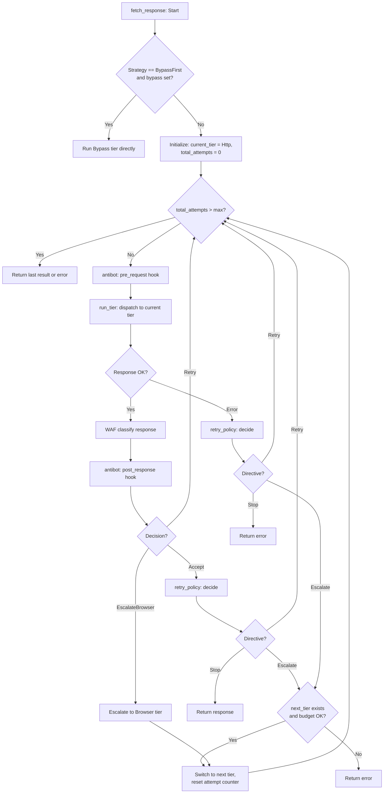

Modern web targets deploy escalating layers of bot protection — from simple User-Agent checks to JavaScript challenges, WAF fingerprinting, and CAPTCHA gates. Crawlberg addresses this with a **three-tier escalation strategy** that starts with the cheapest fetch method and progressively escalates to more capable (and more expensive) backends only when the current tier fails.

This page explains the dispatch architecture: how requests flow through tiers, what triggers escalation, how costs are controlled, and how you can plug in custom behavior at every decision point.

## The Three Tiers

Crawlberg defines three distinct fetch backends, ordered from cheapest to most expensive:

| Tier | Backend | Cost | Best For |
|---|---|---|---|
| **Http** | `reqwest` via Tower service stack | Free | Static HTML, standard APIs |
| **Bypass** | Caller-supplied `BypassProvider` | ~$0.003/request | WAF-heavy targets (Bright Data, Zyte, ScrapingBee) |
| **Browser** | Headless Chrome (CDP or native) | High (browser pool + proxy) | JavaScript-rendered SPAs, Cloudflare challenges |

The `Tier` enum lives at [types/dispatch.rs](crates/crawlberg/src/types/dispatch.rs#L81-L91):

```rust
pub enum Tier {
    Http,    // Plain HTTP fetch tier
    Bypass,  // Caller-supplied bypass vendor
    Browser, // Headless-browser tier
}
```

Each tier has a heuristic cost in "cents" used for budget accounting — `Http` costs 0, while `Bypass` and `Browser` each cost 1 ([engine/mod.rs](crates/crawlberg/src/engine/mod.rs#L637-L643)). This allows a `FixedBudget(10)` to cap the total number of non-HTTP escalations per job.

## Escalation Strategies

The `EscalationStrategy` enum at [types/dispatch.rs](crates/crawlberg/src/types/dispatch.rs#L43-L63) defines the chain of escalation:

```rust
pub enum EscalationStrategy {
    None,               // No escalation — surface failures as-is
    BrowserOnly,        // HTTP → Browser (default)
    BypassFirst,        // Skip HTTP, go straight to Bypass
    BypassOnly,         // HTTP → Bypass, never Browser
    BypassThenBrowser,  // HTTP → Bypass → Browser (maximum resilience)
}
```

The `next_tier` function at [engine/mod.rs](crates/crawlberg/src/engine/mod.rs#L612-L630) implements a **complete match matrix** — every `(Tier, EscalationStrategy)` pair is explicitly enumerated so that adding a new strategy variant produces a compile error instead of silently falling through:

```rust
fn next_tier(current: Tier, strategy: EscalationStrategy) -> Option<Tier> {
    match (current, strategy) {
        (Tier::Http, EscalationStrategy::BrowserOnly)       => Some(Tier::Browser),
        (Tier::Http, EscalationStrategy::BypassOnly)        => Some(Tier::Bypass),
        (Tier::Http, EscalationStrategy::BypassThenBrowser) => Some(Tier::Bypass),
        (Tier::Bypass, EscalationStrategy::BypassThenBrowser) => Some(Tier::Browser),
        // All terminal states explicitly listed:
        (Tier::Browser, _) => None,
        (_, EscalationStrategy::None) => None,
        // ...
    }
}
```

### Choosing a Strategy

| Strategy | When to Use |
|---|---|
| `None` | Audit crawls where you want raw HTTP errors without automatic recovery |
| `BrowserOnly` | Default for JS-heavy sites where the browser is already configured |
| `BypassFirst` | Legacy: auto-selected when `bypass` is set but strategy is unset |
| `BypassOnly` | WAF-heavy targets where no browser backend is available |
| `BypassThenBrowser` | Maximum resilience: vendor bypass first, browser as the ultimate fallback |

**Important:** When `BrowserMode::Never` is active and the effective strategy is `BrowserOnly`, the engine silently demotes it to `None` so that the original HTTP error survives rather than producing a confusing "browser not available" error ([engine/mod.rs](crates/crawlberg/src/engine/mod.rs#L156-L163)).

## The Dispatch Loop

The core dispatch loop lives in `CrawlEngine::fetch_response` at [engine/mod.rs](crates/crawlberg/src/engine/mod.rs#L126-L472). It orchestrates tier selection, retry, and escalation through a single `loop`:



### Per-Tier Execution

The `run_tier` method at [engine/mod.rs](crates/crawlberg/src/engine/mod.rs#L478-L538) dispatches to the appropriate backend:

**Http tier** — builds a Tower service stack with per-domain rate limiting, caching, and UA rotation, then calls the innermost `HttpFetchService` ([tower/service.rs](crates/crawlberg/src/tower/service.rs#L17-L280)).

**Bypass tier** — calls `provider.fetch(url)` on the configured `DynBypassProvider`, returning the vendor's rendered HTML directly ([engine/mod.rs](crates/crawlberg/src/engine/mod.rs#L493-L513)).

**Browser tier** — calls `browser_fetch` which delegates to either the `chromiumoxide` backend or the native `crawlberg-browser` backend depending on `BrowserConfig.backend` ([browser.rs](crates/crawlberg/src/browser.rs#L38-L58)).

### Budget Gating

Before escalating, the dispatcher calls `budget.try_consume(tier_cost)`. The default `UnlimitedBudget` always succeeds ([defaults/dispatch.rs](crates/crawlberg/src/defaults/dispatch.rs#L125-L134)), but callers can inject a `FixedBudget` that atomically decrements a counter — returning `BudgetExhausted` when the remaining budget can't cover the escalation cost ([defaults/dispatch.rs](crates/crawlberg/src/defaults/dispatch.rs#L142-L180)).

## WAF Detection and Fingerprint Classification

Escalation is driven by detection signals. The engine uses two complementary WAF detection paths:

### 1. Status-Code-Based Detection

At the HTTP fetch layer ([tower/service.rs](crates/crawlberg/src/tower/service.rs#L150-L166)), a 403 response is checked against the built-in `TomlClassifier`. If the body contains known WAF fingerprints, the response is classified as `CrawlError::WafBlocked` with vendor attribution.

### 2. Body-Level Fingerprint Matching

The `TomlClassifier` at [waf/mod.rs](crates/crawlberg/src/waf/mod.rs#L37-L97) loads a TOML corpus of fingerprints (embedded at compile time from [rules/waf_fingerprints.toml](crates/crawlberg/rules/waf_fingerprints.toml)). It builds a single **Aho-Corasick automaton** over all body patterns and checks response headers for WAF-stamp signals:

```toml
[[fingerprint]]
id = "cloudflare_challenge_v1"
vendor = "cloudflare"
weight = 1.0
[[fingerprint.signals]]
kind = "response_header"
name = "server"
value_contains = "cloudflare"
[[fingerprint.signals]]
kind = "body_substring"
pattern = "/cdn-cgi/challenge-platform/"
```

Key properties:
- A fingerprint fires only when **all** its signals match
- 2xx responses with small bodies (<100KB) are also checked — some WAFs return challenge pages with a 200 status ([http.rs](crates/crawlberg/src/http.rs#L279-L288))
- Hot-reload via `ArcSwap`: call `classifier.swap(new_rules)` or `classifier.watch(path)` to atomically replace rules at runtime ([waf/mod.rs](crates/crawlberg/src/waf/mod.rs#L71-L90))
- The classifier is wrapped in the `WafClassifier` trait ([types/dispatch.rs](crates/crawlberg/src/types/dispatch.rs#L346-L354)), allowing fully custom implementations

### 3. SPA Shell Detection

The `detect_js_render_needed` function at [browser_detect.rs](crates/crawlberg/src/browser_detect.rs#L25-L53) uses **pure HTML heuristics** (no network access) to identify pages that need JavaScript rendering:

| Signal | Detection Method |
|---|---|
| Empty SPA mount point | Checks `#root`, `#app`, `#__next`, `#__nuxt` for empty content |
| Noscript warning | Regex match on `enable javascript` / `need javascript` text |
| Sparse content + scripts | Word count < 20 with `<script src>` tags present |
| Content density threshold | Pages with ≥ 50 words are never flagged |

This function runs after the HTTP fetch succeeds — it feeds the `js_render_hint` field of `ScrapeResult`, which triggers a browser re-fetch when `BrowserMode::Auto` is active.

## Escalation Reasons

The `EscalationReason` enum at [types/dispatch.rs](crates/crawlberg/src/types/dispatch.rs#L116-L133) categorizes why the dispatcher escalated:

| Reason | Trigger | Typical Next Tier |
|---|---|---|
| `WafBlocked { vendor }` | WAF fingerprint matched on 403 or 2xx body | Bypass or Browser |
| `SoftBlock` | 200 with low content density (0.0–0.1) | Browser |
| `RenderNeeded` | SPA shell detected by `browser_detect` | Browser |
| `OriginUnreliable` | Sustained 5xx errors | Browser |
| `AntibotEscalate` | Custom `AntibotStrategy` returned `EscalateBrowser` | Browser |

## Pluggable Decision Points

The dispatch architecture is built around six pluggable traits, all wired through `DispatchProfile` at [types/dispatch.rs](crates/crawlberg/src/types/dispatch.rs#L592-L619):

### RetryPolicy

Decides what to do after each attempt: `Stop`, `Retry { backoff_ms }`, or `Escalate { reason }`. The default `SimpleRetryPolicy` ([defaults/dispatch.rs](crates/crawlberg/src/defaults/dispatch.rs#L28-L111)) maps errors as follows:

| Error | Directive |
|---|---|
| `WafBlocked` | `Escalate { WafBlocked }` |
| `Forbidden` | `Escalate { WafBlocked }` (403 treated as block) |
| `RateLimited`, `ServerError`, `BadGateway`, `Timeout` | `Retry` with exponential backoff, up to 3 retries |
| `Dns`, `Ssl`, `Connection`, `NotFound`, `Unauthorized` | `Stop` (permanent) |

### WafClassifier

Pluggable WAF fingerprint detection. Default: `TomlClassifier::builtin()`. The `classify` method receives an `HttpResponse` and returns `Option<WafSignal>`.

### DomainStatePort

Persistent per-domain learning backend. The built-in `EwmaDomainState` ([defaults/domain_state.rs](crates/crawlberg/src/defaults/domain_state.rs#L97-L185)) uses a `DashMap` with EWMA smoothing:

- **Alpha = 0.1** (~72-hour half-life at typical crawl rates)
- **Promote** to `Tier::Bypass` when block rate ≥ 0.4 with ≥ 10 samples
- **Demote** to `Tier::Http` when block rate ≤ 0.1 with ≥ 50 samples

The `LearningRetryPolicy` ([defaults/domain_state.rs](crates/crawlberg/src/defaults/domain_state.rs#L192-L232)) combines `SimpleRetryPolicy` with `DomainStatePort` observation — each decision records the outcome to the state backend for future recommendations.

### EscalationBudget

Controls per-job spending. `UnlimitedBudget` (default) permits unlimited escalations. `FixedBudget(n)` limits total non-HTTP escalations to `n` via lock-free atomic CAS ([defaults/dispatch.rs](crates/crawlberg/src/defaults/dispatch.rs#L142-L180)).

### AntibotStrategy

A pre-request / post-response hook pair at [types/antibot.rs](crates/crawlberg/src/types/antibot.rs#L96-L165):

- `pre_request(&url)` — fires before each fetch (header injection, token rotation)
- `post_response(&response, &waf_signal)` — returns `Decision::Accept`, `Retry`, `RotateProxy`, or `EscalateBrowser`

When `None` (default), the engine's built-in WAF-signal logic applies unchanged.

### BypassProvider

The external bypass backend at [types/bypass.rs](crates/crawlberg/src/types/bypass.rs#L51-L62):

```rust
pub trait BypassProvider: Send + Sync + fmt::Debug {
    async fn fetch(&self, url: &str) -> Result<BypassResponse, CrawlError>;
    fn vendor_name(&self) -> &'static str;
}
```

The `crawlberg-bypass` crate provides a YAML-config-driven `SimpleHttpProvider` ([crawlberg-bypass/src/provider.rs](crates/crawlberg-bypass/src/provider.rs#L17-L55)) with pre-built configs for Bright Data, Zyte, and ScrapingBee:

```yaml
# crates/crawlberg-bypass/configs/bright_data.yaml
vendor_name: bright_data
endpoint: "https://api.brightdata.com/request"
method: POST
auth:
  kind: bearer
  token: "${BRIGHT_DATA_TOKEN}"
```

## Browser Tier Deep Dive

When escalation reaches the Browser tier, `browser_fetch` at [browser.rs](crates/crawlberg/src/browser.rs#L38-L58) delegates to one of two backends based on `BrowserBackend`:

| Backend | Feature Flag | Strengths |
|---|---|---|
| `Chromiumoxide` | `browser` | Full CDP control, session affinity, connection pooling via `BrowserPool` |
| `Native` | `browser-native` | TLS fingerprint spoofing (Chrome 145 via wreq), stealth patches, lighter footprint |

Both backends apply:
- **SSRF validation** before navigation ([net/ssrf.rs](crates/crawlberg/src/net/ssrf.rs))
- **Session affinity** — reuse Chrome pages per domain so cookies and challenge solutions persist ([BrowserConfig.session_affinity](crates/crawlberg/src/types/config.rs#L268-L271))
- **Stealth patches** when `BrowserMode::Stealth` — JavaScript patches for `navigator.webdriver`, fake plugins, WebGL vendor spoofing, and Chrome runtime objects ([stealth.rs](crates/crawlberg/src/stealth.rs#L1-L80))

## Configuration

### DispatchProfile Setup

```rust
use crawlberg::{
    CrawlEngine, CrawlConfig, DispatchProfile, EscalationStrategy,
    FixedBudget, SimpleRetryPolicy,
};

let profile = DispatchProfile::builder()
    .strategy(EscalationStrategy::BypassThenBrowser)
    .max_total_attempts(15)
    .build();

let config = CrawlConfig::builder()
    .dispatch(profile)
    .build();
```

### BrowserMode Interplay

| `BrowserMode` | `EscalationStrategy` | Behavior |
|---|---|---|
| `Always` | Any | Skips HTTP entirely, goes straight to Browser |
| `Auto` | `BrowserOnly` | HTTP first, escalates to Browser on WAF/SPA |
| `Auto` | `BypassThenBrowser` | HTTP → Bypass → Browser |
| `Never` | `BrowserOnly` | Demoted to `None`; HTTP errors surface as-is |
| `Stealth` | Any | Like `Always`, plus all stealth patches enabled |

## Observability

The dispatch loop emits structured telemetry at every decision boundary:

- **Tracing span** `crawlberg::dispatch` with `tier_chain`, `escalation_reason`, `attempt_count`, `policy`, `content_density` ([engine/mod.rs](crates/crawlberg/src/engine/mod.rs#L673-L691))
- **OTel metric** `backend_escalations_total` with labels `from_tier`, `to_tier`, `reason` ([engine/mod.rs](crates/crawlberg/src/engine/mod.rs#L302-L309))
- **WAF classifier** emits `waf_fingerprint_matches_total` with vendor and fingerprint ID labels

## Related Pages

- [WAF Detection and Fingerprint Classification](19-waf-detection-and-fingerprint-classification) — Deep dive into the TOML fingerprint corpus and Aho-Corasick matching
- [Browser Rendering Backends](21-browser-rendering-backends) — chromiumoxide vs native backend architecture
- [Bot Detection Evasion and Stealth](23-bot-detection-evasion-and-stealth) — Stealth JS patches and TLS fingerprinting
- [Configuration Reference (CrawlConfig)](11-configuration-reference-crawlconfig) — Full list of dispatch and browser configuration fields
- [Trait-Based Pluggable Engine](10-trait-based-pluggable-engine) — How all pluggable traits compose in the engine