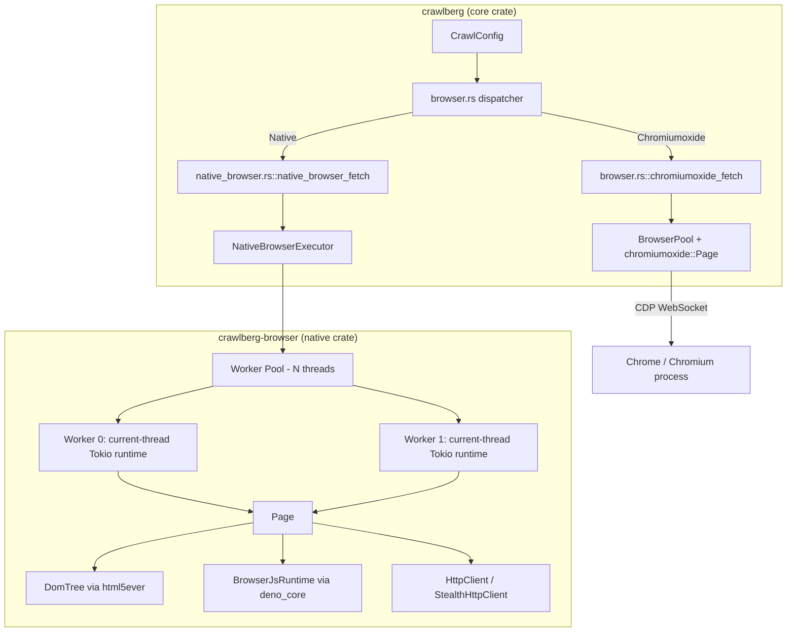
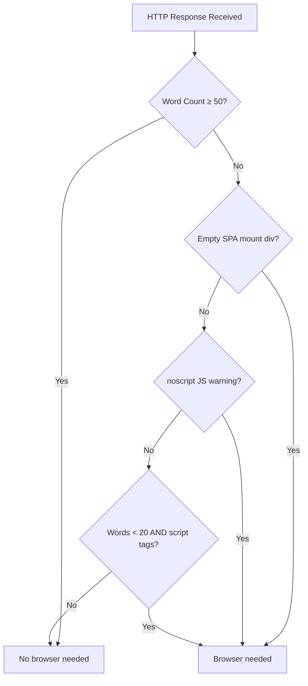
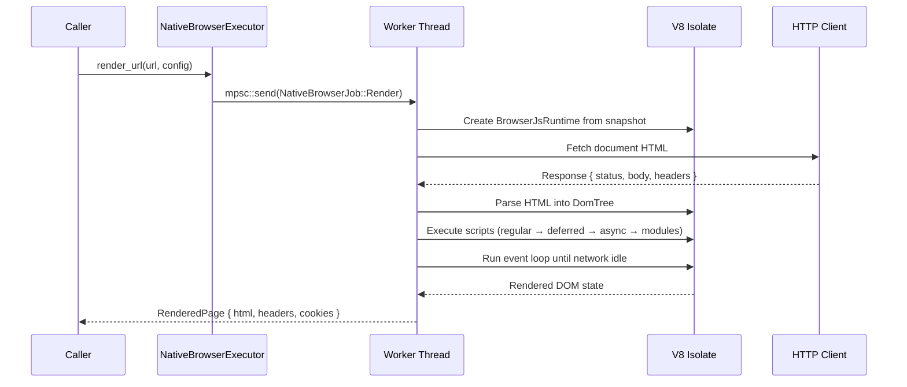

Modern web applications increasingly rely on client-side JavaScript to render meaningful content. Server-delivered HTML is often just an empty shell — a `

` waiting for React, Vue, or Angular to populate it. Crawlberg addresses this reality through a dual-backend browser rendering architecture that provides two distinct strategies for executing JavaScript and extracting the resulting DOM: the **Chromiumoxide** backend (external Chrome via CDP) and the **Native** backend (in-process V8 engine).

This page explains the architecture of both backends, how they share a common adapter interface, how the engine selects between them, and the tradeoffs that guide when to use each.

## Architecture Overview

The browser rendering subsystem lives across two crates and follows a clear separation of concerns. The core `crawlberg` crate defines the `BrowserBackend` enum and dispatches to backend-specific modules, while the `crawlberg-browser` crate encapsulates the entire Native backend implementation — its V8 JavaScript runtime, DOM tree, network stack, and worker pool.

Both backends produce the same output contract — an `HttpResponse` with status, headers, body, and optional `BrowserExtras` (eval results, cookies, network events). This uniform interface means the rest of the crawl pipeline (content extraction, markdown conversion, link discovery) is backend-agnostic.

Sources: [browser.rs](crates/crawlberg/src/browser.rs#L38-L57), [native_browser.rs](crates/crawlberg/src/native_browser.rs#L19-L47)

## Backend Selection

The `BrowserBackend` enum is the primary discriminator. It is configured via `CrawlConfig.browser.backend` and defaults to `Chromiumoxide`.

| Backend | Enum Variant | Feature Flag | Description |
|---------|-------------|-------------|-------------|
| **Chromiumoxide** | `BrowserBackend::Chromiumoxide` | `browser-chromiumoxide` | Connects to Chrome/Chromium via CDP WebSocket. Requires an external Chrome process. |
| **Native** | `BrowserBackend::Native` | `browser-native` | In-process V8 engine derived from Obscura. No external browser needed. |

Sources: [config.rs](crates/crawlberg/src/types/config.rs#L68-L77), [Cargo.toml](crates/crawlberg/Cargo.toml#L24-L26)

The `BrowserMode` enum controls *when* the browser is invoked, independent of *which* backend is used:

| Mode | Behavior |
|------|----------|
| `Auto` (default) | Only escalates to the browser when heuristics detect JavaScript-rendering necessity (empty SPA shells, `<noscript>` warnings, sparse content with `<script>` tags). |
| `Always` | Every HTTP request is routed through the browser pipeline. |
| `Never` | Browser is completely disabled; only raw HTTP fetching is used. |
| `Stealth` | Like `Always`, but additionally enables TLS fingerprint spoofing (native backend), JavaScript stealth patches (chromiumoxide), and a 1920×1080 viewport override. |

Sources: [config.rs](crates/crawlberg/src/types/config.rs#L29-L53)

## Detection Heuristics

When `BrowserMode::Auto` is active, the engine must decide whether a given page requires JavaScript execution. This decision is made *after* the initial HTTP fetch, by analyzing the server-delivered HTML. The detection logic lives in `browser_detect.rs` and operates on three signals:

1. **Empty SPA mount-point**: A well-known `
` (`#root`, `#app`, `#__next`, `#__nuxt`) exists but contains no text content.
2. **`<noscript>` warning**: A `<noscript>` element contains text matching patterns like "enable JavaScript" or "requires JavaScript."
3. **Sparse content with scripts**: Fewer than 20 words of text combined with external `<script[src]>` tags.

Pages with 50+ words of content are immediately classified as server-rendered and bypass the browser entirely, regardless of script presence.

Sources: [browser_detect.rs](crates/crawlberg/src/browser_detect.rs#L12-L53)

## Chromiumoxide Backend

The Chromiumoxide backend is the original and default browser integration. It communicates with a real Chrome/Chromium process over the Chrome DevTools Protocol (CDP), using the `chromiumoxide` Rust crate.

### Process Management

Chrome instances are managed through two mechanisms:

- **One-shot**: For single requests, a fresh Chrome process is launched, used for one page, then torn down. This pays the full startup cost each time.
- **Pooled**: The `BrowserPool` keeps a persistent Chrome process alive and hands out pages (tabs) bounded by a semaphore. Pages are opened via `browser.new_page()` and closed after use. The pool includes automatic crash recovery — if Chrome dies, the next `acquire_page()` call relaunches it.

Sources: [browser_pool.rs](crates/crawlberg/src/browser_pool.rs#L114-L129), [browser.rs](crates/crawlberg/src/browser.rs#L107-L166)

### Session Affinity

When `session_affinity` is enabled (the default), the pool reuses Chrome pages for requests to the same domain. This preserves cookies, localStorage, and any WAF challenge state across requests, significantly improving pass-through rates against Cloudflare and DataDome.

Sources: [browser_session_pool.rs](crates/crawlberg/src/browser_session_pool.rs#L1-L11)

### SSRF Interception

The Chromiumoxide backend actively intercepts all browser-issued network requests via the CDP Fetch domain. Each request is validated against the configured SSRF policy before being allowed to proceed. This prevents the browser from being used as an SSRF proxy — a critical security boundary since browser JavaScript can initiate requests to arbitrary URLs.

Sources: [browser.rs](crates/crawlberg/src/browser.rs#L193-L200)

### Stealth Patches

When `BrowserMode::Stealth` is active with the Chromiumoxide backend, a set of JavaScript patches are injected into every page before the target page's scripts execute. These patches mask common headless Chrome fingerprints:

- `navigator.webdriver` is set to `false`
- `navigator.plugins` and `navigator.mimeTypes` are populated with fake entries
- `window.chrome.runtime` is defined with standard properties
- WebGL vendor/renderer strings are spoofed to common Intel/AMD/NVIDIA values
- Canvas and audio fingerprints receive small per-page random offsets

Sources: [stealth.rs](crates/crawlberg/src/stealth.rs#L1-L24)

## Native Backend

The Native backend is Crawlberg's own browser implementation, derived from the Obscura project. It runs entirely in-process — no external Chrome process is required. This makes it suitable for environments where spawning Chrome is impractical (serverless, containers without a display, resource-constrained systems).

### Architecture

The native backend is built on three pillars:

| Component | Technology | Purpose |
|-----------|-----------|---------|
| **JavaScript Runtime** | `deno_core` (V8) | Executes page JavaScript, ES modules, fetch/XHR |
| **DOM Tree** | `html5ever` + custom tree sink | Parses HTML into an in-memory DOM that the JS runtime manipulates |
| **Network Layer** | `reqwest` (standard) or `wreq` (stealth) | Fetches documents, sub-resources, and handles cookies |

Sources: [Cargo.toml](crates/crawlberg-browser/Cargo.toml#L15-L34)

### V8 Snapshot and Bootstrap

At compile time, `build.rs` creates a V8 snapshot by executing `js/bootstrap.js`. This snapshot is embedded in the binary and loaded into every new `BrowserJsRuntime` instance, providing near-instant startup. The bootstrap script establishes:

- `document`, `window`, and `navigator` emulation objects
- A DOM bridge (`op_dom`) that delegates DOM queries to the Rust `DomTree`
- Fingerprint spoofing (GPU, screen resolution, canvas, audio context)
- Event system (`addEventListener`, `dispatchEvent`)
- Console interception

Sources: [build.rs](crates/crawlberg-browser/build.rs#L1-L38), [bootstrap.js](crates/crawlberg-browser/js/bootstrap.js#L1-L43)

### Worker Pool

The `NativeBrowserExecutor` manages a pool of dedicated worker threads. Each worker owns:

- Its own OS thread (named `crawlberg-native-browser-{index}`)
- Its own single-threaded Tokio runtime
- An isolated V8 `JsRuntime` instance (V8 isolates are not `Send`, so they cannot be shared across threads)

This design keeps all public executor futures `Send` — workers receive jobs via bounded `mpsc` channels and return results via `oneshot` channels. The worker count defaults to `min(available_parallelism, 8)`, with a queue capacity of 64 jobs per worker.

Sources: [adapter.rs](crates/crawlberg-browser/src/adapter.rs#L223-L257), [adapter.rs](crates/crawlberg-browser/src/adapter.rs#L395-L428)

### Navigation and Script Execution

The native `Page` implements a faithful emulation of browser navigation semantics:

1. **HTML Fetch**: The document is fetched via the HTTP client (with SSRF validation, cookies, proxy support).
2. **DOM Parse**: The response body is parsed into a `DomTree` using `html5ever` via a custom `TreeSink`.
3. **Resource Fetch**: Stylesheets (`<link rel="stylesheet">`) are fetched and parsed. Scripts are categorized into regular, deferred, async, and ES module queues.
4. **Script Execution**: Scripts are fetched (if external), loaded into V8, and executed. ES modules use `import()` through a custom `BrowserModuleLoader` that supports proxy configuration.
5. **Event Loop**: The V8 event loop runs until network activity drops to zero (500ms idle window) or the deadline is reached.
6. **Wait Strategy**: Depending on `NativeBrowserWait`, the page may wait for `Load`, `NetworkIdle`, or a specific CSS selector to appear.

Sources: [page.rs](crates/crawlberg-browser/src/page.rs#L456-L511), [page.rs](crates/crawlberg-browser/src/page.rs#L209-L298)

### Stealth TLS Fingerprinting

When the `stealth` feature is enabled, the native backend uses `wreq` instead of `reqwest` for HTTP requests. `wreq` is configured with a Chrome 145 TLS fingerprint profile (`wreq_util::Profile::Chrome145`), making the TLS handshake indistinguishable from a real Chrome browser. This addresses the growing sophistication of TLS-based bot detection.

| Client | TLS Fingerprint | Use Case |
|--------|----------------|----------|
| `reqwest` | Native OS TLS | Default, standard requests |
| `wreq` | Chrome 145 profile | Stealth mode, WAF evasion |

Sources: [wreq_client.rs](crates/crawlberg-browser/src/net/wreq_client.rs#L21-L22), [wreq_client.rs](crates/crawlberg-browser/src/net/wreq_client.rs#L38-L61)

### URL Pattern Blocking

The native backend supports blocking sub-resource requests before they are made, using wildcard patterns configured via `BrowserConfig.block_url_patterns`. This is useful for skipping advertisements, analytics scripts, and large image downloads that would slow rendering without contributing to the final content.

The chromiumoxide backend does not currently honor this field; it is native-only.

Sources: [adapter.rs](crates/crawlberg-browser/src/adapter.rs#L618-L623), [page.rs](crates/crawlberg-browser/src/page.rs#L139-L164)

## Backend Comparison

| Capability | Chromiumoxide | Native |
|-----------|--------------|--------|
| External Chrome required | Yes | No |
| Full Chrome DevTools Protocol | Yes | No |
| CDP WebSocket endpoint support | Yes | No |
| Session affinity / cookie persistence | Via CDP pages | Via in-process CookieJar |
| JavaScript stealth patches | Via `AddScriptToEvaluateOnNewDocument` | Via bootstrap.js fingerprint spoofing |
| TLS fingerprint spoofing | No (uses Chrome's real fingerprint) | Yes (wreq Chrome 145 profile) |
| URL pattern blocking | Not supported | Supported |
| Screenshot capture | Full Chrome screenshot API | DOM snapshot rendering to PNG |
| ES module support | Native Chrome | Via custom `BrowserModuleLoader` |
| `browser.endpoint` (remote Chrome) | Supported | Not supported |
| Process memory overhead | Chrome process (~100MB+) | V8 isolate (~30MB) |
| Concurrency model | One Chrome process, multiple tabs | N worker threads, each with own V8 isolate |

Sources: [config.rs](crates/crawlberg/src/types/config.rs#L223-L292), [adapter.rs](crates/crawlberg-browser/src/adapter.rs#L39-L82)

## Wait Strategies

Both backends support three wait strategies, configured via `BrowserConfig.wait`:

| Strategy | Behavior |
|----------|----------|
| `NetworkIdle` (default) | Waits until no network requests have been active for 500ms. |
| `Selector` | Polls `document.querySelector(selector)` every 100ms until the element appears, respecting the overall timeout. |
| `Fixed` | Waits for the page `load` event, then sleeps for an additional 2 seconds. |

An optional `extra_wait` duration can be added after any strategy completes, providing a buffer for slow-loading post-idle content.

Sources: [config.rs](crates/crawlberg/src/types/config.rs#L55-L66), [adapter.rs](crates/crawlberg-browser/src/adapter.rs#L625-L657)

## Integration with the Crawl Pipeline

The browser backends are not standalone features — they are deeply integrated into the crawl pipeline through the tiered escalation strategy. When `BrowserMode::Auto` is active:

1. The engine first attempts a raw HTTP fetch.
2. If the response triggers a WAF detection, has low content density, or matches a known SPA pattern, the engine **escalates** to the browser.
3. The dispatch loop selects the appropriate escalation tier (HTTP → Bypass → Browser) based on the configured `EscalationStrategy`.

This means the browser is used as a **fallback**, not a primary fetch mechanism, unless explicitly configured otherwise. The escalation ensures that the overhead of JavaScript execution is only paid when necessary.

Sources: [engine/mod.rs](crates/crawlberg/src/engine/mod.rs#L119-L141), [browser_detect.rs](crates/crawlberg/src/browser_detect.rs#L25-L53)

## Page Interactions

Both backends support scripted page interactions beyond simple navigation — clicking elements, typing text, pressing keys, scrolling, taking screenshots, and executing arbitrary JavaScript. The interaction system is covered in detail on the [Page Interaction and Action Execution](22-page-interaction-and-action-execution) page.

The key architectural distinction is that Chromiumoxide interactions drive a real Chrome tab via CDP commands, while native interactions execute equivalent JavaScript through the V8 runtime and manipulate the in-memory DOM tree.

Sources: [interact/mod.rs](crates/crawlberg/src/interact/mod.rs#L1-L39)

## Next Steps

- [Page Interaction and Action Execution](22-page-interaction-and-action-execution) — Detailed action types and execution model for both backends
- [Bot Detection Evasion and Stealth](23-bot-detection-and-stealth) — Full coverage of stealth patches, TLS fingerprinting, and anti-detection strategies
- [Tiered Escalation Strategy](20-tiered-escalation-strategy-http-bypass-browser) — How the engine decides when to escalate from HTTP to browser
- [Configuration Reference (CrawlConfig)](11-configuration-reference-crawlconfig) — Complete `BrowserConfig` field reference