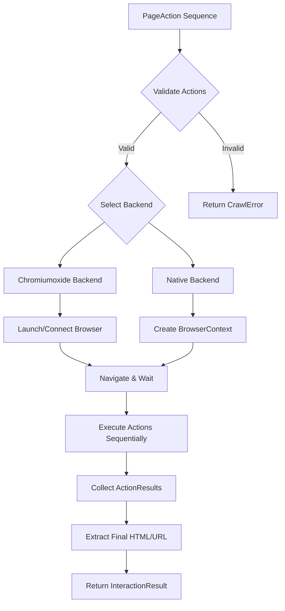
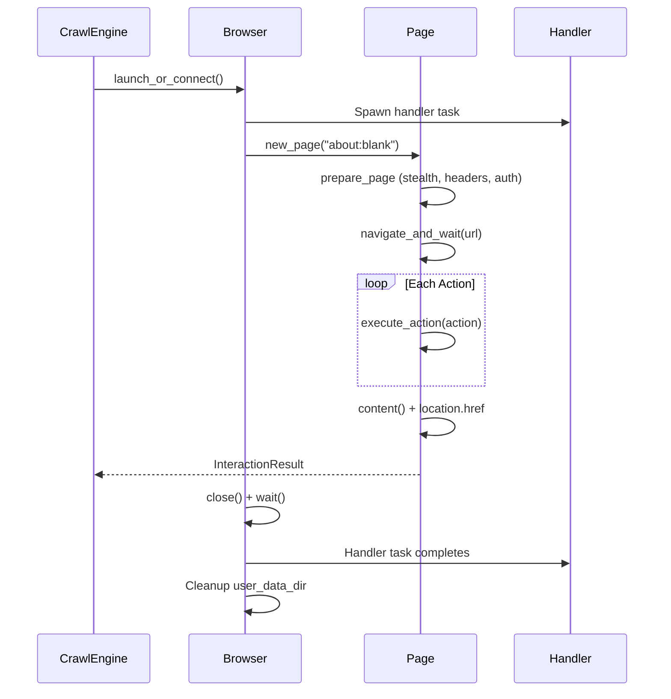

Page interaction represents the culmination of crawlberg's browser automation capabilities, enabling programmatic control over dynamic web pages beyond static HTML fetching. This module provides a declarative action sequencing system that abstracts the complexity of browser automation across multiple backend implementations, transforming a series of user interactions into reproducible, testable automation workflows.

## Action System Architecture

The interaction system operates on a **validation-then-execute** pipeline, ensuring safety constraints before any browser resources are allocated. The architecture separates action definitions from execution engines, enabling backend-agnostic interaction scripts that work identically across chromiumoxide and native browser backends.



The system enforces strict resource limits through constants defined in `actions.rs`: maximum 100 actions per sequence, 300 seconds total wait time, and 4KB selector length limits. These constraints prevent runaway automation while maintaining practical utility for complex interaction scenarios.

Sources: [actions.rs](crates/crawlberg/src/interact/actions.rs#L1-L22)

## Action Type Taxonomy

The `PageAction` enum defines eight distinct interaction primitives, each with specific execution semantics and return value characteristics. The enum uses tagged serialization with camelCase naming, except for the `ExecuteJs` variant which uses explicit rename mapping.

| Action Type | Input Parameters | Execution Behavior | Return Data |
|-------------|------------------|-------------------|-------------|
| **Click** | CSS selector | Finds element, dispatches mousedown/mouseup/click events, processes pending navigation | Empty |
| **TypeText** | CSS selector, text string | Focuses element, dispatches keydown/keypress/keyup for each character, updates value and fires input/change events | Empty |
| **Press** | Key name (e.g., "Enter", "Tab") | Dispatches keyboard events to active element; Enter triggers form submission, Backspace modifies input values | Empty |
| **Scroll** | Direction (up/down), optional selector, optional pixel amount | Scrolls window or element's scrollTop; defaults to 800px when amount unspecified | Empty |
| **Wait** | Optional milliseconds, optional CSS selector | Polls selector existence every 100ms or sleeps for specified duration; 30-second default timeout for selector waits | Empty |
| **Screenshot** | Optional fullPage boolean | Captures viewport or full scrollable page as PNG; native backend renders via `resvg` | `{bytes, format, full_page}` |
| **ExecuteJs** | JavaScript source code (max 1MB) | Executes script in page context; wraps return statements in IIFE for Chrome Runtime.evaluate compatibility | Script return value |
| **Scrape** | None | Extracts current page HTML via `page.content()` | `{html}` |

Sources: [actions.rs](crates/crawlberg/src/interact/actions.rs#L24-L99)

## Validation Pipeline

Before any browser interaction occurs, the `validate_actions` function enforces a comprehensive set of safety constraints. This pre-execution validation prevents resource exhaustion, malformed selector attacks, and script injection vectors.

The validation performs five distinct checks:
1. **Action count validation**: Ensures sequence length does not exceed `MAX_ACTIONS` (100)
2. **Cumulative wait time**: Sums all wait durations and enforces `MAX_TOTAL_WAIT_SECS` (300 seconds)
3. **Selector integrity**: Validates non-empty selectors within `MAX_SELECTOR_LEN` (4096 bytes)
4. **Script bounds**: Enforces `MAX_SCRIPT_LEN` (1MB) for ExecuteJs payloads
5. **Text length limits**: Applies `MAX_TEXT_LEN` (1MB) for TypeText content

The validation function returns `Result<(), CrawlError>`, providing descriptive error messages that identify the failing action by index, enabling precise debugging of malformed interaction sequences.

Sources: [validation.rs](crates/crawlberg/src/interact/validation.rs#L7-L20)

## Chromiumoxide Backend Implementation

The chromiumoxide backend leverages the Chrome DevTools Protocol (CDP) through the `chromiumoxide` crate, providing direct browser control without dependency on the native rendering stack. This backend supports both local browser launch and remote endpoint connection.

### Browser Lifecycle Management

The backend implements a complete browser lifecycle with automatic cleanup:



The implementation creates isolated browser instances with unique temporary directories, ensuring no state leakage between interaction sessions. For stealth mode configurations, the system applies fingerprint modification patches before navigation.

Sources: [chromiumoxide.rs](crates/crawlberg/src/interact/chromiumoxide.rs#L15-L34)

### Action Execution Mechanics

Each action type maps to specific CDP commands or JavaScript evaluation:

**Click Execution**: Uses `page.find_element(selector)` followed by `element.click()`, which internally triggers the full mouse event sequence through CDP's `Input.dispatchMouseEvent`.

**TypeText Execution**: Combines element focus (via click), followed by `element.type_str(text)` which simulates character-by-character keyboard input through CDP's `Input.dispatchKeyEvent`.

**JavaScript Evaluation**: The `evaluate_json` function wraps scripts containing `return` statements in IIFE syntax, addressing Chrome Runtime.evaluate's rejection of top-level return statements:

Sources: [chromiumoxide.rs](crates/crawlberg/src/interact/chromiumoxide.rs#L285-L299)

## Native Browser Backend

The native backend utilizes crawlberg's custom browser implementation built on html5ever and V8, operating through the `NativeBrowserExecutor` worker pool. This backend provides superior performance for interaction sequences by maintaining persistent browser contexts and avoiding Chromium process startup overhead.

### Worker Pool Architecture

The `NativeBrowserExecutor` implements a multi-threaded worker pool with bounded job queues, enabling concurrent interaction execution across isolated browser instances:

```rust
pub struct NativeBrowserExecutor {
    workers: Vec<JoinHandle<()>>,
    job_txs: Vec<tokio::sync::mpsc::Sender<InteractJob>>,
    worker_count: usize,
}
```

Each worker operates on its own tokio runtime, executing `interact_url_local` which creates a fresh `BrowserContext` and `Page` for each interaction request. This isolation prevents cross-contamination of cookies, JavaScript state, and DOM trees between concurrent operations.

Sources: [adapter.rs](crates/crawlberg-browser/src/adapter.rs#L186-L199)

### Event-Driven Action Simulation

The native backend implements user interaction through synthesized DOM events rather than CDP commands. Each action type generates appropriate JavaScript that dispatches realistic event sequences:

**Click Synthesis**: Generates `mousedown`, `mouseup`, and `click` events with proper bubbling and cancelability flags, followed by `process_pending_navigation()` to handle any resulting page transitions.

**TypeText Synthesis**: Iterates through each character, dispatching `keydown`, `keypress`, and `keyup` events, conditionally updating the element's value property only when both keydown and keypress events remain uncancelled, then fires `input` and `change` events.

**Press Key Handling**: Implements special behavior for Enter (triggers form submission), Backspace (modifies input value), and single-character keys (updates input value), ensuring realistic keyboard interaction simulation.

Sources: [adapter.rs](crates/crawlberg-browser/src/adapter.rs#L794-L835)

## Result Model and Error Handling

The interaction system produces structured results through two primary types:

### InteractionResult Structure

```rust
pub struct InteractionResult {
    pub action_results: Vec<ActionResult>,
    pub final_html: String,
    pub final_url: String,
    pub screenshot: Option<Vec<u8>>,
}
```

The `final_html` and `final_url` capture the page state after all actions complete, accounting for any navigations triggered by clicks or form submissions. The optional `screenshot` field contains raw PNG bytes when a Screenshot action was executed.

### ActionResult Granularity

Each action produces an independent `ActionResult` containing:
- **Zero-based index**: Position in the original action sequence
- **Action type string**: Stable identifier ("click", "type", "press", etc.)
- **Success boolean**: Whether the action completed without error
- **Optional data**: Action-specific return values (screenshot bytes, JS return values, HTML)
- **Optional error message**: Descriptive failure reason when success is false

This granular reporting enables partial success handling—failed actions do not abort the remaining sequence, allowing subsequent actions to potentially recover or provide useful diagnostic information.

Sources: [results.rs](crates/crawlberg/src/types/results.rs#L58-L91)

## Configuration Integration

Browser interaction configuration integrates with the broader `CrawlConfig` system through the `BrowserConfig` struct, which controls backend selection, navigation behavior, and resource limits.

Key configuration parameters affecting interaction execution:

| Parameter | Type | Default | Effect on Interactions |
|-----------|------|---------|----------------------|
| `browser.mode` | BrowserMode | Auto | Determines when browser automation activates |
| `browser.backend` | BrowserBackend | Chromiumoxide | Selects execution engine |
| `browser.timeout` | Duration | 30s | Maximum navigation + action execution time |
| `browser.wait` | BrowserWait | NetworkIdle | Post-navigation wait strategy |
| `browser.wait_selector` | Option\<String\> | None | CSS selector for Selector wait mode |
| `browser.extra_wait` | Option\<Duration\> | None | Additional delay after wait condition |
| `browser.eval_script` | Option\<String\> | None | JavaScript executed before actions |
| `browser.block_url_patterns` | Vec\<String\> | Empty | URL patterns to intercept and block |

The `eval_script` parameter runs after navigation but before action execution, enabling page preparation (cookie injection, state initialization) that persists across the action sequence.

Sources: [config.rs](crates/crawlberg/src/types/config.rs#L226-L292)

## Integration Points

### MCP Server Exposure

The interaction system is exposed through the MCP server's `interact` tool, accepting JSON-serialized action sequences and returning structured results. This enables AI agents to orchestrate complex web interactions through natural language instructions translated into action sequences.

Sources: [server.rs](crates/crawlberg/src/mcp/server.rs#L487-L507)

### Language Bindings

All polyglot language bindings access interaction through the same `interact()` function signature, with the native backend handling cross-language type marshaling through the FFI layer. The `NativePageAction` enum mirrors `PageAction` exactly, ensuring consistent behavior across Rust, Python, Go, Node.js, and other supported languages.

## Next Steps

Understanding page interaction completes the browser automation trilogy alongside [Browser Rendering Backends](21-browser-rendering-backends) and [Bot Detection Evasion and Stealth](23-bot-detection-evasion-and-stealth). For implementation guidance on stealth configurations that complement interaction sequences, consult the stealth documentation. To understand the architectural foundation that enables both browser backends, review the [Trait-Based Pluggable Engine](10-trait-based-pluggable-engine) design patterns.