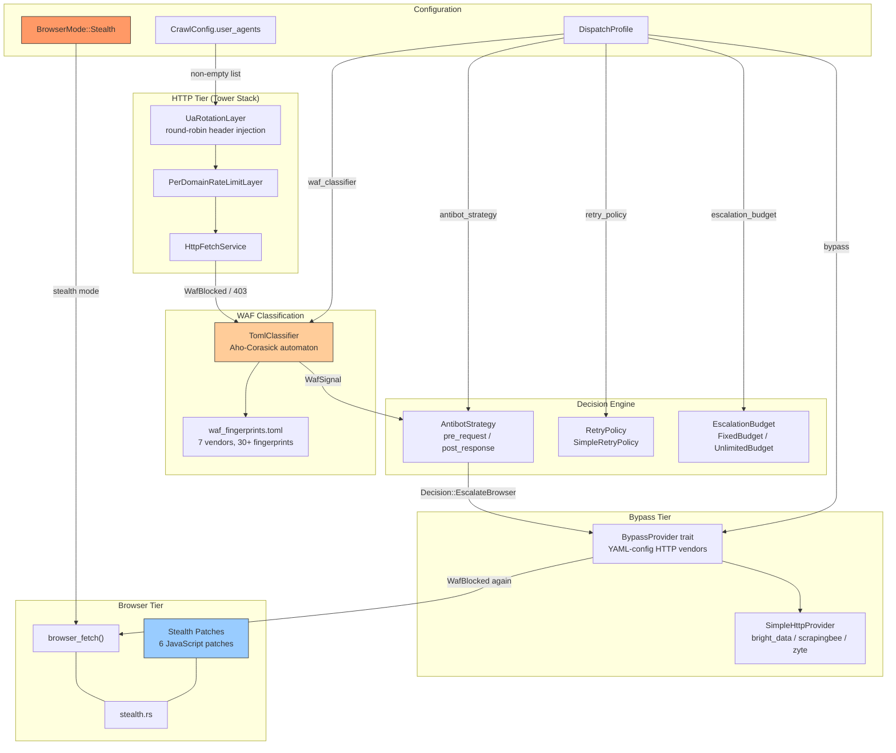
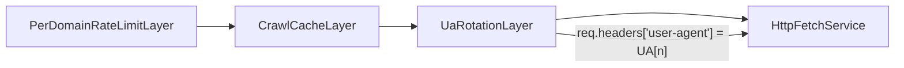
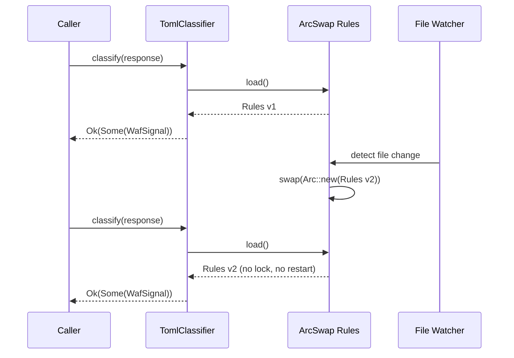
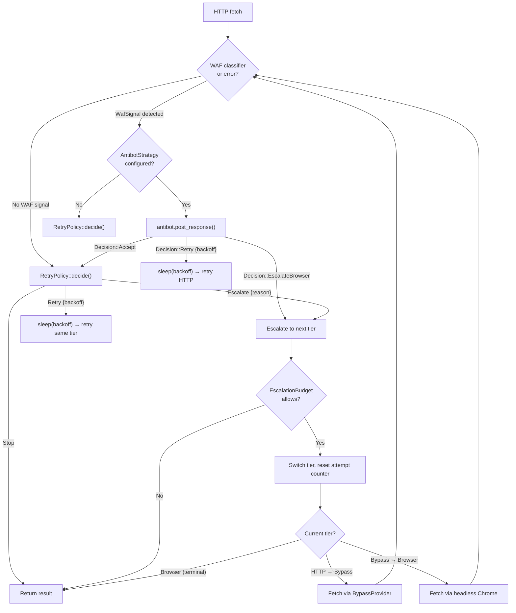
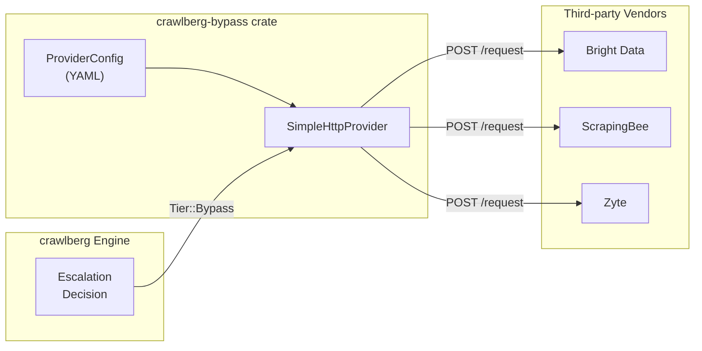

Crawlberg implements a **layered anti-detection architecture** spanning four independent subsystems: browser-level JavaScript fingerprint patching, HTTP-level user-agent rotation, pluggable WAF classification with tiered escalation, and a vendor-driven bypass provider abstraction. This page explains how each layer works, how they compose, and how to configure them.

## Architecture Overview

The following diagram shows the complete anti-detection pipeline from request initiation through result delivery. Each layer can be independently enabled, configured, or replaced via trait-based pluggable interfaces.



The pipeline proceeds from left to right: every request begins at the HTTP tier, gets classified by the WAF engine, and may escalate through bypass and browser tiers based on configurable policies.

## Browser-Level Stealth Patches

When `browser.mode` is set to `BrowserMode::Stealth`, crawlberg injects six JavaScript patches into every page navigation via Chrome DevTools Protocol's `Page.addScriptToEvaluateOnNewDocument`. These patches execute **before** the target page's own scripts, so the page's detection heuristics observe a realistic browser fingerprint.

Sources: [stealth.rs](crates/crawlberg/src/stealth.rs#L1-L148)

### The Six Patch Categories

| # | Patch | What It Fixes | Detection Technique |
|---|-------|---------------|---------------------|
| 1 | `navigator.webdriver = false` | Headless Chrome sets `navigator.webdriver` to `true` | Page reads `navigator.webdriver` property |
| 2 | `navigator.plugins` / `mimeTypes` | Headless Chrome has empty plugin lists | Page checks `navigator.plugins.length === 0` |
| 3 | `window.chrome.runtime` | Headless Chrome leaves `window.chrome` undefined | Page checks for Chrome extension APIs |
| 4 | WebGL vendor/renderer spoof | Headless returns Google SwiftShader strings | `getParameter(UNMASKED_VENDOR_WEBGL)` |
| 5 | Canvas + audio fingerprint noise | Identical canvas fingerprints across requests | `toDataURL()` / `getFloatFrequencyData()` comparison |
| 6 | Permissions query override | Notifications default to `denied` in headless | `navigator.permissions.query({name: 'notifications'})` |

Each patch is wrapped in an independent `try/catch` block, so a failure in one patch does not cascade. The WebGL spoof returns `Intel Iris OpenGL Engine` as the renderer — a common integrated GPU string that blends with real-world traffic.

### Stealth Mode Activation

Stealth mode is activated by setting `browser.mode` to `Stealth`. This mode automatically enables:

- All six JavaScript stealth patches
- TLS fingerprint spoofing (native backend only, via `wreq` stealth client)
- A realistic default user-agent: `Mozilla/5.0 (X11; Linux x86_64) AppleWebKit/537.36 (KHTML, like Gecko) Chrome/145.0.0.0 Safari/537.36`
- A 1920×1080 viewport override

Sources: [config.rs](crates/crawlberg/src/types/config.rs#L65-L85), [browser.rs](crates/crawlberg/src/browser.rs#L293-L317)

The stealth user-agent is resolved by `resolve_default_user_agent()` when no explicit `user_agent` is set. This ensures the browser's HTTP-layer user-agent matches the viewport and JavaScript fingerprint, presenting a coherent profile to anti-bot systems.

Sources: [browser.rs](crates/crawlberg/src/browser.rs#L527-L529)

## User-Agent Rotation

For HTTP-tier crawling, crawlberg provides a Tower middleware layer that rotates user-agent headers across requests using atomic round-robin indexing.

Sources: [ua_rotation.rs](crates/crawlberg/src/tower/ua_rotation.rs#L1-L80)

### How It Works

The `UaRotationLayer` wraps the Tower service stack and intercepts each `CrawlRequest`. Before the request reaches the inner HTTP service, it reads the next user-agent from a shared `Vec<String>` using `AtomicUsize::fetch_add` with `Relaxed` ordering — this avoids lock contention while providing a deterministic round-robin cycle.

| Configuration | Behavior |
|---------------|----------|
| `user_agents: ["UA-A", "UA-B"]` | Alternates between UA-A and UA-B across all requests |
| `user_agents: []` (empty) | No rotation; each request uses `config.user_agent` or the built-in default |
| `user_agents: ["UA-A"]` + `user_agent: "fallback"` | Single-element list still wins; UA-A used for all requests |

Sources: [config.rs](crates/crawlberg/src/types/config.rs#L325-L329)

The rotation layer is **shared across all concurrent fetch tasks** within a crawl engine instance via `Arc<AtomicUsize>`, so user-agents cycle globally rather than per-thread.

### Tower Stack Position

The UA rotation layer sits between the caching layer and the base HTTP fetch service in the Tower middleware chain:



Sources: [mod.rs](crates/crawlberg/src/engine/mod.rs#L96-L105)

## WAF Detection and Classification

Crawlberg ships with a compile-time WAF fingerprint classifier that identifies bot-protection vendors from HTTP response headers and body content using an Aho-Corasick automaton. The classifier is hot-reloadable via `arc_swap::ArcSwap` without restarting the process.

Sources: [waf/mod.rs](crates/crawlberg/src/waf/mod.rs#L1-L98)

### Supported Vendors

| Vendor | Detection Signals | Example Fingerprint |
|--------|-------------------|---------------------|
| **Cloudflare** | `server: cloudflare` header + body patterns (`/cdn-cgi/challenge-platform/`, `__cf_chl_`, `turnstile`) | 10 fingerprints |
| **DataDome** | `x-datadome` header, `captcha-delivery.com` body | 5 fingerprints |
| **PerimeterX** | `x-px-block` header, `/px/captcha` body | 4 fingerprints |
| **Imperva/Incapsula** | `x-sucuri-id` header, `_incap_ses_` body | 5 fingerprints |
| **AWS WAF** | `x-amzn-waf-action` header, `awswaf.com/token` body | 4 fingerprints |
| **Akamai** | `server: akamaighost` header | 1 fingerprint |
| **F5 BIG-IP** | `server: big-ip` header, `bigipserver` body | 2 fingerprints |
| **Generic** | `request blocked` body pattern | 1 fingerprint |

Sources: [waf_fingerprints.toml](crates/crawlberg/rules/waf_fingerprints.toml#L1-L318)

### Classification Algorithm

The classifier operates in two passes:

**Pass 1 — Header-first short-circuit.** Fingerprints whose signals are entirely `response_header`-type are evaluated before the body is scanned. If a header-only fingerprint matches (e.g., `x-datadome` present), the function returns immediately without touching the body. This provides an O(1) fast path for header-stamp detection.

**Pass 2 — Aho-Corasick body scan.** All body patterns are compiled into a single Aho-Corasick automaton at load time. The automaton scans the response body once, collecting which fingerprint indices matched. Then each multi-signal fingerprint (requiring both header and body matches) is evaluated against the collected set.

On **2xx responses**, body fingerprints are only checked when the body size is ≤ 100 KB (`CHALLENGE_BODY_LIMIT`). This prevents false positives on legitimate content pages that happen to mention vendor names (e.g., a blog post *about* Cloudflare).

Sources: [rules.rs](crates/crawlberg/src/waf/rules.rs#L233-L310)

### Hot-Reload

The classifier wraps its `Rules` in `ArcSwap`, enabling atomic swaps without restarting. The `watch()` method sets up an OS filesystem watcher with 500ms debouncing for editors that write via tmpfile+rename.



Sources: [waf/mod.rs](crates/crawlberg/src/waf/mod.rs#L59-L82)

## Tiered Escalation Strategy

When the WAF classifier detects a block (or any fetch fails), the engine's dispatch loop decides what to do next via a configurable escalation strategy. This is the core anti-detection decision engine.

Sources: [dispatch.rs](crates/crawlberg/src/types/dispatch.rs#L17-L75)

### Escalation Strategies

| Strategy | Chain | When to Use |
|----------|-------|-------------|
| `None` | HTTP only (no escalation) | Diagnostic crawls, raw error inspection |
| `BrowserOnly` | HTTP → Browser | Default; JS-heavy sites with browser configured |
| `BypassFirst` | Bypass only (skip HTTP) | Legacy: preserves pre-tier-dispatch behavior when `bypass` is set |
| `BypassOnly` | HTTP → Bypass | WAF-heavy targets without a browser backend |
| `BypassThenBrowser` | HTTP → Bypass → Browser | Maximum resilience: cheapest bypass first, browser as last resort |

Sources: [dispatch.rs](crates/crawlberg/src/types/dispatch.rs#L17-L75)

### Decision Flow



Sources: [mod.rs](crates/crawlberg/src/engine/mod.rs#L195-L349)

### SimpleRetryPolicy Mapping

The built-in `SimpleRetryPolicy` maps `CrawlError` variants to directives without learning:

| Error | Directive | Notes |
|-------|-----------|-------|
| `WafBlocked` | `Escalate { WafBlocked }` | Immediately tries next tier |
| `Forbidden` (403) | `Escalate { WafBlocked }` | Treated as WAF block |
| `RateLimited` | `Retry { exponential backoff }` | Up to `max_retries` (default 3) |
| `ServerError` / `Timeout` | `Retry { exponential backoff }` | Up to `max_retries` |
| `Dns` / `Ssl` / `Connection` | `Stop` | Permanent failures |

Exponential backoff: `min(2^attempt × 100ms, 60s)`.

Sources: [dispatch.rs](crates/crawlberg/src/defaults/dispatch.rs#L1-L80)

## Pluggable Antibot Strategy

The `AntibotStrategy` trait provides a hook pair that fires before and after each fetch attempt, allowing custom logic to inject headers, rotate tokens, or force tier escalation based on vendor-specific knowledge.

Sources: [antibot.rs](crates/crawlberg/src/types/antibot.rs#L1-L165)

### Hook Points

| Hook | When | Use Cases |
|------|------|-----------|
| `pre_request(url)` | Before the Tower-stack fetch | Warm CAPTCHA tokens, rotate shared state, inject timing jitter |
| `post_response(response, waf_signal)` | After WAF classification, before retry policy | Vendor-specific backoff, proxy rotation, forced browser escalation |

### Decision Enum

| Decision | Effect |
|----------|--------|
| `Accept` | Continue normally — response passes to retry policy |
| `Retry { backoff }` | Sleep for `backoff` duration, then retry the same tier |
| `RotateProxy` | Rotate to different proxy (not yet implemented) |
| `EscalateBrowser` | Force escalation to browser tier, bypassing retry policy |

### Default Behavior

`DefaultAntibotStrategy` is a no-op on `pre_request` and returns `Decision::EscalateBrowser` whenever a WAF signal is present — identical to the built-in engine behavior without a pluggable strategy.

Sources: [antibot.rs](crates/crawlberg/src/types/antibot.rs#L131-L165)

## Bypass Provider Abstraction

For targets protected by WAFs that cannot be solved by browser rendering alone (e.g., IP-based reputation systems), crawlberg provides a `BypassProvider` trait that routes requests through third-party HTTP services.

Sources: [bypass.rs](crates/crawlberg/src/types/bypass.rs#L1-L66)

### Architecture



### YAML Configuration

Each vendor is defined by a YAML file that specifies the endpoint, authentication scheme, request body template, response decoding, and cost extraction:

```yaml
# crates/crawlberg-bypass/configs/bright_data.yaml
vendor_name: bright_data
endpoint: "https://api.brightdata.com/request"
method: POST

auth:
  kind: bearer
  token: "${BYPASS_BRIGHT_DATA_TOKEN}"

request:
  body:
    kind: json
    template: '{"url": "{{url}}", "format": "raw", "country": "us"}'
  url_param:
    kind: body_field

response:
  kind:
    kind: raw_body
  cost_extraction:
    kind: static
  fallback_cost_usd: 0.003
```

Sources: [bright_data.yaml](crates/crawlberg-bypass/configs/bright_data.yaml#L1-L33)

The `SimpleHttpProvider` handles authentication, URL template substitution, response decoding, cost extraction, and error mapping — all driven by the YAML config without writing Rust code.

## Session Affinity and Browser Profiles

When `browser.session_affinity` is `true` (the default), the engine reuses browser pages for same-domain requests, preserving cookies, localStorage, and JavaScript challenge state across fetches. This is critical for solving multi-step bot challenges where the first request receives a challenge token that must persist into subsequent requests.

Sources: [config.rs](crates/crawlberg/src/types/config.rs#L275-L278)

### Browser Profiles

For cross-session persistence, `browser_profile` enables named profiles that store Chrome's `--user-data-dir` under `<data_dir>/crawlberg/profiles/<name>`. When `save_browser_profile` is `true`, cookie and storage changes are written back to disk on exit.

Sources: [browser_profile.rs](crates/crawlberg/src/browser_profile.rs#L1-L148)

## SPA Detection and Render Escalation

Before invoking the browser, the engine detects JavaScript-rendered single-page applications through HTML heuristics. The `detect_js_render_needed()` function examines:

1. **Empty SPA mount points** — `<div id="root">`, `<div id="app">`, `<div id="__next">`, `<div id="__nuxt">` with no inner content
2. **Noscript warnings** — `<noscript>` elements containing "enable javascript" text
3. **Sparse content with script tags** — body word count < 20 with external `<script src>` elements

When all signals agree and the body has < 50 words, the page is flagged as needing browser rendering even without a WAF block.

Sources: [browser_detect.rs](crates/crawlberg/src/browser_detect.rs#L1-L80)

| Condition | Detected? | Action |
|-----------|-----------|--------|
| `<div id="root"></div>` + `<noscript>You need to enable JavaScript</noscript>` + `<script src="/main.js">` | ✅ | Route to browser tier |
| `<div id="root"><main><h1>Hello World</h1>...</main></div>` with 60+ words | ❌ | HTTP tier (server-rendered) |
| `<h1>Example</h1><p>Normal content</p>` with 10 words, no scripts | ❌ | HTTP tier (static page) |

## Configuration Summary

| Feature | Config Path | Default | Description |
|---------|-------------|---------|-------------|
| Stealth mode | `browser.mode: "stealth"` | `auto` | Enables all JS patches + TLS spoofing + realistic UA |
| UA rotation | `user_agents: [...]` | `[]` | Round-robin header rotation across requests |
| WAF classifier | `dispatch.waf_classifier` | `TomlClassifier::builtin()` | Aho-Corasick fingerprint matching |
| Escalation strategy | `dispatch.strategy` | `BrowserOnly` | HTTP → Bypass → Browser chain |
| Antibot hooks | `dispatch.antibot_strategy` | `None` | Pre/post request hook pair |
| Bypass provider | `dispatch.bypass` | `None` | Third-party HTTP bypass vendor |
| Retry policy | `dispatch.retry_policy` | `SimpleRetryPolicy` | Per-error retry/escalate decisions |
| Escalation budget | `dispatch.escalation_budget` | `UnlimitedBudget` | Per-job cost cap |
| Session affinity | `browser.session_affinity` | `true` | Reuse pages for same-domain requests |
| Browser profile | `browser_profile` | `None` | Named persistent Chrome profile |

Sources: [config.rs](crates/crawlberg/src/types/config.rs#L200-L400), [dispatch.rs](crates/crawlberg/src/types/dispatch.rs#L548-L650)

## Next Steps

- [WAF Detection and Fingerprint Classification](19-waf-detection-and-fingerprint-classification) — Deep dive into the TOML fingerprint corpus and Aho-Corasick matching internals
- [Tiered Escalation Strategy (HTTP, Bypass, Browser)](20-tiered-escalation-strategy-http-bypass-browser) — Complete guide to configuring the three-tier dispatch chain
- [Browser Rendering Backends](21-browser-rendering-backends) — Chromiumoxide vs. native backend comparison and session pool management
- [Rate Limiting and Caching](17-rate-limiting-and-caching) — Per-domain rate limiting and HTTP response caching configuration