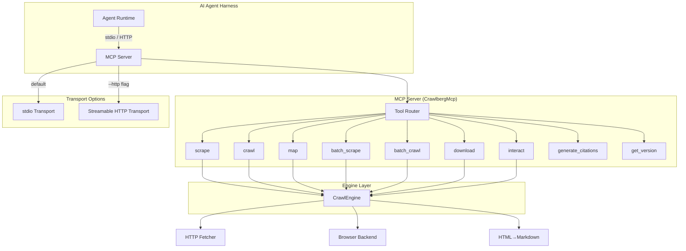
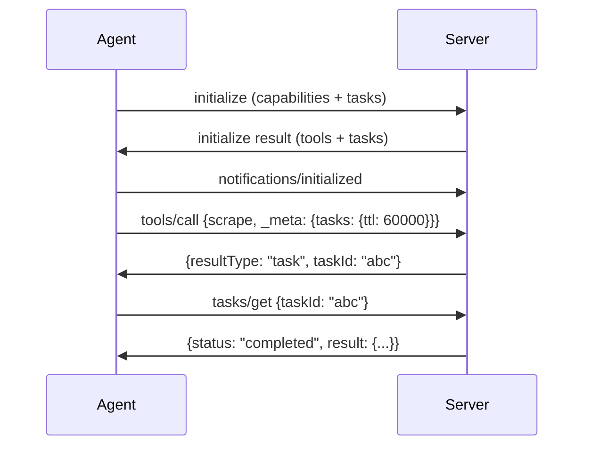
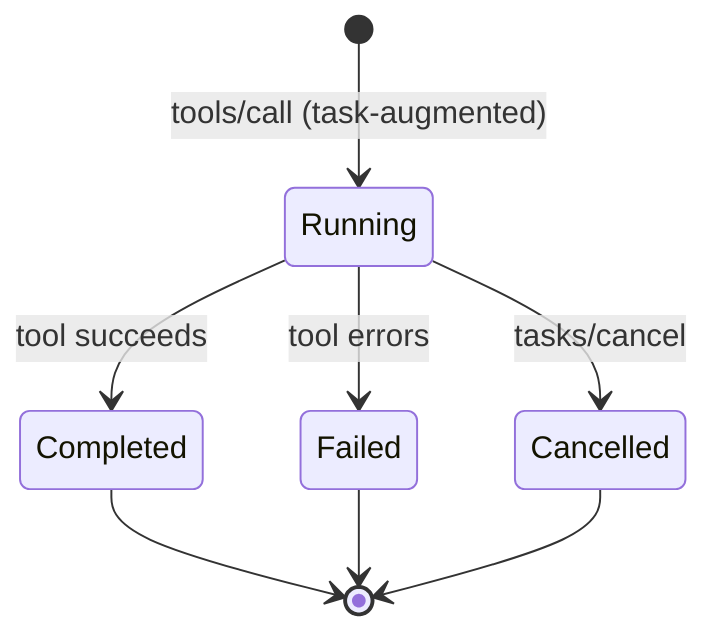
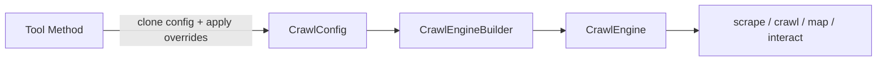

Crawlberg ships a Model Context Protocol (MCP) server that exposes its web crawling and scraping capabilities as typed tools for AI agent harnesses. The server runs as a subprocess communicating over stdio (the default) or as a stateless Streamable HTTP endpoint, and registers nine tools that cover single-page scraping, multi-page crawling, URL discovery, batch operations, browser interaction, document downloads, citation generation, and version introspection. The implementation lives entirely within the `crawlberg` core crate behind a compile-time feature gate, with the plugin layer responsible for auto-registering the server in each supported agent environment.

## Architecture Overview

The MCP server is built on the `rmcp` crate and follows a handler-router pattern. A `CrawlbergMcp` struct owns a `ToolRouter` that dispatches incoming `tools/call` requests to individual tool methods, each annotated with the `#[tool]` macro. The server advertises both the tools capability and the SEP-2663 tasks extension, enabling clients to request asynchronous task-based execution for long-running operations. A shared `TaskManager` instance coordinates task lifecycle across requests.



Sources: [mod.rs](crates/crawlberg/src/mcp/mod.rs#L1-L39), [server.rs](crates/crawlberg/src/mcp/server.rs#L60-L100)

## Feature Flags and Compilation

The MCP server is not compiled by default. It requires the `mcp` Cargo feature, which activates the `rmcp` and `schemars` dependencies. For HTTP transport support, the `mcp-http` feature adds `axum` on top. The CLI binary gates both subcommands behind these features, so a from-source build must pass explicit flags:

```bash
cargo install crawlberg-cli --features mcp        # stdio only
cargo install crawlberg-cli --features mcp-http   # stdio + Streamable HTTP
cargo install crawlberg-cli --features all        # everything
```

The Homebrew tap ships with all features enabled, so the MCP subcommand works out of the box for Homebrew installations.

| Feature | Dependencies Added | Enables |
|---------|-------------------|---------|
| `mcp` | `rmcp`, `schemars` | `crawlberg mcp` (stdio), all nine tools |
| `mcp-http` | `mcp` + `axum` | `crawlberg mcp --http`, `streamable_http_service` |
| `full` | all features | Everything including browser, AI, WARC |

Sources: [Cargo.toml](crates/crawlberg/Cargo.toml#L20-L50), [lib.rs](crates/crawlberg/src/lib.rs#L32-L87)

## Tool Registry

The server registers exactly nine tools, each with typed input parameters (via `schemars::JsonSchema`), output schemas (SEP-2106), and safety annotations that communicate intent to the agent harness.

| Tool | Read-Only | Destructive | Open World | Purpose |
|------|-----------|-------------|------------|---------|
| `scrape` | ✓ | — | ✓ | Single URL → Markdown or JSON with metadata |
| `crawl` | ✓ | — | ✓ | Follow links from a seed URL, depth-bounded |
| `map` | ✓ | — | ✓ | Discover URLs via sitemaps and link extraction |
| `batch_scrape` | ✓ | — | ✓ | Scrape multiple URLs concurrently |
| `batch_crawl` | ✓ | — | ✓ | Crawl multiple seed URLs concurrently |
| `download` | ✓ | — | ✓ | Download a document and return file metadata |
| `interact` | — | ✓ | ✓ | Execute browser actions (click, type, scroll) |
| `generate_citations` | ✓ | — | — | Rewrite markdown links as numbered citations |
| `get_version` | ✓ | — | — | Return the crawlberg library version |

The `interact` tool is the only one marked as `read_only_hint: false` and `destructive_hint: true`, signaling to agent harnesses that it may mutate page state. The `generate_citations` and `get_version` tools set `open_world_hint: false` since they operate on provided text only.

Sources: [server.rs](crates/crawlberg/src/mcp/server.rs#L120-L580), [test_mcp_http.rs](crates/crawlberg/tests/test_mcp_http.rs#L100-L160)

## Input Parameters

Each tool accepts a typed parameter struct with serde deserialization and JSON Schema generation. The `#[serde(deny_unknown_fields)]` attribute ensures clients cannot silently pass unrecognized arguments. Optional parameters default to `None` and are omitted from the serialized schema's `required` set.

```rust
// Example: ScrapeParams
pub struct ScrapeParams {
    pub url: String,                    // required
    pub format: Option<String>,         // "markdown" (default) or "json"
    pub use_browser: Option<bool>,      // force browser rendering
}

// Example: CrawlParams
pub struct CrawlParams {
    pub url: String,                    // required
    pub max_depth: Option<usize>,       // 0..=100, default 2
    pub max_pages: Option<usize>,       // 1..=100000
    pub format: Option<String>,
    pub stay_on_domain: Option<bool>,   // restrict to seed domain
}
```

The server validates inputs before building an engine. URLs must start with `http://` or `https://`, `max_depth` cannot exceed 100, and `max_pages` must be between 1 and 100,000. Batch operations reject empty URL arrays.

Sources: [params.rs](crates/crawlberg/src/mcp/params.rs#L1-L160), [server.rs](crates/crawlberg/src/mcp/server.rs#L30-L50)

## Output Formatting

Every tool returns a `CallToolResult` carrying both a human-readable `text` block and a machine-readable `structuredContent` (SEP-2106). The `structured_success` helper constructs this dual-format response. The text representation depends on the `format` parameter:

- **Markdown mode** (default): Renders page titles, status codes, content types, and the converted markdown content. Crawl results list each page with depth and size metadata. Map results produce a bullet list of discovered URLs.
- **JSON mode**: Returns the full `ScrapeResult` / `CrawlResult` / `MapResult` struct as pretty-printed JSON.

Batch operations aggregate per-URL results into `BatchScrapeItem` or `BatchCrawlItem` arrays, each carrying an `ok` boolean and either a `result` or `error` field.

Sources: [format.rs](crates/crawlberg/src/mcp/format.rs#L1-L120), [outputs.rs](crates/crawlberg/src/mcp/outputs.rs#L1-L89)

## Transport Mechanisms

### Stdio Transport (Default)

The default `crawlberg mcp` command starts a long-lived process communicating over stdin/stdout using newline-delimited JSON-RPC. This is the transport the plugin auto-registers in agent harnesses. The stdio transport supports full SEP-2663 task lifecycle: clients declare the tasks capability during `initialize`, augment `tools/call` requests with task metadata, and poll `tasks/get` until completion.



### Streamable HTTP Transport

When built with `mcp-http`, the `--http` flag starts a stateless HTTP server mounting the MCP endpoint at `/mcp`. This transport follows SEP-2567 (stateless mode) and uses `json_response` for plain JSON responses with transparent SSE fallback for streaming. A shared `TaskManager` ensures tasks survive across per-request `CrawlbergMcp` instances.

```bash
crawlberg mcp --http --host 127.0.0.1 --port 3001
```

The HTTP transport degrades task augmentation to inline execution because it cannot propagate per-request client capabilities in stateless mode.

Sources: [server.rs](crates/crawlberg/src/mcp/server.rs#L700-L800), [test_mcp_http.rs](crates/crawlberg/tests/test_mcp_http.rs#L1-L100)

## Error Handling

The `map_crawl_error` function translates every `CrawlError` variant to an appropriate MCP error response. Configuration and validation errors map to `INVALID_PARAMS` (-32602), while network, browser, and server errors map to `INTERNAL_ERROR` (-32603). The error message is preserved verbatim to aid debugging.

| CrawlError Variant | MCP Error Code | Example Message |
|-------------------|----------------|-----------------|
| `InvalidConfig` | -32602 | "Invalid configuration: bad value" |
| `SsrfPolicyViolation` | -32602 | "SSRF policy violation for http://localhost: ..." |
| `NotFound` | -32603 | "Not found: https://example.com/missing" |
| `Timeout` | -32603 | "Request timed out: ..." |
| `WafBlocked` | -32603 | "Blocked by WAF/bot protection: ..." |
| `Connection` | -32603 | "Connection error: ..." |

Sources: [errors.rs](crates/crawlberg/src/mcp/errors.rs#L1-L100)

## Plugin Integration

The plugin layer auto-registers the MCP server across seven agent harnesses. Each configuration file points at the same launcher script, which resolves or installs a version-matched binary before executing `crawlberg mcp`.

| Harness | Config File | Registration Pattern |
|---------|------------|---------------------|
| Claude Code | `.claude-plugin/plugin.json` | `"command": "${CLAUDE_PLUGIN_ROOT}/scripts/mcp-launch.sh"` |
| Codex | `.codex-plugin/plugin.json` | Points to `.mcp.json` |
| Cursor | `.cursor-plugin/plugin.json` | `"command": "./scripts/mcp-launch.sh"` |
| Gemini | `gemini-extension.json` | `"command": "${extensionPath}/scripts/mcp-launch.sh"` |
| Kimi | `kimi.plugin.json` | `"command": "./scripts/mcp-launch.sh"` |
| OpenCode | `.opencode/plugins/crawlberg.js` | CLI wrapper spawning `crawlberg` subprocess |
| Factory | `.factory-plugin/plugin.json` | Standard MCP registration |

Sources: [.claude-plugin/plugin.json](plugin/.claude-plugin/plugin.json#L1-L29), [.cursor-plugin/plugin.json](plugin/.cursor-plugin/plugin.json#L1-L30), [gemini-extension.json](plugin/gemini-extension.json#L1-L15)

## Binary Resolution (Launcher)

The `mcp-launch.sh` script implements a cascading resolution strategy to locate or install the `crawlberg` binary before invoking `crawlberg mcp`:

1. **Cached binary** — checks `plugin/bin/crawlberg`
2. **PATH lookup** — searches for `crawlberg` on the system PATH
3. **npx** — probes `@xberg-io/crawlberg-cli@latest`
4. **uvx** — probes `crawlberg-cli` via Python's uv tool
5. **Homebrew** — installs via `brew install xberg-io/tap/crawlberg`
6. **Direct download** — fetches the platform-specific release artifact from GitHub

The `CRAWLBERG_LAUNCHER` environment variable constrains the search to a single method (`auto|npx|uvx|brew|download`).

Sources: [mcp-launch.sh](plugin/scripts/mcp-launch.sh#L1-L185)

## SEP-2663 Tasks Extension

The server advertises the SEP-2663 tasks capability, enabling clients to run long-lived operations as background tasks. When a client augments a `tools/call` request with the `io.modelcontextprotocol/tasks` extension key, the server spawns the tool as a task and returns a task handle immediately. The client then polls `tasks/get` until the task reaches a terminal state (`completed`, `failed`, or `cancelled`).



The `TaskManager` is `Arc`-backed and cheaply cloneable, so all clones share the same task store. This is critical for the stateless HTTP transport, where each request may materialize a fresh `CrawlbergMcp` instance.

Sources: [server.rs](crates/crawlberg/src/mcp/server.rs#L500-L580), [mcp_stdio_tasks.rs](crates/crawlberg-cli/tests/mcp_stdio_tasks.rs#L1-L154)

## Integration with the Crawl Engine

Each tool call builds a fresh `CrawlEngine` from the stored `CrawlConfig` with per-request parameter overrides applied. This design ensures that tool calls are independent — a crawl with `max_depth: 3` does not affect a subsequent scrape's configuration. The engine builder validates the merged configuration and returns a `CrawlError` on failure, which the MCP layer translates to an appropriate error response.



Sources: [server.rs](crates/crawlberg/src/mcp/server.rs#L100-L120)

## When to Use MCP vs. CLI vs. REST API

| Scenario | Recommended Interface | Reason |
|----------|----------------------|--------|
| AI agent driving the crawler | **MCP** | Typed schemas, structured output, task support |
| Shell pipeline or scripting | **CLI** | One-shot execution, stderr capture, shell chaining |
| Multiple apps over network | **REST API** (`serve`) | Persistent HTTP service, Firecrawl-v1 compatible |
| Non-agent HTTP client | **REST API** | Standard HTTP semantics, no MCP handshake |

The MCP server is the preferred interface inside agent harnesses because typed schemas surface argument errors before execution, results stream back as structured tool output, and the tasks extension handles long-running operations without blocking the agent loop.