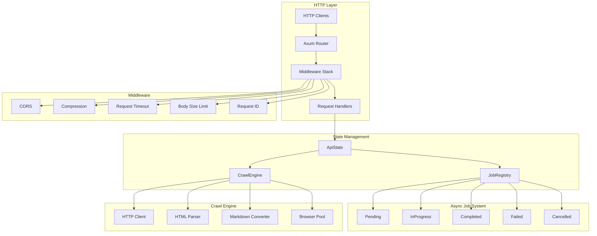
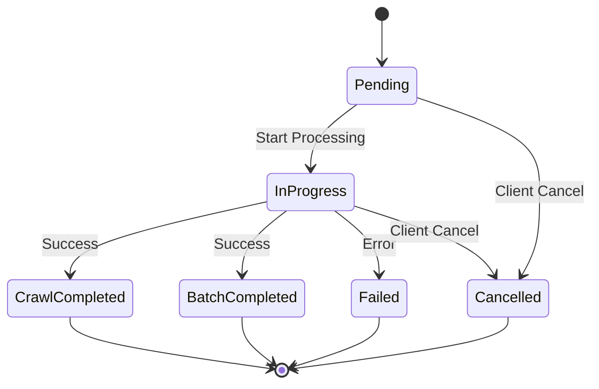

Crawlberg exposes a Firecrawl v1-compatible HTTP API that wraps the core crawling engine in a persistent, network-accessible service. This architecture enables any HTTP-capable client—from mobile apps to microservices—to leverage crawlberg's scraping, crawling, and URL discovery capabilities without embedding the Rust library directly. The API is implemented as an optional feature (`api`) built on Axum, generating OpenAPI documentation through utoipa for client integration and testing.

## Architecture Overview

The REST API follows a layered architecture where HTTP handlers delegate to a shared `CrawlEngine` instance. The engine is constructed once at startup and passed through Axum's state extraction mechanism to all handlers, ensuring thread-safe access to the underlying crawling infrastructure.



The server operates in two modes: synchronous endpoints (`/v1/scrape`, `/v1/map`, `/v1/download`) that return results immediately, and asynchronous endpoints (`/v1/crawl`, `/v1/batch/scrape`) that return a job ID for polling. This design prevents HTTP timeouts during long-running crawl operations while maintaining responsive API interactions.

**Sources**: [crates/crawlberg/src/api/startup.rs](crates/crawlberg/src/api/startup.rs#L1-L60), [crates/crawlberg/src/api/router.rs](crates/crawlberg/src/api/router.rs#L1-L115)

## Endpoint Reference

The API provides 11 endpoints organized into four functional groups. All request bodies use `camelCase` field naming to maintain Firecrawl compatibility.

| Method | Path | Purpose | Response Type |
|--------|------|---------|---------------|
| `POST` | `/v1/scrape` | Scrape a single URL synchronously | `ScrapeResult` |
| `POST` | `/v1/crawl` | Start asynchronous crawl job | `JobCreatedResponse` |
| `GET` | `/v1/crawl/{id}` | Poll crawl job status | `JobStatusResponse` |
| `DELETE` | `/v1/crawl/{id}` | Cancel running crawl job | Success message |
| `POST` | `/v1/map` | Discover URLs on a site | `MapResult` |
| `POST` | `/v1/batch/scrape` | Start asynchronous batch scrape | `JobCreatedResponse` |
| `GET` | `/v1/batch/scrape/{id}` | Poll batch job status | `JobStatusResponse` |
| `POST` | `/v1/download` | Download a document | `ScrapeResult` |
| `GET` | `/health` | Health check | `HealthResponse` |
| `GET` | `/version` | Version information | `VersionResponse` |
| `GET` | `/openapi.json` | OpenAPI 3.1 schema | JSON Schema |

The `/v1/scrape` endpoint accepts a `ScrapeRequest` with the following parameters:

| Field | Type | Required | Description |
|-------|------|----------|-------------|
| `url` | `string` | Yes | Target URL (http/https only) |
| `formats` | `string[]` | No | Output formats (`markdown`, `html`) |
| `onlyMainContent` | `boolean` | No | Extract main content only |
| `includeTags` | `string[]` | No | CSS selectors to include |
| `excludeTags` | `string[]` | No | CSS selectors to exclude |
| `timeout` | `number` | No | Request timeout in milliseconds |

**Sources**: [crates/crawlberg/src/api/handlers.rs](crates/crawlberg/src/api/handlers.rs#L70-L92), [crates/crawlberg/src/api/types.rs](crates/crawlberg/src/api/types.rs#L6-L32)

## Request and Response Patterns

All responses follow a consistent envelope pattern that wraps data in a `success` flag with either `data` or `error` fields. This structure enables clients to implement uniform error handling across all endpoints.

### Success Response Envelope

```json
{
  "success": true,
  "data": { ... }
}
```

### Error Response Envelope

```json
{
  "success": false,
  "error": {
    "code": "BAD_REQUEST",
    "message": "url is required"
  }
}
```

Error codes map directly to HTTP status codes and provide machine-readable identifiers for programmatic handling. The `ApiError` type converts `CrawlError` variants to appropriate HTTP responses:

| CrawlError Variant | HTTP Status | Error Code |
|-------------------|-------------|------------|
| `NotFound` | 404 | `NOT_FOUND` |
| `Unauthorized` | 401 | `UNAUTHORIZED` |
| `Forbidden` | 403 | `FORBIDDEN` |
| `WafBlocked` | 403 | `WAF_BLOCKED` |
| `Timeout` | 504 | `TIMEOUT` |
| `RateLimited` | 429 | `RATE_LIMITED` |
| `InvalidConfig` | 422 | `INVALID_CONFIG` |

The crawl endpoint accepts additional parameters for controlling traversal depth and scope:

| Field | Type | Default | Description |
|-------|------|---------|-------------|
| `maxDepth` | `number` | Unlimited | Maximum link depth to follow |
| `maxPages` | `number` | Unlimited | Maximum pages to crawl |
| `includePaths` | `string[]` | All | URL patterns to include (regex) |
| `excludePaths` | `string[]` | None | URL patterns to exclude (regex) |

**Sources**: [crates/crawlberg/src/api/error.rs](crates/crawlberg/src/api/error.rs#L1-L86), [crates/crawlberg/src/api/types.rs](crates/crawlberg/src/api/types.rs#L108-L155)

## Asynchronous Job Management

Long-running operations like crawling and batch scraping use an asynchronous job system that decouples request submission from result retrieval. This pattern prevents HTTP connection timeouts while allowing clients to monitor progress.

### Job Lifecycle



The `JobRegistry` uses `DashMap` for concurrent access, allowing multiple clients to query job status simultaneously without blocking. Jobs automatically expire after 1 hour via a background eviction task that runs every 60 seconds.

### Polling Pattern

Clients initiate an asynchronous job by POSTing to the crawl or batch endpoint, receiving an immediate response with a UUID job identifier. They then poll the corresponding GET endpoint until the status transitions to a terminal state:

```bash
# Start crawl job
JOB_ID=$(curl -s http://127.0.0.1:3000/v1/crawl \
  -H 'content-type: application/json' \
  -d '{"url":"https://example.com","maxDepth":2}' | jq -r '.id')

# Poll until completion
while true; do
  STATUS=$(curl -s "http://127.0.0.1:3000/v1/crawl/$JOB_ID" | jq -r '.status')
  echo "Status: $STATUS"
  [ "$STATUS" = "completed" ] && break
  sleep 2
done
```

The polling response includes progress metrics:

| Field | Type | Description |
|-------|------|-------------|
| `status` | `string` | Current state (`pending`, `in_progress`, `completed`, `failed`, `cancelled`) |
| `total` | `number` | Estimated total pages (0 during processing) |
| `completed` | `number` | Pages processed so far |
| `data` | `array` | Results array (populated when `completed`) |
| `error` | `string` | Error message (populated when `failed`) |

**Sources**: [crates/crawlberg/src/api/jobs.rs](crates/crawlberg/src/api/jobs.rs#L1-L152), [crates/crawlberg/src/api/handlers.rs](crates/crawlberg/src/api/handlers.rs#L176-L230)

## Middleware and Request Processing

The Axum router applies a comprehensive middleware stack that handles cross-cutting concerns without polluting handler logic. Each layer addresses a specific operational requirement while maintaining separation of concerns.

### Security and Validation Middleware

| Middleware | Purpose | Configuration |
|-----------|---------|---------------|
| `CorsLayer` | Enable cross-origin requests | Allow all origins, methods, headers |
| `RequestBodyLimitLayer` | Prevent memory exhaustion | 10 MB maximum |
| `SetSensitiveHeadersLayer` | Protect auth headers | Redacts `Authorization` header in logs |
| `CatchPanicLayer` | Prevent server crashes | Catches panics in handlers |

### Observability Middleware

| Middleware | Purpose | Implementation |
|-----------|---------|----------------|
| `TraceLayer` | Request/response logging | HTTP-level tracing |
| `CompressionLayer` | Reduce bandwidth | gzip/deflate encoding |
| `SetRequestIdLayer` | Request correlation | UUID-based request tracking |
| `PropagateRequestIdLayer` | Header forwarding | Propagates request ID in responses |

### Timeout Enforcement

A custom `request_timeout` middleware enforces a 5-minute deadline on all handlers. This prevents indefinite execution from blocking the server while allowing legitimate long-running scrapes:

```rust
async fn request_timeout(req: Request, next: Next) -> impl IntoResponse {
    match tokio::time::timeout(REQUEST_TIMEOUT, next.run(req)).await {
        Ok(response) => response,
        Err(_elapsed) => StatusCode::REQUEST_TIMEOUT.into_response(),
    }
}
```

The MCP (Model Context Protocol) endpoint is intentionally excluded from timeout and compression middleware because its Server-Sent Events (SSE) transport requires persistent connections that would break under these constraints.

**Sources**: [crates/crawlberg/src/api/router.rs](crates/crawlberg/src/api/router.rs#L30-L100)

## Configuration and Startup

The server accepts configuration through command-line arguments and constructs a `CrawlEngine` at startup. This design separates deployment configuration from runtime request parameters.

### CLI Arguments

| Argument | Default | Description |
|----------|---------|-------------|
| `--host` | `0.0.0.0` | Bind address (use `127.0.0.1` for local-only) |
| `--port` | `3000` | Listening port |

The server boots with the default `CrawlConfig` and applies per-request overrides through the HTTP request body. This allows a single server instance to handle diverse crawling requirements without restart.

### Feature Flags

The REST API is gated behind the `api` Cargo feature, which pulls in Axum, tower-http, utoipa, uuid, and base64 dependencies. This keeps the core library lightweight for embedding scenarios:

```toml
[features]
api = [
    "dep:axum",
    "dep:tower-http",
    "dep:utoipa",
    "dep:uuid",
    "dep:base64",
    "native-runtime",
]
```

For Homebrew installations, the `api` feature is included by default. Source builds require explicit feature activation:

```bash
cargo install crawlberg-cli --features api
# or
cargo install crawlberg-cli --features all
```

The `serve_with_config` public API allows programmatic server construction with custom `CrawlConfig` values, enabling integration into existing Rust applications that need embedded crawling services.

**Sources**: [crates/crawlberg/Cargo.toml](crates/crawlberg/Cargo.toml#L19-L56), [plugin/skills/serving-the-api/SKILL.md](plugin/skills/serving-the-api/SKILL.md#L23-L27)

## Client Integration Examples

### Python with requests

```python
import requests

# Synchronous scrape
response = requests.post(
    "http://127.0.0.1:3000/v1/scrape",
    json={
        "url": "https://example.com",
        "formats": ["markdown"],
        "onlyMainContent": True
    }
)
data = response.json()
print(data["data"]["markdown"])

# Async crawl with polling
job_response = requests.post(
    "http://127.0.0.1:3000/v1/crawl",
    json={
        "url": "https://docs.example.com",
        "maxDepth": 2,
        "maxPages": 50
    }
)
job_id = job_response.json()["id"]

import time
while True:
    status = requests.get(f"http://127.0.0.1:3000/v1/crawl/{job_id}")
    if status.json()["status"] == "completed":
        results = status.json()["data"]
        break
    time.sleep(1)
```

### JavaScript/TypeScript with fetch

```typescript
// Synchronous scrape
const scrapeResponse = await fetch("http://127.0.0.1:3000/v1/scrape", {
  method: "POST",
  headers: { "Content-Type": "application/json" },
  body: JSON.stringify({
    url: "https://example.com",
    formats: ["markdown"]
  })
});
const { data } = await scrapeResponse.json();

// URL mapping
const mapResponse = await fetch("http://127.0.0.1:3000/v1/map", {
  method: "POST",
  headers: { "Content-Type": "application/json" },
  body: JSON.stringify({
    url: "https://example.com",
    limit: 100,
    search: "api"
  })
});
const { data: urls } = await mapResponse.json();
```

### Docker Deployment

The standard Docker image includes the `api` feature and can be started with:

```bash
docker run -p 3000:3000 ghcr.io/xberg-io/crawlberg serve --host 0.0.0.0 --port 3000
```

For production deployments, place the server behind a reverse proxy (nginx, Traefik) that adds authentication, rate limiting, and TLS termination. The server itself implements no authentication and accepts CORS from all origins.

**Sources**: [tests/api/test_stateful.py](tests/api/test_stateful.py#L13-L89), [docker/Dockerfile](docker/Dockerfile#L1-L73)

## OpenAPI and Testing

The server exposes a complete OpenAPI 3.1 specification at `/openapi.json`, generated automatically from the Rust type definitions using utoipa. This specification serves as both documentation and the basis for contract testing.

### Contract Testing

The test suite uses Schemathesis for property-based testing against the OpenAPI schema. This approach validates that:

- All endpoints return valid responses matching declared schemas
- No server errors (5xx) occur for any valid or invalid input
- Response content types match specifications
- Health and version endpoints always return 200

```python
# Property-based contract test
def test_all_endpoints_no_server_errors(api_schema):
    for result in api_schema.get_all_operations():
        operation = result.ok()
        case = operation.Case()
        response = case.call()
        case.validate_response(response, checks=(
            schemathesis.checks.not_a_server_error,
            schemathesis.checks.response_schema_conformance,
        ))
```

The test infrastructure automatically starts a crawlberg server on a random port, waits for health check confirmation, and tears down the process after test completion. This ensures integration tests run against a real server instance without manual setup.

**Sources**: [crates/crawlberg/src/api/openapi.rs](crates/crawlberg/src/api/openapi.rs#L1-L131), [tests/api/conftest.py](tests/api/conftest.py#L1-L92)

## Production Considerations

### Security Posture

The API server implements **no built-in authentication** and accepts CORS from all origins. This design choice reflects its intended use as a local development tool or backend service behind a gateway. For public exposure:

1. Deploy behind an API gateway with authentication middleware
2. Bind to `127.0.0.1` to restrict network access
3. Implement rate limiting at the gateway level
4. Use network policies to restrict outbound connections (SSRF mitigation)

### Performance Characteristics

The server maintains these operational limits:

| Constraint | Value | Rationale |
|-----------|-------|-----------|
| Request body size | 10 MB | Prevent memory exhaustion |
| Request timeout | 5 minutes | Balance responsiveness with long scrapes |
| Job TTL | 1 hour | Automatic cleanup of abandoned jobs |
| Eviction interval | 60 seconds | Balance memory usage with cleanup frequency |

The `CrawlEngine` instance is shared across all requests through `Arc<CrawlEngine>`, enabling connection pooling and configuration reuse. Per-request configuration overrides (e.g., `maxDepth`, `maxPages`) create temporary engine instances with modified settings without mutating the shared state.

### Observability Integration

When compiled with the `otel` feature, the server emits OpenTelemetry traces and metrics that integrate with observability platforms. The API-specific features (`api`, `mcp-http`) are independent of telemetry, allowing selective capability inclusion based on deployment requirements.

**Sources**: [plugin/skills/serving-the-api/SKILL.md](plugin/skills/serving-the-api/SKILL.md#L106-L116), [crates/crawlberg/src/api/state.rs](crates/crawlberg/src/api/state.rs#L1-L33)

## Related Documentation

- [Architecture and Data Flow](9-architecture-and-data-flow) - Core engine design and request processing pipeline
- [Configuration Reference (CrawlConfig)](11-configuration-reference-crawlconfig) - Detailed configuration options
- [MCP Server for AI Agents](24-mcp-server-for-ai-agents) - Alternative protocol for AI agent integration
- [Docker and Deployment](29-docker-and-deployment) - Containerization and production deployment patterns