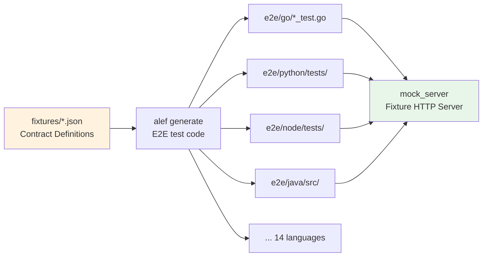
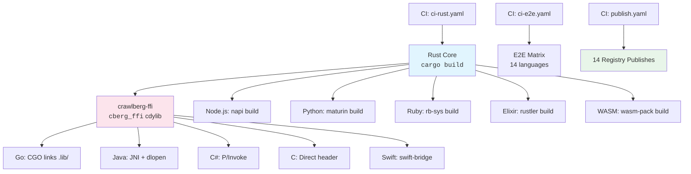

Crawlberg delivers a **single Rust crawling engine** with identical behavioral semantics across 14 language targets through a code-generation-first architecture. The system uses **alef** — a polyglot binding generator — to produce language-specific bridge code from annotated Rust source, ensuring that every binding exposes the same API surface, data models, and error semantics as the core engine. This page explains how the binding architecture works, the strategies employed for each language family, and how consistency is maintained from source to distribution.

## The Binding Generation Pipeline

The entire polyglot system is orchestrated through **alef**, configured in [alef.toml](alef.toml#L1-L20). The workspace-level configuration declares all 16 target languages and their DTO mapping strategies, then each crate defines the exact API surface to expose:

```toml
# alef.toml — excerpted from workspace configuration
languages = [
  "python", "node", "ruby", "php", "ffi", "go", "java", "csharp",
  "elixir", "wasm", "dart", "kotlin_android", "jni", "swift", "zig",
]
```

The generation pipeline follows a three-stage process:

```mermaid
graph TD
    A[Rust Source<br/><code>crates/crawlberg/src/bindings.rs</code><br/><code>crates/crawlberg/src/types/</code>] --> B[alef Analyzer<br/>Reads <code>#[cfg_attr(alef, ...)]</code><br/>Expands DTOs + function signatures]
    B --> C[Language Adapters<br/>16 target generators<br/>FMT: idiomatic per language]
    C --> D[Generated Output<br/>Per-language crate/module<br/>All files marked<br/><code>auto-generated by alef</code>]
    
    E[<code>alef.toml</code><br/>Workspace + Crate Config] -.->|Drives| B
    F[<code>crates/include</code><br/>+ <code>functions</code> whitelist] -.->|Constrains| B
    G[<code>crates.adapters</code><br/>Streaming pattern defs] -.->|Extends| B
    
    style A fill:#e1f5fe
    style D fill:#e8f5e9
    style E fill:#fff3e0
```

Sources: [alef.toml#L3-L19](alef.toml#L3-L19), [alef.toml#L283-L301](alef.toml#L283-L301), [alef.toml#L384-L444](alef.toml#L384-L444)

## Three Binding Strategies

Crawlberg employs three fundamentally different binding strategies depending on the target language's runtime model. The choice is driven by how each language manages memory, concurrency, and native code boundaries.

| Strategy | Languages | Mechanism | Concurrency Model | Streaming Support |
|----------|-----------|-----------|-------------------|-------------------|
| **Native NAPI/PyO3/Magnus** | Node.js, Python, Ruby, Elixir | Rust crate compiled to native module; loaded by language runtime | Thread-local async runtime or NIF scheduler | ✅ Native async iterators / channels |
| **C FFI + cgo/FFI** | Go, C, C#/.NET, Java, Kotlin, Swift, Zig | Rust `cdylib` → C header → language-specific FFI wrapper | Blocking FFI calls; streaming via polling adapters | ⚠️ Start/next/free polling pattern |
| **WASM** | WebAssembly (JS host) | `wasm-bindgen` direct exports to JS | Single-threaded Promise-based | ❌ No native streaming (wasm32 incompatible) |

The core engine uses `Arc<dyn Trait>` for pluggable components — a pattern that **cannot cross FFI boundaries**. The binding layer solves this through a config-only construction path with default implementations, documented explicitly in the bindings module:

> "The core `CrawlEngine` uses `Arc<dyn Trait>` for pluggable components, which cannot cross FFI boundaries. This module provides a config-only construction path with default implementations."

Sources: [crates/crawlberg/src/bindings.rs#L1-L6](crates/crawlberg/src/bindings.rs#L1-L6), [alef.toml#L364-L380](alef.toml#L364-L380)

### Strategy 1: Native Module Bindings (Node.js, Python, Ruby, Elixir)

These languages embed a Rust async runtime directly within their process. Each binding uses a language-specific native module crate:

| Crate | Runtime Framework | Module Entry Point | Async Strategy |
|-------|------------------|--------------------|----------------|
| [crawlberg-node](crates/crawlberg-node/src/lib.rs) | `napi` + `napi-derive` | `#[napi]` annotations | Static `tokio::Runtime` with 16 MB worker stacks |
| [crawlberg-py](crates/crawlberg-py/src/lib.rs) | `pyo3` + `maturin` | `#[pymodule]` | GIL-aware blocking via `tokio::runtime::Runtime::block_on` |
| [crawlberg-ruby](packages/ruby/ext/crawlberg_rb/src/lib.rs) | `magnus` (rb-sys) | `#[magnus::wrap]` classes | Ruby NIF scheduler integration |
| [crawlberg-nif](packages/elixir/native/crawlberg_nif/src/lib.rs) | `rustler` | `#[rustler::nif]` | Erlang NIF dirty schedulers |

The Node.js binding demonstrates the pattern most clearly — it creates a static tokio runtime at module load time and wraps every async function:

```rust
// crates/crawlberg-node/src/lib.rs — simplified
static WORKER_POOL: std::sync::LazyLock<tokio::runtime::Runtime> = 
    std::sync::LazyLock::new(|| {
        tokio::runtime::Builder::new_multi_thread()
            .enable_all()
            .thread_stack_size(16 * 1024 * 1024) // 16 MB stack for deep futures
            .build()
            .expect("Failed to create Tokio runtime")
    });
```

Each native binding also defines **custom wrapper types** for traits that cannot cross FFI boundaries — for example, `PyVisitorRef` in Python wraps `Arc<Py<PyAny>>` to provide `Clone`:

```rust
// crates/crawlberg-py/src/lib.rs — trait visitor wrapper
pub struct PyVisitorRef {
    pub inner: std::sync::Arc<pyo3::Py<pyo3::PyAny>>,
}

impl Clone for PyVisitorRef {
    fn clone(&self) -> Self {
        PyVisitorRef { inner: std::sync::Arc::clone(&self.inner) }
    }
}
```

Sources: [crates/crawlberg-node/src/lib.rs#L49-L62](crates/crawlberg-node/src/lib.rs#L49-L62), [crates/crawlberg-py/src/lib.rs#L55-L99](crates/crawlberg-py/src/lib.rs#L55-L99), [packages/ruby/ext/crawlberg_rb/src/lib.rs#L1-L27](packages/ruby/ext/crawlberg_rb/src/lib.rs#L1-L27), [packages/elixir/native/crawlberg_nif/src/lib.rs#L19-L23](packages/elixir/native/crawlberg_nif/src/lib.rs#L19-L23)

### Strategy 2: C FFI Bridge (Go, Java, C#, C, Kotlin, Swift, Zig)

Languages that cannot host a Rust async runtime use a two-layer architecture: a **C `cdylib`** produced by [crawlberg-ffi](crates/crawlberg-ffi/src/lib.rs) generates a C header via `cbindgen`, and each language's binding crate wraps those C functions with idiomatic types.

The C FFI layer is entirely auto-generated and exposes:

- **Opaque handles**: `CBERGCrawlEngineHandle *` — constructed via `cberg_create_engine()`, freed via `cberg_*_free()` functions
- **Thread-local error state**: `cberg_last_error_code()` + `cberg_last_error_context()` — errors are communicated through a thread-local pattern since C cannot propagate Rust `Result` types
- **Memory management**: `cberg_free_string()` and `cberg_free_bytes()` for owned pointer cleanup
- **Streaming adapters**: A start/next/free polling pattern for async stream consumption:

```c
// crates/crawlberg-ffi/include/crawlberg.h — streaming pattern
struct CBERGCrawlEngineHandleCrawlStreamStreamHandle *
  cberg_crawl_engine_handle_crawl_stream_start(
    const CBERGCrawlEngineHandle *client,
    const CBERGCrawlStreamRequest *req);

CBERGCrawlEvent *
  cberg_crawl_engine_handle_crawl_stream_next(
    struct CBERGCrawlEngineHandleCrawlStreamStreamHandle *handle);

void cberg_crawl_engine_handle_crawl_stream_free(
    struct CBERGCrawlEngineHandleCrawlStreamStreamHandle *handle);
```

Each language wraps this pattern differently:

| Language | FFI Mechanism | Async Bridge | Package Location |
|----------|--------------|-------------|-----------------|
| **Go** | `cgo` direct link to `.lib/` per platform | Blocking FFI + goroutine | [packages/go/binding.go](packages/go/binding.go) |
| **Java** | JNI via `jni` crate + `dlopen` | `CompletableFuture` wrapping | [packages/java/src/](packages/java/src/) |
| **C#/.NET** | P/Invoke + `NativeLibrary` | `Task<T>` wrapping | [packages/csharp/](packages/csharp/) |
| **Swift** | `swift-bridge` FFI crate | `Task` + async/await | [packages/swift/](packages/swift/) |
| **C** | Direct C header consumption | Caller manages concurrency | `e2e/c/main.c` |
| **Zig** | Direct C header consumption | Caller manages concurrency | [packages/zig/](packages/zig/) |

The Go binding exemplifies the cgo integration pattern — it links against platform-specific prebuilt `.dylib`/`.so`/`.dll` files with correct rpath settings:

```go
// packages/go/binding.go — cgo directives
/*
#cgo darwin,arm64 LDFLAGS: -L${SRCDIR}/.lib/macos-arm64 -Wl,-rpath,${SRCDIR}/.lib/macos-arm64 -lcrawlberg_ffi
#cgo darwin,amd64 LDFLAGS: -L${SRCDIR}/.lib/macos-x86_64 -Wl,-rpath,${SRCDIR}/.lib/macos-x86_64 -lcrawlberg_ffi
#cgo linux,amd64 LDFLAGS: -L${SRCDIR}/.lib/linux-x86_64 -Wl,-rpath,${SRCDIR}/.lib/linux-x86_64 -lcrawlberg_ffi
#include "crawlberg.h"
*/
import "C"
```

Sources: [crates/crawlberg-ffi/src/lib.rs#L1-L86](crates/crawlberg-ffi/src/lib.rs#L1-L86), [crates/crawlberg-ffi/include/crawlberg.h#L313-L349](crates/crawlberg-ffi/include/crawlberg.h#L313-L349), [packages/go/binding.go#L1-L27](packages/go/binding.go#L1-L27), [crates/crawlberg-ffi/build.rs#L23-L26](crates/crawlberg-ffi/build.rs#L23-L26)

### Strategy 3: WASM Direct Exports

The [crawlberg-wasm](crates/crawlberg-wasm/src/lib.rs) crate uses `wasm-bindgen` to export Rust functions and types directly to JavaScript. It is explicitly **excluded from streaming adapters** (`skip_languages = ["wasm"]` in [alef.toml#L454](alef.toml#L454)) because `wasm32` targets lack native concurrency primitives (tokio channels, `JoinSet`) required for `BoxStream`.

Every WASM-exported type gets JavaScript-style camelCase getter/setter pairs:

```rust
// crates/crawlberg-wasm/src/lib.rs — JS-idiomatic API
#[wasm_bindgen(getter, js_name = "promptTokens")]
pub fn prompt_tokens(&self) -> Option<u64> {
    self.prompt_tokens
}

#[wasm_bindgen(setter, js_name = "promptTokens")]
pub fn set_prompt_tokens(&mut self, value: Option<u64>) {
    self.prompt_tokens = value;
}
```

Sources: [crates/crawlberg-wasm/src/lib.rs#L1-L100](crates/crawlberg-wasm/src/lib.rs#L1-L100), [alef.toml#L446-L454](alef.toml#L446-L454)

## The Binding API Surface

The public API exposed to all language bindings is defined in a single source of truth: [crates/crawlberg/src/bindings.rs](crates/crawlberg/src/bindings.rs). Alef reads this module along with the types and error modules to generate the full binding surface.

### Core Functions

| Function | Signature | Description |
|----------|-----------|-------------|
| `create_engine` | `(Option<CrawlConfig>) -> Result<CrawlEngineHandle, CrawlError>` | Construct engine with config-only defaults |
| `scrape` | `(engine, url) -> Result<ScrapeResult, CrawlError>` | Single-page scrape |
| `crawl` | `(engine, url) -> Result<CrawlResult, CrawlError>` | Multi-page recursive crawl |
| `map_urls` | `(engine, url) -> Result<MapResult, CrawlError>` | URL discovery without scraping |
| `interact` | `(engine, url, actions) -> Result<InteractionResult, CrawlError>` | Browser page actions |
| `batch_scrape` | `(engine, urls) -> Result<BatchScrapeResults, CrawlError>` | Concurrent multi-URL scrape |
| `batch_crawl` | `(engine, urls) -> Result<BatchCrawlResults, CrawlError>` | Concurrent multi-URL crawl |

The streaming functions (`crawl_stream`, `batch_crawl_stream`) are conditionally compiled out on `wasm32` targets and exposed through language-specific adapter patterns defined in [alef.toml#L446-L472](alef.toml#L446-L472).

### Data Transfer Objects

All 33+ DTOs are generated from Rust structs into language-idiomatic forms — configured via `[workspace.dto]` in [alef.toml#L25-L36](alef.toml#L25-L36):

| Language | DTO Style | Example |
|----------|-----------|---------|
| Python | `TypedDict` | `class ScrapeResult(TypedDict)` |
| Node.js | `interface` | `interface ScrapeResult { ... }` |
| Go | `struct` | `type ScrapeResult struct { ... }` |
| Java | `record` | `record ScrapeResult(...)` |
| C# | `record` | `record ScrapeResult(...)` |
| Ruby | `struct` | `ScrapeResult = Struct.new(...)` |
| PHP | `readonly-class` | `readonly class ScrapeResult { ... }` |
| Elixir | `struct` | `defmodule Crawlberg.ScrapeResult do ... end` |
| Dart | `dataclass` | `@dataclass class ScrapeResult { ... }` |
| Kotlin | `data-class` | `data class ScrapeResult(...)` |

Sources: [crates/crawlberg/src/bindings.rs#L100-L181](crates/crawlberg/src/bindings.rs#L100-L181), [alef.toml#L25-L36](alef.toml#L25-L36), [alef.toml#L384-L434](alef.toml#L384-L434)

## Consistency Architecture

### Single-Source Type Definitions

The [crawlberg-bindings-common](crates/crawlberg-bindings-common/src/lib.rs) crate re-exports the core binding API, ensuring all native-language crates (Node.js, Python, Ruby) compile against the same Rust types:

```rust
// crates/crawlberg-bindings-common/src/lib.rs
pub use crawlberg;
pub use crawlberg::{
    BatchCrawlResult, BatchCrawlResults, BatchScrapeResult, BatchScrapeResults,
    CrawlEngineHandle, batch_crawl, batch_scrape, crawl, create_engine, map_urls, scrape,
};
```

### Auto-Generated Code Provenance

Every generated file carries a BLAKE3 hash for freshness verification:

```rust
// Every alef-generated file starts with:
// This file is auto-generated by alef. DO NOT EDIT.
// alef:hash:7c011ee5688979448c85a639a24835fac91faabe56dd33eb0e8239833a035980
// Re-generate with: alef generate
```

The `alef verify --exit-code` command checks that generated files match their source hash, and the `poly-hooks.lock` file tracks the provenance chain.

### E2E Test Matrix

Every binding runs an identical set of fixture-driven E2E tests. The test fixtures live in [fixtures/](fixtures/) as JSON contracts, and each language's E2E suite in [e2e/](e2e/) generates tests from these same fixtures:



The E2E tests for Go ([e2e/go/scrape_test.go](e2e/go/scrape_test.go)) demonstrate the pattern — each test loads a fixture URL from environment variables and asserts against the contract:

```go
// e2e/go/scrape_test.go — fixture-driven test
func Test_ScrapeAssetDedup(t *testing.T) {
    url := os.Getenv("MOCK_SERVER_SCRAPE_ASSET_DEDUP")
    if url == "" {
        url = os.Getenv("MOCK_SERVER_URL") + "/fixtures/scrape_asset_dedup"
    }
    result, err := pkg.Scrape(engine, url)
    // assertions against fixture contract...
}
```

Sources: [e2e/go/scrape_test.go#L1-L47](e2e/go/scrape_test.go#L1-L47), [crates/crawlberg-bindings-common/src/lib.rs#L1-L10](crates/crawlberg-bindings-common/src/lib.rs#L1-L10)

## Build and Release Pipeline

The build system uses [Task](https://taskfile.dev/) with per-language task files in [`.task/languages/`](.task/languages/). Each language's build task depends on the Rust FFI crate being built first:



The [publish workflow](.github/workflows/publish.yaml#L1-L82) orchestrates publishing to 14+ registries: crates.io, PyPI, npm, Maven Central, NuGet, Packagist, RubyGems, Hex.pm, pub.dev, Homebrew, Docker, and GitHub Releases.

Sources: [Taskfile.yml#L1-L56](Taskfile.yml#L1-L56), [.task/languages/go.yml#L28-L43](.task/languages/go.yml#L28-L43), [.github/workflows/publish.yaml#L47-L82](.github/workflows/publish.yaml#L47-L82)

## Crate Layout Reference

```
crates/
├── crawlberg/                     # Core Rust engine
│   └── src/
│       ├── bindings.rs            # ← Binding API surface (single source of truth)
│       ├── traits.rs              # ← Pluggable component traits
│       ├── types/                 # ← All DTOs and config types
│       ├── error.rs               # ← CrawlError definition
│       └── ...
├── crawlberg-bindings-common/     # Shared re-exports for native bindings
├── crawlberg-ffi/                 # C FFI cdylib + cbindgen header
│   ├── include/crawlberg.h        # ← Generated C header
│   └── src/lib.rs                 # ← Generated C wrapper functions
├── crawlberg-node/                # Node.js native module (napi)
├── crawlberg-py/                  # Python native module (pyo3)
├── crawlberg-php/                 # PHP native extension (php-ext)
├── crawlberg-wasm/                # WebAssembly (wasm-bindgen)
├── crawlberg-jni/                 # JNI bridge (for Java/Kotlin)
└── ...
```

## Language Output Paths

All generated binding code is written to predictable locations defined in [alef.toml#L367-L380](alef.toml#L367-L380):

| Language | Generated Code Path | Distribution Format |
|----------|-------------------|-------------------|
| Python | `crates/crawlberg-py/src/` | PyPI wheel via maturin |
| Node.js | `crates/crawlberg-node/src/` | npm package per platform |
| Ruby | `packages/ruby/ext/crawlberg_rb/src/` | RubyGems gem with native ext |
| PHP | `crates/crawlberg-php/src/` | Packagist package |
| Go | `packages/go/` | Go module with embedded FFI |
| Java | `packages/java/src/main/java/` | Maven Central JAR with JNI |
| C# | `packages/csharp/` | NuGet package with P/Invoke |
| Elixir | `packages/elixir/native/crawlberg_nif/src/` | Hex.pm package with NIF |
| WASM | `crates/crawlberg-wasm/src/` | npm WASM package |
| Dart | `packages/dart/lib/src/` | pub.dev package via flutter_rust_bridge |
| Kotlin | `packages/kotlin-android/src/main/kotlin/` | Maven Central AAR |
| Swift | `packages/swift/Sources/Crawlberg/` | Swift Package Manager |
| Zig | `packages/zig/src/` | Zig build package |
| C FFI | `crates/crawlberg-ffi/src/` | GitHub Releases (cdylib + header) |

## Related Pages

- [Architecture and Data Flow](9-architecture-and-data-flow) — the core engine architecture that bindings wrap
- [Trait-Based Pluggable Engine](10-trait-based-pluggable-engine) — the pluggable trait system that bindings abstract via config-only defaults
- [Result Types and Data Models](12-result-types-and-data-models) — the DTOs generated across all bindings
- [Testing Strategy (Unit, E2E, Fuzz)](28-testing-strategy-unit-e2e-fuzz) — the E2E test matrix approach
- [REST API Server](25-rest-api-server) — an alternative binding surface via HTTP