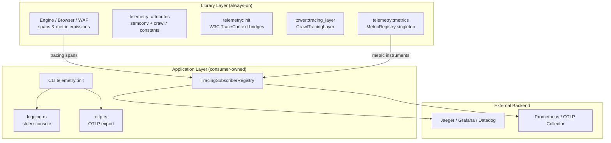
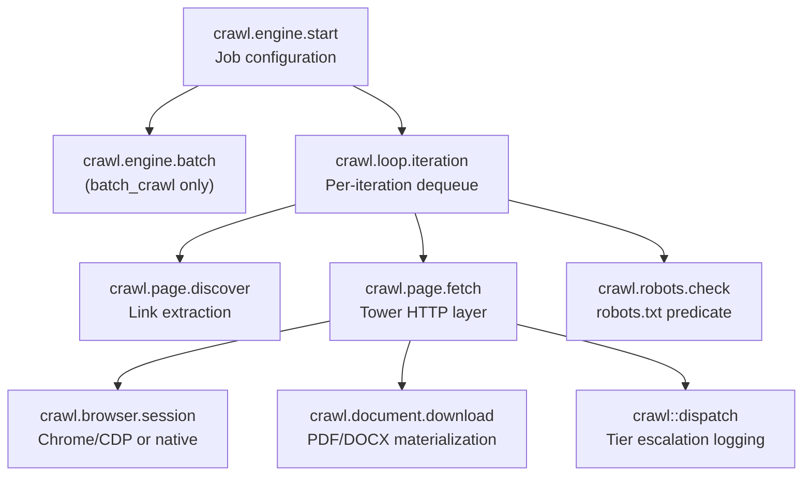

Crawlberg provides a comprehensive observability framework built on OpenTelemetry standards, enabling developers to monitor crawl performance, diagnose WAF interactions, and track system behavior across distributed deployments. The architecture follows a deliberate **emit-only** pattern: the library emits traces, metrics, and semantic attributes unconditionally, while the responsibility of installing subscribers and exporters belongs to the application layer. This separation ensures that downstream consumers—including the CLI, REST API server, MCP server, and language bindings—can plug into their own observability infrastructure without coupling to a specific telemetry backend.

Sources: [telemetry/mod.rs](crates/crawlberg/src/telemetry/mod.rs#L1-L23), [telemetry/metrics.rs](crates/crawlberg/src/telemetry/metrics.rs#L1-L23), [crawlberg-cli/telemetry/mod.rs](crates/crawlberg-cli/src/telemetry/mod.rs#L1-L55)

## Two-Layer Architecture

The telemetry system is split across two architectural boundaries. The **library layer** (`crates/crawlberg/src/telemetry/`) defines all OTel instrument handles, semantic-convention attribute keys, and W3C TraceContext propagation helpers. These are always compiled and always emit—there is no feature gate that disables them. The **application layer** (`crates/crawlberg-cli/src/telemetry/`) installs the global `tracing` subscriber and, when the `otel` feature is active and `OTEL_EXPORTER_OTLP_ENDPOINT` is set, wires an OTLP exporter for both spans and metrics.



This design means that integrating OpenTelemetry into a custom service wrapping crawlberg requires zero library-side changes: you install your own `TracerProvider` and `MeterProvider` globally, and crawlberg's spans and instruments flow into them automatically.

Sources: [crawlberg-cli/Cargo.toml](crates/crawlberg-cli/Cargo.toml#L42-L56), [crawlberg/Cargo.toml](crates/crawlberg/Cargo.toml#L35-L37), [CLI telemetry/otlp.rs](crates/crawlberg-cli/src/telemetry/otlp.rs#L75-L120)

## Metric Registry

The [`MetricRegistry`](crates/crawlberg/src/telemetry/metrics.rs) is a `'static` singleton obtained via the `registry()` function. It holds 10 OpenTelemetry instrument handles, initialized lazily on first access using `OnceLock`. Each instrument maps to a specific crawl subsystem and carries labels that enable dimensional analysis in monitoring dashboards.

| Metric Name | Type | Labels | Purpose |
|---|---|---|---|
| `crawl_pages_total` | Counter (u64) | `status` ∈ `{ok, http_error, timeout, blocked}` | Pages fetched, partitioned by terminal status |
| `crawl_documents_discovered_total` | Counter (u64) | `mime_type` | Non-HTML documents discovered (PDF, DOCX, etc.) |
| `crawl_robots_blocked_total` | Counter (u64) | — | Requests rejected by robots.txt |
| `crawl_waf_blocks_total` | Counter (u64) | `vendor` | WAF challenges detected, per vendor |
| `crawl_backend_escalations_total` | Counter (u64) | `from_tier`, `to_tier`, `reason` | Tier escalations (HTTP → Browser, etc.) |
| `crawl_bypass_requests_total` | Counter (u64) | `vendor`, `mode` ∈ `{managed, byo}` | Requests routed through bypass provider |
| `crawl_bypass_failures_total` | Counter (u64) | `vendor`, `reason` | Bypass provider failures |
| `crawl_duration_seconds` | Histogram (f64) | `output_mode`, `status` | End-to-end crawl duration |
| `crawl_pages_duration_seconds` | Histogram (f64) | `host` | Per-page fetch latency |
| `crawl_browser_sessions_active` | Up-down Counter (i64) | — | Active headless-browser sessions |

The registry is populated by Cluster 2 instrument handles during initialization. The metric names align with xberg-enterprise's existing emission points, enabling cloud deployments to consolidate duplicate metrics in downstream consolidation work.

Sources: [telemetry/metrics.rs](crates/crawlberg/src/telemetry/metrics.rs#L24-L168), [engine/mod.rs](crates/crawlberg/src/engine/mod.rs#L302-L365)

## Semantic Convention Attributes

All attribute keys used in spans and metric labels are centralized in the [`telemetry::attributes`](crates/crawlberg/src/telemetry/attributes.rs) module. Upstream OpenTelemetry semantic-convention constants (`HTTP_REQUEST_METHOD`, `HTTP_RESPONSE_STATUS_CODE`, `SERVER_ADDRESS`, `URL_FULL`) are re-exported so callers import from a single location. Extension constants in the `crawl.*` namespace are defined as `pub const` strings:

| Constant | Key | Usage |
|---|---|---|
| `CRAWL_SEED_COUNT` | `crawl.seed_count` | Number of seed URLs in the crawl job |
| `CRAWL_MAX_DEPTH` | `crawl.max_depth` | Configured maximum crawl depth |
| `CRAWL_MAX_PAGES` | `crawl.max_pages` | Configured maximum number of pages |
| `CRAWL_STRATEGY` | `crawl.strategy` | Crawl strategy (bfs, dfs, best_first) |
| `CRAWL_BROWSER_MODE` | `crawl.browser_mode` | Browser mode (never, always, auto, stealth) |
| `CRAWL_DEPTH` | `crawl.depth` | Depth of current URL being processed |
| `CRAWL_FRONTIER_SIZE` | `crawl.frontier_size` | URLs currently in the frontier |
| `CRAWL_PAGES_COMPLETED` | `crawl.pages_completed` | Pages successfully completed |
| `CRAWL_PARENT_URL` | `crawl.parent_url` | Parent URL for link discovery |
| `CRAWL_LINK_TYPE` | `crawl.link_type` | Link classification (internal, external, document) |
| `CRAWL_TIER` | `crawl.tier` | Dispatch tier (http, browser) |
| `CRAWL_FINAL_URL` | `crawl.final_url` | URL after redirects |
| `CRAWL_MIME_TYPE` | `crawl.mime_type` | MIME type of fetched resource |
| `CRAWL_BROWSER_BACKEND` | `crawl.browser.backend` | Browser backend (chromiumoxide, native) |
| `CRAWL_BROWSER_SESSION_ID` | `crawl.browser.session_id` | Opaque session identifier |
| `CRAWL_HOST` | `crawl.host` | Hostname for robots.txt checks |
| `CRAWL_ALLOWED` | `crawl.allowed` | Whether robots.txt check passed |

Sources: [telemetry/attributes.rs](crates/crawlberg/src/telemetry/attributes.rs#L1-L61)

## Span Catalogue

Every span is emitted via `tracing::info_span!` and automatically bridged to OpenTelemetry by the `tracing_opentelemetry::layer()`. The spans form a hierarchical tree that mirrors the crawl lifecycle, enabling request tracing from engine initialization through individual page fetches.



| Span Name | Location | Key Attributes |
|---|---|---|
| `crawl.engine.start` | `CrawlEngine::crawl` entry | `crawl.seed_count`, `crawl.max_depth`, `crawl.max_pages`, `crawl.strategy`, `crawl.browser_mode` |
| `crawl.engine.batch` | `batch_crawl()` entry | `crawl.seed_count` |
| `crawl.loop.iteration` | Crawl loop dequeue | `crawl.depth`, `crawl.frontier_size`, `crawl.pages_completed` |
| `crawl.page.discover` | Link extraction (per discovered URL) | `url.full`, `url.domain`, `crawl.parent_url`, `crawl.depth`, `crawl.link_type` |
| `crawl.page.fetch` | Tower `CrawlTracingLayer` | `http.request.method`, `url.full`, `server.address`, `http.response.status_code`, `http.response.body_size`, `crawl.tier` |
| `crawl.browser.session` | Browser fetch (chromiumoxide or native) | `crawl.browser.backend`, `crawl.browser.session_id`, `crawl.pages_rendered` |
| `crawl.robots.check` | robots.txt predicate | `url.domain`, `crawl.host`, `crawl.allowed` |
| `crawl.document.download` | Document materialization | `url.full`, `crawl.mime_type`, `crawl.size_bytes` |
| `crawl::dispatch` | Dispatch telemetry (structured event) | `url`, `dispatch.tier_chain`, `dispatch.escalation_reason`, `dispatch.attempt_count`, `dispatch.policy`, `dispatch.content_density` |

Sources: [engine/crawl_loop.rs](crates/crawlberg/src/engine/crawl_loop.rs#L347-L360), [tower/tracing_layer.rs](crates/crawlberg/src/tower/tracing_layer.rs#L50-L75), [engine/mod.rs](crates/crawlberg/src/engine/mod.rs#L668-L685), [browser.rs](crates/crawlberg/src/browser.rs#L65-L70), [document.rs](crates/crawlberg/src/document.rs#L62-L68)

## Tower Tracing Layer

The [`CrawlTracingLayer`](crates/crawlberg/src/tower/tracing_layer.rs) is a Tower middleware layer that wraps every HTTP fetch in a `crawl.page.fetch` span with HTTP metadata attributes. It is part of the Tower service stack (outermost to innermost: per-domain rate limiting → HTTP response caching → UA rotation → tracing → base HTTP fetch). This layer also emits per-page metrics to the global `MetricRegistry`:

- On success: increments `pages_total` with `status="ok"` and records `pages_duration_seconds`
- On error: increments `pages_total` with `status="timeout"` or `status="http_error"` and records `pages_duration_seconds`

The layer uses `tracing::Instrument` to associate the span with the async future, ensuring that all work within the fetch—including decompression, charset detection, and header parsing—occurs within the span's context.

Sources: [tower/tracing_layer.rs](crates/crawlberg/src/tower/tracing_layer.rs#L1-L125)

## W3C TraceContext Propagation

Crawlberg provides two W3C TraceContext propagation helpers in [`telemetry::init`](crates/crawlberg/src/telemetry/init.rs) for Rust callers:

- **`with_traceparent(traceparent, callback)`** — Executes a callback with the given `traceparent` header value parsed into an active OpenTelemetry context. Any span created inside `f` becomes a child of the supplied parent span in the collector.
- **`current_traceparent()`** — Extracts the active OpenTelemetry context as a W3C `traceparent` header string (`00-<trace_id>-<span_id>-<flags>`), suitable for forwarding to downstream services.

These helpers are always compiled but are not exposed by generated language bindings because `with_traceparent` requires a Rust closure. Language bindings should propagate trace context at the host-service layer using that language's OpenTelemetry SDK.

```
W3C traceparent format: 00-4bf92f3577b34da6a3ce929d0e0e4736-00f067aa0ba902b7-01
                         ── ───────────────────────────── ──────────────── ──
                         ver          trace-id                  span-id    flags
```

Sources: [telemetry/init.rs](crates/crawlberg/src/telemetry/init.rs#L1-L72)

## CLI Telemetry Initialization

The CLI owns the process-wide telemetry pipeline installation. When `--otel` (feature `otel`) is compiled and the `OTEL_EXPORTER_OTLP_ENDPOINT` environment variable is set, the CLI calls `init_otlp()` which:

1. Builds a `TracerProvider` with a batched OTLP span exporter wired to the configured gRPC endpoint
2. Builds a `MeterProvider` with a periodic metric reader (15-second interval) exporting to the same endpoint
3. Registers the W3C `TraceContextPropagator` for distributed context propagation
4. Bridges `tracing` spans to OpenTelemetry via `tracing_opentelemetry::layer()`
5. Returns a `TelemetryGuard` that flushes and shuts down providers on drop

When OTLP is not configured, the CLI falls back to stderr console logging via `tracing_subscriber::fmt`. The `LogConfig` struct controls output format (Pretty, Compact, or JSON), ANSI coloring, and log-level filtering via `CRAWLBERG_LOG` or `RUST_LOG` environment variables.

| Configuration | Behavior |
|---|---|
| `OTEL_EXPORTER_OTLP_ENDPOINT` set + `otel` feature | Full OTLP export (spans + metrics) |
| `otel` feature but no endpoint | Falls back to console logging with warning |
| No `otel` feature | Console logging only |
| `CRAWLBERG_LOG=debug` | Overrides default log level |
| `RUST_LOG=crawlberg=trace` | Standard env-filter override |

Sources: [CLI telemetry/otlp.rs](crates/crawlberg-cli/src/telemetry/otlp.rs#L1-L120), [CLI telemetry/logging.rs](crates/crawlberg-cli/src/telemetry/logging.rs#L1-L139), [CLI main.rs](crates/crawlberg-cli/src/main.rs#L491-L498)

## Event Sink and Crawl Events

Beyond OTel spans and metrics, crawlberg provides a pluggable [`EventSink`](crates/crawlberg/src/sink.rs) trait for streaming structured `CrawlEvent` variants (PageComplete, Error, Complete, etc.) to external consumers. The default `TracingEventSink` logs events at `info` level to the `crawlberg.event` target. A `MultiEventSink` enables fan-out to multiple backends concurrently. This mechanism is orthogonal to OTel: events carry structured payload data (URLs, error messages, page counts) while spans carry request-scoped context and metrics carry aggregate counters.

Sources: [sink.rs](crates/crawlberg/src/sink.rs#L1-L100)

## Bring-Your-Own SDK Integration

When integrating crawlberg into an application that already initializes OpenTelemetry (such as xberg-enterprise), no `init_otlp` call is needed. The library automatically emits spans and metrics to the global tracer and meter providers. Dependency versions must align:

| Crate | Required Version |
|---|---|
| `opentelemetry` | `0.32` (features: `trace`, `metrics`) |
| `opentelemetry_sdk` | `0.32` (features: `rt-tokio`) |
| `opentelemetry-otlp` | `0.32` (features: `grpc-tonic`, `trace`, `metrics`) |
| `opentelemetry-semantic-conventions` | `0.32` |
| `tracing-opentelemetry` | `0.33` |
| `tracing-subscriber` | `0.3.23` |

Mixing major versions will break propagator injection and cause spans to silently drop.

## Next Steps

After understanding the observability subsystem, explore these related topics for deeper architectural context:

- [Testing Strategy (Unit, E2E, Fuzz)](28-testing-strategy-unit-e2e-fuzz) — How telemetry is validated in the test suite
- [Architecture and Data Flow](9-architecture-and-data-flow) — The broader system architecture that observability instruments
- [Tiered Escalation Strategy (HTTP, Bypass, Browser)](20-tiered-escalation-strategy-http-bypass-browser) — How dispatch telemetry tracks tier escalations
- [WAF Detection and Fingerprint Classification](19-waf-detection-and-fingerprint-classification) — How WAF detection feeds the `crawl_waf_blocks_total` metric