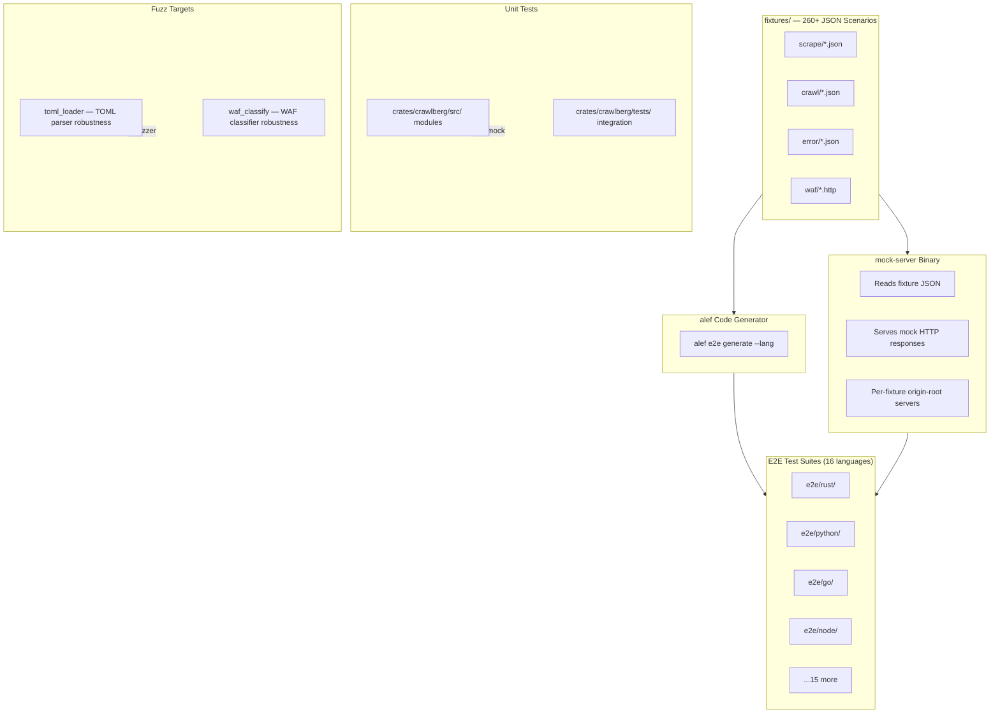
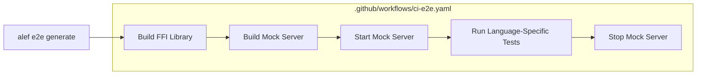

Crawlberg employs a three-tiered testing strategy — **unit tests**, **end-to-end (E2E) tests**, and **fuzz tests** — orchestrated through a fixture-driven, code-generated pipeline that validates the Rust core engine and all 16 language bindings with identical behavioral contracts. This architecture ensures that a single JSON fixture defines a scenario once and produces equivalent test assertions in Rust, Python, Go, Node.js, Ruby, PHP, Java, C#, Elixir, Dart, Swift, Zig, C, Kotlin, WASM, and even CLI (Homebrew shell) — eliminating manual per-language test maintenance.

## Testing Architecture Overview

The testing infrastructure is built on three foundational pillars:

| Pillar | Scope | Runner | Fixture Count |
|---|---|---|---|
| **Unit Tests** | Rust core modules, in-crate `#[cfg(test)]` and integration tests under `crates/crawlberg/tests/` | `cargo test` | Hand-written per module |
| **E2E Tests** | All 16 language bindings, identical behavioral assertions | `alef e2e generate` + language-native runners | **260+ JSON fixtures** across 30 categories |
| **Fuzz Tests** | Parser robustness, WAF classifier resilience | `cargo fuzz` (libFuzzer) | 2 targets with random byte streams |



Sources: [fixtures/schema.json](fixtures/schema.json#L1-L5), [alef.toml](alef.toml#L1-L19), [.task/workflows/e2e.yml](.task/workflows/e2e.yml#L44-L83)

## Unit Tests: The Rust Core

Unit tests exercise the Rust engine internals — HTML parsing, WAF detection, markdown conversion, link extraction, URL normalization, SSRF defense, and more — at function and module granularity. They use **`wiremock`** for HTTP mocking, **`proptest`** for property-based invariant testing, and **`criterion`** for benchmarking.

### In-Module Unit Tests

Core modules embed `#[cfg(test)]` blocks with focused behavioral assertions. For example, the WAF module tests each vendor fingerprint (Cloudflare challenge scripts, DataDome headers, PerimeterX tokens, Imperva session cookies, AWS WAF action headers, Akamai server strings) against synthetic `HttpResponse` objects constructed inline:

```rust
#[test]
fn classifier_cloudflare_challenge_detected() {
    let c = TomlClassifier::builtin();
    let resp = make_response(
        403,
        vec![("server", "cloudflare")],
        "<html><script src='/cdn-cgi/challenge-platform/h/g/orchestrate/v1'></script></html>",
    );
    let signal = c.classify(&resp).expect("classify must not fail");
    assert!(signal.is_some(), "cloudflare challenge must be detected");
    assert_eq!(signal.expect("signal is Some — asserted above").vendor, "cloudflare");
}
```

The tests also verify **negative cases** — that large 2xx pages mentioning vendor names are not misclassified, and that benign small pages pass through cleanly. Custom rule loading and multi-signal matching are tested by constructing TOML source strings and verifying `load_from_str` behavior, including rejection of over-limit fingerprint counts.

Sources: [crates/crawlberg/src/waf/tests.rs](crates/crawlberg/src/waf/tests.rs#L29-L144)

### Integration Tests (`crates/crawlberg/tests/`)

The 30+ integration test files under `crates/crawlberg/tests/` cover cross-cutting concerns that span multiple modules. Key categories include:

| Test File | Concern | Mocking Strategy |
|---|---|---|
| `test_dispatch_robustness.rs` | Soft HTTP errors × escalation strategy interaction | `wiremock::MockServer` + custom `BypassProvider` impl |
| `test_waf_fixtures.rs` | WAF fingerprint detection from real `.http` fixture files | Filesystem-scanned `.http` fixtures parsed into `HttpResponse` |
| `test_proptest_invariants.rs` | EWMA tracker bounds, FixedBudget non-overdraw, backoff monotonicity | `proptest` with random input generation |
| `test_browser_mode_stealth.rs` | Browser mode and stealth configuration integration | `wiremock` mock endpoints |
| `test_middleware_integration.rs` | Tower middleware layer composition | `wiremock` mock server |
| `test_streaming_memory_bounded.rs` | Stream event ordering and memory bounds | Custom async assertions |

The fixture replay test (`test_waf_fixtures.rs`) scans `tests/fixtures/waf/` for `.http` files, parses them into `HttpResponse` structs, and asserts the classifier returns the correct vendor for each. This pattern ensures that newly added WAF fingerprints are immediately covered:

```rust
#[test]
fn waf_fixtures_all_match() {
    let fixtures_dir = Path::new(env!("CARGO_MANIFEST_DIR")).join("tests/fixtures/waf");
    let classifier = TomlClassifier::builtin();
    // ... iterates .http files, asserts vendor match ...
    assert!(fixture_count > 0, "no .http fixtures found");
}
```

Sources: [crates/crawlberg/tests/test_dispatch_robustness.rs](crates/crawlberg/tests/test_dispatch_robustness.rs#L1-L159), [crates/crawlberg/tests/test_waf_fixtures.rs](crates/crawlberg/tests/test_waf_fixtures.rs#L89-L144), [crates/crawlberg/tests/test_proptest_invariants.rs](crates/crawlberg/tests/test_proptest_invariants.rs#L1-L100)

### Property-Based Testing

Three behavioral surfaces are validated through **proptest** property tests:

1. **EWMA Tracker**: Output is always bounded in `[0.0, 1.0]`, converges to 1.0 after 200 consecutive blocks, converges to 0.0 after 200 consecutive successes — regardless of the initial value.
2. **FixedBudget**: Sum of approved demands never exceeds the initial budget, even under concurrent access with 100 simultaneous `try_consume(1)` tasks on a budget of 100.
3. **Backoff Computation**: Capped at `max_ms` and monotonically increasing until the cap.

Sources: [crates/crawlberg/tests/test_proptest_invariants.rs](crates/crawlberg/tests/test_proptest_invariants.rs#L25-L100)

### Benchmarks

Criterion benchmarks measure performance-critical paths, particularly WAF classification overhead:

| Benchmark | Description |
|---|---|
| `waf_ac_build_builtin` | Time to build the Aho-Corasick automaton from built-in rules |
| `waf_classify_clean_100kb` | Classification latency on a 100KB clean HTML page (no match) |
| `waf_classify_match_early_100kb` | Classification latency when the match appears early in the body |
| `waf_classify_match_late_100kb` | Classification latency when the match appears at the end of the body |

Sources: [crates/crawlberg/benches/waf.rs](crates/crawlberg/benches/waf.rs#L35-L87)

## E2E Tests: Polyglot Behavioral Contracts

The E2E test suite is the project's most distinctive testing achievement. A single JSON fixture defines a complete test scenario — mock HTTP responses, engine configuration, and assertion specifications — and the **alef** code generator emits equivalent tests in every supported language. This ensures behavioral parity across the entire FFI binding surface.

### Fixture-Driven Architecture

Each fixture is a JSON file following the schema defined in `fixtures/schema.json`. A fixture specifies:

- **`id`**: Unique identifier (e.g., `scrape_basic_html_page`) that becomes the test function name
- **`input.mock_responses`**: Array of HTTP responses with status codes, headers, and body content (inline or file-referenced)
- **`input.config`**: A `CrawlConfig` object serialized as JSON
- **`assertions`**: Flat array of typed assertions (`equals`, `contains`, `not_empty`, `greater_than`, `error`, etc.)

For example, `scrape_basic_html_page.json` defines a simple HTML page scenario:

```json
{
  "id": "scrape_basic_html_page",
  "input": {
    "mock_responses": [{
      "status_code": 200,
      "headers": { "content-type": "text/html" },
      "body_file": "html/basic_page.html"
    }],
    "config": { "max_depth": 0, "respect_robots_txt": false }
  },
  "assertions": [
    { "type": "equals", "field": "status_code", "value": 200 },
    { "type": "equals", "field": "metadata.title", "value": "Example Domain" },
    { "type": "contains", "field": "metadata.description", "value": "illustrative examples" },
    { "type": "greater_than", "field": "links.length", "value": 0 }
  ]
}
```

The assertion vocabulary supports 11 types: `equals`, `contains`, `not_empty`, `greater_than`, `greater_than_or_equal`, `less_than`, `less_than_or_equal`, `contains_all`, `is_empty`, `not_contains`, and `error`. Field paths use dot notation (e.g., `metadata.title`) and array projections (e.g., `links[].link_type`).

Sources: [fixtures/schema.json](fixtures/schema.json#L1-L265), [fixtures/scrape/scrape_basic_html_page.json](fixtures/scrape/scrape_basic_html_page.json#L1-L70)

### Fixture Categories

The **260+ fixtures** span 30 categories covering the full crawling surface:

| Category | Fixtures | Coverage Area |
|---|---|---|
| `scrape/` | 15 | HTML parsing, metadata extraction, assets, feeds, JSON-LD |
| `crawl/` | 23 | Depth control, deduplication, path filtering, subdomain handling |
| `error/` | 26 | HTTP errors (4xx/5xx), DNS failures, timeouts, WAF blocks, SSL errors |
| `robots/` | 14 | robots.txt compliance, crawl-delay, meta tags, sitemaps |
| `redirect/` | 12 | HTTP redirect chains, meta refresh, loops, cross-domain |
| `browser/` | 17 | SPA detection, WAF fallback, wait strategies, profiles |
| `markdown/` | 8 | HTML-to-Markdown conversion, citations, headings |
| `metadata/` | 8 | Open Graph, Twitter Cards, hreflang, word count |
| `batch/` | 8 | Batch crawl and scrape operations |
| `validation/` | 13 | Config validation, SSRF denial, parameter bounds |
| `interaction/` | 12 | Click, type, scroll, JavaScript execution, screenshots |

Sources: [fixtures/](fixtures/), [fixtures/schema.json](fixtures/schema.json#L228-L261)

### Mock Server Infrastructure

A dedicated **Rust mock-server binary** (`e2e/rust/src/main.rs`) reads all fixture JSON files at startup and serves mock HTTP responses. It supports two response schemas:

1. **Single-response** (`mock_response` or `http.expected_response`): The fixture's `id` becomes the serving path (`/fixtures/<id>`)
2. **Route-array** (`input.mock_responses`): Multiple routes per fixture, with origin-root paths (`/robots.txt`, `/sitemap.xml`) served on dedicated per-fixture listeners

The server emits two sentinel lines to stdout:
```
MOCK_SERVER_URL=http://127.0.0.1:<port>
MOCK_SERVERS={"fixture_id":"http://...", ...}
```

Each language's test harness reads these lines during setup. For Rust, the `common.rs` module spawns the binary once per process and caches the URL in a `OnceLock`. For Python, `conftest.py` uses a `session`-scoped pytest fixture. For Go, `TestMain` orchestrates the lifecycle.

Sources: [e2e/rust/src/main.rs](e2e/rust/src/main.rs#L1-L96), [e2e/rust/tests/common.rs](e2e/rust/tests/common.rs#L26-L114), [e2e/python/conftest.py](e2e/python/conftest.py#L34-L97)

### Generated Test Code

Every generated test file carries an `alef:hash` header and a "DO NOT EDIT" directive. To regenerate:

```bash
task e2e:generate          # all languages
task rust:e2e:generate     # single language
alef e2e generate --lang go  # direct invocation
```

To verify freshness without regenerating:

```bash
alef verify --exit-code
```

Each language's generated tests follow its idiomatic patterns:

| Language | Test Framework | Async Model | Key Pattern |
|---|---|---|---|
| **Rust** | `#[tokio::test]` | `async fn` | `scrape(&engine, &url).await` |
| **Python** | `pytest` + `asyncio` | `async def` | `await scrape(engine, url)` |
| **Go** | `testing.T` | Goroutines | `pkg.Scrape(engine, url)` |
| **Node.js** | Vitest | `async/await` | `scrape(engine, url)` |
| **Bash** | Shell functions | Subprocess | `crawlberg scrape <url> --format json` |
| **Ruby** | RSpec | Bundler | `Crawlberg.scrape(engine, url)` |
| **Java** | JUnit 5 | Blocking | `Crawlberg.scrape(engine, url)` |
| **C#** | xUnit | `async Task` | `await Crawlberg.ScrapeAsync(engine, url)` |

Sources: [e2e/rust/tests/scrape_test.rs](e2e/rust/tests/scrape_test.rs#L1-L100), [e2e/python/tests/test_scrape.py](e2e/python/tests/test_scrape.py#L32-L60), [e2e/go/scrape_test.go](e2e/go/scrape_test.go#L18-L161), [e2e/brew/test_scrape.sh](e2e/brew/test_scrape.sh#L9-L86)

### E2E Test Orchestration

The full E2E pipeline follows a **generate → build → test** sequence:



The CI workflow (`ci-e2e.yaml`) builds the FFI library on 4 platforms (Linux ARM64, Linux x86_64, macOS ARM64, Windows x86_64) in a `build-ffi` job, then runs E2E tests for all 16 languages in parallel on `ubuntu-24.04-arm` using the `e2e-tests` job matrix. The matrix sets up each language's toolchain independently (Python via `uv`, Node via `pnpm`, Go via `actions/setup-go`, etc.) and stages the pre-built FFI artifacts.

Locally, the `task` runner provides grouped commands:

| Command | Description |
|---|---|
| `task e2e:test:all` | Full pipeline: build, start mock-server, run all languages |
| `task e2e:test:quick` | Rust + Go only (fastest feedback) |
| `task e2e:generate:all` | Regenerate all language test files from fixtures |
| `task e2e:verify:all` | Generate + lint + test (full verification) |

Sources: [.github/workflows/ci-e2e.yaml](.github/workflows/ci-e2e.yaml#L1-L377), [.task/workflows/e2e.yml](.task/workflows/e2e.yml#L44-L101)

## Fuzz Tests: Parser and Classifier Robustness

Crawlberg uses **cargo-fuzz** with `libfuzzer_sys` to test two critical code paths against random byte streams. Fuzz tests run on Rust nightly and execute for 30 seconds per target in CI.

### Fuzz Targets

| Target | Path Under Test | Input Strategy |
|---|---|---|
| `toml_loader` | `crawlberg::waf_rules_from_str` | Random UTF-8 strings fed to the TOML parser |
| `waf_classify` | `TomlClassifier::builtin().classify` | Random status codes (200–599) + random body bytes |

The `toml_loader` target converts raw bytes to UTF-8 and passes them to the WAF rules TOML parser. This tests robustness against malformed, truncated, and adversarial TOML input — ensuring the parser never panics on untrusted data:

```rust
fuzz_target!(|data: &[u8]| {
    let Ok(s) = std::str::from_utf8(data) else { return };
    let _ = crawlberg::waf_rules_from_str(s);
});
```

The `waf_classify` target constructs a synthetic `HttpResponse` from random data — using the first byte to derive a status code (200–599) and the remainder as the body — then runs it through the built-in WAF classifier. This tests that the Aho-Corasick matching engine and classification logic never panic on arbitrary response content:

```rust
fuzz_target!(|data: &[u8]| {
    let Some((&status_byte, rest)) = data.split_first() else { return };
    let status = 200u16 + (status_byte as u16 % 400);
    let body = String::from_utf8_lossy(rest).into_owned();
    let response = HttpResponse { status, body, body_bytes: rest.to_vec(), .. };
    let classifier = TomlClassifier::builtin();
    let _ = classifier.classify(&response);
});
```

### CI Integration

The fuzz workflow runs on every PR and push to `main`:

```yaml
- name: Run fuzz target ${{ matrix.target }} for 30s
  working-directory: fuzz
  run: cargo +nightly fuzz run ${{ matrix.target }} -- -max_total_time=30
```

The 30-second budget per target is sufficient to explore deep code paths while keeping CI fast. The `fail-fast: false` strategy ensures both targets run even if one discovers an issue.

Sources: [fuzz/Cargo.toml](fuzz/Cargo.toml#L1-L29), [fuzz/fuzz_targets/toml_loader.rs](fuzz/fuzz_targets/toml_loader.rs#L1-L10), [fuzz/fuzz_targets/waf_classify.rs](fuzz/fuzz_targets/waf_classify.rs#L1-L29), [.github/workflows/ci-fuzz.yaml](.github/workflows/ci-fuzz.yaml#L1-L32)

## API Contract Tests

The REST API (`/api`) is validated through **Schemathesis** property-based contract testing. The `test_contract.py` suite feeds generated inputs against the OpenAPI specification, asserting:

- **No 5xx errors** on any valid or invalid input
- **Response status codes** match the declared spec
- **Content types** conform to declared schemas
- **Response bodies** validate against their declared schemas

To avoid DNS hangs from generated URLs, the tests replace all URL fields with `http://127.0.0.1:1/noop` (a non-routable address).

Sources: [tests/api/test_contract.py](tests/api/test_contract.py#L1-L93)

## Test Apps: Smoke Tests for Language Bindings

In addition to the full E2E suite, `test_apps/` contains **minimal smoke tests** for each language binding — focused on the three most common operations (scrape, metadata extraction, markdown conversion). These serve as quick sanity checks that a freshly built binding can load and call the core library:

| Directory | Purpose |
|---|---|
| `test_apps/rust/` | Rust native smoke tests (scrape, metadata, markdown) |
| `test_apps/go/` | Go binding smoke tests |
| `test_apps/python/` | Python binding smoke tests |
| `test_apps/node/` | Node.js binding smoke tests |
| `test_apps/java/` | Java binding smoke tests |
| `test_apps/c/` | C FFI binding smoke tests |

Sources: [test_apps/rust/](test_apps/rust/), [test_apps/go/](test_apps/go/)

## Running Tests Locally

### Unit Tests (fastest feedback)

```bash
# Quick Rust unit tests only
task rust:test:quick

# Full Rust test suite (all features)
task rust:test

# Core Rust tests in CI mode with backtraces
task rust:test:ci
```

Sources: [.task/languages/rust.yml](.task/languages/rust.yml#L142-L162)

### E2E Tests

```bash
# Full E2E pipeline (builds everything, starts mock-server, runs all languages)
task e2e:test:all

# Quick E2E (Rust + Go only)
task e2e:test:quick

# Verify all generated tests are up to date
task e2e:verify:all
```

### Fuzz Tests

```bash
# Requires nightly Rust and cargo-fuzz
cargo install cargo-fuzz

# Run a specific target for 60 seconds
cd fuzz
cargo +nightly fuzz run toml_loader -- -max_total_time=60
cargo +nightly fuzz run waf_classify -- -max_total_time=60
```

### API Contract Tests

```bash
cd tests/api
uv run pytest test_contract.py -v
```

## CI Pipeline Summary

The CI infrastructure runs through six specialized workflows:

| Workflow | Trigger | What It Tests |
|---|---|---|
| `ci-rust.yaml` | Push/PR | Rust unit tests, clippy, formatting |
| `ci-e2e.yaml` | Push/PR (crates/, packages/, e2e/, fixtures/) | All 16 language E2E suites |
| `ci-fuzz.yaml` | Push/PR | Fuzz targets for 30s each |
| `ci-lint.yaml` | Push/PR | Cross-language linting |
| `ci-docker.yaml` | Push/PR | Docker build verification |
| `ci-docs.yaml` | Push/PR | Documentation site build |

The `ci-e2e.yaml` workflow is the most substantial — it builds the FFI library on 4 platforms, then runs 16 language-specific test jobs in parallel, each with its own toolchain setup and test execution.