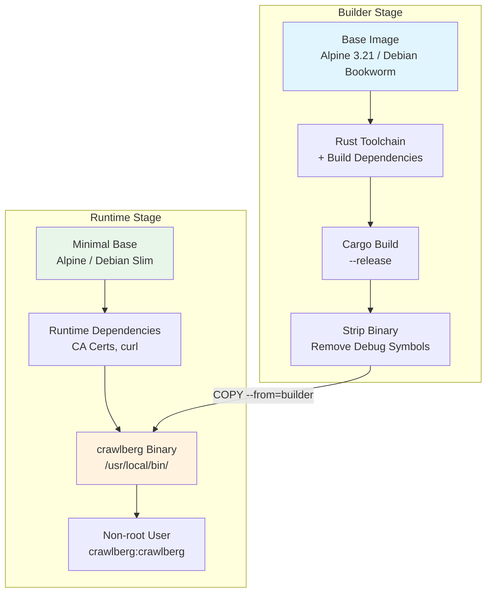
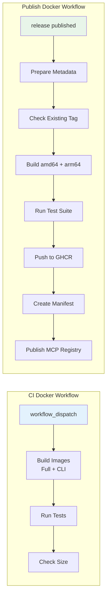

Crawlberg provides a comprehensive Docker deployment strategy with multiple image variants optimized for different use cases — from lightweight CLI tools to full-featured API servers with browser automation. This documentation covers the Docker architecture, building images, running containers, CI/CD integration, and security best practices.

## Docker Image Architecture

Crawlberg uses a **multi-stage build pattern** across all Dockerfiles, separating the compilation environment from the minimal runtime. The architecture follows a consistent pattern: a builder stage compiles the Rust binary with all necessary dependencies, then copies only the stripped binary to a minimal runtime image.



### Image Variants

| Variant | Base Image | Size | Features | Use Case |
|---------|------------|------|----------|----------|
| **Alpine CLI** (`Dockerfile.alpine`) | Alpine 3.21 | ~30-50MB | API, MCP, CLI | **Primary production image** |
| **Full** (`Dockerfile`) | Debian Bookworm | ~500MB+ | API, MCP, WARC, AI, OTel, Browser | Complex document processing with OCR |
| **CLI** (`Dockerfile.cli`) | Debian Bookworm Slim | ~100-150MB | WARC only | Legacy CLI usage |
| **Musl Build** (`Dockerfile.musl-build`) | Alpine 3.21 → scratch | Binary only | API, MCP | Static binary extraction |
| **Musl FFI** (`Dockerfile.musl-ffi`) | Alpine 3.21 → scratch | Shared lib | FFI bindings | Python/Ruby/Node.js bindings |
| **Musl NIF** (`Dockerfile.musl-nif`) | Alpine 3.21 → scratch | Shared lib | Elixir NIF | Ruby NIF bindings |

Sources: [docker/README.md](docker/README.md#L1-L50), [docker/Dockerfile.alpine](docker/Dockerfile.alpine#L1-L55), [docker/Dockerfile](docker/Dockerfile#L1-L73)

## Building Docker Images

### Quick Build Commands

```bash
# Production Alpine CLI (recommended)
docker build -f docker/Dockerfile.alpine -t crawlberg:latest .

# Full API server with browser support
docker build -f docker/Dockerfile -t crawlberg:dev .

# Legacy CLI image
docker build -f docker/Dockerfile.cli -t crawlberg:cli .

# Extract static binary without Docker runtime
docker build -f docker/Dockerfile.musl-build -t crawlberg-extract .
docker create --name extract crawlberg-extract
docker cp extract:/crawlberg ./dist/crawlberg
docker rm extract
```

### Using Task Commands

The project provides convenient Task commands for Docker operations:

```bash
# Build the API server image
task docker:build

# Build the CLI image
task docker:build:cli

# Run the API server
task docker:run
```

Sources: [.task/tools/docker.yml](.task/tools/docker.yml#L1-L38), [docker/README.md](docker/README.md#L52-L68)

### BuildKit Cache Optimization

All Dockerfiles leverage Docker BuildKit's cache mount feature for significantly faster rebuilds:

```bash
# Ensure BuildKit is enabled (default in modern Docker)
export DOCKER_BUILDKIT=1

# First build: ~10-15 minutes (downloading Rust, building dependencies)
# Incremental builds: ~2-3 minutes (cached layers)
```

The cache mounts target three directories:
- `/usr/local/cargo/registry` — Downloaded crate sources
- `/usr/local/cargo/git` — Git-based dependencies
- `/build/target` — Compilation artifacts

Sources: [docker/Dockerfile](docker/Dockerfile#L28-L32), [docs-site/src/content/docs/guides/docker.md](docs-site/src/content/docs/guides/docker.md#L45-L52)

## Running Containers

### API Server Mode

The default entry point starts the REST API server compatible with Firecrawl v1:

```bash
# Start API server on default port 3000
docker run -d \
  --name crawlberg \
  -p 3000:3000 \
  -e RUST_LOG=info \
  crawlberg:latest

# Custom port configuration
docker run -d \
  -p 8080:8080 \
  crawlberg:latest \
  serve --host 0.0.0.0 --port 8080
```

### CLI Commands

```bash
# Scrape a single URL
docker run --rm crawlberg:latest scrape https://example.com

# Crawl with depth limit and markdown output
docker run --rm crawlberg:latest crawl https://example.com --depth 2 --format markdown

# Map a site (discover URLs)
docker run --rm crawlberg:latest map https://example.com --limit 50

# Extract text from local files (mount volume)
docker run --rm \
  -v /data:/data:ro \
  crawlberg:latest \
  extract /data/document.pdf
```

### MCP Server Mode

The Model Context Protocol server uses stdio transport for AI agent integration:

```bash
# Run MCP server (requires interactive stdin)
docker run -i --rm crawlberg:latest mcp
```

Sources: [docker/README.md](docker/README.md#L70-L88), [docs-site/src/content/docs/guides/docker.md](docs-site/src/content/docs/guides/docker.md#L70-L105)

## Environment Variables

| Variable | Default | Description |
|----------|---------|-------------|
| `RUST_LOG` | `info` | Log level filter for Rust tracing (e.g., `debug`, `crawlberg=trace`) |
| `CHROME_BIN` | `/usr/bin/chromium` | Path to Chrome/Chromium binary (Full image only) |
| `CRAWLBERG_DISABLE_GPU` | `true` | Disable GPU acceleration in browser |

Sources: [docker/Dockerfile](docker/Dockerfile#L56-L60), [docs-site/src/content/docs/guides/docker.md](docs-site/src/content/docs/guides/docker.md#L120-L130)

## Health Checks

The API server image includes a Docker `HEALTHCHECK` directive for orchestrator integration:

```dockerfile
HEALTHCHECK --interval=30s --timeout=10s --start-period=5s --retries=3 \
    CMD ["curl", "-f", "http://localhost:3000/health"]
```

The `/health` endpoint returns:

```json
{ "status": "ok", "version": "0.3.0" }
```

This enables automatic health monitoring in Docker Compose, Kubernetes, and cloud platforms.

Sources: [docker/Dockerfile](docker/Dockerfile#L65-L66), [docs-site/src/content/docs/guides/docker.md](docs-site/src/content/docs/guides/docker.md#L132-L148)

## Docker Compose Examples

### Basic API Server

```yaml
services:
  crawlberg:
    build:
      context: .
      dockerfile: docker/Dockerfile
    ports:
      - "3000:3000"
    environment:
      RUST_LOG: info
    healthcheck:
      test: ["CMD", "curl", "-f", "http://localhost:3000/health"]
      interval: 30s
      timeout: 10s
      start_period: 5s
      retries: 3
    restart: unless-stopped
```

### With Browser Sidecar

For browser-based crawling, run Chrome as a sidecar container:

```yaml
services:
  crawlberg:
    build:
      context: .
      dockerfile: docker/Dockerfile
    ports:
      - "3000:3000"
    environment:
      RUST_LOG: info
    depends_on:
      chrome:
        condition: service_healthy

  chrome:
    image: chromedp/headless-shell:latest
    ports:
      - "9222:9222"
    healthcheck:
      test: ["CMD", "curl", "-f", "http://localhost:9222/json/version"]
      interval: 10s
      timeout: 5s
      retries: 3
```

Configure the browser endpoint in CrawlConfig:

```bash
browser.endpoint = "ws://chrome:9222/devtools/browser/..."
```

:::caution[CLI image has no browser]
The Alpine CLI and legacy CLI images do not include Chrome/Chromium. For browser-based features, use the Full API server image with an external browser endpoint.
:::

Sources: [docs-site/src/content/docs/guides/docker.md](docs-site/src/content/docs/guides/docker.md#L150-L185), [docker-compose.test.yml](docker-compose.test.yml#L1-L11)

## CI/CD Pipeline

### GitHub Actions Workflows

Crawlberg uses two primary Docker-related GitHub Actions workflows:



### CI Docker Workflow (`.github/workflows/ci-docker.yaml`)

Triggered manually via `workflow_dispatch`, this workflow:

1. Builds both Full and CLI image variants
2. Saves images as compressed artifacts
3. Checks image size against thresholds
4. Runs feature and CLI tests

```bash
# Trigger CI Docker workflow
gh workflow run ci-docker.yaml
```

### Publish Docker Workflow (`.github/workflows/publish-docker.yaml`)

Triggered on release publication or manually, this workflow:

1. Resolves release metadata (tag, version, ref)
2. Checks if the Docker image tag already exists
3. Builds amd64 and arm64 images in parallel
4. Runs the full test suite before pushing
5. Creates a multi-arch manifest list
6. Publishes to GitHub Container Registry (`ghcr.io/xberg-io/crawlberg`)
7. Publishes MCP registry metadata

```bash
# Manual trigger with specific tag
gh workflow run publish-docker.yaml -f tag=v1.0.0

# Dry run (test without publishing)
gh workflow run publish-docker.yaml -f tag=v1.0.0 -f dry_run=true
```

### Multi-Architecture Build Matrix

| Architecture | Runner | Platform |
|--------------|--------|----------|
| amd64 | `ubuntu-latest` | `linux/amd64` |
| arm64 | `ubuntu-24.04-arm` | `linux/arm64` |

Sources: [.github/workflows/ci-docker.yaml](.github/workflows/ci-docker.yaml#L1-L71), [.github/workflows/publish-docker.yaml](.github/workflows/publish-docker.yaml#L1-L200)

## Testing Docker Images

### Automated Test Suite

The project includes a comprehensive Python test script (`scripts/ci/docker/test_docker.py`) that validates:

| Test | Description |
|------|-------------|
| Version check | Verifies `--version` output contains "crawlberg" |
| Help output | Confirms subcommands (scrape, crawl) are listed |
| Scrape help | Validates scrape command documentation |
| Scrape JSON | Tests actual scraping with JSON output validation |
| Non-root user | Ensures container runs as unprivileged user |
| Invalid URL error | Verifies proper error handling |

### Running Tests Locally

```bash
# Build and test Alpine CLI image
scripts/ci/docker/build_and_test.sh

# Test a pre-built image
scripts/ci/docker/build_and_test.sh --image crawlberg:v1.0.0

# Verbose output
scripts/ci/docker/build_and_test.sh --verbose

# Direct test execution
python3 scripts/ci/docker/test_docker.py --image crawlberg:latest --variant cli --verbose
```

### Image Size Monitoring

The CI pipeline monitors image size and warns when thresholds are exceeded:

| Variant | Warning Threshold |
|---------|-------------------|
| CLI | 200MB |
| Full | 2560MB (2.5GB) |

```bash
# Check image size locally
scripts/ci/docker/check-image-size.sh cli
scripts/ci/docker/check-image-size.sh full
```

Sources: [scripts/ci/docker/test_docker.py](scripts/ci/docker/test_docker.py#L1-L128), [scripts/ci/docker/build_and_test.sh](scripts/ci/docker/build_and_test.sh#L1-L109)

## Security Best Practices

### Container Security Features

| Feature | Implementation |
|---------|----------------|
| **Non-root user** | Dedicated `crawlberg:crawlberg` user/group |
| **Minimal base** | Alpine 3.21 or Debian Bookworm Slim |
| **Read-only support** | Compatible with `--read-only` flag |
| **No secrets** | Configuration via env vars or CLI args |
| **Stripped binary** | Debug symbols removed for smaller size |
| **Static linking** | Musl-based builds for portability |

### Recommended Security Configuration

```bash
# Read-only root filesystem with tmpfs for temp files
docker run --rm \
  --read-only \
  --tmpfs /tmp \
  --user crawlberg:crawlberg \
  -v /data:/data:ro \
  crawlberg:latest \
  extract /data/document.pdf

# Memory limits to prevent OOM
docker run --rm \
  --memory 512m \
  --memory-swap 512m \
  crawlberg:latest \
  scrape https://example.com

# Drop all capabilities, add only needed ones
docker run --rm \
  --cap-drop ALL \
  --cap-add NET_BIND_SERVICE \
  -p 3000:3000 \
  crawlberg:latest
```

### Hadolint Configuration

Dockerfile linting is configured via `.hadolint.yaml` with intentional suppressions:

```yaml
ignored:
  - DL3008  # Version pinning not required for build images
  - DL3018  # Alpine package version pinning
  - DL4006  # Shell pipefail not required in builder
```

Sources: [.hadolint.yaml](.hadolint.yaml#L1-L7), [docker/README.md](docker/README.md#L180-L220)

## Troubleshooting

### Common Issues

| Problem | Cause | Solution |
|---------|-------|----------|
| Image too large | Using legacy Full variant | Switch to `Dockerfile.alpine` |
| Build fails on ARM64 | Missing platform flag | Use `--platform linux/arm64` |
| Binary crashes at startup | Dynamic linking issues | Verify static linking: `ldd crawlberg` |
| Browser features unavailable | Using CLI image | Use Full image with browser sidecar |
| Cache not working | BuildKit disabled | Set `DOCKER_BUILDKIT=1` |

### Verification Commands

```bash
# Check if binary is statically linked
docker run --rm --entrypoint sh crawlberg:latest -c "ldd /usr/local/bin/crawlberg"

# Verify non-root execution
docker run --rm --entrypoint id crawlberg:latest

# Check image layers and size
docker history crawlberg:latest

# Inspect environment variables
docker inspect crawlberg:latest --format='{{.Config.Env}}'
```

### Disk Space Management

```bash
# Clean up Docker resources
scripts/ci/docker/cleanup.sh cli
scripts/ci/docker/cleanup.sh full

# Manual cleanup
docker system prune -af --volumes
```

Sources: [docker/README.md](docker/README.md#L230-L250), [scripts/ci/docker/cleanup.sh](scripts/ci/docker/cleanup.sh#L1-L23)

## Registry Access

### GitHub Container Registry (GHCR)

```bash
# Pull latest image
docker pull ghcr.io/xberg-io/crawlberg:latest

# Pull specific version
docker pull ghcr.io/xberg-io/crawlberg:v1.0.0

# Login for pushing (CI only)
docker login ghcr.io -u $GITHUB.actor -p $GITHUB_TOKEN
```

### MCP Registry

Crawlberg publishes to the Model Context Protocol registry for AI agent discovery:

```json
{
  "name": "io.github.xberg-io/crawlberg",
  "packages": [{
    "registryType": "oci",
    "identifier": "ghcr.io/xberg-io/crawlberg:1.0.0-rc.1",
    "transport": { "type": "stdio" },
    "packageArguments": [{ "type": "positional", "value": "mcp" }]
  }]
}
```

Sources: [server.json](server.json#L1-L30), [.github/workflows/publish-docker.yaml](.github/workflows/publish-docker.yaml#L280-L343)

## Next Steps

- Explore [REST API Server](25-rest-api-server) for API endpoint documentation
- Learn about [MCP Server for AI Agents](24-mcp-server-for-ai-agents) integration
- Review [Configuration Reference (CrawlConfig)](11-configuration-reference-crawlconfig) for runtime options
- See [Testing Strategy (Unit, E2E, Fuzz)](28-testing-strategy-unit-e2e-fuzz) for validation approaches