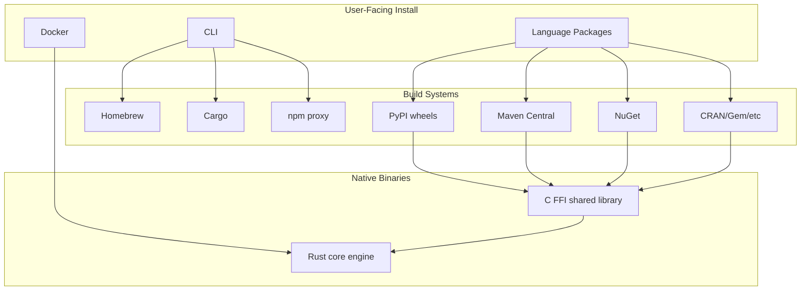

Crawlberg provides native bindings for **14 programming languages** plus Docker, with prebuilt binaries for Linux, macOS, and Windows. Every binding wraps the same Rust core engine, so you get identical crawling behavior regardless of your chosen language.

This guide walks you through installing Crawlberg in your preferred environment. For a quick taste of what comes after installation, see [Quick Start](2-quick-start).

## Installation Architecture



Sources: [README.md](README.md#L100-L150), [docker/Dockerfile](docker/Dockerfile#L1-L73)

## CLI Installation

The CLI provides direct access to all Crawlberg features—scraping, crawling, mapping, and the API server—without writing code.

| Method | Command | Requirements |
|--------|---------|--------------|
| **Homebrew** | `brew install xberg-io/tap/crawlberg` | macOS/Linux |
| **Cargo** | `cargo install crawlberg-cli` | Rust 1.91+ |
| **cargo-binstall** | `cargo binstall crawlberg-cli` | Cargo |
| **npm** | `npm install -g @xberg-io/crawlberg-cli` | Node.js 18+ |

The **npm proxy** method downloads a prebuilt binary from GitHub Releases—no Rust toolchain needed. It automatically detects your platform (x86_64/aarch64) and installs the correct binary.

```bash
# Verify installation
crawlberg --version

# Quick test
crawlberg scrape https://example.com
```

Sources: [cli-proxy/npm/install.js](cli-proxy/npm/install.js#L1-L100), [cli-proxy/npm/package.json](cli-proxy/npm/package.json#L1-L27)

### Feature Flags (Cargo)

When building from source, enable additional features:

```toml
[dependencies]
crawlberg-cli = { version = "0.3", features = ["api", "mcp", "otel"] }
```

| Feature | Description |
|---------|-------------|
| `api` | REST API server via Axum |
| `mcp` | Model Context Protocol server |
| `otel` | OpenTelemetry/OTLP telemetry |

Sources: [docs-site/src/content/docs/getting-started/installation.mdx](docs-site/src/content/docs/getting-started/installation.mdx#L20-L60)

## Language Bindings Overview

Every binding provides the same core API: `scrape()`, `crawl()`, `map_urls()`, `batch_scrape()`, and `batch_crawl()`. The table below summarizes installation methods and requirements.

| Language | Package Name | Install Command | Min Version | Binding Technology |
|----------|--------------|-----------------|-------------|-------------------|
| **Rust** | `crawlberg` | `cargo add crawlberg` | Rust 1.91 | Native |
| **Python** | `crawlberg` | `pip install crawlberg` | Python 3.10 | PyO3 wheels |
| **Node.js** | `@xberg-io/crawlberg` | `npm install @xberg-io/crawlberg` | Node.js 18+ | NAPI-RS |
| **Go** | `github.com/xberg-io/crawlberg/packages/go` | `go get ...` | Go 1.21 | cgo/FFI |
| **Java** | `io.xberg.crawlberg:crawlberg` | Maven dependency | Java 25+ | Panama FFM |
| **Kotlin Android** | `io.xberg.crawlberg.android:crawlberg-android` | Gradle dependency | API 21+ | JNI |
| **C#** | `Crawlberg` | `dotnet add package Crawlberg` | .NET 10+ | P/Invoke |
| **Ruby** | `crawlberg` | `gem install crawlberg` | Ruby 3.2+ | Magnus/rb_sys |
| **PHP** | `xberg-io/crawlberg` | `composer require xberg-io/crawlberg` | PHP 8.2+ | ext-php-rs |
| **Elixir** | `{:crawlberg, "~> 0.3"}` | mix deps.get | Elixir 1.14+ | Rustler NIFs |
| **Dart** | `crawlberg` | `dart pub add crawlberg` | Dart 3.0+ | FFI |
| **Swift** | `Crawlberg` | Swift Package Manager | macOS 13+ | swift-bridge |
| **Zig** | `crawlberg` | `zig fetch --save` | Zig 0.12+ | C FFI |
| **WebAssembly** | `@xberg-io/crawlberg-wasm` | `npm install @xberg-io/crawlberg-wasm` | ES2020 | wasm-bindgen |
| **C/C++** | FFI library | Build from source | C99 | cbindgen headers |

Sources: [README.md](README.md#L60-L180), [packages/python/pyproject.toml](packages/python/pyproject.toml#L1-L54)

## Binding Technology Patterns

Crawlberg uses different integration strategies depending on the target language's capabilities:

```mermaid
graph LR
    subgraph "Direct Native"
        Rust[ Rust Core]
        PyO3[PyO3]
        NAPI[NAPI-RS]
        Magnus[Magnus]
        ExtPHP[ext-php-rs]
    end
    
    subgraph "FFI Layer"
        FFI[C FFI<br/>cbindgen]
        Go[Go/cgo]
        Java[Java/Panama]
        CSharp[C#/P/Invoke]
        Dart[Dart/FFI]
        Zig[Zig/@cImport]
    end
    
    subgraph "NIF/Bridge"
        Rustler[Rustler NIFs]
        Swift[swift-bridge]
        JNI[JNI]
    end
    
    subgraph "WASM"
        WASM[wasm-bindgen]
    end
    
    Rust --> PyO3
    Rust --> NAPI
    Rust --> Magnus
    Rust --> ExtPHP
    Rust --> FFI
    FFI --> Go
    FFI --> Java
    FFI --> CSharp
    FFI --> Dart
    FFI --> Zig
    Rust --> Rustler
    Rust --> Swift
    Rust --> JNI
    Rust --> WASM
```

Sources: [packages/swift/BUILDING.md](packages/swift/BUILDING.md#L1-L79), [packages/zig/README.md](packages/zig/README.md#L1-L50)

## Python Installation

Python bindings ship as prebuilt wheels via PyO3—no Rust toolchain needed.

```bash
# Standard pip
pip install crawlberg

# With uv (faster)
uv add crawlberg

# From source (requires Rust)
pip install maturin
maturin build --release -p crates/crawlberg-py
pip install target/wheels/crawlberg-*.whl
```

**Supported platforms**: Linux (x86_64/aarch64), macOS (ARM64), Windows (x64).

**Python versions**: 3.10, 3.11, 3.12, 3.13, 3.14 (single abi3 wheel per platform).

```python title="Quick verification"
import crawlberg
print(f"Crawlberg version: {crawlberg.__version__}")
```

Sources: [packages/python/pyproject.toml](packages/python/pyproject.toml#L1-L54), [packages/python/README.md](packages/python/README.md#L80-L90)

## Node.js / TypeScript Installation

The Node.js binding uses NAPI-RS for native performance with full TypeScript type definitions.

```bash
# npm
npm install @xberg-io/crawlberg

# pnpm
pnpm add @xberg-io/crawlberg

# yarn
yarn add @xberg-io/crawlberg
```

**Features**: Prebuilt native binaries, TypeScript types (`.d.ts`), async/await support.

```typescript title="Quick verification"
import { scrape, createEngine } from "@xberg-io/crawlberg";

const engine = createEngine();
const result = await scrape(engine, "https://example.com");
console.log(`Title: ${result.metadata?.title}`);
```

Sources: [crates/crawlberg-node/README.md](crates/crawlberg-node/README.md#L80-L90), [README.md](README.md#L100-L110)

## Go Installation

Go bindings use cgo with the C FFI layer. A C compiler is required.

```bash
go get github.com/xberg-io/crawlberg/packages/go
```

**Requirements**: Go 1.21+, C compiler (gcc/clang), crawlberg shared library at link time.

```go title="Quick verification"
package main

import (
    "fmt"
    crawlberg "github.com/xberg-io/crawlberg/packages/go"
)

func main() {
    engine := crawlberg.NewEngine(nil)
    result, err := crawlberg.Scrape(engine, "https://example.com")
    if err != nil {
        panic(err)
    }
    fmt.Printf("Title: %s\n", result.Metadata.Title)
}
```

Sources: [packages/go/README.md](packages/go/README.md#L80-L100), [docs-site/src/content/docs/getting-started/installation.mdx](docs-site/src/content/docs/getting-started/installation.mdx#L120-L130)

## Java / Kotlin Installation

### Java (JVM)

Requires Java 25+ for the Panama Foreign Function & Memory API.

**Maven**:
```xml title="pom.xml"
<dependency>
    <groupId>io.xberg.crawlberg</groupId>
    <artifactId>crawlberg</artifactId>
    <version>1.1.2</version>
</dependency>
```

**Gradle**:
```kotlin
implementation("io.xberg.crawlberg:crawlberg:1.1.2")
```

### Kotlin (Android)

For Android applications:

```kotlin title="build.gradle.kts"
dependencies {
    implementation("io.xberg.crawlberg.android:crawlberg-android:0.3.0")
}
```

The Android package bundles JNI shared libraries and targets Android NDK.

Sources: [packages/java/README.md](packages/java/README.md#L80-L100), [docs-site/src/content/docs/getting-started/installation.mdx](docs-site/src/content/docs/getting-started/installation.mdx#L130-L160)

## C# / .NET Installation

Requires .NET 10+ and uses P/Invoke to call the C FFI layer.

```bash
dotnet add package Crawlberg
```

Or in your `.csproj`:

```xml title="Crawlberg.csproj"
<PackageReference Include="Crawlberg" Version="0.3.0" />
```

**Features**: Async/await, nullable reference types, modern C# idioms.

Sources: [packages/csharp/README.md](packages/csharp/README.md#L80-L100), [docs-site/src/content/docs/getting-started/installation.mdx](docs-site/src/content/docs/getting-started/installation.mdx#L160-L180)

## Ruby Installation

Requires Ruby 3.2+ with native extension support.

```ruby title="Gemfile"
gem "crawlberg", "~> 0.3"
```

Then:

```bash
bundle install
```

Or install directly:

```bash
gem install crawlberg
```

The gem includes a native extension built with Magnus and rb_sys—no separate Rust toolchain needed.

Sources: [README.md](README.md#L110-L120), [docs-site/src/content/docs/getting-started/installation.mdx](docs-site/src/content/docs/getting-started/installation.mdx#L100-L110)

## PHP Installation

Requires PHP 8.2+ with extension support.

```bash
composer require xberg-io/crawlberg
```

**Verify the extension loads**:

```bash
php -m | grep crawlberg
```

The PHP bindings are built with ext-php-rs and load as a native PHP extension.

Sources: [README.md](README.md#L120-L130), [docs-site/src/content/docs/getting-started/installation.mdx](docs-site/src/content/docs/getting-started/installation.mdx#L180-L200)

## Elixir Installation

Requires Elixir 1.14+ with OTP 25+.

```elixir title="mix.exs"
defp deps do
  [
    {:crawlberg, "~> 0.3"}
  ]
end
```

Then:

```bash
mix deps.get
mix compile
```

The Elixir bindings use Rustler NIFs for native performance.

Sources: [README.md](README.md#L130-L140), [docs-site/src/content/docs/getting-started/installation.mdx](docs-site/src/content/docs/getting-started/installation.mdx#L200-L220)

## Dart / Flutter Installation

Requires Dart or Flutter with native FFI support.

```bash
dart pub add crawlberg
```

Sources: [README.md](README.md#L140-L150), [docs-site/src/content/docs/getting-started/installation.mdx](docs-site/src/content/docs/getting-started/installation.mdx#L220-L230)

## Swift Installation

Add via Swift Package Manager:

```swift
.package(url: "https://github.com/xberg-io/crawlberg", exact: "0.3.0")
```

**Note**: Swift bindings require building the Rust library first:

```bash
cargo build -p crawlberg-swift
```

This compiles `libcrawlberg_swift.a` and runs `swift-bridge-build` to generate Swift/C sources.

Sources: [packages/swift/BUILDING.md](packages/swift/BUILDING.md#L1-L79), [packages/swift/Package.swift](packages/swift/Package.swift#L1-L91)

## Zig Installation

Use the generated Zig package over the C FFI layer:

```bash
zig fetch --save https://github.com/xberg-io/crawlberg/archive/refs/tags/v0.3.0.tar.gz
```

Sources: [packages/zig/README.md](packages/zig/README.md#L80-L90), [docs-site/src/content/docs/getting-started/installation.mdx](docs-site/src/content/docs/getting-started/installation.mdx#L250-L260)

## WebAssembly Installation

For browser or Node.js environments:

```bash
npm install @xberg-io/crawlberg-wasm
```

```typescript
import init from "@xberg-io/crawlberg-wasm";
await init();
```

**Limitations**: WASM build runs without native browser backends, REST/MCP server starters, WARC file output, native streaming crawl wrappers, and other native-only I/O surfaces.

Sources: [README.md](README.md#L150-L160), [docs-site/src/content/docs/getting-started/installation.mdx](docs-site/src/content/docs/getting-started/installation.mdx#L220-L235)

## C/C++ FFI Installation

For languages not listed above, Crawlberg provides a C-compatible FFI layer.

**Build from source**:

```bash
cargo build --release -p crawlberg-ffi
```

**Output files**:
- `libcrawlberg.so` (Linux)
- `libcrawlberg.dylib` (macOS)
- `crawlberg.dll` (Windows)
- C headers generated by `cbindgen`

**Alternative**: Download prebuilt binaries from [GitHub Releases](https://github.com/xberg-io/crawlberg/releases).

Sources: [crates/crawlberg-ffi/README.md](crates/crawlberg-ffi/README.md#L1-L50), [docs-site/src/content/docs/getting-started/installation.mdx](docs-site/src/content/docs/getting-started/installation.mdx#L260-L275)

## Docker Installation

Pull the official image:

```bash
docker pull ghcr.io/xberg-io/crawlberg:latest
```

**Run commands**:

```bash
# Scrape a URL
docker run --rm ghcr.io/xberg-io/crawlberg:latest scrape https://example.com

# Crawl with depth limit
docker run --rm ghcr.io/xberg-io/crawlberg:latest \
  crawl https://example.com --depth 2

# Run API server
docker run -p 8000:3000 --rm ghcr.io/xberg-io/crawlberg:latest serve
```

**Docker variants**:

| Image | Size | Features |
|-------|------|----------|
| `latest` (Alpine) | ~30-50MB | CLI, API server, MCP |
| Full variant | ~500MB+ | Chromium, Tesseract OCR |
| CLI-only | ~100-150MB | Minimal CLI |

Sources: [docker/README.md](docker/README.md#L1-L200), [docker/Dockerfile.alpine](docker/Dockerfile#L1-L73)

## AI Coding Assistant Integration

Install the Crawlberg plugin to use Crawlberg from AI coding assistants:

```text
# Claude Code
/plugin marketplace add xberg-io/crawlberg
/plugin install crawlberg@crawlberg

# Codex CLI
/plugins add https://github.com/xberg-io/crawlberg

# Cursor
Settings → Plugins → Add from URL → https://github.com/xberg-io/crawlberg
```

Works with Claude Code, Codex CLI, Cursor, Gemini CLI, Factory Droid, GitHub Copilot CLI, and opencode.

Sources: [README.md](README.md#L230-L280)

## Verifying Your Installation

After installation, verify everything works:

**CLI**:
```bash
crawlberg --version
crawlberg scrape https://example.com
```

**Python**:
```python
import crawlberg
engine = crawlberg.create_engine()
result = crawlberg.scrape(engine, "https://example.com")
print(f"Status: {result.status_code}")
```

**Node.js**:
```typescript
import { scrape, createEngine } from "@xberg-io/crawlberg";
const engine = createEngine();
const result = await scrape(engine, "https://example.com");
console.log(`Status: ${result.statusCode}`);
```

Sources: [packages/python/README.md](packages/python/README.md#L90-L110), [crates/crawlberg-node/README.md](crates/crawlberg-node/README.md#L90-L110)

## Troubleshooting

| Issue | Solution |
|-------|----------|
| **Go build fails** | Ensure C compiler is installed (`gcc` or `clang`) |
| **Java version error** | Upgrade to Java 25+ for Panama FFM support |
| **PHP extension not loading** | Check `php -m` output and ensure PHP 8.2+ |
| **Docker GPU errors** | Set `CRAWLBERG_DISABLE_GPU=true` environment variable |
| **Rust compilation fails** | Ensure Rust 1.91+ (`rustc --version`) |

## Next Steps

- **[Quick Start](2-quick-start)** — Scrape a page, run a crawl, and map a site in under five minutes
- **[CLI Usage](4-cli-usage)** — Comprehensive CLI command reference
- **[Core Public API](5-core-public-api)** — API details for each language binding
- **[Configuration Reference](11-configuration-reference-crawlconfig)** — Tune depth, concurrency, content filtering, and more