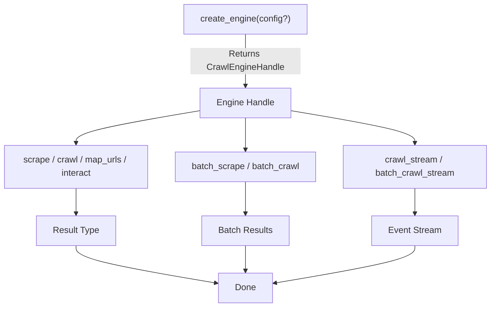
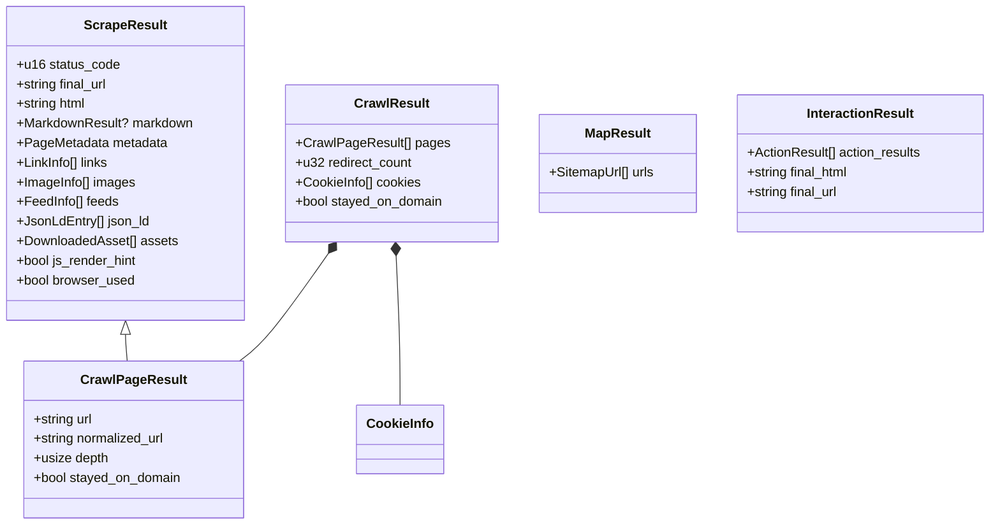
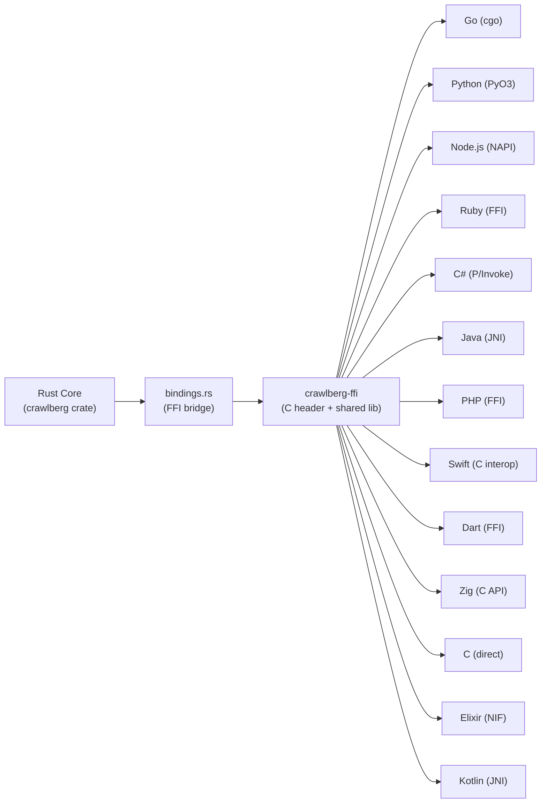

Crawlberg exposes a **uniform async API** for web data extraction across 14+ programming languages. The same operations — `scrape`, `crawl`, `map_urls`, `interact`, and their batch/streaming variants — are available with identical semantics whether you call them from Rust, Python, Go, Node.js, Dart, Elixir, Ruby, PHP, C#, Java, Kotlin, Swift, Zig, or C via FFI. Every language binding is auto-generated from a single Rust source-of-truth by [alef](https://github.com/ahmettok/alef), ensuring that results are wire-compatible across all backends.

The API is organized around a **two-step pattern**: create an engine handle with configuration, then invoke operations on that handle. Configuration is a serializable JSON/TOML structure (`CrawlConfig`), and results are typed data structures that serialize identically across all languages.

Sources: [lib.rs](crates/crawlberg/src/lib.rs#L1-L112), [bindings.rs](crates/crawlberg/src/bindings.rs#L1-L50)

## API Overview: Operations at a Glance

The public API consists of **seven core operations** and two supporting functions. Each operation is async, takes an engine handle and operation-specific parameters, and returns a typed result or an error.

| Operation | Purpose | Input | Output |
|---|---|---|---|
| `create_engine` | Initialize a configured crawl engine | `CrawlConfig?` | `CrawlEngineHandle` |
| `scrape` | Extract data from a single URL | `engine`, `url` | `ScrapeResult` |
| `crawl` | Crawl a website following links | `engine`, `url` | `CrawlResult` |
| `map_urls` | Discover all URLs on a website | `engine`, `url` | `MapResult` |
| `interact` | Execute browser actions on a page | `engine`, `url`, `actions[]` | `InteractionResult` |
| `batch_scrape` | Scrape multiple URLs concurrently | `engine`, `urls[]` | `BatchScrapeResults` |
| `batch_crawl` | Crawl multiple seeds concurrently | `engine`, `urls[]` | `BatchCrawlResults` |
| `crawl_stream` | Stream crawl events for one URL | `engine`, `url` | `Stream<CrawlEvent>` |
| `batch_crawl_stream` | Stream crawl events across seeds | `engine`, `urls[]` | `Stream<CrawlEvent>` |
| `generate_citations` | Convert links to numbered citations | `markdown` | `CitationResult` |

Sources: [bindings.rs](crates/crawlberg/src/bindings.rs#L206-L307), [python api.py](packages/python/crawlberg/api.py#L265-L318)

## Engine Lifecycle: Create → Configure → Execute

Every usage of the crawlberg API follows a consistent three-phase lifecycle:



The **engine handle** is a lightweight, cloneable reference to a fully-configured crawl pipeline. It holds all trait implementations (frontier, rate limiter, cache, strategy, filters) needed to execute operations. Creating multiple handles with different configurations is safe and cheap — each handle is an independent pipeline.

Sources: [bindings.rs](crates/crawlberg/src/bindings.rs#L143-L160), [engine/builder.rs](crates/crawlberg/src/engine/builder.rs#L1-L50)

## Configuration: CrawlConfig

The `CrawlConfig` structure is the central configuration object. It is **serializable** (JSON, TOML, YAML) and **identical across all languages** — the same config object works whether constructed in Python, Go, Rust, or any other binding.

### Key Configuration Categories

| Category | Fields | Default |
|---|---|---|
| **Crawl Limits** | `max_depth`, `max_pages`, `max_concurrent` | Unlimited |
| **Domain Policy** | `stay_on_domain`, `allow_subdomains`, `include_paths`, `exclude_paths` | Crawl all domains |
| **HTTP Behavior** | `request_timeout`, `max_redirects`, `retry_count`, `retry_codes`, `rate_limit_ms` | 30s timeout, 10 redirects |
| **Authentication** | `auth` (Basic/Bearer/Header), `cookies_enabled`, `custom_headers` | None |
| **Content Processing** | `content` (ContentConfig), `remove_tags`, `download_assets`, `download_documents` | Markdown output |
| **Browser Rendering** | `browser` (BrowserConfig) — mode, backend, timeout, wait strategy | Auto-detect |
| **Security** | `ssrf` (SsrfPolicy), `proxy`, `user_agent`/`user_agents` | Deny private networks |
| **Output** | `warc_output`, `capture_screenshot`, `browser_profile` | Disabled |

Sources: [types/config.rs](crates/crawlberg/src/types/config.rs#L286-L450), [types/builder.rs](crates/crawlberg/src/types/builder.rs#L1-L100)

### Configuration Examples Across Languages

The configuration is language-agnostic. Every binding accepts the same field names and types:

**Python:**
```python
from crawlberg import create_engine, CrawlConfig

engine = create_engine(CrawlConfig(
    max_pages=50,
    stay_on_domain=True,
    respect_robots_txt=True,
    content={"output_format": "markdown", "remove_navigation": True},
))
```

**Go:**
```go
config := &crawlberg.CrawlConfig{
    MaxPages:       crawlberg.Ptr(50),
    StayOnDomain:   crawlberg.Ptr(true),
    RespectRobotsTxt: crawlberg.Ptr(true),
}
engine, err := crawlberg.CreateEngine(config)
```

**Rust:**
```rust
use crawlberg::{CrawlConfig, CrawlEngine};

let config = CrawlConfig::builder()
    .max_pages(50)
    .stay_on_domain(true)
    .respect_robots_txt(true)
    .build();

let engine = CrawlEngine::builder()
    .config(config)
    .build()?;
```

Sources: [types/config.rs](crates/crawlberg/src/types/config.rs#L330-L400), [types/builder.rs](crates/crawlberg/src/types/builder.rs#L1-L80)

## Operation: `scrape` — Single-Page Extraction

The `scrape` operation fetches a single URL and extracts structured data including HTML content, markdown conversion, metadata, links, images, feeds, JSON-LD, and optionally downloaded assets. It is the most basic data extraction unit.

**Input:** An engine handle and a URL string.

**Output:** A `ScrapeResult` containing:

| Field | Type | Description |
|---|---|---|
| `status_code` | `u16` | HTTP response status |
| `final_url` | `string` | URL after redirects |
| `html` | `string` | Raw HTML body |
| `markdown` | `MarkdownResult?` | Converted markdown with tables, citations, fit content |
| `metadata` | `PageMetadata` | Title, description, author, word count, favicons, headings, etc. |
| `links` | `LinkInfo[]` | Internal/external/document links with anchor text |
| `images` | `ImageInfo[]` | Image sources with alt text and dimensions |
| `feeds` | `FeedInfo[]` | RSS/Atom feed discovery |
| `json_ld` | `JsonLdEntry[]` | Structured data (JSON-LD) |
| `assets` | `DownloadedAsset[]` | Downloaded CSS, JS, images (if enabled) |
| `is_allowed` | `bool` | robots.txt permission |
| `js_render_hint` | `bool` | Whether browser rendering may be needed |
| `browser_used` | `bool` | Whether the browser fallback was used |

Sources: [scrape.rs](crates/crawlberg/src/scrape.rs#L1-L173), [types/results.rs](crates/crawlberg/src/types/results.rs#L108-L168)

## Operation: `crawl` — Multi-Page Link Following

The `crawl` operation starts from a seed URL and follows discovered links up to the configured `max_depth` and `max_pages` limits. It respects `stay_on_domain`, `include_paths`/`exclude_paths` patterns, and robots.txt directives.

**Input:** An engine handle and a seed URL.

**Output:** A `CrawlResult` containing:

| Field | Type | Description |
|---|---|---|
| `pages` | `CrawlPageResult[]` | All crawled pages with their extracted data |
| `final_url` | `string` | Final URL after any redirects from the seed |
| `redirect_count` | `u32` | Number of redirects followed |
| `error` | `string?` | Error message if the crawl failed |
| `cookies` | `CookieInfo[]` | Cookies collected during crawling |
| `stayed_on_domain` | `bool` | Whether all pages stayed on the seed domain |
| `browser_used` | `bool` | Whether any page required browser rendering |

Each `CrawlPageResult` adds crawl-specific fields like `depth` (link hops from seed) and `normalized_url` (for deduplication tracking).

Sources: [bindings.rs](crates/crawlberg/src/bindings.rs#L209-L212), [types/results.rs](crates/crawlberg/src/types/results.rs#L170-L250)

## Operation: `map_urls` — Website URL Discovery

The `map_urls` operation discovers all URLs on a website through sitemap parsing, robots.txt directives, and HTML link extraction. It applies `exclude_paths`, `map_search`, and `map_limit` filters.

**Discovery order:**
1. Robots.txt sitemap directives (if `respect_robots_txt` is enabled)
2. `/sitemap.xml` fallback at the domain root
3. Direct fetch — handles XML sitemaps, gzip-compressed sitemaps, or HTML link extraction

**Input:** An engine handle and a root URL.

**Output:** A `MapResult` containing a list of `SitemapUrl` entries with optional `lastmod`, `changefreq`, and `priority` metadata.

Sources: [map.rs](crates/crawlberg/src/map.rs#L20-L80), [types/results.rs](crates/crawlberg/src/types/results.rs#L260-L290)

## Operation: `interact` — Browser Action Execution

The `interact` operation opens a page in the configured browser backend and executes a sequence of actions. It requires the `browser` feature flag.

**Available actions:**

| Action | Parameters | Description |
|---|---|---|
| `click` | `selector` | Click an element by CSS selector |
| `type` | `selector`, `text` | Type text into an input field |
| `press` | `key` | Press a keyboard key (Enter, Tab, etc.) |
| `scroll` | `direction`, `selector?`, `amount?` | Scroll the page or an element |
| `wait` | `milliseconds?`, `selector?` | Wait for time or an element to appear |
| `screenshot` | `full_page?` | Capture a screenshot |
| `executeJs` | `script` | Execute arbitrary JavaScript |
| `scrape` | *(none)* | Scrape the current page HTML |

**Safety limits** enforced by validation:

| Limit | Value |
|---|---|
| Maximum actions per sequence | 100 |
| Maximum CSS selector length | 4,096 bytes |
| Maximum JavaScript length | 1 MB |
| Maximum text input length | 1 MB |
| Maximum scroll amount | 100,000 pixels |
| Maximum single wait | 5 minutes |
| Maximum total wait | 300 seconds |

Sources: [interact/actions.rs](crates/crawlberg/src/interact/actions.rs#L1-L120), [types/results.rs](crates/crawlberg/src/types/results.rs#L26-L96)

## Batch Operations

Batch operations process multiple URLs concurrently using the engine's configured `max_concurrent` limit. Each URL is processed independently — a failure on one URL does not abort the others.

**`batch_scrape`** returns a `BatchScrapeResults` with per-URL results and precomputed counts:

| Field | Type | Description |
|---|---|---|
| `results` | `BatchScrapeResult[]` | Per-URL results in submission order |
| `total_count` | `usize` | Total URLs submitted |
| `completed_count` | `usize` | URLs that succeeded |
| `failed_count` | `usize` | URLs that failed |

**`batch_crawl`** returns a `BatchCrawlResults` with the same structure, where each entry contains a `CrawlResult` instead of a `ScrapeResult`.

Both batch operations validate that the URL list is non-empty and return `InvalidConfig` if it is.

Sources: [bindings.rs](crates/crawlberg/src/bindings.rs#L56-L140), [bindings.rs](crates/crawlberg/src/bindings.rs#L248-L307)

## Streaming Operations

Streaming operations yield `CrawlEvent` values as pages are processed, rather than waiting for the entire crawl to complete. This is useful for real-time monitoring, dashboards, and incremental processing.

**Event types:**

| Event | Fields | When Emitted |
|---|---|---|
| `page` | `url`, `status_code`, `depth` | A page was successfully crawled |
| `error` | `url`, `error` | A page failed to crawl |
| `complete` | `pages_crawled` | The crawl finished (all queues drained or limits reached) |

Streaming is available on native platforms (not WASM). Each language binding exposes it using its idiomatic async pattern — Go uses channels, Python uses async iterators, Node.js uses async generators.

Sources: [bindings.rs](crates/crawlberg/src/bindings.rs#L162-L200), [traits.rs](crates/crawlberg/src/traits.rs#L30-L65)

## Error Handling: CrawlError

The `CrawlError` enum provides **stable, language-agnostic error classification**. Every variant maps to a fixed string prefix that can be matched across all language bindings.

| Error Variant | Prefix | Meaning |
|---|---|---|
| `NotFound` | `not_found:` | HTTP 404 |
| `Unauthorized` | `unauthorized:` | HTTP 401 |
| `Forbidden` | `forbidden:` | HTTP 403 |
| `WafBlocked` | `forbidden: waf/blocked:` | WAF or bot protection |
| `Timeout` | `timeout:` | Request deadline exceeded |
| `RateLimited` | `rate_limited:` | HTTP 429 |
| `ServerError` | `server_error:` | HTTP 5xx |
| `BadGateway` | `bad_gateway:` | HTTP 502 |
| `Gone` | `gone:` | HTTP 410 |
| `Connection` | `connection:` | TCP connection failure |
| `Dns` | `dns:` | DNS resolution failure |
| `Ssl` | `ssl:` | TLS/SSL error |
| `DataLoss` | `data_loss:` | Truncated transfer |
| `BrowserError` | `browser:` | Browser launch/connect failure |
| `BrowserTimeout` | `browser_timeout:` | Browser page timeout |
| `InvalidConfig` | `invalid_config:` | Configuration validation error |
| `Unsupported` | `unsupported:` | Capability not available |
| `SsrfPolicyViolation` | `ssrf_policy_violation:` | URL blocked by security policy |

Each language binding re-exports these as native error types (Go error sentinels, Python exception classes, etc.) with the same classification.

Sources: [error.rs](crates/crawlberg/src/error.rs#L95-L190)

## Result Type Hierarchy

The API's result types form a consistent hierarchy. `ScrapeResult` is the leaf type for single-page extraction. `CrawlPageResult` extends it with crawl-specific fields. `CrawlResult` aggregates multiple pages.



Sources: [types/results.rs](crates/crawlberg/src/types/results.rs#L1-L350)

## Markdown Conversion Pipeline

Every `ScrapeResult` includes a `markdown` field containing the rich conversion output. The conversion pipeline supports three output formats and configurable preprocessing:

| Setting | Options | Default |
|---|---|---|
| `output_format` | `"markdown"`, `"plain"`, `"djot"` | `"markdown"` |
| `preprocessing_preset` | `"minimal"`, `"standard"`, `"aggressive"` | `"standard"` |
| `remove_navigation` | `true` / `false` | `true` |
| `remove_forms` | `true` / `false` | `true` |
| `exclude_selectors` | CSS selectors for elements to drop entirely | `[]` |
| `strip_tags` | Tag names to unwrap (keep children) | `["noscript"]` |

The `MarkdownResult` includes not just the converted content, but also a document structure tree, extracted tables, processing warnings, and a precomputed `fit_content` field optimized for LLM consumption. Citation conversion is automatically applied to all markdown links.

Sources: [markdown.rs](crates/crawlberg/src/markdown.rs#L1-L80), [citations.rs](crates/crawlberg/src/citations.rs#L1-L60)

## Polyglot Binding Architecture

The API surface is generated by **alef** from the Rust source-of-truth in `crates/crawlberg/src/bindings.rs`. The FFI layer uses JSON serialization as the wire format, ensuring type safety across language boundaries.



Each binding follows the same pattern: accept language-native types → serialize to JSON → call C FFI → deserialize the JSON response into language-native result types. The `CrawlEngineHandle` is an opaque pointer that persists across calls, maintaining the engine's internal state (frontier, caches, rate limiters).

Sources: [lib.rs](crates/crawlberg/src/lib.rs#L30-L55), [bindings.rs](crates/crawlberg/src/bindings.rs#L1-L50)

## Language-Specific Quick Reference

| Language | Package | Async Model | Error Model |
|---|---|---|---|
| **Rust** | `crawlberg` crate | `async fn` / `tokio` | `Result<T, CrawlError>` |
| **Python** | `crawlberg` (PyPI) | `async def` / `asyncio` | `CrawlError` exception hierarchy |
| **Go** | `github.com/ahmettok/crawlberg` | `chan CrawlEvent` / goroutines | Error sentinels (`crawlberg.ErrNotFound`) |
| **Node.js** | `crawlberg` (npm) | `AsyncIterator` / async generators | `CrawlError` class with `.code` |
| **Dart** | `crawlberg` (pub.dev) | `Future` / `Stream` | `CrawlError` exception |
| **Elixir** | `crawlberg` (Hex) | `Task` / `GenServer` | `{:ok, result} \| {:error, reason}` |
| **Ruby** | `crawlberg` (RubyGems) | FFI sync wrappers | `Crawlberg::CrawlError` |
| **PHP** | `crawlberg/crawlberg` (Packagist) | Sync / generators | `CrawlError` exception |
| **C#** | `Crawlberg` (NuGet) | `Task<T>` / `IAsyncEnumerable` | `CrawlException` |
| **Java** | `io.github.ahmettok:crawlberg` | `CompletableFuture` | `CrawlException` |
| **Swift** | `crawlberg` (SwiftPM) | `async throws` | `CrawlError` |
| **Zig** | `crawlberg` (build.zig.zon) | Callback-based | Error union |

Sources: [python `__init__.py`](packages/python/crawlberg/__init__.py#L1-L193), [go binding.go](packages/go/binding.go#L1-L60)

## Next Steps

Now that you understand the core API surface, explore these topics to deepen your knowledge:

- **[Scrape a Single Page](6-scrape-a-single-page)** — Walk through a complete scrape workflow with concrete examples
- **[Crawl a Website](7-crawl-a-website)** — Learn depth-limited crawling with domain restrictions
- **[Discover URLs with Map](8-discover-urls-with-map)** — Master sitemap-based URL discovery
- **[Configuration Reference (CrawlConfig)](11-configuration-reference-crawlconfig)** — Full field-by-field reference for all configuration options
- **[Result Types and Data Models](12-result-types-and-data-models)** — Detailed documentation of every result structure