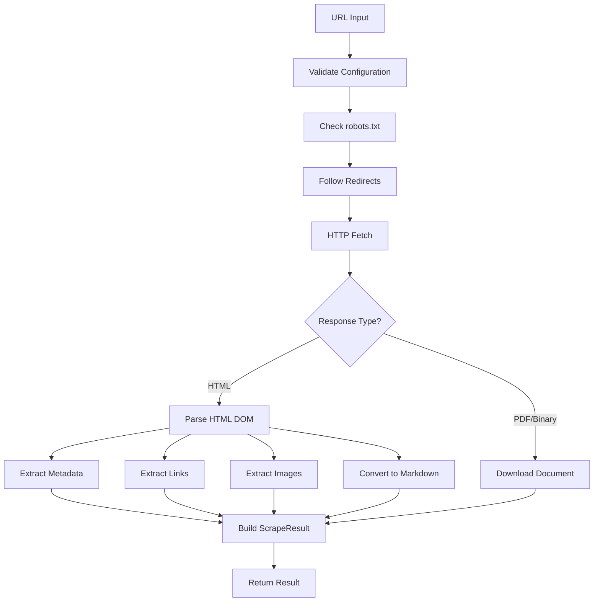
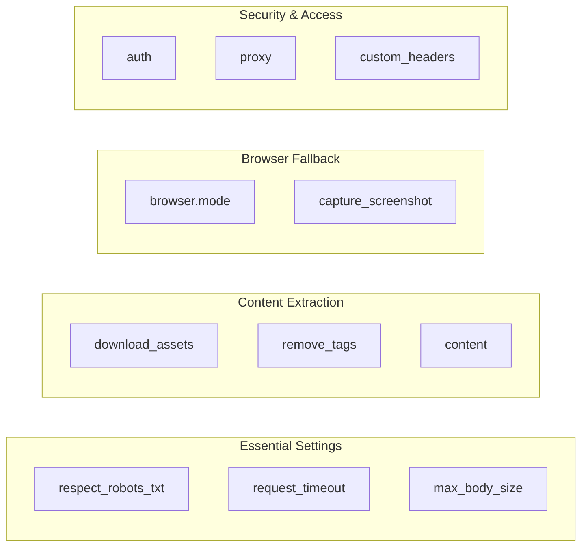

This guide teaches you how to extract structured data from a single web page using crawlberg's `scrape` operation. Unlike full crawling, which follows links across multiple pages, scraping targets one URL and returns a rich result containing metadata, links, images, and clean markdown content — all from a single HTTP request.

## How Single-Page Scraping Works

When you call `scrape`, crawlberg executes a multi-stage extraction pipeline on a single URL:



The pipeline begins by validating your configuration and fetching the page while respecting robots.txt directives. If the URL returns HTML, the engine parses the DOM to extract metadata (title, description, Open Graph tags), classifies all links by type, collects image sources, and converts the full HTML to clean Markdown. For non-HTML content like PDFs or images, the engine downloads the document instead.

Sources: [scrape.rs](crates/crawlberg/src/scrape.rs#L1-L173), [engine/mod.rs](crates/crawlberg/src/engine/mod.rs#L706-L854)

## Your First Scrape

Every scrape operation requires two things: a configured engine handle and a URL. The engine handle wraps all the pluggable components — rate limiters, caches, and extraction strategies — behind a simple API.

**Rust**

```rust
use crawlberg::{create_engine, scrape, CrawlConfig};

#[tokio::main]
async fn main() {
    let config = CrawlConfig::default();
    let engine = create_engine(Some(config)).unwrap();
    let result = scrape(&engine, "https://example.com").await.unwrap();

    println!("Status: {}", result.status_code);
    println!("Title: {:?}", result.metadata.title);
    println!("Links: {}", result.links.len());
}
```

**Go**

```go
import crawlberg "github.com/xberg-io/crawlberg/packages/go"

engine, _ := crawlberg.CreateEngine(nil)
result, _ := crawlberg.Scrape(engine, "https://example.com")

fmt.Printf("Status: %d\n", result.StatusCode)
fmt.Printf("Title: %s\n", result.Metadata.Title)
```

**Python**

```python
import asyncio
from crawlberg import create_engine, scrape

async def main():
    engine = create_engine()
    result = await scrape(engine, "https://example.com")

    print(f"Status: {result.status_code}")
    print(f"Title: {result.metadata.title}")

asyncio.run(main())
```

Sources: [bindings.rs](crates/crawlberg/src/bindings.rs#L192-L200), [api.py](packages/python/crawlberg/api.py#L268-L275), [binding.go](packages/go/binding.go#L1631-L1663)

## Understanding the ScrapeResult

The `ScrapeResult` struct is the heart of single-page scraping. It contains everything the engine extracted from the page, organized into several categories:

| Category | Fields | What It Contains |
|----------|--------|------------------|
| **HTTP Response** | `status_code`, `final_url`, `content_type`, `body_size` | Raw response metadata |
| **HTML Content** | `html` | Full HTML body after charset decoding |
| **Page Metadata** | `title`, `description`, `canonical_url`, `og_*`, `twitter_*` | Semantic page information |
| **Links** | `links[]` | All hrefs classified as internal, external, anchor, or document |
| **Images** | `images[]` | Image sources with alt text and dimensions |
| **Feeds** | `feeds[]` | RSS/Atom feed links discovered on the page |
| **Structured Data** | `json_ld[]` | JSON-LD schema.org entries |
| **Markdown** | `markdown.content` | Clean, readable text conversion of the page |
| **Robots Compliance** | `is_allowed`, `noindex_detected`, `nofollow_detected` | robots.txt and meta directive status |
| **Browser Metadata** | `js_render_hint`, `browser_used` | Whether JavaScript rendering was needed |

The `PageMetadata` struct alone contains over 40 fields covering standard HTML meta tags, Open Graph protocol, Twitter Cards, Dublin Core, article metadata, hreflang entries, favicon links, and heading hierarchy.

Sources: [results.rs](crates/crawlberg/src/types/results.rs#L97-L175), [metadata.rs](crates/crawlberg/src/types/metadata.rs#L82-L170)

## Configuration Options for Scraping

While `CrawlConfig::default()` works for most simple scraping tasks, you can customize behavior with these common options:



| Option | Type | Default | Purpose |
|--------|------|---------|---------|
| `respect_robots_txt` | bool | `true` | Check and obey robots.txt directives |
| `request_timeout` | u64 (ms) | 30000 | HTTP request timeout in milliseconds |
| `max_body_size` | usize | unlimited | Truncate response body beyond this size |
| `download_assets` | bool | `false` | Download CSS, JS, and image assets |
| `browser.mode` | BrowserMode | `Auto` | When to use headless browser fallback |
| `auth` | AuthConfig | `None` | Basic, Bearer, or custom header authentication |

**Custom Configuration Example (Rust)**

```rust
use crawlberg::{create_engine, scrape, CrawlConfig, BrowserConfig, BrowserMode};

let config = CrawlConfig {
    respect_robots_txt: true,
    request_timeout: Some(10_000),  // 10 second timeout
    download_assets: true,          // also download CSS/JS/images
    browser: BrowserConfig {
        mode: BrowserMode::Auto,    // use browser if JS rendering needed
        ..Default::default()
    },
    ..Default::default()
};

let engine = create_engine(Some(config)).unwrap();
let result = scrape(&engine, "https://example.com").await.unwrap();
```

Sources: [types/config.rs](crates/crawlberg/src/types/config.rs), [binding.go](packages/go/binding.go#L819-L950)

## Extracting Specific Data

### Working with Metadata

The `metadata` field contains everything crawlberg extracted from the page's HTML meta tags, including standard properties, Open Graph, Twitter Cards, and Dublin Core:

```rust
// Access standard metadata
if let Some(title) = &result.metadata.title {
    println!("Page title: {}", title);
}

if let Some(description) = &result.metadata.description {
    println!("Description: {}", description);
}

// Access Open Graph data
if let Some(og_title) = &result.metadata.og_title {
    println!("OG Title: {}", og_title);
}

// Access Twitter Card data
if let Some(twitter_image) = &result.metadata.twitter_image {
    println!("Twitter image: {}", twitter_image);
}
```

### Working with Links

Links are classified into types, making it easy to filter for specific kinds:

| LinkType | Description | Example |
|----------|-------------|---------|
| `internal` | Same-domain links | `/about`, `/contact` |
| `external` | Cross-domain links | `https://other-site.com` |
| `anchor` | In-page fragment links | `#section-2` |
| `document` | Non-HTML document links | `/report.pdf`, `/data.csv` |
| `image` | Image source links | `/photo.jpg` |

```rust
// Filter for external links only
let external_links: Vec<_> = result.links.iter()
    .filter(|link| link.link_type == "external")
    .collect();

println!("Found {} external links", external_links.len());
```

### Working with Markdown

The `markdown` field provides a clean, readable version of the page content with HTML stripped away. This is particularly useful for content analysis and NLP tasks:

```rust
if let Some(markdown) = &result.markdown {
    // The main content as markdown
    println!("Content:\n{}", markdown.content);
    
    // If citations were generated
    if let Some(citations) = &markdown.citations {
        println!("Citations found: {}", citations.references.len());
    }
}
```

Sources: [metadata.rs](crates/crawlberg/src/html/metadata.rs#L1-L212), [results.rs](crates/crawlberg/src/types/results.rs#L97-L175)

## Error Handling

Scrape operations can fail for various reasons. Crawlberg provides structured error types that help you diagnose and handle failures:

| Error Type | Cause | Recovery Strategy |
|------------|-------|-------------------|
| `NotFound` (404) | Page doesn't exist | Check URL, verify page exists |
| `Forbidden` (403) | Access denied | Check auth, verify permissions |
| `WafBlocked` | Web Application Firewall | Use `BrowserMode::Stealth` |
| `Timeout` | Request too slow | Increase `request_timeout` |
| `SsrfPolicyViolation` | Private network blocked | Adjust SSRF policy |
| `InvalidConfig` | Bad configuration | Validate config fields |

**Soft Error Mode**

By default, HTTP errors like 404 and 403 raise exceptions. Enable `soft_http_errors` to receive them as normal results with the appropriate status code:

```rust
let config = CrawlConfig {
    soft_http_errors: true,  // Don't throw on 404/403
    ..Default::default()
};

let result = scrape(&engine, "https://example.com/missing").await?;
// result.status_code will be 404, no exception raised
```

Sources: [engine/mod.rs](crates/crawlberg/src/engine/mod.rs#L740-L770), [error.rs](crates/crawlberg/src/error.rs)

## Advanced: Browser Fallback

When a page requires JavaScript to render its content (single-page applications, dynamic loading), crawlberg can automatically fall back to headless browser rendering:

```rust
use crawlberg::{create_engine, scrape, CrawlConfig, BrowserConfig, BrowserMode};

let config = CrawlConfig {
    browser: BrowserConfig {
        mode: BrowserMode::Auto,  // Automatically detect JS-heavy pages
        ..Default::default()
    },
    ..Default::default()
};

let engine = create_engine(Some(config)).unwrap();
let result = scrape(&engine, "https://spa-example.com").await?;

// Check if browser was used
if result.browser_used {
    println!("Page required JavaScript rendering");
}
```

The `js_render_hint` field in the result indicates whether the page content suggests JavaScript rendering might be needed, even if the browser wasn't used.

Sources: [engine/mod.rs](crates/crawlberg/src/engine/mod.rs#L700-L730), [browser_detect.rs](crates/crawlberg/src/browser_detect.rs)

## What's Next

Now that you understand single-page scraping, you can:

- **[Crawl a Website](7-crawl-a-website)** — Follow links across multiple pages with configurable depth and concurrency
- **[Discover URLs with Map](8-discover-urls-with-map)** — Enumerate all pages on a site without fetching content
- **[Configuration Reference](11-configuration-reference-crawlconfig)** — Explore all available configuration options in detail
- **[Result Types and Data Models](12-result-types-and-data-models)** — Deep-dive into ScrapeResult and related structures