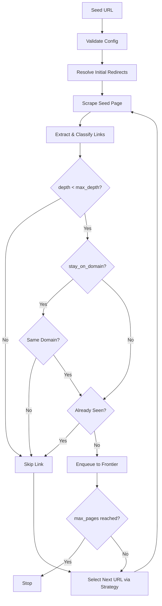
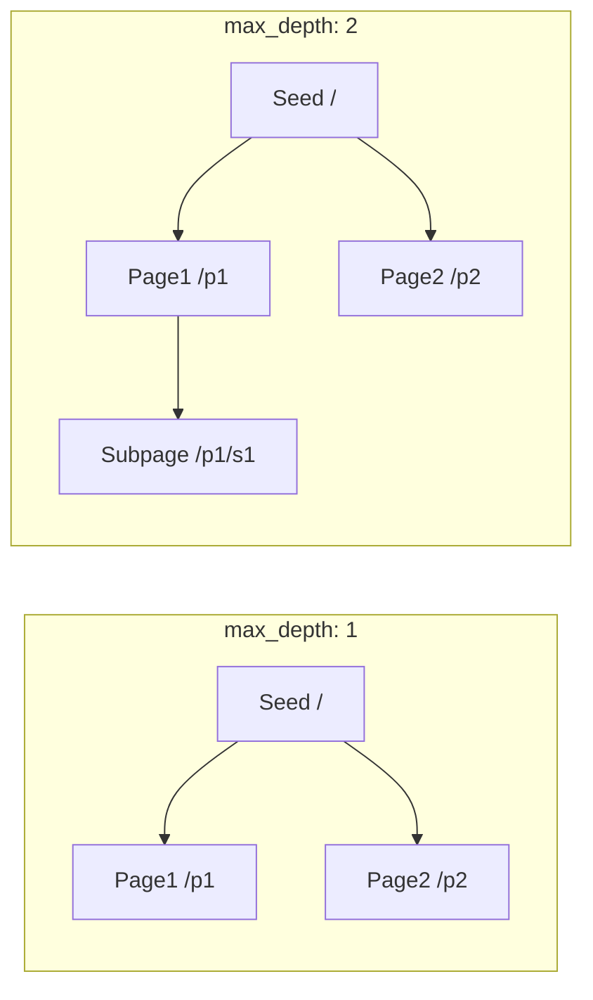
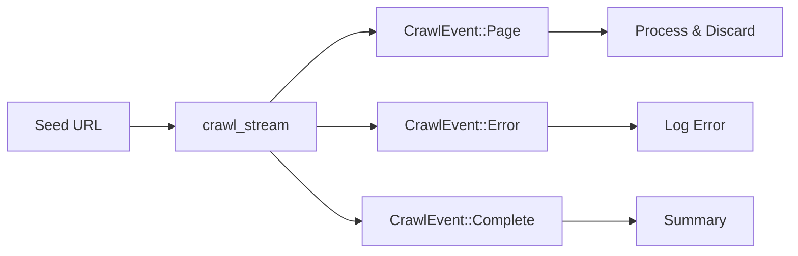

Crawling extends beyond single-page scraping by automatically following links discovered on each page, building a collection of related content up to configurable depth and page limits. This guide covers the core crawl API, configuration patterns, concurrency, streaming, and batch operations — everything you need to systematically traverse a website and extract structured data from every reachable page.

## How Crawling Works

When you call `crawl`, crawlberg orchestrates a multi-phase pipeline that starts at a seed URL, extracts links, and iteratively fetches discovered pages using a breadth-first (BFS) strategy by default.



The engine maintains a **frontier** (URL queue) and a **seen set** for deduplication. At each iteration, the configured `CrawlStrategy` selects the next URL from the frontier — by default breadth-first — the page is scraped, links are extracted, and new internal URLs are enqueued. This continues until no URLs remain, `max_depth` is exceeded, or the `max_pages` budget is exhausted.

Sources: [engine/mod.rs](crates/crawlberg/src/engine/mod.rs#L1-L80), [engine/batch.rs](crates/crawlberg/src/engine/batch.rs#L29-L47)

## Your First Crawl

Every crawl requires an engine handle (created from a `CrawlConfig`) and a seed URL. The simplest crawl fetches the seed and follows its links:

**Rust**

```rust
use crawlberg::{create_engine, crawl, CrawlConfig};

#[tokio::main]
async fn main() {
    let config = CrawlConfig {
        max_depth: Some(2),
        respect_robots_txt: true,
        ..Default::default()
    };
    let engine = create_engine(Some(config)).unwrap();
    let result = crawl(&engine, "https://example.com").await.unwrap();

    println!("Crawled {} pages", result.pages.len());
    for page in &result.pages {
        println!("  [depth {}] {}", page.depth, page.url);
    }
}
```

**Go**

```go
import crawlberg "github.com/xberg-io/crawlberg/packages/go"

config := &crawlberg.CrawlConfig{
    MaxDepth:       2,
    RespectRobotsTxt: true,
}
engine, _ := crawlberg.CreateEngine(config)
result, _ := crawlberg.Crawl(engine, "https://example.com")

fmt.Printf("Crawled %d pages\n", len(result.Pages))
for _, page := range result.Pages {
    fmt.Printf("  [depth %d] %s\n", page.Depth, page.URL)
}
```

**Python**

```python
import asyncio
from crawlberg import create_engine, crawl, CrawlConfig

async def main():
    config = CrawlConfig(max_depth=2, respect_robots_txt=True)
    engine = create_engine(config)
    result = await crawl(engine, "https://example.com")

    print(f"Crawled {len(result.pages)} pages")
    for page in result.pages:
        print(f"  [depth {page.depth}] {page.url}")

asyncio.run(main())
```

**Node.js**

```typescript
import { createEngine, crawl } from "@xberg-io/crawlberg";

const engine = createEngine({ maxDepth: 2, respectRobotsTxt: true });
const result = await crawl(engine, "https://example.com");

console.log(`Crawled ${result.pages.length} pages`);
for (const page of result.pages) {
    console.log(`  [depth ${page.depth}] ${page.url}`);
}
```

Sources: [bindings.rs](crates/crawlberg/src/bindings.rs#L196-L204), [e2e/rust/tests/crawl_test.rs](e2e/rust/tests/crawl_test.rs#L64-L77)

## Depth and Page Limits

Two parameters control crawl scope: **depth** (how many hops from the seed) and **pages** (total pages to collect).

| Parameter | Type | Default | Behavior |
|-----------|------|---------|----------|
| `max_depth` | `Option<usize>` | `None` (seed only) | Maximum link hops from the seed URL. `None` or `0` fetches only the seed page. |
| `max_pages` | `Option<usize>` | `None` (unlimited) | Maximum pages to crawl. Engine stops once this limit is reached. |



:::caution[Depth 0 = seed only]
When `max_depth` is `None` or `Some(0)`, the engine fetches the seed URL but does not follow any links. Set `max_depth: Some(1)` to crawl one hop outward. The maximum allowed depth is 100.
:::

**Budget-limited crawl example:**

```rust
let config = CrawlConfig {
    max_pages: Some(3),       // stop after 3 pages
    max_depth: Some(2),       // but don't go deeper than 2 hops
    ..Default::default()
};
```

This configuration crawls the seed page, follows links up to depth 2, but halts as soon as 3 pages have been fetched — even if more links remain.

Sources: [fixtures/crawl/crawl_depth_one.json](fixtures/crawl/crawl_depth_one.json), [fixtures/crawl/crawl_max_pages.json](fixtures/crawl/crawl_max_pages.json), [engine/mod.rs](crates/crawlberg/src/engine/mod.rs#L943-L960)

## Controlling Concurrency

By default, the engine uses up to 10 concurrent HTTP requests. Tune this with `max_concurrent`:

| Parameter | Type | Default | Description |
|-----------|------|---------|-------------|
| `max_concurrent` | `Option<usize>` | `None` (10) | Maximum simultaneous HTTP requests across the crawl. |

```rust
let config = CrawlConfig {
    max_concurrent: Some(3),   // 3 simultaneous fetches
    max_depth: Some(1),
    ..Default::default()
};
```

A per-domain rate limit also applies: the engine enforces a 200ms minimum interval between requests to the same domain by default. You can adjust this with `rate_limit_ms`:

```rust
let config = CrawlConfig {
    max_concurrent: Some(5),
    rate_limit_ms: Some(500),  // 500ms between requests to same domain
    ..Default::default()
};
```

:::tip
Use lower concurrency (1–3) when crawling sites with strict rate limits or WAF protection. Use higher values (10–20) for internal or development crawls where throughput matters.
:::

Sources: [fixtures/crawl/crawl_concurrent_depth.json](fixtures/crawl/crawl_concurrent_depth.json), [fixtures/crawl/crawl_concurrent_limit.json](fixtures/crawl/crawl_concurrent_limit.json)

## Domain Scoping

By default, crawling follows all links regardless of domain. Use `stay_on_domain` and `allow_subdomains` to restrict which URLs are followed:

| Parameter | Type | Default | Description |
|-----------|------|---------|-------------|
| `stay_on_domain` | `bool` | `false` | Only follow links on the same domain as the seed URL. |
| `allow_subdomains` | `bool` | `false` | When `stay_on_domain` is true, also follow links to subdomains. |

**Domain-scoped crawl (exact match only):**

```rust
let config = CrawlConfig {
    stay_on_domain: true,
    allow_subdomains: false,  // only crawl exact same domain
    max_depth: Some(1),
    ..Default::default()
};
let result = crawl(&engine, "https://example.com").await?;
// result.stayed_on_domain == true
```

**Domain-scoped crawl (with subdomains):**

```rust
let config = CrawlConfig {
    stay_on_domain: true,
    allow_subdomains: true,   // also crawl blog.example.com, api.example.com
    max_depth: Some(1),
    ..Default::default()
};
let result = crawl(&engine, "https://example.com").await?;
// Also crawls links to docs.example.com, etc.
```

Sources: [fixtures/crawl/crawl_stay_on_domain.json](fixtures/crawl/crawl_stay_on_domain.json), [fixtures/crawl/crawl_subdomain_exclusion.json](fixtures/crawl/crawl_subdomain_exclusion.json), [engine/mod.rs](crates/crawlberg/src/engine/mod.rs#L1052-L1070)

## Path Filtering with Regex

Fine-tune which URL paths the crawler follows using `include_paths` and `exclude_paths`:

| Parameter | Type | Default | Description |
|-----------|------|---------|-------------|
| `include_paths` | `Vec<String>` | `[]` | Regex patterns — only URLs whose path matches at least one pattern are crawled. The seed URL is always included. |
| `exclude_paths` | `Vec<String>` | `[]` | Regex patterns — URLs whose path matches any pattern are skipped. Excludes take priority over includes. |

**Crawl only blog posts:**

```rust
let config = CrawlConfig {
    include_paths: vec![r"^/blog/".to_string()],
    max_depth: Some(1),
    ..Default::default()
};
```

**Skip admin pages:**

```rust
let config = CrawlConfig {
    exclude_paths: vec![r"/admin/".to_string(), r"\.pdf$".to_string()],
    max_depth: Some(1),
    ..Default::default()
};
```

Sources: [fixtures/crawl/crawl_include_path_pattern.json](fixtures/crawl/crawl_include_path_pattern.json), [fixtures/crawl/crawl_exclude_path_pattern.json](fixtures/crawl/crawl_exclude_path_pattern.json)

## URL Deduplication and Normalization

Crawlberg automatically prevents redundant fetches by normalizing URLs before checking them against a seen set. This means equivalent URLs pointing to the same resource are fetched only once:

| Normalization | Example | Result |
|---------------|---------|--------|
| **Fragment stripping** | `/article#section1`, `/article#section2` | Both resolve to `/article` — fetched once |
| **Trailing slash dedup** | `/page`, `/page/` | Treated as the same URL |
| **Query param dedup** | `/page?ref=home`, `/page?ref=nav` | Treated as the same URL |
| **Double-slash normalization** | `//page` | Normalized to `/page` |
| **Self-link detection** | `/` linking to `/` | Not re-enqueued |

Sources: [fixtures/crawl/crawl_fragment_stripping.json](fixtures/crawl/crawl_fragment_stripping.json), [fixtures/crawl/crawl_url_deduplication.json](fixtures/crawl/crawl_url_deduplication.json), [fixtures/crawl/crawl_trailing_slash_dedup.json](fixtures/crawl/crawl_trailing_slash_dedup.json)

## Redirect Handling

The engine resolves HTTP redirects before the crawl loop processes each page. It follows HTTP 3xx status codes, `Refresh` headers, and `<meta http-equiv="refresh">` tags:

| Parameter | Type | Default | Description |
|-----------|------|---------|-------------|
| `max_redirects` | `usize` | `10` | Maximum redirect hops before stopping. Must be ≤ 100. |

Redirect loops are detected (via a seen-set on redirect targets) and gracefully terminated. If the final destination returns an error, the crawl reports it in the `error` field of `CrawlResult` rather than aborting the entire operation.

Sources: [fixtures/crawl/crawl_redirect_in_traversal.json](fixtures/crawl/crawl_redirect_in_traversal.json), [engine/crawl_loop.rs](crates/crawlberg/src/engine/crawl_loop.rs#L52-L120)

## Custom Headers and User-Agent

Send custom HTTP headers with every request in the crawl, or set a custom user-agent:

```rust
use std::collections::HashMap;

let mut headers = HashMap::new();
headers.insert("Authorization".to_string(), "Bearer my-token".to_string());
headers.insert("Accept-Language".to_string(), "en-US".to_string());

let config = CrawlConfig {
    custom_headers: headers,
    user_agent: Some("MyCrawler/1.0".to_string()),
    max_depth: Some(1),
    ..Default::default()
};
```

Sources: [fixtures/crawl/crawl_custom_headers.json](fixtures/crawl/crawl_custom_headers.json)

## Understanding CrawlResult

The `crawl` function returns a `CrawlResult` containing all crawled pages and crawl metadata:

| Field | Type | Description |
|-------|------|-------------|
| `pages` | `Vec<CrawlPageResult>` | All successfully crawled pages. |
| `final_url` | `String` | The URL after resolving initial redirects from the seed. |
| `redirect_count` | `usize` | Number of redirects followed from the seed URL. |
| `was_skipped` | `bool` | Whether any page was skipped (binary or PDF content). |
| `error` | `Option<String>` | Error message if the crawl encountered a fatal issue. |
| `cookies` | `Vec<CookieInfo>` | Cookies collected (when `cookies_enabled` is true). |
| `stayed_on_domain` | `bool` | Whether all crawled pages stayed on the seed domain. |
| `browser_used` | `bool` | Whether the browser fallback was used for any page. |

### CrawlPageResult Reference

Each entry in `pages` contains the full extraction result for a single crawled page:

| Field | Type | Description |
|-------|------|-------------|
| `url` | `String` | The original URL fetched. |
| `normalized_url` | `String` | Normalized URL (for deduplication). |
| `status_code` | `u16` | HTTP response status code. |
| `content_type` | `String` | The Content-Type header value. |
| `html` | `String` | The full response body. |
| `body_size` | `usize` | Response body size in bytes. |
| `metadata` | `PageMetadata` | Extracted metadata (title, description, OG tags, etc.). |
| `links` | `Vec<LinkInfo>` | Links found, classified as internal/external/document/anchor. |
| `images` | `Vec<ImageInfo>` | Images with source URLs and alt text. |
| `feeds` | `Vec<FeedInfo>` | RSS/Atom/JSON feed links discovered. |
| `json_ld` | `Vec<JsonLdEntry>` | JSON-LD structured data entries. |
| `depth` | `usize` | Distance from the seed URL in link hops. |
| `stayed_on_domain` | `bool` | Whether this page is on the seed domain. |
| `was_skipped` | `bool` | Whether the page was skipped (binary/PDF content). |
| `markdown` | `Option<MarkdownResult>` | Clean markdown conversion of the HTML. |
| `extracted_data` | `Option<Value>` | LLM-extracted data (when configured). |
| `browser_used` | `bool` | Whether the browser fallback was used for this page. |

Sources: [types/results.rs](crates/crawlberg/src/types/results.rs#L218-L280), [types/results.rs](crates/crawlberg/src/types/results.rs#L177-L218)

## Streaming Crawls

For large sites where accumulating all pages into memory isn't feasible, use `crawl_stream` to process pages incrementally as they are discovered:



The streaming interface emits three event types:

| Event | Payload | When |
|-------|---------|------|
| `Page` | `CrawlPageResult` (boxed) | A page was successfully crawled |
| `Error` | `url` + `error` message | A page fetch failed |
| `Complete` | `pages_crawled` count | Crawl finished (always emitted) |

**Rust streaming example:**

```rust
use futures::StreamExt;
use crawlberg::{create_engine, crawl_stream, CrawlConfig};

let engine = create_engine(Some(CrawlConfig {
    max_depth: Some(2),
    max_pages: Some(1000),
    ..Default::default()
}))?;

let mut stream = crawl_stream(&engine, "https://example.com").await?;
while let Some(event) = stream.next().await {
    match event? {
        CrawlEvent::Page { result } => {
            println!("{} (depth {})", result.url, result.depth);
            // Process and discard — memory is freed immediately
        }
        CrawlEvent::Error { url, error } => {
            eprintln!("Failed: {url}: {error}");
        }
        CrawlEvent::Complete { pages_crawled } => {
            println!("Done. {pages_crawled} pages crawled.");
        }
    }
}
```

**Python streaming example:**

```python
from crawlberg import create_engine, crawl_stream, CrawlConfig

engine = create_engine(CrawlConfig(max_depth=2, max_pages=1000))
async for event in crawl_stream(engine, "https://example.com"):
    if event.type == "page":
        page = event.page["result"]
        print(f"{page['url']} (depth {page['depth']})")
    elif event.type == "error":
        print(f"Failed: {event.error['url']}")
    elif event.type == "complete":
        print(f"Done. {event.complete['pages_crawled']} pages.")
```

**Node.js streaming example:**

```typescript
import { createEngine, crawlStream } from "@xberg-io/crawlberg";

const engine = createEngine({ maxDepth: 2, maxPages: 1000 });
const stream = await crawlStream(engine, "https://example.com");

for await (const event of stream) {
    if (event.type === "page") {
        const page = event.page.result;
        console.log(`${page.url} (depth ${page.depth})`);
    } else if (event.type === "complete") {
        console.log(`Done. ${event.complete.pagesCrawled} pages.`);
    }
}
```

:::tip
Streaming uses a channel buffer sized at `16 × max_concurrent`. For large crawls with low concurrency, the default buffer is sufficient. For high-throughput crawls, increasing `max_concurrent` also increases the stream buffer.
:::

Sources: [types/streaming.rs](crates/crawlberg/src/types/streaming.rs#L1-L29), [types/discovery.rs](crates/crawlberg/src/types/discovery.rs#L237-L263), [engine/batch.rs](crates/crawlberg/src/engine/batch.rs#L55-L82)

## Batch Crawling

Crawl multiple seed URLs concurrently, each following links independently:

```rust
use crawlberg::{create_engine, batch_crawl, CrawlConfig};

let engine = create_engine(Some(CrawlConfig {
    max_depth: Some(2),
    ..Default::default()
}))?;

let results = batch_crawl(
    &engine,
    vec![
        "https://example.com".to_owned(),
        "https://other-site.org".to_owned(),
    ],
).await?;

// Aggregate counts
println!("Total: {}, Completed: {}, Failed: {}",
    results.total_count, results.completed_count, results.failed_count);

for entry in &results.results {
    match (&entry.result, &entry.error) {
        (Some(crawl), _) => println!("{}: {} pages", entry.url, crawl.pages.len()),
        (None, Some(e)) => eprintln!("{}: {}", entry.url, e),
        _ => {}
    }
}
```

`batch_crawl` returns `BatchCrawlResults` with aggregate counts (`total_count`, `completed_count`, `failed_count`) plus per-URL results. Each seed runs independently — a failure in one seed does not affect others. Concurrency is shared across all seeds via the same `max_concurrent` semaphore.

**Python batch example:**

```python
import asyncio
from crawlberg import create_engine, batch_crawl, CrawlConfig

async def main():
    engine = create_engine(CrawlConfig(max_depth=2))
    results = await batch_crawl(engine, [
        "https://example.com",
        "https://other-site.org",
    ])

    for entry in results.results:
        if entry.result:
            print(f"{entry.url}: {len(entry.result.pages)} pages")
        elif entry.error:
            print(f"{entry.url}: {entry.error}")

asyncio.run(main())
```

**Node.js batch example:**

```typescript
import { createEngine, batchCrawl } from "@xberg-io/crawlberg";

const engine = createEngine({ maxDepth: 2 });
const results = await batchCrawl(engine, [
    "https://example.com",
    "https://other-site.org",
]);

for (const entry of results.results) {
    if (entry.result) {
        console.log(`${entry.url}: ${entry.result.pages.length} pages`);
    } else if (entry.error) {
        console.error(`${entry.url}: ${entry.error}`);
    }
}
```

Sources: [bindings.rs](crates/crawlberg/src/bindings.rs#L271-L307), [engine/batch.rs](crates/crawlberg/src/engine/batch.rs#L109-L145)

## CLI Usage

The `crawlberg` CLI provides a `crawl` subcommand for quick command-line crawling:

```bash
# Basic crawl — depth 2, 10 concurrent requests
crawlberg crawl https://example.com

# Limit pages and depth
crawlberg crawl https://example.com --depth 1 --max-pages 20

# Stay on domain with custom concurrency
crawlberg crawl https://example.com --stay-on-domain --concurrent 5

# Output as markdown instead of JSON
crawlberg crawl https://example.com --format markdown

# Pass a full JSON config
crawlberg crawl https://example.com --config '{"max_depth":3,"respect_robots_txt":true}'
```

For multiple seed URLs, pass them all as positional arguments — the CLI automatically switches to batch mode:

```bash
crawlberg crawl https://example.com https://other-site.org --depth 2
```

Sources: [main.rs](crates/crawlberg-cli/src/main.rs#L261-L310), [main.rs](crates/crawlberg-cli/src/main.rs#L594-L616)

## Configuration Reference

Here is a summary of the most commonly used crawl configuration options:

| Option | Type | Default | Description |
|--------|------|---------|-------------|
| `max_depth` | `Option<usize>` | `None` (0) | Maximum link hops from seed. Max: 100. |
| `max_pages` | `Option<usize>` | `None` (unlimited) | Stop after this many pages. |
| `max_concurrent` | `Option<usize>` | `None` (10) | Simultaneous HTTP requests. |
| `respect_robots_txt` | `bool` | `false` | Obey robots.txt directives. |
| `stay_on_domain` | `bool` | `false` | Only follow same-domain links. |
| `allow_subdomains` | `bool` | `false` | Include subdomains when `stay_on_domain` is true. |
| `include_paths` | `Vec<String>` | `[]` | Regex whitelist for URL paths. |
| `exclude_paths` | `Vec<String>` | `[]` | Regex blacklist for URL paths. |
| `custom_headers` | `HashMap<String, String>` | `{}` | Extra HTTP headers on all requests. |
| `user_agent` | `Option<String>` | `None` (built-in) | Custom User-Agent string. |
| `request_timeout` | `Duration` | 30s | Per-request timeout. |
| `rate_limit_ms` | `Option<u64>` | `None` (200ms) | Minimum delay between same-domain requests. |
| `max_redirects` | `usize` | `10` | Maximum redirect hops. Max: 100. |
| `cookies_enabled` | `bool` | `false` | Persist cookies across requests. |
| `auth` | `Option<AuthConfig>` | `None` | Basic, Bearer, or custom header auth. |
| `proxy` | `Option<ProxyConfig>` | `None` | HTTP/SOCKS5 proxy. |
| `browser.mode` | `BrowserMode` | `Auto` | When to use headless browser fallback. |
| `soft_http_errors` | `bool` | `false` | Surface HTTP errors as results instead of failures. |

Sources: [types/config.rs](crates/crawlberg/src/types/config.rs#L297-L450), [types/config.rs](crates/crawlberg/src/types/config.rs#L450-L500)

## Next Steps

Now that you understand how to crawl websites, explore these related topics:

- [Discover URLs with Map](8-discover-urls-with-map) — Use sitemaps and link extraction to discover all URLs on a site without fetching their content.
- [Concurrent Crawl Strategies and URL Frontier](15-concurrent-crawl-strategies-and-url-frontier) — Deep dive into BFS, DFS, and adaptive crawl strategies.
- [Rate Limiting and Caching](17-rate-limiting-and-caching) — Configure throttling, per-domain rate limits, and HTTP response caching.
- [Configuration Reference (CrawlConfig)](11-configuration-reference-crawlconfig) — Complete reference for every `CrawlConfig` field and validation rule.
- [Robots.txt and Sitemap Compliance](16-robots-txt-and-sitemap-compliance) — How crawlberg handles robots.txt directives and sitemap parsing.