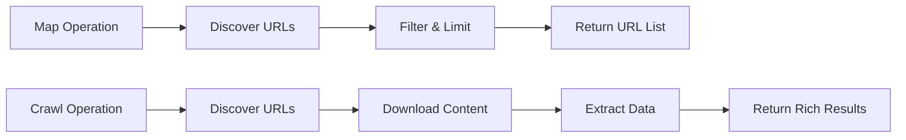
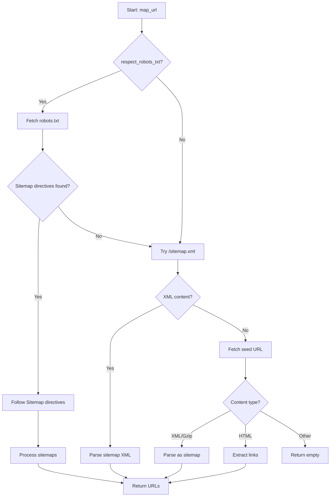
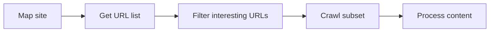

**Map** is crawlberg's lightweight URL discovery operation that finds all URLs a website exposes without downloading or parsing the full page content. It combines sitemap parsing with intelligent link extraction to give you a complete picture of a site's URL structure — fast. This tutorial walks through practical usage patterns, configuration options, and common scenarios.

## Why Use Map Instead of Crawl?

Map and crawl serve fundamentally different purposes. Map focuses exclusively on **URL enumeration** — it discovers what pages exist on a site. Crawl, by contrast, **downloads and processes** each page's content, extracting text, metadata, and structured data.



Map is the right choice when you need to:

- **Plan a crawl** — discover URLs before deciding which to scrape
- **Audit a site's surface** — see all publicly accessible pages
- **Seed another tool** — feed a URL list into a different pipeline
- **Monitor site structure** — track new or removed pages over time

Sources: [map.rs](crates/crawlberg/src/map.rs#L1-L20), [plugin/skills/mapping-urls/SKILL.md](plugin/skills/mapping-urls/SKILL.md#L1-L20)

## Getting Started: Your First Map

The quickest way to discover URLs is through the CLI. Here's a basic example:

```bash
crawlberg map https://example.com --format markdown
```

This outputs one URL per line — perfect for piping into a file or another command. For structured output, use JSON (the default):

```bash
crawlberg map https://example.com --format json
```

The JSON response contains a `urls` array with `SitemapUrl` objects, each carrying the discovered URL and optional metadata like `lastmod` (last modified date) and `priority`.

Sources: [e2e/brew/test_map.sh](e2e/brew/test_map.sh#L10-L20), [fixtures/map/map_discover_urls.json](fixtures/map/map_discover_urls.json#L1-L28)

## How Map Discovers URLs

Map uses a **cascade of strategies**, trying each in order until one succeeds:



The three primary strategies are:

1. **Robots.txt sitemap directives** — When `respect_robots_txt` is enabled, fetches `robots.txt` and follows any `Sitemap:` entries found
2. **Standard sitemap fallback** — Attempts to fetch `/sitemap.xml` at the site root
3. **Direct URL fetch** — Fetches the provided URL and handles XML sitemaps, gzip-compressed sitemaps, or HTML pages with link extraction

Sources: [map.rs](crates/crawlberg/src/map.rs#L28-L100)

## Configuration Reference

Map respects several configuration options that control filtering and discovery behavior:

| Option | Type | Default | Description |
|--------|------|---------|-------------|
| `map_limit` | `Option<usize>` | `None` | Maximum number of URLs to return |
| `map_search` | `Option<String>` | `None` | Case-insensitive substring filter |
| `exclude_paths` | `Vec<String>` | `[]` | Regex patterns to exclude by URL path |
| `respect_robots_txt` | `bool` | `false` | Whether to check robots.txt for sitemaps |

### Filter Application Order

Filters are applied in a specific sequence — understanding this helps predict results:

1. **`exclude_paths`** — Regex patterns matched against URL paths
2. **`map_search`** — Case-insensitive substring match on full URLs
3. **`map_limit`** — Truncation to specified count

This ordering means `exclude_paths` and `map_search` run *before* `map_limit` counts URLs. If you set `map_limit: 10` and have 100 URLs but only 5 match your filters, you'll get exactly 5 results.

Sources: [types/config.rs](crates/crawlberg/src/types/config.rs#L323-L358), [map.rs](crates/crawlberg/src/map.rs#L110-L170)

## Practical Examples

### Limiting Results with --limit

For large sites with thousands of pages, `--limit` prevents overwhelming output:

```bash
crawlberg map https://large-site.com --limit 100 --format json
```

The limit is applied *after* filtering, so combine it with search for targeted discovery:

```bash
crawlberg map https://blog-site.com --search /posts/ --limit 50
```

Sources: [e2e/brew/test_map.sh](e2e/brew/test_map.sh#L56-L63), [fixtures/map/map_limit_pagination.json](fixtures/map/map_limit_pagination.json#L1-L27)

### Excluding Paths with Regex

The `exclude_paths` option accepts regex patterns to filter out unwanted sections:

```bash
crawlberg map https://example.com --config '{"exclude_paths":["/admin/.*","/api/.*"]}'
```

Patterns are matched against the URL's path component. This is useful for:
- Excluding admin panels from discovery
- Skipping API endpoints
- Filtering out static assets

Sources: [e2e/brew/test_map.sh](e2e/brew/test_map.sh#L23-L33), [fixtures/map/map_exclude_patterns.json](fixtures/map/map_exclude_patterns.json#L1-L29)

### Searching by Keyword

The `--search` option performs case-insensitive substring matching on full URLs:

```bash
crawlberg map https://docs-site.com --search "getting-started"
```

This is helpful when you want URLs containing specific keywords in paths or domains.

Sources: [e2e/brew/test_map.sh](e2e/brew/test_map.sh#L70-L79), [fixtures/map/map_search_filter.json](fixtures/map/map_search_filter.json#L1-L28)

### Respecting Third-Party Sites

When mapping external sites, always enable robots.txt compliance:

```bash
crawlberg map https://third-party-site.com --respect-robots-txt --limit 200
```

This fetches and parses `robots.txt` before discovery, honoring crawl delays and sitemap directives.

Sources: [e2e/brew/test_map.sh](e2e/brew/test_map.sh#L34-L42)

## Language-Specific Examples

Map works identically across all supported languages. Here are quick examples:

### Rust

```rust
use crawlberg::{CrawlConfig, create_engine, map_urls};

let engine = create_engine(Some(CrawlConfig {
    respect_robots_txt: true,
    map_limit: Some(100),
    ..Default::default()
}))?;

let result = map_urls(&engine, "https://example.com").await?;

for entry in &result.urls {
    println!("{}", entry.url);
}
```

### Python

```python
from crawlberg import create_engine, map_urls, CrawlConfig

config = CrawlConfig(
    respect_robots_txt=True,
    map_limit=100
)
engine = create_engine(config)

result = map_urls(engine, "https://example.com")

for entry in result.urls:
    print(entry.url)
```

### Go

```go
import pkg "github.com/xberg-io/crawlberg/packages/go"

config := &pkg.CrawlConfig{
    RespectRobotsTxt: true,
    MapLimit:         uint64Ptr(100),
}
engine, _ := pkg.CreateEngine(config)

result, _ := pkg.MapUrls(engine, "https://example.com")

for _, url := range result.Urls {
    fmt.Println(url.Url)
}
```

Sources: [e2e/go/map_test.go](e2e/go/map_test.go#L1-L25), [packages/python/crawlberg/api.py](packages/python/crawlberg/api.py#L1-L20)

## Output Formats

### Markdown Output

Use `--format markdown` for human-readable, pipe-friendly output:

```text
https://example.com/
https://example.com/docs/
https://example.com/docs/getting-started
https://example.com/blog/post-one
```

### JSON Output

The default JSON format returns structured data:

```json
{
  "urls": [
    {
      "url": "https://example.com/",
      "lastmod": null,
      "changefreq": null,
      "priority": null
    },
    {
      "url": "https://example.com/docs/",
      "lastmod": "2024-01-15",
      "changefreq": "weekly",
      "priority": "0.8"
    }
  ]
}
```

Note that `lastmod`, `changefreq`, and `priority` are only populated when URLs come from XML sitemaps — HTML link extraction leaves them as `null`.

Sources: [types/results.rs](crates/crawlberg/src/types/results.rs#L283-L301)

## Combining Map with Crawl

A common workflow is to discover URLs first, then selectively process them:



**Example: Discover blog posts, then scrape them**

```bash
# Step 1: Find all blog post URLs
crawlberg map https://blog-site.com --search /posts/ --format markdown > urls.txt

# Step 2: Crawl the discovered URLs
crawlberg crawl --urls urls.txt --format json > results.json
```

This two-step approach is more efficient than crawling an entire site when you only need specific sections.

Sources: [plugin/skills/mapping-urls/SKILL.md](plugin/skills/mapping-urls/SKILL.md#L80-L103)

## Performance Characteristics

Map is significantly faster than crawl because it:
- **Skips content download** — only fetches sitemaps and the seed page
- **Avoids rendering** — doesn't execute JavaScript unless explicitly configured
- **Bounded memory** — `map_limit` threads through the entire pipeline to prevent materializing huge sitemaps

A typical map of hundreds of URLs completes in seconds, compared to minutes for an equivalent crawl.

Sources: [map.rs](crates/crawlberg/src/map.rs#L20-L28), [plugin/skills/mapping-urls/SKILL.md](plugin/skills/mapping-urls/SKILL.md#L58-L68)

## Troubleshooting

### Empty Results

If map returns no URLs:

1. **Check robots.txt** — The site may block crawlers or have no sitemaps
2. **Verify the URL** — Ensure it's accessible and returns HTML or XML
3. **Try different strategies** — Pass `--respect-robots-txt` to try sitemap directives
4. **Check `exclude_paths`** — Overly broad patterns may filter everything out

### Too Many Results

When a site returns more URLs than expected:

1. **Use `--limit`** — Cap the result count
2. **Add `--search`** — Filter to specific sections
3. **Combine both** — Search first, then limit

### Sitemap Parsing Errors

If sitemaps fail to parse:

- **Gzip issues** — Verify the sitemap uses standard gzip compression
- **XML validation** — Check for malformed XML in the sitemap
- **Encoding** — Ensure proper UTF-8 encoding

Sources: [map.rs](crates/crawlberg/src/map.rs#L100-L180)

## Next Steps

Now that you've learned URL discovery, consider exploring:

- **[Crawl a Website](7-crawl-a-website)** — Download and process page content from discovered URLs
- **[Configuration Reference (CrawlConfig)](11-configuration-reference-crawlconfig)** — Detailed options for all crawlberg operations
- **[Robots.txt and Sitemap Compliance](16-robots-txt-and-sitemap-compliance)** — Deeper dive into robots.txt parsing and sitemap handling