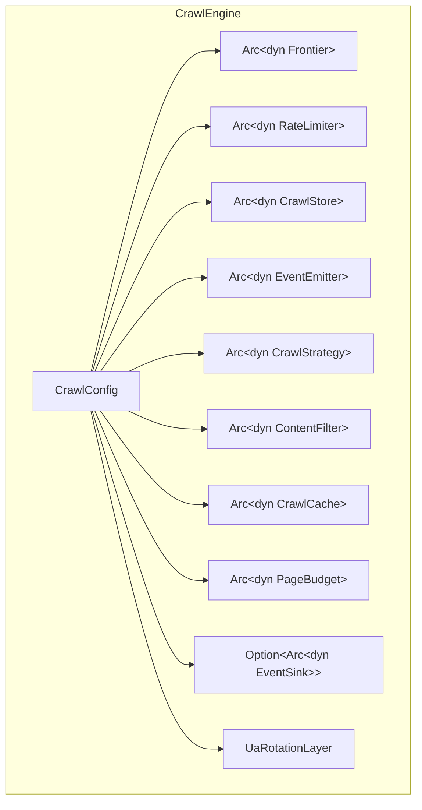
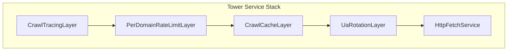
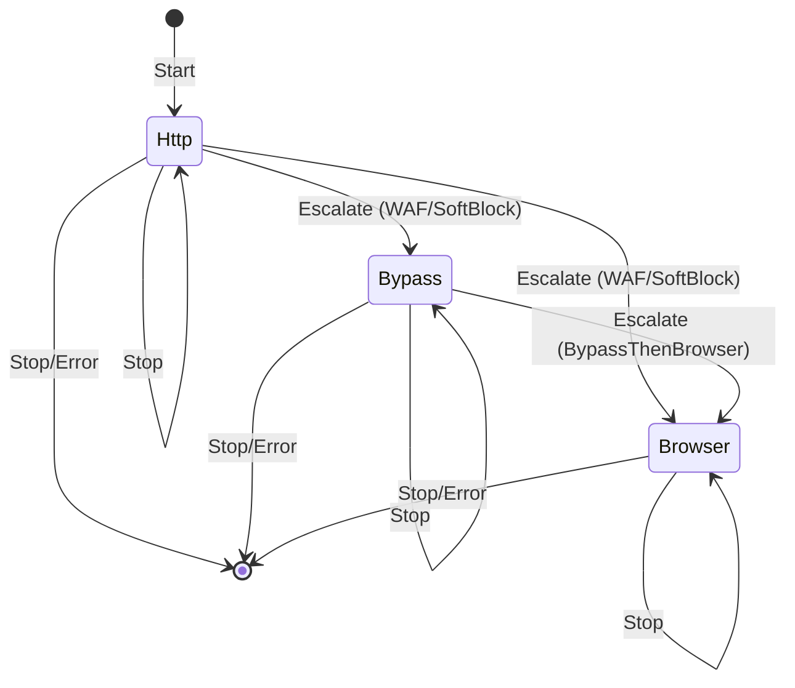
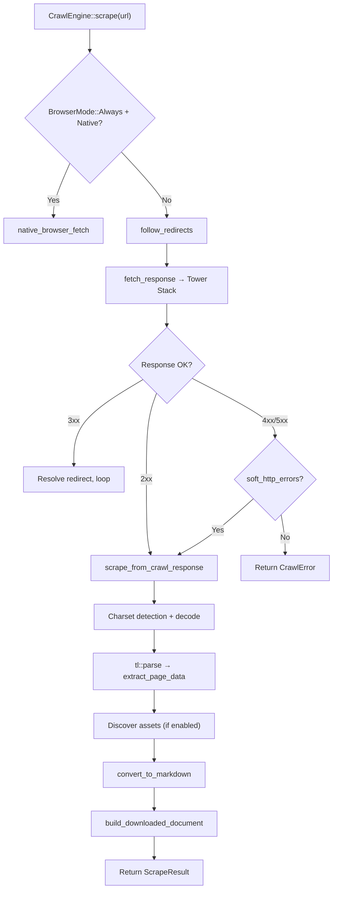
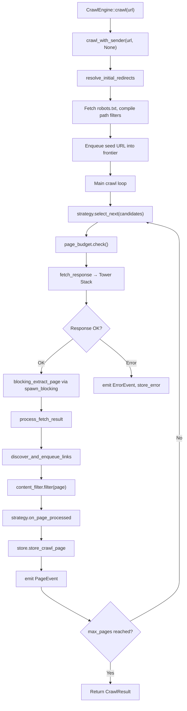
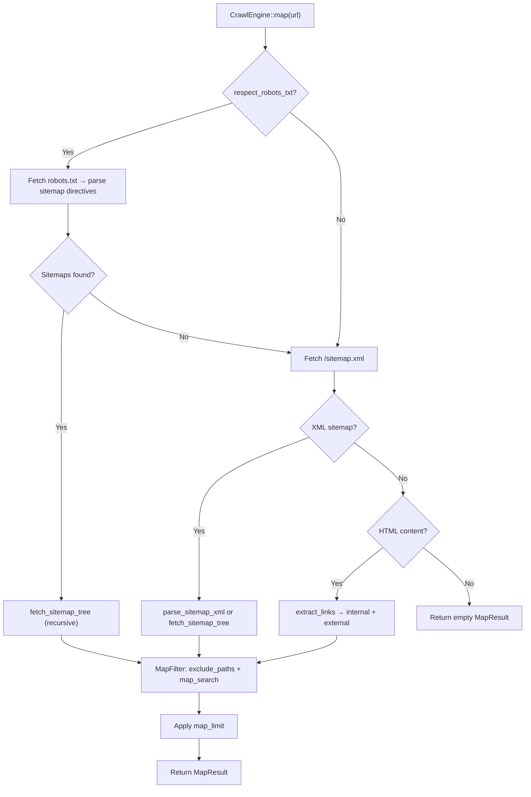

Crawlberg is a Rust-native web crawling engine organized as a Cargo workspace with a trait-driven core, a Tower middleware stack for HTTP, and a three-tier dispatch model for resilience against bot protection. This page maps the internal architecture from the crate boundary down to the data flow of each public operation.

## Workspace Structure

The repository is a single Cargo workspace rooted at `/Users/ahmettok/Developer/crawlberg/Cargo.toml` (lines 1–35). The workspace separates concerns across purpose-built crates:

| Crate | Role |
|---|---|
| `crawlberg` | Core engine: traits, types, Tower stack, crawl loop, extraction, WAF, markdown, map |
| `crawlberg-browser` | Native browser backend (Obscura-derived): V8 runtime, DOM tree, network interception, SSRF, robots |
| `crawlberg-bypass` | WAF bypass vendor adapters |
| `crawlberg-cli` | Command-line interface |
| `crawlberg-ffi` | C/Go FFI header generation via `cbindgen` |
| `crawlberg-jni` | Java/Kotlin JNI bridge |
| `crawlberg-node` | Node.js N-API bindings |
| `crawlberg-php` | PHP extension via `ext-php-rs` |
| `crawlberg-py` | Python bindings via PyO3 |
| `crawlberg-wasm` | WebAssembly target via `wasm-bindgen` |
| `crawlberg-bindings-common` | Shared adapter layer re-exporting the public binding API |

Language-specific packages live under `packages/` (Go, Dart, Swift, Ruby, Elixir, C#, Zig, Kotlin-Android) and consume the engine through the appropriate binding crate.

Sources: [Cargo.toml](Cargo.toml#L1-L35), [crates/crawlberg-bindings-common/src/lib.rs](crates/crawlberg-bindings-common/src/lib.rs#L1-L10)

## Core Engine Composition

The central orchestrator is `CrawlEngine`, a **struct of trait objects** where every behavioral axis is pluggable. The builder pattern in [`CrawlEngineBuilder`](crates/crawlberg/src/engine/builder.rs) assembles these components, falling back to defaults from the `defaults` module when nothing is injected.

Each trait is defined in [`traits.rs`](crates/crawlberg/src/traits.rs) and represents a single axis of variation:

| Trait | Responsibility | Default Implementation |
|---|---|---|
| `Frontier` | URL queue, deduplication, push/pop/batch | `InMemoryFrontier` — `VecDeque` + `AHashSet` |
| `RateLimiter` | Per-domain throttle, crawl-delay from robots.txt | `PerDomainThrottle` — token-bucket with 429 backoff |
| `CrawlStore` | Persistence for pages, errors, completion | `NoopStore` |
| `EventEmitter` | Lifecycle callbacks (page, error, discovered, complete) | `NoopEmitter` |
| `CrawlStrategy` | URL selection scoring and stop-condition | `BfsStrategy` (default), `DfsStrategy`, `BestFirstStrategy`, `AdaptiveStrategy` |
| `ContentFilter` | Post-extraction page filtering | `NoopFilter` |
| `CrawlCache` | HTTP response caching (ETag, Last-Modified) | `NoopCache` |
| `PageBudget` | Pre-fetch budget enforcement (tenant-agnostic) | `DefaultPageBudget` (always permits) |
| `EventSink` | Streaming events to external systems (NATS, dashboards) | `TracingEventSink`, `MultiEventSink` |

The `Arc<dyn Trait>` composition means all components are shared across concurrent crawl tasks without requiring the engine itself to be generic over its components.

Sources: [crates/crawlberg/src/traits.rs](crates/crawlberg/src/traits.rs#L1-L196), [crates/crawlberg/src/engine/builder.rs](crates/crawlberg/src/engine/builder.rs#L1-L200), [crates/crawlberg/src/engine/mod.rs](crates/crawlberg/src/engine/mod.rs#L56-L97)

## Tower Service Stack (HTTP Tier)

On native targets, every HTTP request flows through a Tower service stack composed inside [`CrawlEngine::build_service`](crates/crawlberg/src/engine/mod.rs#L101-L121). The layers are applied outermost-first:

| Layer | File | Behavior |
|---|---|---|
| `CrawlTracingLayer` | [tower/tracing_layer.rs](crates/crawlberg/src/tower/tracing_layer.rs) | Wraps each request in a `crawl.page.fetch` tracing span with tier, domain, status |
| `PerDomainRateLimitLayer` | [tower/rate_limit.rs](crates/crawlberg/src/tower/rate_limit.rs) | Acquires per-domain throttle before forwarding; records 429 responses |
| `CrawlCacheLayer` | [tower/cache.rs](crates/crawlberg/src/tower/cache.rs) | Checks `CrawlCache` for cached responses; stores fresh responses |
| `UaRotationLayer` | [tower/ua_rotation.rs](crates/crawlberg/src/tower/ua_rotation.rs) | Rotates through `config.user_agents` list, preserving counter across service rebuilds |
| `HttpFetchService` | [tower/service.rs](crates/crawlberg/src/tower/service.rs) | Innermost: SSRF validation → `reqwest::Client` GET → classify status → return `CrawlResponse` |

The `HttpFetchService` ([tower/service.rs](crates/crawlberg/src/tower/service.rs#L95-L200)) performs SSRF validation before every request, applies auth and custom headers, and classifies HTTP status codes into typed `CrawlError` variants. Redirects are **not** followed by reqwest (`Policy::none()`) — manual redirect resolution happens in the crawl loop to retain control over the redirect chain.

The request/response types flowing through the stack are `CrawlRequest` and `CrawlResponse` ([tower/types.rs](crates/crawlberg/src/tower/types.rs#L1-L49)), which carry URL, headers, status, body, and content type.

Sources: [crates/crawlberg/src/engine/mod.rs](crates/crawlberg/src/engine/mod.rs#L99-L121), [crates/crawlberg/src/tower/service.rs](crates/crawlberg/src/tower/service.rs#L95-L280), [crates/crawlberg/src/tower/types.rs](crates/crawlberg/src/tower/types.rs#L1-L49)

## Three-Tier Dispatch Model

The engine implements a **tiered escalation strategy** that progressively escalates from cheap HTTP to expensive browser rendering when blocked or challenged. The dispatch loop lives in [`CrawlEngine::fetch_response`](crates/crawlberg/src/engine/mod.rs#L127-L200+).

Three tiers are defined in [`Tier`](crates/crawlberg/src/types/dispatch.rs#L80-L95):

| Tier | Implementation | Cost (internal cents) |
|---|---|---|
| `Http` | Tower service stack (reqwest) | 0 |
| `Bypass` | Caller-supplied `BypassProvider` trait object | 1 |
| `Browser` | Headless Chrome via CDP or native backend | 1 |

The escalation chain is governed by [`EscalationStrategy`](crates/crawlberg/src/types/dispatch.rs#L17-L72):

| Strategy | Chain | Use Case |
|---|---|---|
| `None` | HTTP only | Diagnostic/audit crawls |
| `BrowserOnly` (default) | HTTP → Browser | JS-heavy sites |
| `BypassFirst` | Bypass only (skip HTTP) | Legacy behavior when bypass is configured |
| `BypassOnly` | HTTP → Bypass | WAF-heavy targets, no browser |
| `BypassThenBrowser` | HTTP → Bypass → Browser | Maximum resilience |

The dispatch loop consults a pluggable [`RetryPolicy`](crates/crawlberg/src/types/dispatch.rs#L150-L200) after each attempt. The `RetryDirective` enum controls the next action:

- **`Stop`** — accept the current result
- **`Retry { backoff_ms }`** — sleep and retry the same tier
- **`Escalate { reason }`** — move to the next tier (if budget allows)

An [`EscalationBudget`](crates/crawlberg/src/types/dispatch.rs#L200-L250) caps the total number of non-HTTP escalations. The default `UnlimitedBudget` never refuses; `FixedBudget(n)` limits total escalation cost to `n` cents.

A [`WafClassifier`](crates/crawlberg/src/types/dispatch.rs#L250-L300) inspects each HTTP response and returns an optional `WafSignal` that the retry policy and antibot strategy can use to decide escalation.

Sources: [crates/crawlberg/src/engine/mod.rs](crates/crawlberg/src/engine/mod.rs#L127-L200), [crates/crawlberg/src/types/dispatch.rs](crates/crawlberg/src/types/dispatch.rs#L1-L200)

## Operation Data Flows

### Scrape (Single Page)

The `scrape` method fetches a single URL and returns a `ScrapeResult` with extracted metadata, links, markdown, and assets.

The extraction pipeline in [`scrape_from_crawl_response`](crates/crawlberg/src/scrape.rs#L28-L173) processes the response through these stages:

1. **Charset detection** — inspects `Content-Type` and BOM, decodes with `encoding_rs` if non-UTF-8
2. **HTML parsing** — `tl::parse` produces a DOM tree
3. **Metadata extraction** — title, description, Open Graph, Twitter Card, JSON-LD, hreflang, headings, word count
4. **Link extraction** — internal/external/document classification, base tag resolution
5. **Image extraction** — `src`, `srcset`, alt text
6. **Feed discovery** — RSS/Atom `<link>` tags
7. **Asset discovery** — CSS, JS, images when `download_assets` is enabled
8. **Markdown conversion** — `html-to-markdown-rs` with configurable preprocessing
9. **Document download** — non-HTML resources when `download_documents` is enabled

Sources: [crates/crawlberg/src/scrape.rs](crates/crawlberg/src/scrape.rs#L28-L173), [crates/crawlberg/src/engine/mod.rs](crates/crawlberg/src/engine/mod.rs#L700-L899)

### Crawl (Multi-Page)

The `crawl` method drives a concurrent BFS/DFS/adaptive crawl from a seed URL, discovering and following internal links up to configured depth and page limits.

The crawl loop in [`crawl_with_sender`](crates/crawlberg/src/engine/crawl_loop.rs#L350-L600) manages concurrency through `tokio::JoinSet` and `Semaphore`:

1. **Seed initialization** — resolves initial redirects, fetches `robots.txt`, compiles include/exclude regex patterns
2. **Strategy selection** — `CrawlStrategy::select_next` picks the highest-priority candidate from the working set
3. **Budget check** — `PageBudget::check` is consulted before each fetch
4. **Concurrent fetch** — each URL is spawned into a `JoinSet` task; the `Semaphore` limits concurrency to `max_concurrent` (default 10)
5. **Blocking extraction** — HTML parsing runs via `tokio::task::spawn_blocking` to avoid blocking the async runtime
6. **Link discovery** — discovered links are SSRF-validated (16 concurrent DNS lookups via semaphore), deduplicated, and enqueued
7. **Content filtering** — pages pass through the pluggable `ContentFilter`
8. **Event emission** — `EventEmitter`, `EventSink`, and optional streaming channel receive page/error events
9. **Termination** — stops when `max_pages`, `max_depth`, budget exhaustion, or `CrawlStrategy::should_continue` returns false

The engine also supports **streaming crawl** via `crawl_stream` and `batch_crawl_stream`, which return a `ReceiverStream<CrawlEvent>` that yields events as pages are processed.

Sources: [crates/crawlberg/src/engine/crawl_loop.rs](crates/crawlberg/src/engine/crawl_loop.rs#L350-L600), [crates/crawlberg/src/engine/crawl_loop.rs](crates/crawlberg/src/engine/crawl_loop.rs#L799-L999)

### Map (URL Discovery)

The `map` operation discovers URLs through sitemaps and link extraction without full page processing.

The map implementation in [`map.rs`](crates/crawlberg/src/map.rs#L28-L100) tries three strategies in order:
1. Robots.txt sitemap directives (when `respect_robots_txt` is enabled)
2. `/sitemap.xml` fallback at the domain root
3. Direct fetch with XML sitemap parsing or HTML link extraction

A compiled `MapFilter` applies `exclude_paths` regex patterns and `map_search` substring matching incrementally to bound peak memory.

Sources: [crates/crawlberg/src/map.rs](crates/crawlberg/src/map.rs#L1-L200)

## Security Architecture

### SSRF Defense

Every outbound URL — including redirect targets — is validated against an [`SsrfPolicy`](crates/crawlberg/src/net/ssrf.rs#L85-L120) before any network request. The policy denies private/metadata/link-local IP ranges by default:

| Denied Range | Category |
|---|---|
| `127.0.0.0/8`, `::1/128` | Loopback |
| `10.0.0.0/8`, `172.16.0.0/12`, `192.168.0.0/16` | Private network |
| `169.254.0.0/16` | Link-local (cloud metadata) |
| `0.0.0.0/8`, `::/0` (unspecified) | Unspecified |
| `224.0.0.0/4`, `ff00::/8` | Multicast |

The policy also supports an allowlist of `HostMatcher` entries (exact, suffix, CIDR) and configurable allowed URI schemes. DNS resolution is performed during validation to prevent DNS rebinding attacks.

Sources: [crates/crawlberg/src/net/ssrf.rs](crates/crawlberg/src/net/ssrf.rs#L1-L120)

### WAF Detection and Classification

The [`waf`](crates/crawlberg/src/waf/mod.rs) module provides a TOML-driven rules engine for detecting WAF blocks in HTTP responses. The `TomlClassifier` implements the `WafClassifier` trait, inspecting status codes, response bodies, and headers against configurable patterns. Rules can be loaded from files with live-reload via `notify`-based file watching.

Sources: [crates/crawlberg/src/waf/mod.rs](crates/crawlberg/src/waf/mod.rs), [crates/crawlberg/src/waf/rules.rs](crates/crawlberg/src/waf/rules.rs)

## Concurrency Model

The engine uses Tokio's multi-threaded runtime on native targets and sequential execution on wasm32:

| Aspect | Native | WASM |
|---|---|---|
| Fetch concurrency | `JoinSet` + `Semaphore` (default 10) | Sequential `.await` loops |
| HTML extraction | `tokio::task::spawn_blocking` | Synchronous |
| Link discovery SSRF | 16-concurrent semaphore for DNS | Sequential |
| Batch operations | `JoinSet` with shared semaphore | Sequential |
| Streaming | `mpsc::channel` → `ReceiverStream` | Not available |

The `crawl_stream` and `batch_crawl_stream` methods use Tokio MPSC channels with a buffer size of `max_concurrent × 16` to avoid backpressure blocking the crawl loop.

Sources: [crates/crawlberg/src/engine/crawl_loop.rs](crates/crawlberg/src/engine/crawl_loop.rs#L445-L455), [crates/crawlberg/src/engine/batch.rs](crates/crawlberg/src/engine/batch.rs#L1-L188)

## Feature Flags

The core crate uses Cargo features to control compilation scope. The `full` feature enables everything:

| Feature | Enables | Dependencies |
|---|---|---|
| `browser` | Chromiumoxide browser backend | `chromiumoxide`, `dirs` |
| `browser-native` | Native browser backend (Obscura) | `crawlberg-browser` |
| `ai` | LLM extraction via `liter-llm` | `liter-llm`, `minijinja` |
| `otel` | OpenTelemetry metrics forwarding | `liter-llm/otel` |
| `interact` | Page interaction actions (click, scroll, type) | implies `browser` |
| `mcp` | MCP server for AI agents | `rmcp`, `schemars` |
| `api` | REST API server | `axum`, `tower-http`, `utoipa`, `uuid`, `base64` |
| `mcp-http` | MCP over HTTP transport | implies `mcp` + `api` |
| `warc` | WARC output recording | `uuid` |

The wasm target disables the Tower stack, `EventSink`, `JoinSet` concurrency, and all OS-dependent features. Conditional compilation uses `#[cfg(not(target_arch = "wasm32"))]` and `#[cfg(feature = "...")]` extensively throughout the engine.

Sources: [crates/crawlberg/Cargo.toml](crates/crawlberg/Cargo.toml#L17-L60), [crates/crawlberg/src/lib.rs](crates/crawlberg/src/lib.rs#L1-L112)

## Public API Surface

The engine exposes five primary operations through `CrawlEngine`:

| Method | Signature | Returns |
|---|---|---|
| `scrape` | `async fn scrape(&self, url: &str)` | `Result<ScrapeResult, CrawlError>` |
| `crawl` | `async fn crawl(&self, url: &str)` | `Result<CrawlResult, CrawlError>` |
| `map` | `async fn map(&self, url: &str)` | `Result<MapResult, CrawlError>` |
| `interact` | `async fn interact(&self, url: &str, actions: &[PageAction])` | `Result<InteractionResult, CrawlError>` |
| `batch_scrape` | `async fn batch_scrape(&self, urls: &[&str])` | `Vec<(String, Result<ScrapeResult, CrawlError>)>` |

Streaming variants (`crawl_stream`, `batch_crawl_stream`) return `ReceiverStream<CrawlEvent>`.

The binding-friendly API is exposed through `CrawlEngineHandle` in [`bindings.rs`](crates/crawlberg/src/bindings.rs#L1-L307), which wraps `CrawlEngine` with a config-only construction path (`create_engine`) suitable for FFI boundaries.

Sources: [crates/crawlberg/src/engine/mod.rs](crates/crawlberg/src/engine/mod.rs#L700-L899), [crates/crawlberg/src/engine/batch.rs](crates/crawlberg/src/engine/batch.rs#L1-L188), [crates/crawlberg/src/bindings.rs](crates/crawlberg/src/bindings.rs#L1-L307)

## Next Steps

- Dive deeper into the trait-based pluggable system: [Trait-Based Pluggable Engine](10-trait-based-pluggable-engine)
- Explore the full configuration surface: [Configuration Reference (CrawlConfig)](11-configuration-reference-crawlconfig)
- Understand result structures: [Result Types and Data Models](12-result-types-and-data-models)
- Follow the crawling pipeline: [HTML Parsing and Content Extraction](13-html-parsing-and-content-extraction) and [Concurrent Crawl Strategies and URL Frontier](15-concurrent-crawl-strategies-and-url-frontier)